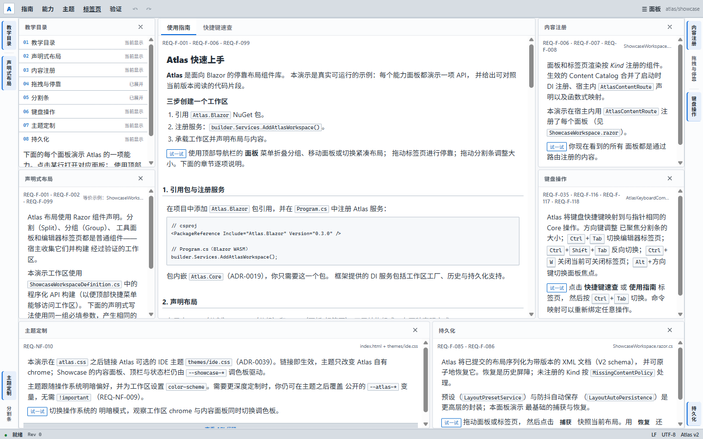

# Atlas

简体中文（权威） | [English introduction](README.en.md)

**Dockable Workspace for Blazor** · 面向 Blazor 的可停靠工作区组件库

[](https://github.com/HestiaLab/Atlas/actions/workflows/ci.yml) [](https://www.nuget.org/packages/Atlas.Blazor) [](https://www.nuget.org/packages/Atlas.Blazor) [](LICENSE)

[**Live Demo**](https://HestiaLab.github.io/Atlas/) · [NuGet](https://www.nuget.org/packages/Atlas.Blazor) · [文档](docs/zh/README.md) · [Releases](https://github.com/HestiaLab/Atlas/releases)

<picture>
  <source media="(prefers-color-scheme: dark)" srcset="docs/assets/atlas-showcase-dark.png">
  
</picture>

> 截图使用可选的 IDE 主题（`themes/ide.css`）。

Atlas 为 IDE、设计器、管理后台等复杂 Web 应用提供工具面板、编辑器标签页、分屏、拖放和布局持久化能力。布局领域模型、Blazor 渲染与浏览器交互分层，UI 层不维护第二份布局状态。

> **NuGet 包：** [NuGet.org 上的 Atlas.Blazor](https://www.nuget.org/packages/Atlas.Blazor)
> （单包内嵌 `Atlas.Core`）· [GitHub Packages](https://github.com/users/HestiaLab/packages/nuget/package/Atlas.Blazor) ·
> [Releases](https://github.com/HestiaLab/Atlas/releases)

## 核心能力

- 工具面板与文档标签页
- 面板/标签页拖放、停靠与跨 Group 移动，含五区放置预览
- Splitter 鼠标/键盘调整，弹性吸收（elastic-absorb）尺寸
- 布局历史、撤销与重做
- XML 布局持久化、恢复与预设
- CSS 变量主题（`--atlas-*` token，见[主题指南](docs/zh/theming.md)）与可选的紧凑 IDE 主题（`themes/ide.css`）
- 内容承载与 SandboxedFrame 安全边界
- 多 Workspace 隔离、ARIA、焦点协调与 reduced-motion

产品行为以 [`docs/zh/SRS.md`](docs/zh/SRS.md) 为准（中文唯一维护版本）。

## 项目组成

```text
Atlas.Core ← Atlas.Blazor ← Application
```

| 项目             | 职责                           |
| -------------- | ---------------------------- |
| `Atlas.Core`   | 与 UI 无关的布局模型、操作引擎、历史、不变量和持久化 |
| `Atlas.Blazor` | Blazor 渲染、内容承载、CSS 和浏览器交互    |

`Atlas.Core` 不依赖 Blazor 或 JavaScript。浏览器输入由 TypeScript 转换为结构化 intent，经 Core operation 提交为 immutable snapshot，再由 Blazor 投影到 DOM。

## 构建

环境要求：.NET 10 SDK（仓库通过 `global.json` 固定 10.0.401 并允许 latestFeature 前滚）、Node.js 24 LTS、npm。

```sh
dotnet restore Atlas.sln

cd src/Atlas.Blazor
npm ci
npm run typecheck
npm run test:js
npm run build:js
cd ../..

dotnet build Atlas.sln --no-restore
dotnet test Atlas.sln --no-build --no-restore
dotnet format Atlas.sln --verify-no-changes --no-restore
```

完整的 Release pack、真实浏览器与独立 consumer 验证流程见[测试指南](docs/zh/guides/testing-guide.md)。

## 示例项目

- [`samples/Atlas.Showcase`](samples/Atlas.Showcase/)——仓库内教学演示，展示公共 API 用法，每个面板附真实 API 代码。
- [`HestiaLab/DbcView`](https://github.com/HestiaLab/DbcView)——基于 Atlas 的 DBC 文件查看器，消费已发布的 `Atlas.Blazor` 包。
- [`HestiaLab/Penelopa`](https://github.com/HestiaLab/Penelopa)——Blazor WebAssembly 图元对齐编辑器（六区域停靠工作区 + SkiaSharp 画布），[在线演示](https://HestiaLab.github.io/Penelopa/)。

## 文档

中文文档位于 `docs/zh/`，是唯一维护的权威版本；国际入口见
[`README.en.md`](README.en.md)。

| 文档                                              | 内容              |
| ----------------------------------------------- | --------------- |
| [开发文档入口](docs/zh/README.md)                     | 文档分类、角色与任务阅读路径  |
| [架构概览](docs/zh/guides/architecture-overview.md) | 分层、状态所有权与运行时数据流 |
| [SRS](docs/zh/SRS.md)                           | 用户可观察行为与非功能需求   |
| [HLD](docs/zh/HLD.md)                           | 内部架构与设计合同       |
| [需求追溯矩阵](docs/zh/requirements-traceability.md)    | 需求到实现与测试证据的状态   |
| [测试指南](docs/zh/guides/testing-guide.md)         | 测试分层与验证命令       |
| [ADR 索引](docs/zh/adr/README.md)                 | 已接受的架构决策        |

## 参与开发

如果 Atlas 对你有帮助，欢迎点亮 Star，或分享给正在构建 Blazor IDE / 设计器的同事。

提交前请阅读 [`CONTRIBUTING.md`](CONTRIBUTING.md)。安全与受支持版本说明见
[`SECURITY.md`](SECURITY.md)。

## 许可证

[MIT](LICENSE)。
