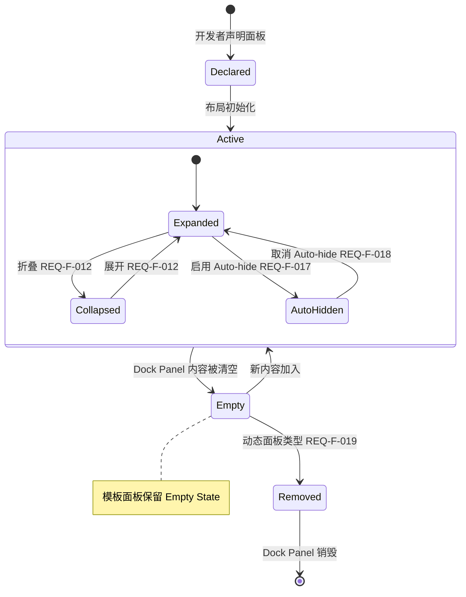
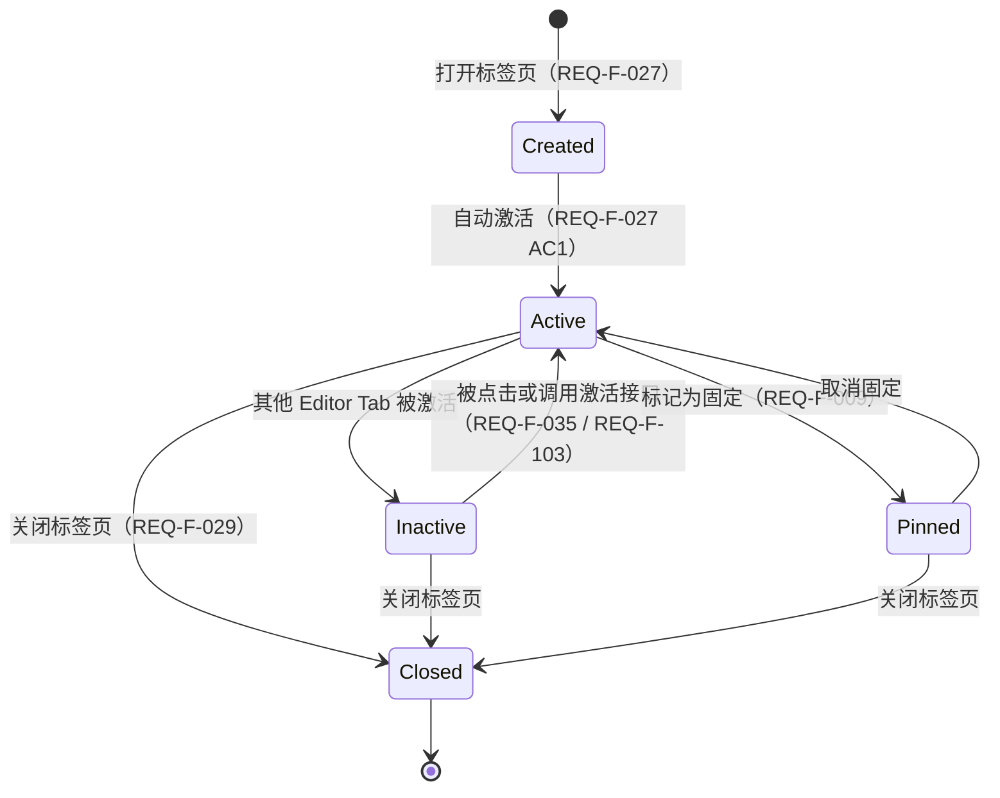
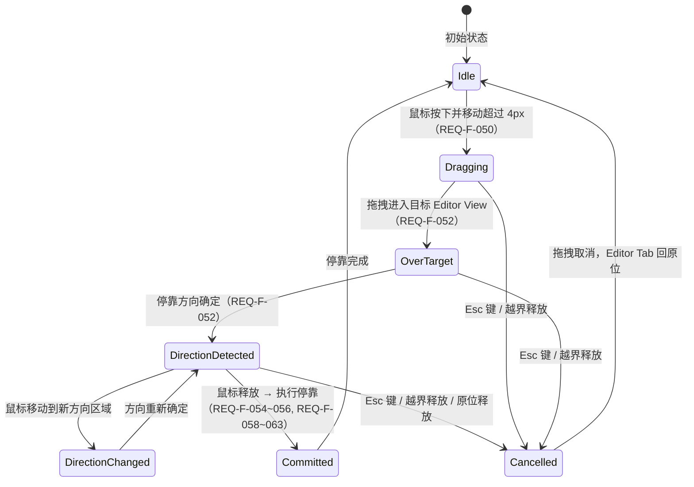

# 概要设计说明书（HLD）

**阅读指南**

- **本文档性质**：概要设计——描述 Atlas 内部架构，说明**如何实现** [SRS.md](./SRS.md) 中定义的产品行为。
- **前置文档**：[SRS.md](./SRS.md)（产品需求规范）。本文档使用与 SRS 完全相同的术语体系。
- **如果你是集成开发者**：只需读 SRS。本文档是框架内部的设计细节。
- **如果你是框架开发者**：本文档是第一入口——先理解架构骨架，再到 SRS 中确认要实现的用户行为细节。
- **设计条目**：本文档以编号设计条目（`DES-XXX-###`）组织，格式与 SRS 需求条目一致。每条设计决策均可追溯到 SRS 中的具体需求。

---

## 1 设计依据

以下设计目标直接派生自 SRS 的需求约束。

| 设计目标 | 来源（SRS） | 说明 |
|----------|------------|------|
| 空间结构可扩展 | F-001~004, F-049 | 当前 9 区域布局不应成为架构约束——支持未来任意嵌套分屏 |
| Dock Panel 与 Editor Tab 共享基础设施 | F-019, F-145, F-069, F-050~068 | 两者在打开/关闭/移动/去重/激活等行为上高度同构，不应维护两套代码路径 |
| 状态变更有据可查 | F-110~115, F-047 | 布局变更事件需携带完整上下文，且支持重置到初始状态 |
| 原子性保证 | F-133, F-014 | 快速连续操作需串行化；空间重分配涉及多个 Panel——中途失败不应产生不一致 |
| 持久化与运行时解耦 | F-085~088, F-091~098 | 导出/导入格式版本化，运行时模型变更不应破坏已有持久化数据 |
| 高性能拖拽 | NF-004, F-050~068, F-073~078 | 拖拽帧率 ≥30fps，JS 层高频预览不应回传 .NET |
| 多实例隔离 | F-109 | 同一页面多个 Layout Instance 互相不可见 |
| Dock 容器自适应折叠 | F-154 | 侧向/Bottom Dock 无可见 Panel 时自动折叠，释放空间给 Editor Area |
| 拖拽投放骨架 | F-155 | 隐藏 Dock Region 在拖拽期间临时渲染 Drop Scaffold 作为有效投放目标 |
| 移动操作撤销 | F-156 | Dock Panel 跨区域移动后支持撤销恢复 |

---

## 2 架构概览

```
DES-ARCH-001
分层架构
系统分为三层——UI 层（Blazor Components）、交互层（JS Interop）、核心层（Atlas.Core）。
每层有明确的职责边界和依赖方向。

┌──────────────────────────────────────────────────────────┐
│  Blazor UI 层（Components）                                │
│  AtlasWorkspaceHost / SplitNodeView / GroupNodeView / …   │
│  仅执行只读渲染 + 事件转发，不持有可变状态                    │
├──────────────────────────────────────────────────────────┤
│  JS 交互层（Interop）                                      │
│  拖拽预览、Splitter 实时调整、pointer 事件 → 结构化 intent   │
├──────────────────────────────────────────────────────────┤
│  Core 层（纯 C#，无 Blazor 依赖）                           │
│  ┌──────────┐ ┌──────────┐ ┌──────────┐ ┌──────────────┐ │
│  │ 布局状态  │ │ 操作引擎  │ │ 持久化   │ │ 内容注册表    │ │
│  │(Snapshot) │ │(Operation)│ │(Serializer)│ │(ContentReg) │ │
│  └──────────┘ └──────────┘ └──────────┘ └──────────────┘ │
└──────────────────────────────────────────────────────────┘

Core 层不引用 Blazor、JSRuntime、DOM——所有布局逻辑可脱离浏览器环境进行单元测试。
JS 层只处理高频交互几何，不直接修改 committed state。Blazor 组件是状态的只读投影。

Core 项目引用限制为 BCL，不依赖任何 UI 框架；状态变更只通过 Core 层的 Operation pipeline；
Blazor 组件通过 ChangeSet 获知需要更新的部分，不自行决定是否重渲染。

来源：F-001~004, NF-004, F-109
```

---

```
DES-ARCH-002
核心设计思想：不可变聚合根 + 原子操作 + 只读投影
所有布局状态收敛到一个不可变的聚合根（WorkspaceSnapshot），变更通过原子操作（Operation）提交，
UI 是该聚合根的只读投影。

"布局状态" = 当前所有 Region、Dock Panel、Editor View、Editor Tab、ToolBar Entry
的结构、位置、大小、激活关系和折叠/自动隐藏状态的完整快照。"原子操作" = 一次打开 Tab、
一次 Panel 移动、一次 Splitter 拖拽结束——操作要么完整生效，要么完全不生效。"只读投影" =
Blazor 组件不修改状态，只是把当前快照渲染成 DOM + 把用户交互转发给操作引擎。

此设计消除了"先改 A 再改 B"的中间状态窗口——任何失败不产生部分修改的残留状态。渲染组件只通过
ChangeSet 获知需要更新的部分，避免全树无效重渲染。

Snapshot 对 consumer 只读，内部使用 immutable collection 或 copy-on-write。
不存在"直接修改 Model 属性"的 mutation 旁路。渲染组件基于明确 projection dependency stamp
实现 ShouldRender。

来源：F-133, F-047, F-110~115
```

---

```
DES-ARCH-003
边界规则
以下跨边界规则在所有设计中强制遵守：

1. Core 不引用 Blazor、RenderFragment、JSRuntime 或 DOM 类型——违反则 Core 无法独立测试
2. Blazor 依赖 Core，负责 RenderTree、component lifetime、CSS 和 JS interop——违反则依赖循环
3. TypeScript 只能提交结构化 user intent，不得直接修改 committed layout state——违反则状态多源
4. Application business state 不进入 Workspace serialization——违反则持久化泄漏运行时对象
5. Razor components 不直接修改 Snapshot 或内部 Model——违反则旁路 mutation 不可追溯
6. Workspace mutation 只能经过 IAtlasWorkspace.ExecuteAsync——违反则操作不可追溯
7. 一次成功 Operation 只发布一个 ChangeSet——违反则渲染不一致

每条规则对应一个已知的 V1 架构问题——多 mutation path、per-element JS registration、
runtime object persistence 等。V2 通过硬性边界规则消除这些问题的可能性。

规则 5 和 6 由 API design 强制保证：Snapshot 不暴露 mutable collection，Components 不持有
IAtlasWorkspace 引用以外任何可修改状态的句柄。规则 3 由 versioned interaction protocol 强制：
JS commit payload 是固定 schema 的 discriminated union。

来源：F-109, F-133, NF-006
```

---

## 3 领域模型

```
DES-DOM-001
SRS 概念到内部模型映射
SRS 定义的产品概念在内部实现中按以下映射表达：

| SRS 概念         | 内部模型                                   | 说明                     |
|-----------------|------------------------------------------|-------------------------|
| Layout Instance | Workspace + WorkspaceSnapshot            | 布局实例的聚合根               |
| Region          | LayoutNode（SplitNode / GroupNode）        | 空间树节点，替代固定命名 Region    |
| Dock Panel      | DockItem（Kind = Tool）                    | Tool 类型的内容项             |
| Editor Tab      | DockItem（Kind = Document）                | Document 类型的内容项         |
| Editor View     | GroupNode（Kind = Document）               | Document 分组容器           |
| Content Identifier | ContentReference                       | 内容渲染器种类 + 业务资源身份       |
| ToolBar Entry   | Dock Panel 集合的派生投影                      | 不独立存储，从 Panel 归属推导     |
| LT / RT         | AutoHideStrip（Edge: InlineStart / InlineEnd） | 边缘停靠条                  |
| Bottom Dock     | WorkArea 的子 SplitNode                     | 通过 Layout Tree 的子节点关系表达 |

Dock Panel 和 Editor Tab 共享 DockItem 作为统一内容项模型。两者的差异由 DockItemKind、
Capabilities 和 DockingPolicy 表达，不维护两套独立的 model hierarchy。ToolBar Entry 不独立
持久化——它从 DockItem 的归属关系实时推导，避免第二真相源。LT/RT 不是"面板容器"，是导航入口——
它们不参与 Panel 移动（F-020~024）。

ToolBar Entry 是渲染层派生数据——WorkspaceSnapshot 中不存储 ToolBar 条目表。派生投影的更新由
ChangeSet 中的 AddedItems/RemovedItems/UpdatedItems 触发重算。固定命名的 Region 不再作为
domain type——IDE preset 通过 Layout Tree builder 生成对应 SplitNode/GroupNode 结构。

来源：§1.7 空间概念, §1.3 系统架构
```

---

```
DES-DOM-002
Workspace 聚合根
WorkspaceSnapshot 是 committed state 的唯一公开快照，对 consumer 只读：

  WorkspaceSnapshot = {
      Id,                   // 布局实例唯一标识
      Revision,             // 单调递增的并发版本号（每次成功操作 +1）
      RootNodeId,           // 空间树根节点（null = 空布局）
      Nodes,                // LayoutNode 字典（SplitNode / GroupNode）
      Items,                // DockItem 字典
      AutoHideStrips,       // Auto-hide 停靠条状态（按 WorkspaceEdge）
  }

所有权规则：

1. RootNodeId + Nodes、Items 和 AutoHideStrips 是 committed authoritative state（F-002）
2. ToolBar Entry 列表、Item 排序索引等是派生投影，不持久化、不是第二真相源（F-021）
3. RootNodeId = null 是唯一空布局表示，不增加 EmptyNode（F-003, F-131）
4. 每个打开 Item 必须恰有一个 placement：Group 或 Auto-hide Strip（F-069, F-017）
5. 新建 Workspace 的初始 Revision 为 0；第一次成功 mutation 发布 Revision 1
6. Snapshot 对 consumer immutable；内部可使用 immutable collection 或 copy-on-write（F-133）

Snapshot 通过 IReadOnlyDictionary 和 IReadOnlyList 暴露，不暴露 mutable collection。
内部 Store 维护 Node/Item index 供 Renderer 快速查找，index 与 Snapshot 原子更新。
Revision 使用 checked increment，溢出时拒绝提交。

来源：F-001~004, F-109, F-047, F-131
```

---

```
DES-DOM-003
Layout Tree（空间树）
SRS §1.3 的固定 9 区域层级树在内部由 Layout Tree 表达，由两种 sealed node type 构成。

SplitNode — 描述两个子节点之间的空间划分：
  Axis: InlineChildren（水平排列）| BlockChildren（垂直排列）
  Anchor: FixedPixels 时约束 First 还是 Second child
  Basis: FixedPixels（像素值）| Proportional（比例）
  Constraints: min/max 尺寸约束
  FirstId, SecondId: 两个子节点 ID

GroupNode — 按顺序容纳一组 DockItem，拥有唯一 committed selection：
  Kind: Tool | Document
  RetentionPolicy: Persistent（模板）| Dynamic（动态）
  Visibility: Expanded | Collapsed
  ItemIds: 有序的 DockItem ID 列表
  SelectedItemId: 当前选中的 Item（null 表示空 Group）

Split sizing 规则：IDE preset 的 outer tool dock 使用 FixedPixels，editor-local split 默认
使用 Proportional（F-015~016, F-144）。Proportional 表示 First child 占可用空间比例。min/max
由 SplitConstraints value object 表达（F-015~016, F-078）。两个 child 最小尺寸总和超过容器时，
不修改 committed basis，由 Renderer 使用确定性 clamp policy（F-078）。resize drag 只在
pointerup 提交一个 history entry（F-074, NF-004）。

SRS 9 区域布局的空间树表达：

  Root (Split, BlockChildren)
  ├── TopToolbar Fixed Slot（不在树中）
  ├── WorkArea (Split, BlockChildren)
  │   ├── MainRow (Split, InlineChildren)
  │   │   ├── LeftDock (Split, BlockChildren)
  │   │   │   ├── GroupNode: Left Dock Upper (Tool, Persistent)
  │   │   │   └── GroupNode: Left Dock Lower (Tool, Persistent)
  │   │   ├── GroupNode: Editor Area (Document, Persistent)
  │   │   └── RightDock (Split, BlockChildren)
  │   │       ├── GroupNode: Right Dock Upper (Tool, Persistent)
  │   │       └── GroupNode: Right Dock Lower (Tool, Persistent)
  │   └── BottomDock (Split, InlineChildren)
  │       ├── GroupNode: Bottom Left Dock (Tool, Persistent)
  │       └── GroupNode: Bottom Right Dock (Tool, Persistent)
  └── StatusBar Fixed Slot（不在树中）

Top Toolbar 和 Status Bar 不在空间树中——它们是 Fixed Slot（固定装饰区域），不参与 Dock Panel
的承载和移动（F-002）。只有承载 Dock Panel 或 Editor View 的节点进入 Layout Tree。SplitAxis
描述 child 排列（Inline/Block），不描述 separator 朝向——ARIA separator orientation 由
renderer 反向派生。

Dock 容器自适应折叠（F-154）的渲染规则：侧向 Dock 的 Upper 和 Lower 子 Group 均无展开 Panel
时不渲染该侧 Dock 内容列及 Splitter，Editor Area 获得释放空间；Bottom Dock 的 Left 和 Right
子 Group 均无展开 Panel 时不渲染 Bottom Dock 行及 Splitter；仅一个子 Group 有展开 Panel
时隐藏其他空子 Group，可见子 Group 占满容器；以上所有情况下 ToolBar Entry 保留（F-021），
用于重新展开或 Auto-hide Flyout。

首版 closed hierarchy：只允许 SplitNode 和 GroupNode，不引入 LeafNode 或 EmptyNode。
SplitAxis.InlineChildren = children 沿 inline axis 排列，BlockChildren = 沿 block axis 排列。
Collapsed 首版只允许 Tool Group，Document Group 必须为 Expanded。Auto-hide 是 Item placement，
不与 Collapsed 共用状态。

来源：F-001~004, F-049, F-025~026, F-154
```

---

```
DES-DOM-004
Dock Item 统一模型
Dock Panel（Tool）和 Editor Tab（Document）统一为 DockItem：

  DockItem = {
      Id,                  // 在 Workspace 内唯一
      Kind,                // Tool | Document
      Title,               // 显示标题（F-143）
      Icon,                // 图标，可选（F-143）
      Content,             // ContentReference（F-006~008）
      Capabilities,        // 可关闭/可移动/可固定/可AutoHide/可分屏
      DocumentState,       // Document 专属状态（IsPinned, IsPreview），仅 Document 有效
  }

Tool 与 Document 共享：identity、title/icon、content identity、group ordering、selection、
move/reorder、close、rendering outlet。差异由 DockItemKind、kind-specific state、Capabilities
和 DockingPolicy 表达。

Capabilities 表达 Item 的稳定固有能力（F-036~037, F-009, F-017）：
  Tool:            CanClose, CanMove, CanAutoHide
  PermanentTool:   CanMove, CanAutoHide  (CanClose = false)
  Document:        CanClose, CanMove, CanSplit, CanPinDocument
  PreviewDocument: CanClose, CanMove     (CanPinDocument = false)

"当前能否移动到这个 target"由 Docking Policy 根据 Snapshot 和 target context 计算，不存储在
Capabilities 中。Capabilities 只表达 Item 自身的固有能力——避免了"为什么 Panel A 有时可移动
有时不可"的困惑。DocumentState 仅对 Kind = Document 有效，Tool 的 pin/unpin 语义由 Auto-hide
机制表达，不复用 Document pin——避免同一字段在不同 kind 下有不同语义。

Capabilities 由 runtime definition/provider 派生，不信任持久化输入。缺失 provider 的
placeholder 使用保守能力（全 false）。提供常用 preset 静态工厂方法，避免开发者逐项赋值。

来源：F-019, F-145, F-143, F-006~009, F-036~037
```

---

```
DES-DOM-005
Content Reference（内容引用）
ContentReference 由 Kind（渲染器种类）和 ResourceId（业务资源身份）组成：

  ContentReference = {
      Kind,        // 由哪个 renderer/provider 渲染（如 "explorer", "document-editor"）
      ResourceId,  // 当前业务资源身份（如 "main-solution", "42"）
  }

语义：Kind = 谁负责渲染，ResourceId = 渲染什么内容。ContentReference 不包含 title、event
callback、parameter dictionary、view model、service instance 或 UI occurrence identity。

多个 DockItemId 可以引用同一 ContentReference——业务共享状态按 ResourceId 管理，per-view
cursor/scroll 等状态按 DockItemId 管理。

去重（F-046）默认 identity 为 Kind + ResourceId，支持四种模式：ActivateExisting（激活已有
Item，不新建）、AllowMultiple（允许多个 DockItem 引用相同 ContentReference）、ReplaceExisting
（保留原 DockItemId 和 placement，替换 ContentReference）、RejectDuplicate（返回 typed error）。

将渲染器标识（Kind）与业务资源标识（ResourceId）分离，使应用层可以同一 renderer 渲染不同资源，
以及不同 renderer 渲染同一资源的不同视图，避免 V1 中 ContentKey 同时承担两种职责的模糊性。

ContentReference 是 immutable value object，构造时拒绝 null/empty。去重判定由
IContentIdentityPolicy 执行，默认使用 Kind + ResourceId。AllowMultiple 下多个 DockItemId
共享 ResourceId——应用层自行管理共享状态。

来源：F-006~007, F-046, F-095
```

---

```
DES-DOM-006
Auto-hide 与 Collapsed 分离
Auto-hide placement 是 committed state：

  AutoHideStripState = { Edge, Entries }
  其中 Edge 为 InlineStart（左）/ InlineEnd（右）/ BlockEnd（下）
  AutoHideEntry = { ItemId, DockBack }
  DockBack = { PreferredGroupId, PreferredIndex, FallbackEdge }

约束：Auto-hide 仅接受 CanAutoHide 且 Kind = Tool 的 Item。恢复时优先使用仍存在的
PreferredGroupId；目标已消失时由 Docking Policy 选择或创建合法 Tool Group。以下状态是
transient UI state，不持久化：hover item、flyout open/closed、300ms close timer、pointer
位置、drag preview。

Collapsed Tool Group 是 committed state：Collapsed Group 仍保留在 Layout Tree 中，但不占用
正常内容空间，也不获得 hover flyout。Collapsed Group 的 ancestor Split 保留原 committed basis
作为展开恢复值。Renderer 将 collapsed child 的 resolved content extent 视为 0、隐藏相邻 splitter。

Expanded ↔ Collapsed（F-012）与 Auto-hide placement（F-017）是两组独立状态。Collapsed 是
Group 的可见性状态——Group 仍在树中，只是不占空间；Auto-hide 是 Item 的 placement 状态——
Item 从 Group 中移出到停靠条。合并这两组状态会导致"折叠后是否应该出现 hover flyout"的语义冲突。

Auto-hide 恢复时，若 PreferredGroupId 已消失，Docking Policy 在 FallbackEdge 选择或创建 Tool
Group。拖动 auto-hidden Item、删除原 Group 和 restore/migration 必须显式更新 bookmark。
Collapsed 全部 Group 时显示 Workspace empty-content surface，同时继续渲染可恢复的 Toolbar entries。

来源：F-017~018, F-012, F-154
```

---

```
DES-DOM-007
强类型 ID
所有实体标识使用强类型 value type，不使用裸 string：

  WorkspaceId   — 布局实例唯一标识
  LayoutNodeId  — 空间树节点唯一标识
  DockItemId    — 内容项唯一标识

构造时拒绝 null、empty 和 whitespace；使用 ordinal equality；实现 IEquatable<T>、==、!=。
ToString() 仅用于诊断，不承担 serialization protocol。JSON/XML 映射由明确 converter/DTO 负责。

裸 string ID 导致无法在编译期区分"这是 Node ID 还是 Item ID"、无法保证 ID 格式合法性、
序列化协议与 domain identity 耦合。强类型 ID 在类型系统层面防止 ID 混淆。

使用 readonly struct 实现，保证零堆分配。内部存储使用 readonly string _value。DTO 层使用
string，与 domain 层之间通过显式转换映射。

来源：F-109, F-028, F-124
```

---

```
DES-DOM-008
不变量（Invariants）
每次 transaction 提交前必须验证以下不变量。任何失败回滚整个 transaction，不产生部分修改。

1. 每个 NodeId 唯一
2. 每个 DockItemId 唯一（F-124）
3. Layout Tree 无循环
4. 每个已打开 DockItem 必须且只能属于一个 Group 或一个 Auto-hide Strip（F-069, F-017）
5. 非空 Group 的 SelectedItemId 必须指向该 Group 中一个 Item；空 Group 的 SelectedItemId 必须为空（F-022）
6. Group 不含重复 ItemId
7. Group 中每个 Item 的 Kind 必须与 Group Kind 兼容，首版不允许 mixed Group（F-019, F-145）
8. Document Item 不进入 Auto-hide Strip；Collapsed 只允许 Tool Group（F-017~018）
9. Split child ID 必须解析且不同，Layout Tree 无共享 child
10. Persistent Group 可以为空；Dynamic Group 为空时自动删除（F-019, F-031, F-145）
11. 删除空 Dynamic Group 后必须递归提升单子 Split 的 sibling
12. 任何失败 operation 不改变 published Snapshot、Revision 或 History（F-133）
13. ContentReference kind/resourceId 非空；所有 Strong ID 不得为 default（F-006）
14. RootNodeId = null 是唯一空布局表示，不增加 EmptyNode（F-003, F-131）

不变量是防止状态腐败的最后防线。每条不变量对应一类已知的 V1 状态 bug——重复 selection、
孤立 Item、半应用变更等。Validator 在每次 transaction commit 前运行，与 Operation Planner
紧密耦合：Planner 产出 candidate，Validator 验证 candidate，两者共享同一 invariant rule engine。

Validator 是纯函数：输入 candidate Snapshot，输出 pass/fail + violation list。Topology
normalization 自叶到根执行。提升 sibling 时保留 sibling NodeId；被删除 Split/Group 的原 Node、
placement、basis、selection 和 visibility 必须进入 reverse patch。Core compatibility matrix
是封闭规则：首版 Docking Policy 只能收紧、不能放宽 Core invariant。

来源：F-133, F-019, F-031~032, F-069, F-017~018
```

---

## 4 操作引擎

```
DES-OP-001
Operation 模型
所有布局变更都封装为操作（Operation）——一个描述"从当前快照到目标快照需要做什么"的原子指令。
不存在"逐条修改属性"的旁路。

第一批 operation：

  OpenItemOperation              — F-027, F-101（打开 Tab/Panel）
  CloseItemOperation             — F-029, F-102（关闭 Tab/Panel）
  SelectItemOperation            — F-035, F-103（激活 Tab/Panel）
  MoveItemOperation              — F-069, F-140（跨区域移动 Panel）
  ReorderItemOperation           — F-142, F-151（区域内排序）
  SplitItemOperation             — F-049, F-055（分屏/方向停靠）
  ResizeSplitOperation           — F-073~078（Splitter 拖拽调整）
  SetGroupVisibilityOperation     — F-012, F-104（折叠/展开）
  SetAutoHideOperation           — F-017（启用 Auto-hide）
  RestoreAutoHiddenItemOperation — F-018（取消 Auto-hide）
  UpdateItemPresentationOperation — F-143（更新标题/图标）
  ReplaceContentReferenceOperation — F-006（替换内容引用）
  ResetWorkspaceOperation        — F-047（重置布局）
  RestoreWorkspaceOperation      — F-086, F-092, F-097（恢复/导入布局）

SRS 中用户操作的效果经常涉及多个实体。如关闭一个 Editor Tab（F-029）涉及移除 Tab + 按策略激活
另一个 Tab + 若为 Dynamic View 的最后一个 Tab 则移除 View + 若 View 移除则重分配空间。逐条
修改属性会因中间步骤失败产生不一致。Operation 模式保证"全部成功或全部回滚"。

便捷 API OpenToolAsync / OpenDocumentAsync 是 operation facade，不建立旁路。所有 operation
都是不可变 value object。新 operation 类型添加时不需修改已有 operation 逻辑——Planner 按
operation type 分发。

来源：F-027~029, F-069, F-049, F-073~078, F-012, F-017, F-047, F-086
```

---

```
DES-OP-002
Transaction Pipeline
操作执行流程：

  API 调用 → 基于当前 Snapshot 构造 Candidate Snapshot
    → 执行 Guard（如关闭前回调 F-041）── 拒绝 → 返回失败，当前状态不变
    → 执行 Validator（检查所有不变量、尺寸约束、去重冲突）
    → 原子替换：旧 Snapshot → 新 Snapshot（Revision + 1）
    → 发布 Changed 事件（F-110~115）

提交合同：

1. 从 current Snapshot 构建 candidate Snapshot、forward/reverse patch、candidate History
   和 ChangeSet
2. 在 candidate 上执行完整 invariant validation（F-133）
3. 原子替换 Snapshot + History 是唯一 linearization point（F-133）
4. Revision 在每次 Execute/Undo/Redo/Restore 成功提交时单调递增；Undo 不回退 Revision
5. failed/no-op/cancelled/stale operation 不交换 state、不递增 Revision、不发布事件（F-133）
6. Changed 事件在锁外发布；subscriber 异常逐个隔离并记录，不阻止后续 subscriber（F-110）
7. subscriber 中重入 ExecuteAsync 可以提交新 Revision，但新事件排在当前事件全部 subscriber 之后

关键设计：Guard（可能异步）在 transaction 外执行；Validator 和 state swap 在短 transaction
内完成。这避免了"持锁期间 await consumer callback"的死锁和 ABA 问题。Changed 在锁外发布，
防止 subscriber 中的重入操作与当前 transaction 互相阻塞。

内部提交使用 WorkspaceStoreState（Snapshot + History 作为一个原子引用替换）。Event dispatcher
不承诺 consumer SynchronizationContext；Blazor Host 通过 InvokeAsync marshal 到 renderer
context。ExecuteAsync 的成功只取决于 commit，不取决于 subscriber 是否成功。

来源：F-133, F-041, F-110~115
```

---

```
DES-OP-003
Async Guard（关闭前回调）
Close/save confirmation 可能异步（F-041）。首版采用严格 Workspace Revision 防止 ABA 问题：

  1. 在 transaction 外执行 async guard
  2. guard 前记录 BaseRevision
  3. guard 完成后进入短 transaction
  4. 若 current Revision ≠ BaseRevision，返回 StaleOperation，不自动重试 guard
  5. 构建并原子应用 patch
  6. publish one change set

禁止在 Workspace lock 内执行 guard、provider、migration hook 或任何 consumer callback。两个
并发 Close 不能静默触发两次保存/确认——第二个调用应共享已有 decision 或返回 typed conflict。
首版采用严格 Revision 而非实体级 version，优先保证简单和可验证。

Guard 接口：IDockItemCloseGuard.CanCloseAsync(DockItemCloseContext, CancellationToken)。
Domain 不持有 delegate，应用通过 DI/registration 将 guard 与 Content Kind 或 Item 关联。
按 operation/session 键控的 in-flight coordinator 保证一次 CloseItemOperation 最多执行一次
guard。Cancellation 只在 linearization point 前生效；state swap 后必须返回真实 committed result。

来源：F-041, F-029
```

---

```
DES-OP-004
Reversible Patch
每次成功 operation 同时生成 forward patch 和 reverse patch。History 不理解 Open、Move、Split
等业务语义，只理解 patch step：

  ForwardPatch  = 从当前 Snapshot 到目标 Snapshot 的变更步骤
  ReversePatch  = 从目标 Snapshot 回到当前 Snapshot 的变更步骤

首版 patch step 类型：
  ReplaceRoot(expectedBefore, after)
  ReplaceNode(nodeId, expectedBefore, after)
  ReplaceGroupItems(groupId, expectedBefore, after)
  ReplaceItem(itemId, expectedBefore, after)
  ReplaceAutoHideStrip(edge, expectedBefore, after)

每个 step 携带 expected-before，使用稳定 ID 寻址，不依赖会被前序 step 改变的裸 index。Reverse
从同一步的 before/after 自动推导。

Move 示例（对应 F-069）：
  Forward:
    1. 从 Group A 移除 item-x
    2. 恢复 Group A 的 selected item
    3. 将 item-x 插入 Group B
    4. Group B selected = item-x
    5. 清理空 Dynamic Group A（若适用）
  Reverse:
    1. 必要时重建 Group A 及其原 placement
    2. 从 Group B 移除 item-x
    3. 将 item-x 插回 Group A 原位
    4. 恢复 Group A / Group B 原 selected item
    5. 恢复被 cleanup 的 Split/Group topology

Patch step 携带 expected-before——如果当前 state 与 expected-before 不匹配，说明有并发修改或
bug，应拒绝应用（fail-fast）。这避免了 V1 中 undo 基于 stale snapshot 恢复导致的静默状态损坏。

所有 step 只应用到私有 candidate builder，中间状态不发布。patch 必须通过 round-trip invariant
test：apply forward 后 apply reverse，snapshot 与初始语义等价。Operation Planner 负责同时生成
Forward 与 Reverse——不手写两套独立逻辑。

来源：F-133, F-069, F-156
```

---

```
DES-OP-005
Undo / Redo
Undo/Redo 规则：

1. 只有成功 committed patch 进入 history
2. Undo = 执行 ReversePatch（产生新 Revision）；Redo = 执行 ForwardPatch（F-156）
3. failed/cancelled/no-op/stale operation 不进入 history
4. Undo 后执行新 operation 清空 redo branch
5. Restore/Reset 是明确 history barrier——默认以新的空 History 与 Snapshot 同时提交（F-047, F-086）
6. resize drag 只在 pointerup 提交一个 history entry（F-074）
7. 连续 keyboard resize 按 (SplitNodeId, input kind) 和配置时间窗口合并
8. History 有 entry 数量上限，超限时淘汰最旧记录
9. 单个 entry 超过 byte budget 时，operation 仍可提交但成为 history barrier

Undo/Redo 只保证 committed Workspace layout state，不撤销 consumer 保存、文件句柄、业务 store
或已执行 guard 的副作用。Close Undo 通过 ContentReference 重新解析内容并允许 remount——这比
试图恢复已 dispose 的组件实例更可靠。

History options：MaxEntries（默认 100）、ApproximateMaxBytes、ResizeCoalescingWindow（默认
500ms）。新 operation 先清空 redo branch，再从最旧的 undo entry 开始淘汰。单个 entry 超 byte
budget 时返回带 HistoryNotRecorded warning 的 success，不能让旧 entry 在新 state 上伪装成可撤销。

来源：F-156, F-047
```

---

```
DES-OP-006
IAtlasWorkspace 公共接口与 LayoutChangeSet
公共接口：

  public interface IAtlasWorkspace : IAsyncDisposable
  {
      WorkspaceId Id { get; }
      WorkspaceSnapshot Current { get; }
      bool CanUndo { get; }
      bool CanRedo { get; }
      event EventHandler<WorkspaceChangedEventArgs>? Changed;
      ValueTask<WorkspaceResult<LayoutChangeSet>> ExecuteAsync(
          LayoutOperation operation, CancellationToken cancellationToken = default);
      ValueTask<WorkspaceResult<LayoutChangeSet>> UndoAsync(
          CancellationToken cancellationToken = default);
      ValueTask<WorkspaceResult<LayoutChangeSet>> RedoAsync(
          CancellationToken cancellationToken = default);
  }

LayoutChangeSet 是渲染器的精确定向失效输入（F-110），包含 AddedNodes / RemovedNodes /
UpdatedNodes、AddedItems / RemovedItems / UpdatedItems、BeforeRevision / AfterRevision、
ChangeKind。

Typed result（WorkspaceResult<T>）：Succeeded 为 true 时 Value 必有，为 false 时 Error 必有。
合法但没有语义变化的 operation 返回 NoChange result（空 ChangeSet，不进入 History，不递增
Revision，不触发 Changed）。

Expected failures（item not found、target not found、target rejected by policy、duplicate
content identity、close cancelled、stale operation、invalid restore document）返回 typed
result。Programming error 和 unexpected failure 保留 exception 及完整日志上下文。

WorkspaceSnapshot 对 consumer immutable。内部实现可以使用 copy-on-write、structural sharing
和 lookup index，但不得把 mutable collection 暴露到 public API。Workspace 拥有 Core state、
history、in-flight guard coordinator、save queue cancellation 和自身事件；DOM listener、
JS controller、DotNetObjectReference 与 transient view state 由 AtlasWorkspaceHost 拥有。

DisposeAsync 必须拒绝新 operation、取消尚未进入 linearization point 的 guard/save wait、
等待当前 callback/notification drain，并保证返回后不再发布 Changed。Dispose 不隐式保存；
consumer 需要持久化时先显式 FlushAsync。WorkspaceError 提供稳定 Code、Operation kind 和可选
Node/Item ID；用户可展示消息与内部 exception/stack 分离。

来源：F-110~115, F-101~103
```

---

## 5 交互架构

```
DES-INT-001
JS / .NET 边界划分
交互处理流程：

  用户输入（pointer/keyboard）
    ↓
  JS 层（高频实时处理）
    - 拖拽预览渲染（F-051）
    - Splitter 实时拖拽（F-073, F-077）
    - 停靠指示区域高亮（F-063~064）
    - 方向/位置判定（F-052~053）
    - ToolBar 投放预览（F-150~151）
    ↓ 交互完成时，发送结构化 intent
  Core 层（.NET）
    - 合法性检查、Docking Policy
    - 构造 Operation → 提交（F-133）
    ↓
  Blazor 层（只读渲染）
    - 根据新 Snapshot + ChangeSet 更新 DOM

JS 负责：pointer capture、drag threshold、root-scoped source/target DOM lookup、geometry
snapshot、target intent resolution、preview/indicator/overlay、scroll/resize/visibility
cancellation、requestAnimationFrame 合并视觉写入、commit/cancel callback。

.NET 负责：ID 与 target validation、Tool/Document docking policy、topology mutation、
committed selection 与 Group visibility、auto-hide placement、history、persistence、
public events。

分工原则：JS 处理交互几何（高频、无状态），.NET 处理布局语义（低频、有状态）。pointermove
期间不回调 .NET——这直接决定了 NF-004（30fps）能否实现。

JS commit payload 是固定 schema 的 discriminated union：DockItemCommit / ResizeSplitCommit /
AutoHideCommit。交互被取消（Esc、窗口 resize、浏览器 Tab 切后台）时 JS 清理所有预览，不发送
commit。checked-in protocol schema/golden fixtures 同时被 C# 与 TypeScript 测试读取。

来源：NF-004, F-050~068, F-073~078
```

---

```
DES-INT-002
根级 Interaction Controller
每个 interactive Host 只注册一个根级 JS controller；首版一个 Workspace 最多绑定一个 interactive
Host。

DOM 通过 data-atlas-* metadata 描述：
  <button data-atlas-drag-source="item" data-atlas-item-id="explorer">
  <section data-atlas-drop-target="group" data-atlas-group-id="left-tools">

TypeScript 通过 closest() 解析 source 和 target，不为每个 element 单独添加 listener。所有查询
限定在 controller root，验证 metadata 所属 hostId。

Controller session 状态机：
  Idle → PendingThreshold → Dragging → Committing/Cancelling → Completed
                                                      ↘ Disposed

每个 session 只能发生一次 terminal transition。必须处理 pointercancel、lostpointercapture、
Escape、page visibility/pagehide、source disconnect、第二 pointer、root disposal 和 rejected
.NET promise。

替代 V1 中 per-element drag handler 注册模式——V1 中 Tab、ToolBar Entry、Panel Header 和 Drop
Target 分别 attach/detach JS handler，导致生命周期分散、内存泄漏风险和重复的 drag session 逻辑。

attachWorkspaceAsync 按 WorkspaceId 与 HostId 原子登记；同一 Workspace 的第二个 interactive
attach 返回 typed failure。Controller dispose 完成后 registry 无 HostId、document/window
listener 与 observer 数量恢复、pointer session 全部 terminal、overlay 全部移除、后续 promise/
observer callback 不进入 .NET。多个 Workspace 的 interaction session 相互隔离，不使用全局单例。

来源：NF-004, F-109
```

---

```
DES-INT-003
拖拽投放模型
两种拖拽模型并行存在，行为不同。

Editor Tab 拖拽停靠（F-050~068）：
- 将目标 Editor View 区域划分为 5 个判定区：边缘 25% 为方向停靠区（上/下/左/右），中心 50%×50%
  为中心停靠区
- 中心停靠（F-058）：被拖拽 Tab 加入目标 Editor View 的 Tab 列表末尾
- 方向停靠（F-055）：在目标 Editor View 对应方向创建新的分屏 Editor View
- Dynamic View 被拖空后自动移除（F-061），Template View 保留为空（F-062）

Dock Panel 拖拽移动（F-069, F-150~153, F-155）：
- 不区分方向——拖入目标 Dock Region 任意位置即完成移动
- ToolBar 是投放目标（F-150）：用户将 Panel 或 ToolBar Entry 拖到目标 ToolBar 区域释放
- Dock Region 不作为直接释放目标（F-150 AC2）：拖到 Dock Region 内释放 → 操作取消
- ToolBar 内显示插入预览（高亮块挤开相邻条目），逻辑区域（Upper/Lower/Bottom）作为有效投放槽位
- Drop Scaffold（F-155）：隐藏 Dock Region 在拖拽期间临时渲染投放骨架，使空 Region 可接收拖入的 Panel
- 固定区域（Editor Area、Top ToolBar、Status Bar）不接受 Dock Panel 拖入（F-071）

Editor Tab 拖拽需要方向判定（分屏方向），Dock Panel 拖拽不需要（Tool 不参与分屏）。两种模型
不应混用——Dock Panel 拖到 Editor Area 内不应该弹出方向指示器，Editor Tab 拖到 ToolBar 也不
应该显示逻辑区域槽位。

JS 层通过 data-atlas-drag-source 的 value（"item" vs "tab"）区分两种拖拽类型。Docking intent
使用 DockingZone 枚举（Center/Before/After/InlineStart/InlineEnd/BlockStart/BlockEnd），
不使用含糊的 Left/Right。Drop Scaffold 在 drag start 时注入 DOM，drag end/cancel 时移除。

来源：F-050~068, F-069, F-150~153, F-155, F-071
```

---

```
DES-INT-004
性能不变量
以下为不可退化的硬性性能约束：

1. pointermove 期间 0 次 JS → .NET 调用（browser devtools profiling）
2. drag start 最多 1 次通知；commit/cancel 最多 1 次通知（交互测试）
3. resize drag pointermove 只更新 preview，pointerup 才提交 Workspace operation（交互测试）
4. 相同 resolved intent 不重复修改 DOM（DOM mutation observer）
5. geometry 只在 drag start 或 invalidation 后重建（交互测试）
6. controller dispose 一次清理所有 listener、observer、overlay 和 DotNet reference（单元测试）
7. 多个 Workspace 的 interaction session 相互隔离（多实例测试）
8. disposed host 的 post-dispose callback 计数 = 0（单元测试）

这些不变量是 V2 交互架构的核心性能合同。违反任何一条意味着架构退化到 V1 模式——per-event .NET
callback、listener 泄漏等。每个不变量必须在 CI 中有对应的自动化断言。

不变量 1~3 由 JS controller 的 session 状态机强制保证。不变量 4~5 由 requestAnimationFrame
合并视觉写入保证。不变量 6~8 由 controller dispose + workspace isolation 单元测试覆盖。

来源：NF-004, NF-005
```

---

## 6 内容渲染

```
DES-RND-001
ContentTemplate（默认路径）
Application Developer 通过 ContentTemplate 定义内容渲染，这是默认的、推荐的路径：

  <AtlasWorkspaceHost Workspace="@_workspace">
      <ContentTemplate Context="content">
          <WorkspaceContent Content="@content" />
      </ContentTemplate>
  </AtlasWorkspaceHost>

应用路由组件根据 Content.Reference.Kind 分发到具体业务组件：

  @switch (Content.Reference.Kind)
  {
      case "explorer":
          <SolutionExplorer State="@ExplorerStore.Get(Content.Reference.ResourceId)" />
          break;
      case "document-editor":
          <DocumentEditor State="@DocumentStore.Get(Content.Reference.ResourceId)" />
          break;
  }

该路径提供编译期参数检查、编译期 EventCallback 检查、Razor language tooling、无字符串
parameter name、无反射 parameter map——相比 V1 的 DynamicComponent + Dictionary<string, object?>
路径，消除了所有运行时绑定风险。

ContentTemplate 是 Blazor RenderFragment<AtlasContentContext> 模板。应用在模板内通过 switch
或字典按 Kind 分发，不强制使用 DynamicComponent。Content resolution 顺序：Host ContentTemplate
明确处理 Kind 时优先 → provider registry → placeholder 或 typed failure。

来源：F-006~008, F-105
```

---

```
DES-RND-002
ContentProvider（插件路径）
运行时模块或第三方插件使用 ContentProvider 注册：

  services.AddAtlasContent<ExplorerContent>("explorer");

组件遵循单参数协议：

  public abstract class AtlasContentComponent : ComponentBase
  {
      [Parameter, EditorRequired]
      public AtlasContentContext Content { get; set; } = null!;
  }

内部可使用 DynamicComponent，但只传递固定参数 Content。禁止重新暴露
Dictionary<string, object?> Parameters 或 SetParameter(string, object?)。

Provider 路径为插件/模块化场景提供运行时注册能力，但通过单参数协议约束确保不退化到 V1 的任意
parameter dictionary。重复注册同一 Kind 默认 composition-root failure，不采用 last-write-wins。

Content resolution 顺序唯一：Host ContentTemplate 明确处理 Kind 时优先；未处理时查找 provider
registry；仍缺失时按 open/restore 各自 policy 生成 placeholder 或 typed failure。Provider 的
late registration 只触发 rendering resolution invalidation，不修改 Workspace Snapshot 或 History。

来源：F-006, F-119
```

---

```
DES-RND-003
AtlasContentContext
每个内容 outlet 接收稳定的 AtlasContentContext：

  AtlasContentContext = {
      ItemId,       // 当前 DockItem 标识
      Reference,    // ContentReference（Kind + ResourceId）
      Item,         // 当前 Revision 的只读投影
      Commands,     // 当前 Item 合法的 bound operations（select/close/update title）
  }

边界：不暴露 mutable Workspace State；不暴露具体 consumer component type。Commands 只捕获
ItemId，执行时重新验证 current Revision/state，不依赖 stale snapshot object。业务服务继续使用
标准 DI。

Commands 不直接暴露 IAtlasWorkspace.ExecuteAsync——它只暴露当前 Item 合法的操作（若 Item 不可
关闭则不暴露 Close 命令）。这避免了内容组件误用 Workspace API（如关闭其他 Item、修改布局结构）。

Item 是 Reference 所属 Revision 的只读 projection。Commands 在每次调用时重新验证 current
Revision——若 Item 已被移除或状态变更，返回 typed failure。Context 对象由 Renderer 在渲染时
创建，不在组件间共享引用。

来源：F-007~008, F-035
```

---

```
DES-RND-004
ErrorBoundary
每个 selected content outlet 都需要独立 ErrorBoundary：

  Group chrome 正常
  Content A 崩溃
  只替换 Content A 的 outlet
  Workspace 和其他 Group 继续工作

每个 outlet 使用 @key=(ItemId, ContentReference, ErrorGeneration) 作为 ErrorBoundary identity。
Content Identifier 未注册（F-119）时显示错误提示而非崩溃。组件渲染异常（F-128）时显示
ErrorBoundary，不影响其他 Panel/Tab。Error UI 不显示 exception message、stack trace 或类型名；
诊断信息进入日志。Retry 通过 bound command 递增 transient error generation，不复用 faulted
boundary。切换 identity 时重建 boundary。

V1 中 content 异常可能导致整个 Layout 崩溃。V2 通过 per-outlet ErrorBoundary + @key 机制确保
错误隔离在一项内、Retry 重建组件实例而非复用崩溃状态、切换 Tab 时重建 boundary 避免跨内容状态
污染。

ErrorBoundary 是 Blazor 标准 ErrorBoundary 组件的包装。ErrorGeneration 是一个递增计数器，
由 bound command 在 Retry 时递增。日志记录包含 ItemId、ContentReference、Exception type 和
message。

来源：F-119~120, F-128
```

---

```
DES-RND-005
Content Lifetime
三层策略：

Default：inactive content unmount。业务状态由 application store 按 ResourceId 外置；per-view
state 按 DockItemId 外置。适用于大多数场景。

KeepAliveWithinGroup：同一 Group 内切换 tab 时可保留实例。inactive outlet 使用 hidden +
aria-hidden + inert，不得保留键盘焦点。跨 Group move/split 仍允许 remount。close 或 Group
删除必须 exactly-once dispose 缓存的组件实例。cache 数量受 WorkspaceContentLifetimeOptions
限制。适用于重度状态 Tab。

WorkspaceWideKeepAlive：首版不实现。需先通过 portal/centralized host spike 验证 RenderTree
ownership、focus、ARIA、DOM order 与 disposal。

明确不承诺"Item 在任意 Group 间拖动后组件实例绝不重建"——Blazor @key 在跨 parent reparent 时
不能保证实例保持。V2 通过外置状态（Default 策略）提供可靠的替代方案。

来源：F-027~029, F-031~032, F-069
```

---

## 7 持久化

```
DES-PER-001
序列化范围
允许持久化：schema version、Workspace identity、Layout Tree topology（Node ID、Split
axis/anchor/basis/constraints、Group kind/retention/visibility/item ordering/selected item）、
Auto-hide edge/ordering 与 dock-back bookmark、DockItem ID/kind/ContentReference 和
kind-specific committed state（如 DocumentState.IsPinned）。

禁止持久化：RenderFragment、EventCallback、Delegate、DI service、ViewModel、arbitrary object
parameter、component instance、open flyout/hover/drag/focus 等 transient state、Workspace
Revision/History/Patch/ChangeSet 和派生索引。

上述禁止项属于运行时对象或瞬态 UI 状态，无法可靠序列化，也不应在会话间恢复。V1 中
Dictionary<string, object?> Parameters 进入持久化的做法导致类型丢失、delegate 无法序列化、
反序列化后对象类型不匹配。V2 只保存拓扑和内容身份，运行时行为由 ContentReference 重新解析。

持久化 DTO 与 domain model 分离——domain model 变更不影响已有持久化数据。Restore 成功后使用
current Revision 的下一个值发布新 Snapshot。持久化文档不携带可伪造的 runtime concurrency Revision。

来源：F-085~088, F-091~092
```

---

```
DES-PER-002
XML Schema
V2 持久化格式为 XML。空 Workspace 使用空 <Layout />，不引入隐式默认 Group 或 EmptyNode。

  <AtlasWorkspace schemaVersion="2" workspaceId="main">
    <Items>
      <Item id="explorer" kind="Tool" title="Explorer">
        <Content kind="explorer" resourceId="main-solution" />
      </Item>
      <Item id="document-42" kind="Document" title="Document 42">
        <Content kind="document-editor" resourceId="42" />
      </Item>
    </Items>
    <Layout>
      <Split id="root" axis="InlineChildren" anchor="First">
        <Basis kind="FixedPixels" value="280" />
        <First>
          <Group id="left-tools" kind="Tool" visibility="Expanded"
                 selectedItemId="explorer">
            <ItemRef id="explorer" />
          </Group>
        </First>
        <Second>
          <Group id="documents" kind="Document" visibility="Expanded"
                 selectedItemId="document-42">
            <ItemRef id="document-42" />
          </Group>
        </Second>
      </Split>
    </Layout>
    <AutoHide>
      <Strip edge="InlineStart">
        <Entry itemId="properties" preferredGroupId="left-tools"
               preferredIndex="1" fallbackEdge="InlineStart" />
      </Strip>
    </AutoHide>
  </AtlasWorkspace>

XML 支持 schema validation、版本化命名空间和人类可读的层级结构——适合布局拓扑这种天然嵌套的数据。
相比 JSON 的优势：schema 版本可以随根元素属性声明、元素顺序在语义上与 Item ordering 一致、
支持注释（便于手工调试和 golden file 审查）。

最终 XML schema 需独立 ADR 与 golden file 审批。SplitAxis 枚举值与 SRS、TypeScript wire value
使用相同定义。Items 独立于 Layout 列出，避免同一 Item 被多处引用时的重复定义。

来源：F-085~088
```

---

```
DES-PER-003
Restore Pipeline
流程：Parse DTO → Check Version → Run Schema Migration → Resolve Content Identity &
Capabilities → Validate Limits & Invariants → Apply Allowlisted Repair → Build Candidate
Store State → Atomic Publish & History Barrier → Return Restore Report。

关键约束：

1. Restore 必须在临时 document 上完成，不修改当前 Workspace（F-088, F-123）
2. 全部步骤成功后才构造新 Snapshot + 空 History，原子 swap 发布
3. 失败时 current Snapshot、Revision、History 和事件流全部不变（F-094, F-123）
4. Repair 默认 strict——仅允许无歧义的 selection fallback、已知旧 edge 名映射和 schema 缺省值
5. 重复 ID、cycle、多 parent、无法解析的 placement、非法数值和超限文档必须失败（F-123）

Missing Content Policy（F-095）：
  PreservePlaceholder（默认）：保留 Item 和 placement，渲染安全 placeholder，使用 conservative
    capabilities
  DropUnknownItems：静默移除未知 Item
  FailRestore：整体失败

Restore 的"临时 document + 原子 swap"模式与 Operation pipeline 一致——不在"半恢复"状态暴露给
consumer。Repair 默认 strict 避免了 V1 中"尽量恢复"导致的不可预测拓扑。

Persisted workspaceId 默认必须与 restore target WorkspaceId 相同。显式 Clone/Import 场景通过
独立 request 提供新的 WorkspaceId，并在 candidate 构建阶段确定性 remap。Restore 只发布一个
ChangeSet。

来源：F-086, F-088, F-094~095, F-123
```

---

```
DES-PER-004
V1 迁移
迁移映射：

  V1                       → V2
  Region + Panel list      → IDE preset 对应 Tool Group + Item ordering
  EditorViews flat list    → 一组 horizontal Document Group
  ContentKey               → ContentReference.Kind
  Panel/Tab ID             → DockItemId / ResourceId fallback
  Active flags             → Group.SelectedItemId（经确定性冲突 repair）
  Size ratios/pixels       → SplitBasis
  AutoHidden display state → AutoHideStrip placement
  Parameters               → 不做 generic migration，由 consumer 显式迁移 hook

Compatibility policy：Atlas 1.x 维持必要修复；Atlas 2.0 使用独立 schemaVersion 2；V2 支持
读取 V1 layout 一个明确兼容窗口；V2 只写 V2；不支持 V1 读取 V2；migration failure 返回
structured report，原状态不变。

旧 Parameters 如果包含业务状态，框架无法猜测其类型和语义——只能由 consumer 通过显式 migration
hook 迁移。已确认的 V1 缺陷不得编码为 V2 compatibility contract；无法由 V1 数据可靠推导的二维
topology 不伪造语义，必须使用记录 warning 的确定性 fallback。

Legacy migration hook 必须运行在 Workspace lock 外，并输出纯 migration data。框架随后在
candidate 上重新执行 identity、capability 和 invariant validation。V1 importer 位于 Core
的明确 Compatibility.V1 边界，兼容窗口结束后可整体删除。

来源：F-085~088
```

---

```
DES-PER-005
资源限制与安全
持久化输入视为不可信。Parser 必须执行以下限制（在 allocation 前检查）：

  MaxDocumentBytes, MaxDepth, MaxNodeCount, MaxItemCount,
  MaxItemsPerGroup, MaxStringLength, MaxMigrationSteps

XML 必须禁用 DTD、外部实体和外部 resource resolution；拒绝 NaN/Infinity、负尺寸、整数溢出、
重复属性、future schema version 和超限 collection。

Save ordering：对同一 storage key 使用 single-writer queue 或 generation-based
latest-write-wins，禁止旧 Revision 的慢写覆盖新 Revision。页面卸载只能承诺 best-effort；
需要持久保证的 consumer 必须显式 await SaveAsync/FlushAsync。

V1 没有 parser 资源限制，恶意或损坏的布局数据可能导致 OOM 或无限递归。V2 在 allocation 前执行
限制检查，fuzz/adversarial tests 验证 parser 不产生无界递归或内存放大。

Serializer 失败、storage 写入失败与 Workspace mutation failure 使用不同 error code，不修改
current state。Save 在调用时原子捕获一个 immutable Snapshot 和 Revision，在 lock 外序列化。

来源：F-088, F-123
```

---

## 8 项目结构

```
DES-PRJ-001
模块划分与依赖方向
项目结构：

  src/
    Atlas.Core/              ← 纯 C#，NuGet 包 Atlas.Core（net10.0）
      Model/                   Nodes/ SplitNode, GroupNode
      │                        Items/ DockItem, ContentReference
      │                        Content/
      Operations/              OpenItem / CloseItem / SelectItem / MoveItem / ...
      Policies/                DockingPolicy, ContentIdentityPolicy
      History/                 LayoutPatch, PatchPlan, History
      Persistence/             Serializer, RestorePipeline, Migration
      Results/                 WorkspaceResult<T>, WorkspaceError

    Atlas.Blazor/            ← NuGet 包 Atlas.Blazor（net10.0），依赖 Atlas.Core
      Components/              Workspace/ AtlasWorkspaceHost
      │                        Nodes/ SplitNodeView, GroupNodeView
      │                        Groups/ GroupHeaderView, DockContentOutlet
      │                        Content/
      │                        Chrome/
      Interop/                 RootInteractionController, IJSAtlasInterop
      ClientScripts/           interaction-controller.ts, drag-session.ts, ...
      wwwroot/

    Atlas.Demo.V2/           ← Demo 应用，不发布为 NuGet 包

  tests/
    Atlas.Core.Tests/        ← 纯逻辑测试（无 Blazor 依赖）
    Atlas.Blazor.Tests/      ← bUnit 组件测试
    Atlas.Interop.Tests/     ← JS protocol 测试
    Atlas.E2E.Tests/         ← 真实浏览器测试

依赖方向：Atlas.Core ← Atlas.Blazor ← Atlas.Demo.V2。禁止反向依赖。

V1/V2 共存规则：

| 层               | Atlas 1.x               | Atlas 2.0                              |
|-----------------|-------------------------|----------------------------------------|
| NuGet PackageId | Atlas                   | Atlas.Core、Atlas.Blazor                |
| Namespace root  | 现有 Atlas.*             | Atlas.Core.*、Atlas.Blazor.*            |
| DI extension    | 现有 AddAtlas            | AddAtlasWorkspace                      |
| Static assets   | _content/Atlas/...      | _content/Atlas.Blazor/...              |

V2 JS/CSS 文件名、module export 和 CSS root class 使用 atlas-v2 前缀或 PackageId 路径，
不覆盖 V1 asset。同一解决方案可以同时引用 V1/V2 以运行迁移工具，但同一 DOM subtree 同时挂载
两个版本不作为支持场景。

Target framework：net10.0（LTS，支持至 2028-11）。Atlas 1.x maintenance branch 独立维护。

两个项目而非更细粒度拆分：Core/Blazor 边界是最重要的架构边界（可测试性、依赖方向），进一步拆分
Model/Operations/Services 项目在没有独立发布需求时只会增加 solution 维护负担和 package
reference 复杂度。Core 不引用 Blazor、ASP.NET DI、Demo。

来源：F-109, NF-002
```

---

```
DES-PRJ-002
TypeScript 模块划分
按职责拆分 TypeScript 模块：

  ClientScripts/
    public-api.ts
    interaction-controller.ts
    drag-session.ts
    geometry-snapshot.ts
    target-resolver.ts
    split-target-resolver.ts
    toolbar-target-resolver.ts
    preview-renderer.ts
    protocol.ts

CI 要求：TypeScript CI 必须分别执行 tsc --noEmit、纯函数/controller 测试和 bundle。esbuild
成功不能替代 typecheck。

V1 的 index.ts 混合了 drag session、geometry、toolbar resolver、preview、overlay、observer、
DOM mutation 和 .NET callback 等职责。按职责拆分后每个模块可独立测试，controller 只编排
session 生命周期。

protocol.ts 定义 versioned wire protocol types——C# 与 TypeScript 共享 golden fixtures。
纯函数模块（geometry-snapshot、target-resolver、preview-renderer）不依赖 DOM，可在 Node.js
环境测试。Controller 和 session 模块需要 jsdom 或 browser 环境测试。

来源：NF-004
```

---

## 附录 A：生命周期状态图

### A.1 面板生命周期



### A.2 Editor Tab 生命周期



### A.3 拖拽状态机



---

## 附录 B：错误码定义

| 错误码 | 触发条件 | 依据 |
|--------|---------|:--:|
| `LAYOUT_VERSION_INCOMPATIBLE` | 导入的布局数据主版本号与当前系统不兼容 | F-088 |
| `DUPLICATE_CONTENT_KEY` | 重复注册已存在的 Content Identifier | F-122 |
| `INVALID_LAYOUT_DATA` | 导入的布局数据结构不符合要求 | F-123 |
| `DUPLICATE_TAB_ID` | 打开 Editor Tab 时指定的标识已存在 | F-124 |
| `STALE_OPERATION` | 操作持有的 BaseRevision 与 current Revision 不一致 | DES-OP-003 |
| `CONTENT_NOT_REGISTERED` | ContentReference.Kind 在 provider registry 中未找到 | F-119 |
| `TARGET_REJECTED_BY_POLICY` | Docking Policy 拒绝目标 placement | F-069 |
| `CLOSE_CANCELLED_BY_GUARD` | 关闭前回调返回拒绝 | F-041 |

> 部分接口使用通用失败结果（如"返回失败结果，不抛出异常"）而不返回具体错误码，详见 F-030（关闭不存在 Tab）、F-037（关闭不可关闭 Tab）、F-121（激活不存在 Tab）。

---

## 附录 C：设计条目索引

| 编号 | 标题 | 来源 |
|------|------|------|
| DES-ARCH-001 | 分层架构 | F-001~004, NF-004, F-109 |
| DES-ARCH-002 | 核心设计思想 | F-133, F-047, F-110~115 |
| DES-ARCH-003 | 边界规则 | F-109, F-133, NF-006 |
| DES-DOM-001 | SRS 概念到内部模型映射 | §1.7, §1.3 |
| DES-DOM-002 | Workspace 聚合根 | F-001~004, F-109, F-047, F-131 |
| DES-DOM-003 | Layout Tree（空间树） | F-001~004, F-049, F-025~026, F-154 |
| DES-DOM-004 | Dock Item 统一模型 | F-019, F-145, F-143, F-006~009, F-036~037 |
| DES-DOM-005 | Content Reference | F-006~007, F-046, F-095 |
| DES-DOM-006 | Auto-hide 与 Collapsed | F-017~018, F-012, F-154 |
| DES-DOM-007 | 强类型 ID | F-109, F-028, F-124 |
| DES-DOM-008 | 不变量 | F-133 等 |
| DES-OP-001 | Operation 模型 | F-027~029, F-069, F-049 等 |
| DES-OP-002 | Transaction Pipeline | F-133, F-041, F-110~115 |
| DES-OP-003 | Async Guard | F-041, F-029 |
| DES-OP-004 | Reversible Patch | F-133, F-069, F-156 |
| DES-OP-005 | Undo / Redo | F-156, F-047 |
| DES-OP-006 | IAtlasWorkspace 公共接口 | F-110~115, F-101~103 |
| DES-INT-001 | JS / .NET 边界划分 | NF-004, F-050~068, F-073~078 |
| DES-INT-002 | 根级 Interaction Controller | NF-004, F-109 |
| DES-INT-003 | 拖拽投放模型 | F-050~068, F-069, F-150~153, F-155, F-071 |
| DES-INT-004 | 性能不变量 | NF-004, NF-005 |
| DES-RND-001 | ContentTemplate | F-006~008, F-105 |
| DES-RND-002 | ContentProvider | F-006, F-119 |
| DES-RND-003 | AtlasContentContext | F-007~008, F-035 |
| DES-RND-004 | ErrorBoundary | F-119~120, F-128 |
| DES-RND-005 | Content Lifetime | F-027~029, F-031~032, F-069 |
| DES-PER-001 | 序列化范围 | F-085~088, F-091~092 |
| DES-PER-002 | XML Schema | F-085~088 |
| DES-PER-003 | Restore Pipeline | F-086, F-088, F-094~095, F-123 |
| DES-PER-004 | V1 迁移 | F-085~088 |
| DES-PER-005 | 资源限制与安全 | F-088, F-123 |
| DES-PRJ-001 | 模块划分与依赖方向 | F-109, NF-002 |
| DES-PRJ-002 | TypeScript 模块划分 | NF-004 |
