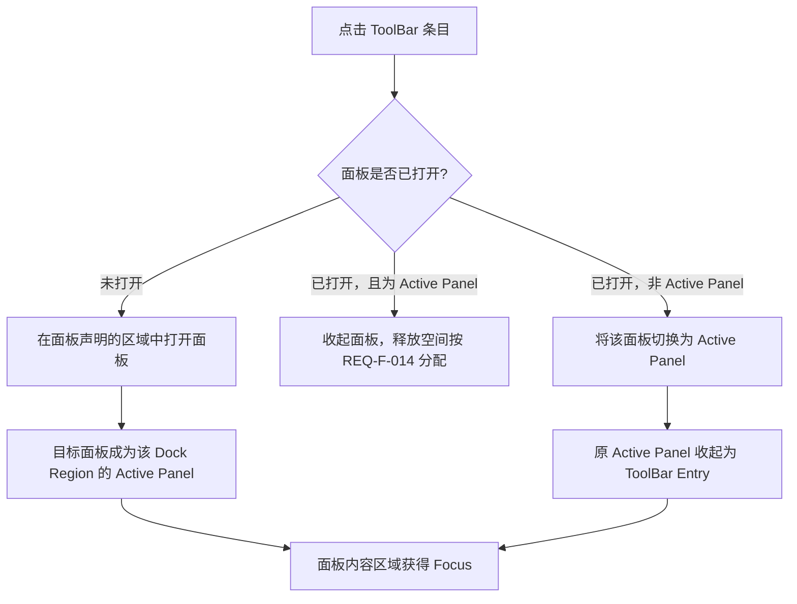
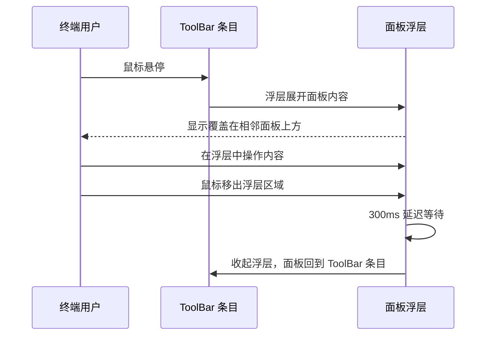

# 软件需求规范（SRS）

> **阅读指南**
> 
> - **本文档性质**：产品需求规范——定义 Atlas **做什么**（用户可感知的行为）。

# 1 引言

## 1.1 目的

**Atlas（Dock 层级布局）** 是一个前端 UI 组件，为 Web 应用程序提供工具窗口停靠、编辑器分屏和面板切换能力。开发者通过声明式或编程式接口集成该组件，终端用户通过拖拽、点击、快捷键等方式操作面板和标签页。

本文档定义 Atlas 的功能需求与非功能需求，作为以下活动的依据：

- **设计** — 架构决策的输入和约束边界
- **开发** — 实现的范围和验收标准
- **测试** — 测试用例的覆盖目标
- **验收** — 交付是否完整的判定基准

**目标读者**：集成 Atlas 的 Application Developer、负责测试的 QA Engineer、以及需要理解系统行为的架构师和项目管理者。

## 1.2 范围

### 范围内

本文档覆盖 Atlas 的全部功能范围，按模块组织如下：

| 模块            | 需求章节 | 核心内容                                                   |
| ------------- |:----:| ------------------------------------------------------ |
| 布局模板与区域定义     | §3.3 | 布局声明、Region 映射、前置概念、Dock Panel 状态与约束、LT/RT/Bottom Dock |
| Editor Tab 管理 | §3.4 | 打开/关闭/激活/溢出/去重/固定/分屏/拖拽停靠                              |
| Dock Panel 移动 | §3.5 | Dock Panel 跨区域移动、投放骨架（Drop Scaffold）、移动撤销              |
| 分割条交互         | §3.6 | 拖拽调整、双击均分、尺寸约束、锁定、容器尺寸自适应                              |
| 布局保存与恢复       | §3.7 | 导出/导入、持久化、预设管理、版本兼容                                    |
| 开发者接口与事件      | §3.8 | 声明/编程 API、事件通知、快捷键                                     |
| 错误处理与容错       | §3.9 | 错误隔离、降级处理、自修复、操作串行化                                    |
| 非功能需求         | §4   | 性能、兼容性、安全、可访问性、内存管理                                    |

### 范围外

以下内容**不在**本文档范围内：

- 触摸设备的交互支持（当前版本仅支持鼠标/触控板指针设备）
- 内容组件（如代码编辑器、终端、文件浏览器）的具体实现——由 Application Developer 提供
- 服务端状态同步与多人协作
- 具体框架（React / Vue / Angular 等）的绑定方案——由详细设计阶段确定
- 主题定制与国际化（i18n）——推迟至后续版本（RTL 镜像见附录 B 延期需求）
- Floating Window（浮动窗口）——推迟至后续版本（见附录 B 延期需求）

### 设计参照

Rider、VSCode等通用编辑器设计。

## 1.3 系统架构

Dock 层级布局由三个垂直堆叠的区域构成：Top Toolbar、Work Area 和 Status Bar，中间 Work Area 容纳所有Dock Panel。

### 层级树

```
Application Window
├── Top Toolbar                     ← 固定，顶部全宽
├── Work Area                       ← 中间弹性区域
│   ├── Left ToolBar (LT)           ← 导航条，覆盖全高
│   ├── Left Dock                   ← Dock Region
│   │   ├── Left Dock Upper
│   │   └── Left Dock Lower
│   ├── Editor Area                 ← 固定主工作区（Editor Tabs + Editor）
│   ├── Right Dock                  ← Dock Region
│   │   ├── Right Dock Upper
│   │   └── Right Dock Lower
│   ├── Bottom Dock                 ← Dock Region
│   │   ├── Bottom Left Dock
│   │   └── Bottom Right Dock
│   └── Right ToolBar (RT)          ← 导航条，覆盖全高
└── Status Bar                      ← 固定，底部全宽
```

> **详细结构（含尺寸说明、分割条位置）**见 [§3.1 层级结构](#31-层级结构)。

**关键架构约束：**

> 各概念（Region、Dock Panel、Editor View、Editor Tab、ToolBar Entry）的详细属性与约束参见 [§1.7 空间概念](#17-空间概念)。

| 约束                     | 说明                                                                 |
| ---------------------- | ------------------------------------------------------------------ |
| Dock 区域支持多个 Dock Panel | 同一区域内同时只有一个 Active Panel（活跃面板）处于展开状态，其余 Dock Panel 通过 ToolBar 条目切换 |
| 固定区域不参与停靠              | Top Toolbar、Editor Area、Status Bar 为固定位置，不可作为停靠目标                  |
| LT/RT 覆盖 Work Area 全高  | Left ToolBar 和 Right ToolBar 纵向覆盖所有 Dock Region的完整高度               |
| 多实例隔离                  | 同一页面可存在多个独立的 Layout Instance（布局实例），互不影响                            |

## 1.5 术语

### 1.5.1 术语定义

| 术语                           | 英文                                     | 定义                                                                                                                                                           |
| ---------------------------- | -------------------------------------- | ------------------------------------------------------------------------------------------------------------------------------------------------------------ |
| Atlas                        | Atlas                                  | 产品名称，Dock 层级布局组件库                                                                                                                                            |
| Dock Area Hierarchy Layout   | Dock 层级布局                              | 一种基于 Region（区域）层级树的通用布局模型，区域之间存在父子与兄弟关系                                                                                                                      |
| Region                       | 区域                                     | 布局中的空间槽位，用于定义 Fixed Region（固定区域）和 Dock Region（Dock 区域）的位置关系。区域本身不承载业务内容，不具有打开、关闭、激活等内容生命周期                                                                   |
| Fixed Region                 | 固定区域                                   | 不可承载 Dock Panel 的固定槽位，包括 Top Toolbar、Editor Area 和 Status Bar。其中 Top Toolbar 和 Status Bar 为纯显示区域；Editor Area 承载 Editor View（编辑器视图）                           |
| Dock Region                  | Dock 区域                                | 可容纳 Dock Panel 的区域槽位，包括 Left Dock Upper / Left Dock Lower、Right Dock Upper / Right Dock Lower、Bottom Left Dock / Bottom Right Dock                           |
| Dock Panel                   | Dock 面板                                | 位于 Dock Region中的工具窗口容器，可移动、折叠、自动隐藏，并通过 LT/RT 的 ToolBar Entry 切换                                                                                              |
| Editor View（编辑器视图）           | 视图 / 编辑器视图                             | Editor Area 内部的编辑器子容器，承载一组 Editor Tab，并显示其中一个激活 Tab 的内容；分屏操作会创建多个 Editor View                                                                                |
| Editor Tab                   | 标签页 / 编辑器标签页                           | Editor View 内的内容切换单元，包含内容标识、标题、参数及状态标记                                                                                                                       |
| Splitter（分割条）                | 分割条                                    | 相邻区域、面板或视图之间的可拖拽分隔线，用于调整尺寸                                                                                                                                   |
| Content Identifier（内容标识）     | 内容标识                                   | 开发者声明的、用于关联到具体组件的唯一字符串标识                                                                                                                                     |
| Template Panel（模板面板）         | 模板面板                                   | Dock Panel 的生命周期类型；当面板内容被清空时保留为空面板                                                                                                                           |
| Dynamic Panel（动态面板）          | 动态面板                                   | Dock Panel 的生命周期类型；当面板内容被清空时自动从布局中移除                                                                                                                         |
| Template View（模板视图）          | 模板视图                                   | Editor View 的生命周期类型；最后一个 Tab 被移除时保留为空视图                                                                                                                      |
| Dynamic View（动态视图）           | 动态视图                                   | Editor View 的生命周期类型；最后一个 Tab 被移除时自动从 Editor Area 中移除                                                                                                         |
| ToolBar                      | LT (Left ToolBar) / RT (Right ToolBar) | 位于 Work Area 左右两侧的常驻纵向边栏，覆盖 Work Area 全高。LT 服务于左侧 Dock Panel（Left Dock + Bottom Left Dock），RT 服务于右侧 Dock Panel（Right Dock + Bottom Right Dock）。LT 与 RT 不参与移动 |
| ToolBar Entry                | ToolBar 条目                             | ToolBar 中代表一个 Dock Panel 的图标与标题组合，1:1 对应。点击 ToolBar Entry 展开对应 Dock Panel 并激活；再次点击收起 Dock Panel                                                              |
| Region Name                  | 区域名称                                   | 布局中预定义的区域标识（如 "Left Dock Upper"），用于将 Dock Panel 渲染至对应 Dock Region，或标识 Fixed Region                                                                           |
| Active State（激活状态）           | 激活状态                                   | Tab、Editor View 或 Dock Panel 处于前台可交互的状态                                                                                                                      |
| Active Panel（活跃面板）           | 活跃面板                                   | Dock 区域中当前展开显示的 Dock Panel。同一 Dock 区域同时仅有一个 Active Panel                                                                                                     |
| Collapsed State（折叠状态）        | 折叠状态                                   | Dock Panel 尺寸缩小至 Collapsed Size（折叠尺寸） 的状态                                                                                                                    |
| Collapsed Size               | 折叠尺寸                                   | Dock Panel 处于 Collapsed State 时的固定最小显示尺寸，具体数值由详细设计确定                                                                                                         |
| Auto-hide State（自动隐藏状态）      | 自动隐藏状态                                 | Dock Panel 在鼠标移出后自动收起为 ToolBar Entry、悬停时以 Flyout（浮层） 展开的状态                                                                                                   |
| Flyout                       | 浮层                                     | Auto-hide 状态下，鼠标悬停于 ToolBar Entry 时展开的覆盖在相邻面板上方的浮动面板                                                                                                         |
| Docking                      | 停靠                                     | 通过拖拽将 Editor Tab 放入目标 Editor View，或将 Dock Panel 放入目标 Dock 区域的操作                                                                                              |
| Directional Docking          | 方向停靠                                   | 在目标 Editor View 的特定方向（上/下/左/右）创建新 Editor View 并移入被拖拽 Editor Tab                                                                                              |
| Center Docking               | 中心停靠                                   | 将被拖拽 Editor Tab 加入目标 Editor View 的 Tab 列表末尾                                                                                                                  |
| Panel Move                   | 面板移动                                   | 将 Dock Panel 拖拽至另一个 Dock 区域的操作。移动后 Panel 内容、激活状态不变，对应 ToolBar Entry 同步迁移。支持移动后撤销恢复（REQ-F-156）                                                                |
| Editor Area                  | Editor Area                            | 位于 Work Area 中心的固定区域，包含 Editor Tab 和 Editor 内容区域                                                                                                             |
| Work Area                    | Work Area                              | 位于 Top Toolbar 与 Status Bar 之间的弹性区域，包含 LT、Left Dock、Editor Area、Right Dock、Bottom Dock、RT                                                                    |
| Bottom Dock                  | Bottom Dock                            | Work Area 的下层区域，包含 Bottom Left Dock 和 Bottom Right Dock                                                                                                      |
| Dedup Key（去重键）               | 去重键                                    | Editor Tab 去重判定的依据，由 Content Identifier + Dedup Parameter 组成                                                                                                 |
| Dedup Parameter              | 去重参数                                   | 开发者指定的细化去重粒度参数（如文件路径），与 Content Identifier 共同构成 Dedup Key                                                                                                    |
| Layout Preset（布局预设）          | 布局预设                                   | 开发者保存的命名布局状态快照，可随时切换恢复                                                                                                                                       |
| Layout Instance（布局实例）        | 布局实例                                   | 页面中一个独立的 Atlas 组件实例，实例间完全隔离                                                                                                                                  |
| Drop Scaffold                | 投放骨架                                   | 隐藏 Dock Region 在 Panel 拖拽期间临时渲染的投放目标，使空 Region 可接收拖入的 Panel（REQ-F-155）                                                                                       |
| Move Undo                    | 移动撤销                                   | Dock Panel 跨区域移动后将 Panel 恢复至源 Region、原 DisplayState 与原 Active 状态的操作（REQ-F-156）                                                                               |
| Dock Container Auto-Collapse | Dock 容器自适应折叠                           | Dock 容器（Left Dock / Right Dock / Bottom Dock）在无展开 Panel 时自动折叠以释放空间给 Editor Area（REQ-F-154）                                                                   |
| RTL                          | RTL (Right-to-Left)                    | 从右到左的语言阅读与布局方向                                                                                                                                               |
| DPI                          | DPI (Dots Per Inch)                    | 显示器每英寸像素点数                                                                                                                                                   |
| Empty State（空状态）             | 空状态                                    | Dock Panel 或 Editor View 未承载任何内容组件时的占位显示状态                                                                                                                   |
| Error Boundary（错误边界）         | 错误边界                                   | 内容组件渲染异常时的隔离显示机制                                                                                                                                             |

> **说明：** 本文中 `Dock Panel`、`Editor Tab`、`Editor View` 等实体名称在正文叙述中可直接使用英文，必要时标注中文。Region 名称（如 `Left Dock Upper`）统一使用英文，以保持与代码实现一致性。

### 1.5.2 角色定义

| 角色                    | 英文                    | 定义                                      |
| --------------------- | --------------------- | --------------------------------------- |
| Application Developer | Application Developer | 集成 Dock 层级布局组件的开发者，通过声明式或编程式接口使用布局功能    |
| End User              | End User（终端用户）        | 使用基于 Dock 层级布局构建的应用程序的最终用户，通过 UI 交互操作布局 |
| System                | System（系统）            | Dock 层级布局组件自身的自动化行为，非由开发者或终端用户直接触发      |

> **System Actor 的子分类：** System 标签覆盖三类行为——

- **渲染行为**（布局初始化后的空间分配、尺寸计算、容器自适应折叠等，实际面向 Developer 的渲染契约验证）、
- **交互响应**（拖拽指示器、停靠高亮、Drop Scaffold 等，实际面向 End User 的视觉反馈）、
- **内部机制**（持久化、错误处理、数据一致性自修复等，真正的系统内部行为）。
  前两类虽标注为 System，但验收标准从对应角色的可观察结果出发编写。

## 1.6 文档约定

### 1.6.1 需求编号规则

每条功能需求使用唯一编号 `REQ-F-XXX`：

- **REQ**: Requirement（需求）
- **F**: Functional（功能需求）
- **XXX**: 三位数字顺序号（F: 001~156；NF: 001~008）

### 1.6.2 优先级定义

| 优先级 | 符号  | 含义                    |
|:---:|:---:| --------------------- |
| P0  | 🔴  | 必须实现——核心功能，缺失则系统不可用   |
| P1  | 🟡  | 应当实现——重要功能，缺失则显著降低可用性 |
| P2  | 🟢  | 可以实现——增强功能，提升用户体验     |

### 1.6.3 需求格式

每条需求包含以下字段：

- **编号与优先级**: `REQ-F-XXX` + 优先级符号（🔴🟡🟢）+ `[Actor: 角色]`
- **Title**: 需求标题
- **Description**: 需求描述
- **Acceptance Criteria**: 使用 Given/When/Then 格式的验收标准

---

## 1.7 空间概念

本系统涉及四个需要严格区分的空间概念：**Region（区域）**、**Dock Panel（Dock 面板）**、**Editor View（视图）**、**Editor Tab（标签页）**。它们分别对应布局槽位、Dock 工具窗口、Editor 分屏子容器和内容切换单元。

### 1.7.1 Region（区域）

区域是布局中的空间槽位，用于定义 Top Toolbar、Editor Area、Dock Region 和 Status Bar 的位置关系。区域本身不是业务内容对象，不具有打开、关闭或激活生命周期。

| 属性           | 说明                                                                                                         |
| ------------ | ---------------------------------------------------------------------------------------------------------- |
| 本质           | 布局空间槽位                                                                                                     |
| 类型           | Fixed Region / Dock Region                                                                                 |
| Fixed Region | Top Toolbar、Editor Area、Status Bar                                                                         |
| Dock Region  | Left Dock Upper / Left Dock Lower、Right Dock Upper / Right Dock Lower、Bottom Left Dock / Bottom Right Dock |
| 可承载对象        | Dock Region 承载 Dock Panel；Editor Area 承载 Editor View                                                       |
| 是否可移动        | 否——Region 由布局模板定义                                                                                          |

### 1.7.2 Dock Panel（Dock 面板 / 工具窗口）

出现在 **Dock Region**（Left Dock Upper / Left Dock Lower、Right Dock Upper / Right Dock Lower、Bottom Left Dock / Bottom Right Dock）的功能工具窗口，如 Explorer、Search、Terminal。Dock Panel 不承载 Editor Tab；其内容由 Application Developer 提供的内容组件决定。

| 属性    | 说明                                                                                         |
| ----- | ------------------------------------------------------------------------------------------ |
| 出现位置  | Dock Region                                                                                |
| 切换方式  | **LT/RT 的 ToolBar Entry 点击**                                                               |
| 多面板共存 | 同一 Dock Region 可容纳多个 Dock Panel；同时仅有一个 Active Panel 展开显示，其余 Dock Panel 通过 ToolBar Entry 切换 |
| 拖拽排序  | 拖拽 Panel Header（面板标题栏） 在同一区域内排序，或拖至另一个 Dock Region                                         |
| 关闭    | 通过 Panel Header 关闭按钮；关闭后 ToolBar Entry 保留（Template Panel）或随面板移除（Dynamic Panel）             |
| 溢出处理  | 不适用——Dock Panel 始终全宽，靠 ToolBar Entry 切换                                                    |
| 去重    | 不适用——每个 Dock Panel 是独立的工具窗口实例                                                              |
| 跨区域移动 | 是——拖拽 Header 到另一个 Dock Region                                                              |

### 1.7.3 Editor View（视图 / 编辑器视图）

Editor View 是 **Editor Area** 内部的编辑器子容器，承载一组 Editor Tab，并显示其中一个激活 Tab 的内容。未分屏时 Editor Area 至少包含一个默认 Editor View；分屏或 Tab 方向停靠会创建新的 Editor View。

| 属性              | 说明                                                      |
| --------------- | ------------------------------------------------------- |
| 出现位置            | 仅在 Editor Area 内                                        |
| 切换方式            | 通过激活其内部 Editor Tab 或键盘 Focus（焦点） 进入                     |
| 承载内容            | 一组 Editor Tab                                           |
| 分屏              | 支持水平/垂直分屏                                               |
| 方向停靠            | 拖拽 Editor Tab 到 Editor View 四周会创建新的分屏 Editor View       |
| 中心停靠            | 拖拽 Editor Tab 到 Editor View 中心会加入该 Editor View 的 Tab 列表 |
| 是否属于 Dock Panel | 否                                                       |

### 1.7.4 Editor Tab（标签页 / 编辑器标签页）

出现在 **Editor View** 内的标签页，代表打开的内容实例。Tab 栏可容纳多个 Editor Tab，用户通过点击或快捷键切换。

| 属性    | 说明                   |
| ----- | -------------------- |
| 出现位置  | 仅在 Editor View 内     |
| 切换方式  | 点击 Tab / Ctrl+Tab    |
| 排列    | 多 Tab 在 Tab 栏横向排列    |
| 拖拽排序  | 是                    |
| 关闭    | 是（每个 Tab 有关闭按钮）      |
| 溢出处理  | 需要（Tab 过多时：滚动/菜单/换行） |
| 去重    | 需要（同一内容不重复创建 Tab）    |
| 固定标记  | 支持（Pinned）           |
| 跨视图拖拽 | 支持中心停靠或方向停靠          |

### 1.7.5 ToolBar Entry（ToolBar 条目）

出现在 **LT / RT** 中的图标条目，每个 ToolBar Entry 代表一个 Dock Panel，用于切换该 Dock Panel 的可见与激活状态。

| 属性               | 说明                                              |
| ---------------- | ----------------------------------------------- |
| 出现位置             | LT（Left ToolBar）、RT（Right ToolBar）              |
| 代表什么             | 一个 Dock Panel 的导航入口                             |
| 数量               | 等于所属侧 Dock Panel 的数量                            |
| 与 Dock Panel 的关系 | 1:1；Dock Panel 移动时 ToolBar Entry 迁移到目标侧 ToolBar |
| 适用范围             | REQ-F-020~024、REQ-F-149~153                     |

### 1.7.6 空间概念总览

下图展示区域、面板、Editor View（编辑器视图）、Editor Tab（编辑器标签页） 和 ToolBar Entry（ToolBar 条目） 在布局中的位置关系（颜色与 §3.1 一致）：

<svg xmlns="http://www.w3.org/2000/svg" width="100%" viewBox="0 0 760 365" font-family="sans-serif" fill="none">
  <defs>
    <style>
      .dock-hd  { fill: #d6eaf8; stroke: #333; stroke-width: 1; }
      .dock-bd  { fill: #f8fbff; stroke: #333; stroke-width: .7; }
      .editor-hd { fill: #c8e6c9; stroke: #2e7d32; stroke-width: 1; }
      .editor-bd { fill: #f1f8e9; stroke: #2e7d32; stroke-width: .7; }
      .toolbar   { fill: #e3f2fd; stroke: #1976d2; stroke-width: 1.2; }
      .tab-off   { fill: #fff; stroke: #c8e6c9; stroke-width: 1; }
      .tab-on    { fill: #e8f5e9; stroke: #2e7d32; stroke-width: 1.5; }
      .panel     { fill: #fff; stroke: #333; }
      .entry-hi  { fill: #bbdefb; stroke: #1976d2; stroke-width: 1.5; }
      .callout   { stroke: #aaa; stroke-width: 1; stroke-dasharray: 4,3; }
      .legend-bg { fill: #fafafa; stroke: #eee; stroke-width: 1; }
      .view-split { stroke: #c8e6c9; stroke-width: 1; stroke-dasharray: 5,3; }
    </style>   
  </defs>
  <!-- Left Dock (Region) -->
  <rect x="50" y="52" width="160" height="195" class="dock-hd" rx="2"/>
  <text x="130" y="68" text-anchor="middle" stroke="none" fill="#333" font-size="10" font-weight="bold">Dock Region（Dock 区域）</text>
  <text x="130" y="80" text-anchor="middle" stroke="none" fill="#ef6c00" font-size="7">Region</text>
  <rect x="50" y="86" width="160" height="161" class="dock-bd"/>
  <rect x="60" y="96" width="140" height="55" class="panel" rx="2"/>
  <text x="130" y="118" text-anchor="middle" stroke="none" fill="#333" font-size="10" font-weight="bold">Dock Panel</text>
  <text x="130" y="133" text-anchor="middle" stroke="none" fill="#888" font-size="8">工具窗口</text>
  <rect x="60" y="159" width="140" height="26" rx="1" fill="#f5f5f5" stroke="#ddd" stroke-dasharray="3,3"/>
  <text x="130" y="176" text-anchor="middle" stroke="none" fill="#bbb" font-size="7">同区域其余 Dock Panel 收起为 ToolBar 条目</text>
  <!-- Editor Area (Region) -->
  <rect x="224" y="52" width="280" height="195" class="editor-hd" rx="2"/>
  <text x="364" y="68" text-anchor="middle" stroke="none" fill="#2e7d32" font-size="10" font-weight="bold">Editor Area</text>
  <text x="364" y="80" text-anchor="middle" stroke="none" fill="#ef6c00" font-size="7">Region</text>
  <rect x="224" y="86" width="280" height="161" class="editor-bd"/>
  <!-- View 1 -->
  <rect x="234" y="92" width="125" height="148" class="view-split" rx="2"/>
  <text x="296" y="106" text-anchor="middle" stroke="none" fill="#2e7d32" font-size="8" font-weight="bold">Editor View 1</text>
  <rect x="238" y="112" width="117" height="14" fill="#e8f5e9" stroke="none"/>
  <rect x="240" y="114" width="34" height="10" class="tab-off" rx="1"/>
  <text x="257" y="121" text-anchor="middle" stroke="none" fill="#666" font-size="6">Tab A</text>
  <rect x="276" y="114" width="34" height="10" class="tab-on" rx="1"/>
  <text x="293" y="121" text-anchor="middle" stroke="none" fill="#2e7d32" font-size="6" font-weight="bold">Tab B</text>
  <line x1="240" y1="148" x2="340" y2="148" stroke="#ddd" stroke-width="1.5"/>
  <line x1="240" y1="162" x2="340" y2="162" stroke="#ddd" stroke-width="1.5"/>
  <!-- View 2 -->
  <rect x="364" y="92" width="130" height="148" class="view-split" rx="2"/>
  <text x="429" y="106" text-anchor="middle" stroke="none" fill="#2e7d32" font-size="8" font-weight="bold">Editor View 2</text>
  <rect x="368" y="112" width="122" height="14" fill="#e8f5e9" stroke="none"/>
  <rect x="370" y="114" width="34" height="10" class="tab-off" rx="1"/>
  <text x="387" y="121" text-anchor="middle" stroke="none" fill="#666" font-size="6">Tab C</text>
  <line x1="370" y1="148" x2="470" y2="148" stroke="#ddd" stroke-width="1.5"/>
  <line x1="370" y1="162" x2="430" y2="162" stroke="#ddd" stroke-width="1.5"/>
  <!-- Right Dock (Region) -->
  <rect x="518" y="52" width="160" height="195" class="dock-hd" rx="2"/>
  <text x="598" y="68" text-anchor="middle" stroke="none" fill="#333" font-size="10" font-weight="bold">Dock Region</text>
  <text x="598" y="80" text-anchor="middle" stroke="none" fill="#ef6c00" font-size="7">Region</text>
  <rect x="518" y="86" width="160" height="161" class="dock-bd"/>
  <rect x="528" y="96" width="140" height="55" class="panel" rx="2"/>
  <text x="598" y="118" text-anchor="middle" stroke="none" fill="#333" font-size="10" font-weight="bold">Dock Panel</text>
  <text x="598" y="133" text-anchor="middle" stroke="none" fill="#888" font-size="8">工具窗口</text>
  <!-- LT / RT -->
  <rect x="22" y="52" width="22" height="195" class="toolbar" rx="2"/>
  <text x="33" y="155" text-anchor="middle" stroke="none" fill="#1565c0" font-size="9" font-weight="bold" transform="rotate(-90 33 155)">LT</text>
  <rect x="684" y="52" width="22" height="195" class="toolbar" rx="2"/>
  <text x="695" y="155" text-anchor="middle" stroke="none" fill="#1565c0" font-size="9" font-weight="bold" transform="rotate(90 695 155)">RT</text>
  <!-- ToolBar Entry highlight -->
  <rect x="18" y="64" width="30" height="20" class="entry-hi" rx="2"/>
  <text x="33" y="78" text-anchor="middle" stroke="none" fill="#1565c0" font-size="7" font-weight="bold">条目</text>
  <!-- ===== Callouts ===== -->
  <!-- ToolBar Entry -->
  <line x1="18" y1="74" x2="8" y2="74" class="callout"/>
  <line x1="8" y1="74" x2="8" y2="18" class="callout"/>
  <line x1="8" y1="18" x2="110" y2="18" class="callout"/>
  <text x="114" y="15" text-anchor="start" stroke="none" font-size="10" fill="#1976d2" font-weight="bold">ToolBar Entry</text>
  <text x="114" y="28" text-anchor="start" stroke="none" font-size="8" fill="#777">1:1 对应 Dock Panel</text>
  <text x="114" y="40" text-anchor="start" stroke="none" font-size="8" fill="#777">点击切换 · 移动时迁移</text>
  <!-- Editor Tab -->
  <line x1="293" y1="114" x2="293" y2="18" class="callout"/>
  <line x1="293" y1="18" x2="272" y2="18" class="callout"/>
  <text x="276" y="15" text-anchor="start" stroke="none" font-size="10" fill="#2e7d32" font-weight="bold">Editor Tab</text>
  <text x="276" y="28" text-anchor="start" stroke="none" font-size="8" fill="#777">横向排列 · 点击/Ctrl+Tab 切换</text>
  <text x="276" y="40" text-anchor="start" stroke="none" font-size="8" fill="#777">溢出 · 去重 · 固定 · 分屏 · 关闭按钮</text>
  <!-- Region -->
  <line x1="224" y1="62" x2="224" y2="18" class="callout"/>
  <line x1="224" y1="18" x2="388" y2="18" class="callout"/>
  <text x="392" y="15" text-anchor="start" stroke="none" font-size="10" fill="#ef6c00" font-weight="bold">Region（区域）</text>
  <text x="392" y="28" text-anchor="start" stroke="none" font-size="8" fill="#777">布局空间槽位 · Fixed / Dock</text>
  <text x="392" y="40" text-anchor="start" stroke="none" font-size="8" fill="#777">不承载内容 · 不可移动</text>
  <!-- Editor View -->
  <line x1="429" y1="92" x2="429" y2="18" class="callout"/>
  <line x1="429" y1="18" x2="502" y2="18" class="callout"/>
  <text x="506" y="15" text-anchor="start" stroke="none" font-size="10" fill="#2e7d32" font-weight="bold">Editor View（视图）</text>
  <text x="506" y="28" text-anchor="start" stroke="none" font-size="8" fill="#777">Editor Area 内部子容器</text>
  <text x="506" y="40" text-anchor="start" stroke="none" font-size="8" fill="#777">承载 Editor Tab · 分屏创建多 View</text>
  <!-- Dock Panel -->
  <line x1="130" y1="151" x2="130" y2="318" class="callout"/>
  <text x="130" y="303" text-anchor="middle" stroke="none" font-size="10" fill="#333" font-weight="bold">Dock Panel（Dock 面板）</text>
  <text x="130" y="318" text-anchor="middle" stroke="none" font-size="8" fill="#777">工具窗口 · 出现在 Dock Region</text>
  <text x="130" y="331" text-anchor="middle" stroke="none" font-size="8" fill="#777">LT/RT Entry 切换 · 支持跨区域移动</text>
  <!-- Legend -->
  <rect x="490" y="308" width="245" height="48" class="legend-bg" rx="2"/>
  <rect x="498" y="318" width="8" height="8" rx="1" fill="#e8f5e9" stroke="#2e7d32"/>
  <text x="510" y="326" stroke="none" fill="#333" font-size="8">Editor Area</text>
  <rect x="578" y="318" width="8" height="8" rx="1" fill="#f8fbff" stroke="#333"/>
  <text x="590" y="326" stroke="none" fill="#333" font-size="8">Dock</text>
  <rect x="620" y="318" width="8" height="8" rx="1" fill="#e3f2fd" stroke="#1976d2"/>
  <text x="632" y="326" stroke="none" fill="#333" font-size="8">LT/RT</text>
  <rect x="662" y="318" width="8" height="8" rx="1" fill="#fff3e0" stroke="#ef6c00"/>
  <text x="674" y="326" stroke="none" fill="#333" font-size="8">Region</text>
  <rect x="498" y="336" width="8" height="8" rx="1" fill="#fafdfa" stroke="#c8e6c9"/>
  <text x="510" y="344" stroke="none" fill="#333" font-size="8">Editor View</text>
</svg>

# 2 总体描述

## 2.1 产品视角

Atlas 是一个前端 UI 组件，为 Web 应用程序提供工具窗口停靠、编辑器分屏和面板切换能力。该组件以声明式或编程式接口供 Application Developer 集成，终端用户通过拖拽、点击等交互操作 Dock Panel 和 Editor Tab。

Dock 层级布局运行在浏览器环境中，为纯客户端组件，不依赖服务端。

## 2.2 功能导航（按角色）

> 以下为各角色在本文档中的需求快速索引。

| 角色                        | 核心关注                                         | 快速跳转                                            |
| ------------------------- | -------------------------------------------- | ----------------------------------------------- |
| **Application Developer** | 声明布局、打开标签页、API、事件                            | §3.3 布局模板 → §3.4 Editor 标签页 → §3.8 API          |
| **End User**              | 拖拽面板、切换标签页、Splitter（分割条）、快捷键、Auto-hide（自动隐藏） | §3.4 Editor Tab → §3.5 Dock Panel 移动 → §3.6 分割条 |
| **System**                | 生命周期、边界条件、错误隔离、去重校验                          | §3.4 溢出/去重 → §3.9 错误处理                          |

> 核心功能覆盖范围详见 [§1.2 范围](#12-范围)。

## 2.3 用户特征

| 用户类型                  | 特征                       | 技术能力                    |
| --------------------- | ------------------------ | ----------------------- |
| Application Developer | 集成组件的开发者，使用声明式标签或编程式 API | 熟悉前端框架、了解组件化开发          |
| End User              | 使用最终应用的终端用户              | 具备基本桌面应用操作经验（拖拽、点击、快捷键） |

## 2.4 约束

- 运行环境为浏览器
- 组件为纯客户端实现，不依赖服务端状态
- 布局的持久化存储依赖浏览器本地存储能力（如 localStorage / IndexedDB）
- 自定义模板和内容组件由 Application Developer 提供

## 2.5 假设与依赖

- 目标浏览器支持 ES6 及以上标准
- 终端用户使用鼠标/触控板等指针设备进行交互（触摸设备支持不在当前版本范围内）
- Application Developer 负责内容组件的实现与Content Identifier（内容标识）的声明

---

# 3 功能需求

> 本文档定义一种通用的 **Dock 层级布局** 模型，适用于需要工具窗口停靠、编辑器分屏和面板切换的网页端/桌面端应用界面。该模型的核心特征是 Dock Region之间存在特定的层级树关系，而非扁平分区。

## 3.1 层级结构

> 层级树参见 [§1.3 系统架构](#13-系统架构)。

<svg xmlns="http://www.w3.org/2000/svg" viewBox="0 0 760 390" font-family="sans-serif" fill="none">
  <defs>
    <style>
      .fixed   { fill: #f5f5f5; stroke: #bbb; stroke-width: 1; }
      .toolbar { fill: #e3f2fd; stroke: #1976d2; stroke-width: 1.2; }
      .dock-hd { fill: #d6eaf8; stroke: #333; stroke-width: 1; }
      .dock-bd { fill: #f8fbff; stroke: #333; stroke-width: .8; }
      .editor-hd { fill: #c8e6c9; stroke: #2e7d32; stroke-width: 1; }
      .editor-bd { fill: #f1f8e9; stroke: #2e7d32; stroke-width: .8; }
      .bottom-hd { fill: #ffe0b2; stroke: #333; stroke-width: 1; }
      .bottom-bd { fill: #fff8f0; stroke: #333; stroke-width: .8; }
      .sep { stroke: #ddd; stroke-width: .6; }
      .legend-box { fill: #fafafa; stroke: #eee; stroke-width: 1; }
    </style>
  </defs>
  <!-- Top Toolbar -->
  <rect x="2" y="2" width="756" height="30" rx="0" class="fixed"/>
  <text x="380" y="21" text-anchor="middle" stroke="none" fill="#999" font-size="11">Top Toolbar</text>
  <!-- Status Bar -->
  <rect x="2" y="358" width="756" height="30" rx="0" class="fixed"/>
  <text x="380" y="378" text-anchor="middle" stroke="none" fill="#999" font-size="11">Status Bar</text>
  <!-- LT -->
  <rect x="2" y="32" width="32" height="326" class="toolbar"/>
  <text x="18" y="200" text-anchor="middle" stroke="none" fill="#1565c0" font-size="11" font-weight="bold" transform="rotate(-90 18 200)">LT</text>
  <!-- RT -->
  <rect x="726" y="32" width="32" height="326" class="toolbar"/>
  <text x="742" y="200" text-anchor="middle" stroke="none" fill="#1565c0" font-size="11" font-weight="bold" transform="rotate(90 742 200)">RT</text>
  <!-- Left Dock -->
  <rect x="34" y="32" width="170" height="210" class="dock-hd"/>
  <text x="119" y="48" text-anchor="middle" stroke="none" fill="#333" font-size="11" font-weight="bold">Left Dock</text>
  <rect x="34" y="52" width="170" height="190" class="dock-bd"/>
  <line x1="34" y1="147" x2="204" y2="147" class="sep"/>
  <text x="119" y="115" text-anchor="middle" stroke="none" fill="#777" font-size="10">Left Dock Upper</text>
  <text x="119" y="200" text-anchor="middle" stroke="none" fill="#777" font-size="10">Left Dock Lower</text>
  <!-- Editor Area -->
  <rect x="204" y="32" width="312" height="210" class="editor-hd"/>
  <text x="360" y="48" text-anchor="middle" stroke="none" fill="#2e7d32" font-size="11" font-weight="bold">Editor Area</text>
  <rect x="204" y="52" width="312" height="190" class="editor-bd"/>
  <line x1="204" y1="68" x2="516" y2="68" stroke="#a5d6a7" stroke-width=".6"/>
  <text x="360" y="82" text-anchor="middle" stroke="none" fill="#999" font-size="9">Editor Tabs</text>
  <line x1="220" y1="110" x2="400" y2="110" stroke="#ddd" stroke-width="2"/>
  <line x1="220" y1="126" x2="460" y2="126" stroke="#ddd" stroke-width="2"/>
  <line x1="220" y1="142" x2="340" y2="142" stroke="#ddd" stroke-width="2"/>
  <line x1="220" y1="158" x2="430" y2="158" stroke="#ddd" stroke-width="2"/>
  <line x1="220" y1="174" x2="380" y2="174" stroke="#ddd" stroke-width="2"/>
  <line x1="220" y1="190" x2="260" y2="190" stroke="#ddd" stroke-width="2"/>
  <text x="360" y="225" text-anchor="middle" stroke="none" fill="#bbb" font-size="9">Editor 内容区域</text>
  <!-- Right Dock -->
  <rect x="516" y="32" width="210" height="210" class="dock-hd"/>
  <text x="621" y="48" text-anchor="middle" stroke="none" fill="#333" font-size="11" font-weight="bold">Right Dock</text>
  <rect x="516" y="52" width="210" height="190" class="dock-bd"/>
  <line x1="516" y1="147" x2="726" y2="147" class="sep"/>
  <text x="621" y="115" text-anchor="middle" stroke="none" fill="#777" font-size="10">Right Dock Upper</text>
  <text x="621" y="200" text-anchor="middle" stroke="none" fill="#777" font-size="10">Right Dock Lower</text>
  <!-- Bottom Dock -->
  <rect x="34" y="242" width="692" height="116" class="bottom-hd"/>
  <text x="380" y="258" text-anchor="middle" stroke="none" fill="#333" font-size="10" font-weight="bold">Bottom Dock</text>
  <rect x="34" y="262" width="692" height="96" class="bottom-bd"/>
  <line x1="380" y1="262" x2="380" y2="358" stroke="#ccc" stroke-width=".6"/>
  <text x="207" y="316" text-anchor="middle" stroke="none" fill="#777" font-size="10">Bottom Left Dock</text>
  <text x="553" y="316" text-anchor="middle" stroke="none" fill="#777" font-size="10">Bottom Right Dock</text>
  <!-- 图例 -->
  <rect x="610" y="366" width="138" height="20" rx="3" class="legend-box"/>
  <rect x="616" y="372" width="8" height="8" rx="1" fill="#e3f2fd" stroke="#1976d2"/>
  <text x="628" y="380" stroke="none" fill="#1976d2" font-size="8">导航</text>
  <rect x="656" y="372" width="8" height="8" rx="1" fill="#e8f5e9" stroke="#2e7d32"/>
  <text x="668" y="380" stroke="none" fill="#2e7d32" font-size="8">主工作区</text>
  <rect x="704" y="372" width="8" height="8" rx="1" fill="#f8fbff" stroke="#333"/>
  <text x="716" y="380" stroke="none" fill="#555" font-size="8">Dock Region</text>
</svg>

**Dock 区域支持多个 Dock Panel**：Left Dock Upper、Left Dock Lower、Right Dock Upper、Right Dock Lower、Bottom Left Dock、Bottom Right Dock。同一区域内同时只有一个 Active Panel（活跃面板）展开，其余 Dock Panel 通过 ToolBar Entry 切换。

此层级模型支持后续扩展：Tool Window 拖拽停靠（Dock）、Auto Hide（自动隐藏）、Floating Window（浮动窗口）、Split Editor（编辑器分屏）等，均可在此模型上自然扩展。

**区域属性一览：**

| 区域                | 位置             | 承载 Dock Panel | 说明                             |
| ----------------- | -------------- |:-------------:| ------------------------------ |
| Top Toolbar       | 容器顶部全宽         | 否             | 固定位置，如导航栏/工具栏                  |
| Left Dock Upper   | Work Area 左列上半 | 是             | 支持 Dock Panel                  |
| Left Dock Lower   | Work Area 左列下半 | 是             | 支持 Dock Panel                  |
| Editor Area       | Work Area 中心   | 否             | 主内容区（Editor Tab + Editor），固定位置 |
| Right Dock Upper  | Work Area 右列上半 | 是             | 支持 Dock Panel                  |
| Right Dock Lower  | Work Area 右列下半 | 是             | 支持 Dock Panel                  |
| Bottom Left Dock  | Bottom Dock 左侧 | 是             | 支持 Dock Panel                  |
| Bottom Right Dock | Bottom Dock 右侧 | 是             | 支持 Dock Panel                  |
| Status Bar        | 容器底部全宽         | 否             | 固定位置，显示状态信息                    |

**Left ToolBar (LT) / Right ToolBar (RT) 属性：**

| 属性     | 说明                                                                                                                                                                        |
| ------ |:------------------------------------------------------------------------------------------------------------------------------------------------------------------------- |
| 位置     | LT 位于 Work Area 左侧，RT 位于 Work Area 右侧                                                                                                                                     |
| 覆盖范围   | 覆盖整个 Work Area 高度（含 Bottom Dock）                                                                                                                                          |
| 职责     | LT 服务于 Left Dock（Left Dock Upper / Left Dock Lower）和 Bottom Left Dock 的 Dock Panel；RT 服务于 Right Dock（Right Dock Upper / Right Dock Lower）和 Bottom Right Dock 的 Dock Panel |
| 参与面板移动 | 否——LT/RT 是导航条而非面板容器，不参与 Dock Panel 移动                                                                                                                                     |

> **章节编号说明：** 本章无 §3.2，该编号为历史空缺。为保持既有章节引用（含 `requirements-traceability.md`）稳定，不作章节重编号。

## 3.3 布局模板与区域结构

```
REQ-F-001 🔴 [Actor: Application Developer]

Title
Dock 层级布局完整声明

Description
系统应使用 Dock 层级布局并支持开发者声明全部区域
（Top Toolbar、Left Dock Upper、Left Dock Lower、Editor Area、Right Dock Upper、
Right Dock Lower、Bottom Left Dock、Bottom Right Dock、Status Bar），布局初始化后各区域按层级树关系渲染为对应的 Dock Panel（Dock 面板）。

Acceptance Criteria

AC1：声明全部区域

Given 开发者声明全部区域
When 布局初始化完成
Then 系统应按层级树关系渲染各区域对应的 Dock Panel
And Dock Panel 分别对应各区域（Top Toolbar、Left Dock Upper、Left Dock Lower、Editor Area、
Right Dock Upper、Right Dock Lower、Bottom Left Dock、Bottom Right Dock、Status Bar）

AC2：无面板初始化

Given 开发者初始化 Dock 层级布局时未声明任何面板
When 布局初始化完成
Then 系统应显示空白容器区域
And 系统不报错
```

```
REQ-F-002 🔴 [Actor: Application Developer]

Title
Dock 层级布局空间结构

Description
系统应按 Dock 层级布局的层级树关系排列各区域：

- Top Toolbar 横跨容器顶部全宽。
- Status Bar 横跨容器底部全宽。
- Work Area 位于 Top Toolbar 与 Status Bar 之间，包含 LT、Left Dock、Editor Area、Right Dock、Bottom Dock、RT。
- Left ToolBar (LT) 位于 Work Area 左侧，覆盖整个 Work Area 高度（含 Bottom Dock）。
- Right ToolBar (RT) 位于 Work Area 右侧，覆盖整个 Work Area 高度（含 Bottom Dock）。
- Left Dock 包含 Left Dock Upper 和 Left Dock Lower，纵向排列。
- Right Dock 包含 Right Dock Upper 和 Right Dock Lower，纵向排列。
- Editor Area 位于 Work Area 中心，包含 Editor Tab（编辑器标签页）s 和 Editor。
- Bottom Dock 包含 Bottom Left Dock 和 Bottom Right Dock，两者之间以垂直Splitter（分割条）分隔。

其中 Left Dock Upper、Left Dock Lower、Right Dock Upper、Right Dock Lower、Bottom Left Dock、
Bottom Right Dock 六个区域为 Dock Panel（Dock 面板），支持 Dock Panel 移动；
Top Toolbar、Editor Area 和 Status Bar 为固定位置区域，不参与移动。

Acceptance Criteria

AC1：Dock 层级布局结构渲染

Given 开发者声明全部区域
When 布局初始化完成
Then Top Toolbar 应横跨容器顶部全宽
And Status Bar 应横跨容器底部全宽
And Left ToolBar 应位于 Work Area 左侧，纵向覆盖 Work Area 完整高度
And Right ToolBar 应位于 Work Area 右侧，纵向覆盖 Work Area 完整高度
And Left Dock Upper 与 Left Dock Lower 应纵向排列于 Left Dock 内
And Left Dock Upper 与 Left Dock Lower 之间以水平分割条分隔
And Right Dock Upper 与 Right Dock Lower 应纵向排列于 Right Dock 内
And Right Dock Upper 与 Right Dock Lower 之间以水平分割条分隔
And Editor Area 应位于 Work Area 中心并占据剩余空间
And Editor Area 包含 Editor Tabs 和 Editor
And Left Dock 与 Editor Area 之间以垂直分割条分隔
And Right Dock 与 Editor Area 之间以垂直分割条分隔
And Bottom Dock 应位于 Work Area 下方
And Work Area 与 Bottom Dock 之间以水平分割条分隔
And Bottom Left Dock 与 Bottom Right Dock 之间以垂直分割条分隔

AC2：仅声明 Editor Area

Given 开发者仅声明 Editor Area
When 布局初始化完成
Then Editor Area 应占据全部容器空间
And 其余区域以零尺寸占位且不可见
```

```
REQ-F-003 🔴 [Actor: Application Developer]

Title
Dock 层级布局部分声明

Description
系统应支持开发者在 Dock 层级布局中仅声明部分区域，未声明的区域以零尺寸占位。

Acceptance Criteria

AC1：仅声明部分区域

Given 开发者未声明全部区域
When 布局初始化完成
Then 系统应在缺失区域生成空 Dock Panel（Dock 面板）
And 该 Dock Panel 高度或宽度为零且不可见
```

```
REQ-F-004 🔴 [Actor: Application Developer]

Title
Dock Panel（Dock 面板） 区域名称映射

Description
系统应支持开发者为 Dock Panel 指定区域名称，将 Dock Panel 渲染至名称对应的 Dock Region（Dock 区域）位置。Dock 层级布局支持的区域名称为：Top Toolbar、Left Dock Upper、Left Dock Lower、Editor Area、Right Dock Upper、Right Dock Lower、Bottom Left Dock、Bottom Right Dock、Status Bar。其中仅 Dock Region可承载 Dock Panel；Fixed Region（固定区域）不可作为 Dock Panel 目标区域。

Acceptance Criteria

AC1：正常指定 Dock Region名称

Given 开发者为 Dock Panel 指定有效 Dock Region名称
When 布局初始化完成
Then 系统应将 Dock Panel 渲染至该名称对应的 Dock Region位置

AC2：多个 Dock Panel 声明相同 Dock Region名称

Given 开发者为多个 Dock Panel 声明了相同的 Dock Region名称
When 布局初始化完成
Then 系统应将这些 Dock Panel 渲染至同一 Dock Region
And 系统应将它们渲染至同一 Dock Region，仅 Active Panel（活跃面板） 展开，其余 Dock Panel 通过 ToolBar Entry（ToolBar 条目） 切换
```

```
REQ-F-005 🔴 [Actor: Application Developer]

Title
Dock Panel（Dock 面板） Empty State（空状态）显示

Description
系统应在 Dock Panel 未承载任何内容组件时显示Empty State（空状态）。

Acceptance Criteria

AC1：Dock Panel 无内容

Given 布局已初始化
When Dock Panel 未承载任何内容组件
Then 系统应在该 Dock Panel 中显示Empty State（空状态）
And Empty State包含 Dock Panel 容器和Empty State提示文本。
```

```
REQ-F-006 🔴 [Actor: Application Developer]

Title
Content Identifier（内容标识）声明

Description
系统应支持开发者为 Dock Panel（Dock 面板） 和 Editor Tab（编辑器标签页） 指定要渲染的内容组件。
开发者通过声明方式将内容标识与具体组件关联，系统在渲染 Panel 或 Tab 时解析标识并渲染对应组件。

Acceptance Criteria

AC1：声明内容标识与组件的关联

Given 开发者声明了内容标识与组件的关联
When 系统渲染持有该内容标识的 Dock Panel 或 Editor Tab
Then 系统应渲染开发者指定的组件作为内容
```

```
REQ-F-007 🔴 [Actor: Application Developer]

Title
Editor Tab（编辑器标签页）内容渲染

Description
系统应在标签页持有有效Content Identifier（内容标识）时渲染该标识对应的组件作为标签页内容。

Acceptance Criteria

AC1：有效内容标识

Given 标签页持有有效内容标识
And 开发者已声明该内容标识与组件的关联
When 系统渲染该标签页
Then 系统应渲染该内容标识对应的组件作为标签页内容
```

```
REQ-F-008 🔴 [Actor: Application Developer]

Title
Editor Tab（编辑器标签页）参数传递

Description
系统应支持开发者在打开标签页时传入参数，并将参数传递至标签页内容组件。

Acceptance Criteria

AC1：传入参数

Given 开发者准备了参数集合
When 开发者在打开标签页时传入该参数集合
Then 标签页内容组件应收到与传入值一致的参数
```

```
REQ-F-009 🟡 [Actor: End User | Application Developer]

Title
Editor Tab（编辑器标签页）Pinned（固定标记）

Description
系统应支持开发者或终端用户将标签页标记为固定状态，固定状态的标签页在标签页栏中始终排列在
非固定标签页之前，并显示固定标识图标。

Acceptance Criteria

AC1：标记标签页为固定

Given Editor View（编辑器视图）中存在多个标签页且未处于固定状态
When 终端用户点击标签页的固定按钮或开发者调用固定接口
Then 系统应将该标签页标记为固定状态
And 该标签页显示固定标识图标
And 该标签页移动至标签页栏中所有非固定标签页之前

AC2：取消标签页固定

Given 标签页处于固定状态
When 终端用户再次点击固定按钮或开发者调用取消固定接口
Then 系统应取消该标签页的固定状态
And 该标签页移除固定标识图标
And 该标签页排列至固定标签页之后
```

```
REQ-F-010 🟡 [Actor: Application Developer]

Title
自定义Empty State（空状态）模板

Description
系统应支持开发者定义Empty State（空状态）模板，替代默认Empty State提示。

Acceptance Criteria

AC1：定义了Empty State（空状态）模板

Given 开发者定义了Empty State模板
When Dock Panel（Dock 面板） 处于Empty State
Then 系统应使用开发者定义的模板内容替代默认Empty State提示
```

```
REQ-F-011 🔴 [Actor: End User]

Title
拖入Editor Tab（编辑器标签页）至空Editor View（编辑器视图）

Description
系统应支持终端用户将标签页拖入空视图并显示被拖入的内容。

Acceptance Criteria

AC1：拖入标签页至空视图

Given Editor Area 中存在一个空视图
When 终端用户将标签页拖入该空视图并释放
Then 系统应在该视图中显示被拖入的内容
And 被拖入的标签页成为该视图的激活标签页
```

### 3.3.1 Dock Panel 状态与约束

> 涵盖 Dock Panel 的折叠/展开、空间重分配、尺寸约束、Auto-hide、类型声明、标题图标和初始比例。

```
REQ-F-012 🟡 [Actor: End User | Application Developer]

Title
Dock Panel 折叠与展开

Description
系统应支持通过用户操作或编程调用将 Dock Panel 在展开状态与折叠状态之间切换。
折叠时将 Dock Panel 尺寸缩小至 Collapsed Size（折叠尺寸）；展开时恢复至折叠前尺寸。
折叠尺寸的具体数值由详细设计确定。

Acceptance Criteria

AC1：终端用户点击折叠按钮

Given Dock Panel 处于展开状态
When 终端用户点击 Dock Panel 的折叠按钮
Then 系统应将该 Dock Panel 的显示尺寸缩小至折叠尺寸

AC2：开发者调用折叠接口

Given Dock Panel 处于展开状态
When 开发者调用 Dock Panel 折叠接口
Then 系统应将该 Dock Panel 的显示尺寸缩小至折叠尺寸

AC3：终端用户点击展开按钮

Given Dock Panel 处于 Collapsed State（折叠状态）
When 终端用户点击 Dock Panel 的展开按钮
Then 系统应将该 Dock Panel 的显示尺寸恢复至折叠前的尺寸

AC4：开发者调用展开接口

Given Dock Panel 处于折叠状态
When 开发者调用 Dock Panel 展开接口
Then 系统应将该 Dock Panel 的显示尺寸恢复至折叠前的尺寸
```

```
REQ-F-014 🟡 [Actor: Application Developer]

Title
折叠后 Dock Panel（Dock 面板） 空间重分配

Description
系统应在 Dock Panel 被折叠时将释放的空间按比例分配给相邻 Dock Panel。

Acceptance Criteria

AC1：Dock Panel 折叠后空间重分配

Given 布局中存在多个相邻 Dock Panel
When 某 Dock Panel 被折叠
Then 相邻 Dock Panel 应自动获得被折叠 Dock Panel 释放的空间
And 空间按相邻可见 Dock Panel 的当前尺寸比例进行分配
```

```
REQ-F-154 🟡 [Actor: Application Developer]

Title
Dock 容器空状态自适应折叠

Description
系统应在以下情况自动折叠 Dock 容器以释放空间给 Editor Area：

- 侧向 Dock（Left Dock / Right Dock）的 Upper 和 Lower 子 Region 均无展开状态的 Dock Panel
- Bottom Dock 的 Left 和 Right 子 Region 均无展开状态的 Dock Panel
- 同一 Dock 容器内仅一个子 Region 有展开 Panel 时，隐藏其他空子 Region

折叠后对应 ToolBar Entry（ToolBar 条目）保留（REQ-F-021），用于重新展开或 Auto-hide（自动隐藏）Flyout（浮层）。

Acceptance Criteria

AC1：侧向 Dock 无可见面板时折叠

Given Left Dock 或 Right Dock 的 Upper Dock 与 Lower Dock 均不存在展开状态的 Dock Panel
And 该侧 Dock Panel 不存在、已折叠或处于 Auto-hide 状态
When 系统渲染 Work Area
Then 系统不应渲染该侧 Left/Right Dock 内容列及其列 Splitter（分割条）
And Editor Area 应获得该侧 Dock 内容列释放的空间
And 该侧 ToolBar Entry 应按 REQ-F-021 保留，用于重新展开或显示 Auto-hide Flyout

AC2：Bottom Dock 无可见面板时折叠

Given Bottom Left Dock 与 Bottom Right Dock 均不存在展开状态的 Dock Panel
And Bottom Dock 相关 Dock Panel 不存在、已折叠或处于 Auto-hide 状态
When 系统渲染 Work Area
Then 系统不应渲染 Bottom Dock 行及其行 Splitter
And 上方 Work Area 应获得 Bottom Dock 释放的垂直空间
And Bottom Dock 相关 ToolBar Entry 应按 REQ-F-021 保留，用于重新展开或显示 Auto-hide Flyout

AC3：Dock 容器内子 Dock Region 无可见面板时隐藏

Given Left Dock、Right Dock 或 Bottom Dock 中仅一个子 Dock Region 存在展开状态的 Dock Panel
And 同一 Dock 容器内其他子 Dock Region 不存在展开状态的 Dock Panel
When 系统渲染该 Dock 容器
Then 系统应隐藏无展开 Dock Panel 的子 Dock Region
And 系统不应渲染该隐藏子 Dock Region 与可见子 Dock Region 之间的 Splitter
And 剩余可见子 Dock Region 应占满该 Dock 容器的可用内容空间
```

```
REQ-F-015 🔴 [Actor: Application Developer]

Title
Dock Panel（Dock 面板） 最小尺寸约束

Description
系统应支持开发者为 Dock Panel 设置最小尺寸，Dock Panel 实际尺寸不应小于该最小值。

Acceptance Criteria

AC1：拖拽Splitter（分割条）达到最小尺寸

Given 开发者为 Dock Panel 设置了最小尺寸
When 终端用户拖拽分割条或布局调整导致 Dock Panel 尺寸缩小
Then Dock Panel 实际尺寸不应小于该最小值
```

```
REQ-F-016 🟡 [Actor: Application Developer]

Title
Dock Panel（Dock 面板） 最大尺寸约束

Description
系统应支持开发者为 Dock Panel 设置最大尺寸，Dock Panel 实际尺寸不应超过该最大值。

Acceptance Criteria

AC1：拖拽Splitter（分割条）达到最大尺寸

Given 开发者为 Dock Panel 设置了最大尺寸
When 终端用户拖拽分割条或布局调整导致 Dock Panel 尺寸增大
Then Dock Panel 实际尺寸不应超过该最大值
```

```
REQ-F-017 🟡 [Actor: End User | Application Developer]

Title
Dock Panel（Dock 面板） Auto-hide（自动隐藏）模式

Description
系统应支持将 Dock Panel 设置为自动隐藏模式，Dock Panel 在终端用户鼠标移出后自动收起为 ToolBar Entry（ToolBar 条目）。窗口尺寸变化时系统应保持 ToolBar 条目可见并适配 Flyout（浮层）尺寸。
鼠标悬停于 ToolBar 条目时自动展开Flyout（浮层）显示 Dock Panel 内容。

Acceptance Criteria

AC1：启用自动隐藏

Given Dock Panel 处于展开状态
When 终端用户点击自动隐藏按钮或开发者调用自动隐藏接口
Then 系统应将 Dock Panel 收起为 ToolBar 条目
And ToolBar 条目显示面板图标和标题
And Dock Panel 状态标记为自动隐藏

AC2：鼠标悬停展开

Given Dock Panel 处于自动隐藏状态
When 终端用户鼠标悬停于 ToolBar 条目
Then 系统应以浮层形式展开 Dock Panel 内容
And 浮层覆盖在相邻 Dock Panel 上方

AC3：鼠标移出收起

Given 自动隐藏 Dock Panel 处于浮层展开状态
When 终端用户鼠标移出 Dock Panel 浮层区域
Then 系统应在 300ms 延迟后将 Dock Panel 收起回 ToolBar 条目

AC4：窗口缩小时自动隐藏 ToolBar 条目适配

Given 存在自动隐藏面板且 ToolBar 条目可见
When 终端用户缩小浏览器窗口尺寸
Then 系统应保持 ToolBar 条目可见
And ToolBar 条目不超出容器边界

AC2：窗口缩小时浮层尺寸适配

Given 自动隐藏面板处于浮层展开状态
When 终端用户缩小浏览器窗口尺寸
Then 系统应调整浮层尺寸不超过容器边界
And 浮层内容正确重排
```

```
REQ-F-018 🟡 [Actor: End User | Application Developer]

Title
Auto-hide（自动隐藏） Dock Panel（Dock 面板） 取消

Description
系统应支持将自动隐藏模式的 Dock Panel 恢复为常驻展开状态。

Acceptance Criteria

AC1：取消自动隐藏

Given Dock Panel 处于自动隐藏状态
When 终端用户在 Dock Panel Flyout（浮层）展开时点击自动隐藏按钮或开发者调用取消自动隐藏接口
Then 系统应将 Dock Panel 恢复为常驻展开状态
And Dock Panel 重新占据布局中的原有空间
And 相邻 Dock Panel 按比例缩小以腾出空间
```

```
REQ-F-019 🔴 [Actor: Application Developer]

Title
Dock Panel（Dock 面板） 类型声明

Description
系统应支持开发者在 Dock 层级布局中声明 Dock Panel 类型为 Template Dock Panel 或 Dynamic Dock Panel。Template Dock Panel 在 Dock Panel 内容被清空时保留为空 Dock Panel；Dynamic Dock Panel 在 Dock Panel 内容被清空时自动从布局中移除。

Acceptance Criteria

AC1：声明 Template Dock Panel

Given 开发者在 Dock 层级布局中声明 Dock Panel 类型为 Template Dock Panel
When 该 Dock Panel 内容被清空
Then 系统应保留该 Dock Panel 为空 Dock Panel
And 系统不移除 Dock Panel

AC2：声明 Dynamic Dock Panel

Given 开发者在 Dock 层级布局中声明 Dock Panel 类型为 Dynamic Dock Panel
When 该 Dock Panel 内容被清空
Then 系统应移除该 Dynamic Dock Panel
AC3：未声明 Dock Panel 类型的默认值

Given 开发者在 Dock 层级布局中未声明 Dock Panel 类型
When 布局初始化时
Then 系统应将 Dock Panel 默认设为 Template Dock Panel
```

> **Template Dock Panel vs Dynamic Dock Panel 对比：**
> 
> <svg xmlns="http://www.w3.org/2000/svg" width="100%" viewBox="0 0 760 260" font-family="sans-serif" fill="none">
>   <defs>
>     <marker id="arrow-panel-type" markerWidth="8" markerHeight="8" refX="7" refY="4" orient="auto" markerUnits="strokeWidth">
>       <path d="M0,0 L8,4 L0,8 Z" fill="#666"/>
>     </marker>
>   </defs>
>   <!-- Template Panel（模板面板） -->
>   <rect x="28" y="28" width="330" height="190" rx="6" fill="#f8fbff" stroke="#333" stroke-width="1"/>
>   <rect x="28" y="28" width="330" height="34" rx="6" fill="#d6eaf8" stroke="#333" stroke-width="1"/>
>   <text x="193" y="50" text-anchor="middle" stroke="none" fill="#333" font-size="13" font-weight="bold">Template Panel（模板 Dock Panel）</text>
>   <rect x="58" y="90" width="110" height="54" rx="3" fill="#ffffff" stroke="#1976d2" stroke-width="1.3"/>
>   <text x="113" y="114" text-anchor="middle" stroke="none" fill="#1976d2" font-size="11" font-weight="bold">Dock Panel 有内容</text>
>   <text x="113" y="130" text-anchor="middle" stroke="none" fill="#777" font-size="9">Active Panel（活跃面板）</text>
>   <rect x="218" y="90" width="110" height="54" rx="3" fill="#f5f5f5" stroke="#999" stroke-width="1.3" stroke-dasharray="4,3"/>
>   <text x="273" y="114" text-anchor="middle" stroke="none" fill="#555" font-size="11" font-weight="bold">空 Dock Panel 保留</text>
>   <text x="273" y="130" text-anchor="middle" stroke="none" fill="#777" font-size="9">Empty Kept</text>
>   <line x1="170" y1="117" x2="214" y2="117" stroke="#666" stroke-width="1.4" marker-end="url(#arrow-panel-type)"/>
>   <text x="192" y="104" text-anchor="middle" stroke="none" fill="#666" font-size="9">内容被清空</text>
>   <path d="M273 148 C273 186,113 186,113 148" stroke="#777" stroke-width="1.2" stroke-dasharray="4,3" marker-end="url(#arrow-panel-type)"/>
>   <text x="193" y="196" text-anchor="middle" stroke="none" fill="#666" font-size="9">新内容加入后恢复为有内容 Dock Panel</text>
>   <!-- Dynamic Panel（动态面板） -->
>   <rect x="402" y="28" width="330" height="190" rx="6" fill="#fff8f0" stroke="#333" stroke-width="1"/>
>   <rect x="402" y="28" width="330" height="34" rx="6" fill="#ffe0b2" stroke="#333" stroke-width="1"/>
>   <text x="567" y="50" text-anchor="middle" stroke="none" fill="#333" font-size="13" font-weight="bold">Dynamic Panel（动态 Dock Panel）</text>
>   <rect x="432" y="90" width="110" height="54" rx="3" fill="#ffffff" stroke="#ef6c00" stroke-width="1.3"/>
>   <text x="487" y="114" text-anchor="middle" stroke="none" fill="#ef6c00" font-size="11" font-weight="bold">Dock Panel 有内容</text>
>   <text x="487" y="130" text-anchor="middle" stroke="none" fill="#777" font-size="9">Active Panel</text>
>   <rect x="592" y="90" width="110" height="54" rx="3" fill="#fff3e0" stroke="#ef6c00" stroke-width="1.3" stroke-dasharray="5,3"/>
>   <text x="647" y="112" text-anchor="middle" stroke="none" fill="#bf360c" font-size="11" font-weight="bold">Dock Panel 移除</text>
>   <text x="647" y="128" text-anchor="middle" stroke="none" fill="#777" font-size="9">Removed</text>
>   <line x1="544" y1="117" x2="588" y2="117" stroke="#666" stroke-width="1.4" marker-end="url(#arrow-panel-type)"/>
>   <text x="566" y="104" text-anchor="middle" stroke="none" fill="#666" font-size="9">内容被清空</text>
>   <text x="567" y="181" text-anchor="middle" stroke="none" fill="#666" font-size="10">Dynamic Panel 不会保留空容器，而是触发 Dock Panel 移除事件</text>
> </svg>

```
REQ-F-143 🟡 [Actor: Application Developer]

Title
Dock Panel（Dock 面板） 标题与图标声明

Description
系统应支持开发者为 Dock Panel 指定标题文本和图标。标题显示在 Panel Header（面板标题栏）和 ToolBar Entry（ToolBar 条目）中；图标显示在 ToolBar Entry 中。

Acceptance Criteria

AC1：指定标题

Given 开发者为 Dock Panel 指定了标题文本
When 系统渲染 Panel Header 和 ToolBar Entry
Then Panel Header 应显示该标题文本
And ToolBar Entry 应显示该标题文本

AC2：指定图标

Given 开发者为 Dock Panel 指定了图标
When 系统渲染 ToolBar Entry
Then ToolBar Entry 应显示该图标

AC3：未指定时的默认值

Given 开发者未指定标题
When 系统渲染 Panel Header 和 ToolBar Entry
Then 系统应使用 Dock Panel 的唯一标识作为默认标题

AC4：运行时更新

Given 开发者调用接口更新 Dock Panel 标题或图标
When 更新完成
Then Panel Header 和 ToolBar Entry 的显示内容应同步更新
```

```
REQ-F-144 🟡 [Actor: Application Developer]

Title
Dock Panel（Dock 面板） 初始尺寸比例

Description
系统应支持开发者在声明 Dock Panel 时指定其在所属 Dock Region（Dock 区域）内的初始尺寸比例。尺寸比例用于布局初始化和布局重置（REQ-F-047）时确定 Panel 的尺寸。

Acceptance Criteria

AC1：指定初始尺寸比例

Given 开发者为 Dock Panel 指定了初始尺寸比例（如占所属区域 40%）
When 布局初始化完成
Then 该 Dock Panel 的尺寸应符合声明的比例
And 同一区域内其他 Panel 按剩余比例分配

AC2：未指定时的默认行为

Given 同一 Dock Region 中存在多个 Dock Panel 且开发者未指定尺寸比例
When 布局初始化完成
Then 各 Panel 应均分该区域的可用空间

AC3：单一面板默认占满

Given 某 Dock Region 中仅有一个 Dock Panel 且未指定尺寸比例
When 布局初始化完成
Then 该 Panel 应占满该区域全部可用空间
```

### 3.3.2 ToolBar（Dock Panel 切换栏）

> **💡 Design Rationale:** LT/RT 是面板的导航入口而非 Dock Region（Dock 区域）——它们不参与面板停靠或拖拽，仅用于在所属侧的面板间切换。Dock 负责容纳，ToolBar 负责导航。

```
REQ-F-020 🔴 [Actor: Application Developer]

Title
Left ToolBar / Right ToolBar 结构声明

Description
系统应在 Work Area 左侧渲染 Left ToolBar (LT)、右侧渲染 Right ToolBar (RT)，用于切换所属侧的
Dock Panel（Dock 面板）。LT 与 RT 为纵向边栏元素，覆盖整个 Work Area 的高度和 Bottom Dock，
当所属侧存在面板时渲染。用户可通过按钮控制 ToolBar 的折叠与展开。

Acceptance Criteria

AC1：左侧 面板声明时渲染 Left ToolBar

Given 开发者声明了 Left Dock Upper、Left Dock Lower 或 Bottom Left 面板
When 布局初始化完成
Then 系统应在 Work Area 左侧渲染纵向 Left ToolBar
And Left ToolBar 覆盖 Work Area 和 Bottom Dock 的完整高度
And Left ToolBar 不参与面板移动

AC2：右侧 面板声明时渲染 Right ToolBar

Given 开发者声明了 Right Dock Upper、Right Dock Lower 或 Bottom Right 面板
When 布局初始化完成
Then 系统应在 Work Area 右侧渲染纵向 Right ToolBar
And Right ToolBar 覆盖 Work Area 和 Bottom Dock 的完整高度

AC3：ToolBar 与内容区域的空间关系

Given Dock 层级布局已初始化且存在 ToolBar
When 系统渲染布局
Then Left ToolBar 应位于 Work Area 左侧，Right ToolBar 应位于 Work Area 右侧
And ToolBar 纵向覆盖范围为 Top Toolbar 下沿至 Status Bar 上沿之间，不与 Top Toolbar、Status Bar 重叠
And ToolBar 纵向覆盖 Work Area 和 Bottom Dock 的完整高度
And ToolBar 不占用 Top Toolbar、Editor Area、Status Bar 的尺寸

AC4：未声明侧 面板

Given 开发者未声明左侧或右侧的任何 面板
When 布局初始化完成
Then 系统不应渲染该侧的 ToolBar
And 布局行为与未引入 ToolBar 时一致
```

```
REQ-F-021 🔴 [Actor: Application Developer]

Title
ToolBar Entry（ToolBar 条目）与Dock Panel（Dock 面板）同步

Description
系统应为 ToolBar 所属侧中的每个 面板渲染一个 ToolBar 条目，条目显示面板图标与标题；同一面板不创建重复条目。
条目是面板的持久开关，不随面板展开或收起而创建或销毁。当面板经面板移动改变所属区域时，
ToolBar 条目应同步迁移至目标侧 ToolBar；动态面板被移除时，对应条目同步移除。

Acceptance Criteria

AC1：条目展示

Given 某侧存在一个或多个 面板
When 布局初始化完成
Then 该侧 ToolBar 应为每个 面板渲染一个 ToolBar 条目
And 条目显示面板图标和标题

AC2：面板移动后条目迁移

Given Left Dock Upper 与 Right Dock Upper 的面板执行了移动
When 移动完成
Then 原 Left ToolBar 中该面板的 ToolBar 条目应迁移至 Right ToolBar
And 原 Right ToolBar 中对应面板的 ToolBar 条目应迁移至 Left ToolBar

AC3：动态面板增减同步

Given 某侧存在动态面板
When 动态面板被创建或被移除
Then 该侧 ToolBar 应同步新增或移除对应 ToolBar 条目

AC4：跨 Work Area / Bottom 面板归属变化同步

Given Left Dock Upper 与 Bottom Left Dock 的面板执行了移动
When 移动完成
Then Left ToolBar 中两个面板的 ToolBar 条目状态应保持同步
And 条目所属侧不发生变化（均属于左侧）

AC5：ToolBar 条目按Dock Region（Dock 区域）分组

Given 某侧 ToolBar 包含来自不同 Dock Region 的 ToolBar Entry（ToolBar 条目）
When 系统渲染该侧 ToolBar
Then ToolBar Entry 应按其所属 Dock Region 分组排列
And 组间应以视觉分隔符（Divider）分隔
And 分组顺序为：Upper Dock → Lower Dock → Bottom Dock
And 组内条目按添加顺序排列
```

```
REQ-F-149 🟡 [Actor: Application Developer]

Title
ToolBar 空间分区布局

Description
系统应将 LT/RT 纵向划分为上下两个物理区段，
以空间分区方式组织 ToolBar Entry（ToolBar 条目）：
上半部分承载 Left/Right Dock Upper 和 Left/Right Dock Lower 的条目，
下半部分承载 Bottom Left Dock 和 Bottom Right Dock 的条目。
条目空间分区使 Dock Panel 的区域归属关系通过 ToolBar 中的空间位置直观体现，
分区之间以视觉分隔线（Divider）区分。

Acceptance Criteria

AC1：上半部分 — Up Dock 与 Lower Dock 条目分区

Given 某侧 ToolBar 包含来自 Left/Right Dock Upper 和 Left/Right Dock Lower 的条目
When 系统渲染该侧 ToolBar
Then ToolBar 上半部分应包含两个纵向子区
And 上子区排列属于 Upper Dock 区域的条目（按添加顺序）
And 下子区排列属于 Lower Dock 区域的条目（按添加顺序）
And 上子区与下子区之间以视觉分隔线（Divider）分隔

AC2：下半部分 — Bottom Dock 条目分区

Given 某侧 ToolBar 包含来自 Bottom Left Dock 或 Bottom Right Dock 的条目
When 系统渲染该侧 ToolBar
Then ToolBar 下半部分应排列属于 Bottom Dock 区域的条目
And 条目应从 ToolBar 下半部分的底部开始向上堆叠填充
And ToolBar 上半部分与下半部分之间以视觉分隔线（Divider）分隔

AC3：仅存在 Up/Lower Dock 条目（无 Bottom Dock 条目）

Given 某侧 ToolBar 仅包含来自 Up Dock 或 Lower Dock 的条目，无 Bottom Dock 条目
When 系统渲染该侧 ToolBar
Then ToolBar 上半部分正常渲染 Up/Lower Dock 条目子区
And ToolBar 下半部分以空白占位
And 上半部分与下半部分之间的分隔线不显示

AC4：仅存在 Bottom Dock 条目（无 Up/Lower Dock 条目）

Given 某侧 ToolBar 仅包含来自 Bottom Dock 的条目，无 Up Dock 或 Lower Dock 条目
When 系统渲染该侧 ToolBar
Then ToolBar 上半部分以空白占位
And ToolBar 下半部分渲染 Bottom Dock 条目（从底部向上堆叠）
And 上半部分与下半部分之间的分隔线不显示

AC5：面板移动后分区同步更新

Given 某 Dock Panel 从 Up Dock 区域移动至 Bottom Dock 区域
When 移动完成后系统更新 ToolBar
Then 该 Panel 的 ToolBar Entry 应从上半部分（Up/Lower 子区）移至下半部分（Bottom 区）
And 条目按目标分区规则重新排列
And 若源分区变空且两侧均有条目，分隔线按 AC3/AC4 规则处理
```

```
REQ-F-150 🔴 [Actor: End User]

Title
拖拽目标区域悬浮层高亮指示器

Description
系统应在 Panel 或 ToolBar Entry 拖拽过程中，仅在 ToolBar 中显示有效放置目标预览。
ToolBar 是 Dock Panel 放置与排序的主交互目标；六个 Dock Region 不作为 Panel 的直接释放目标，也不显示 Dock 区域可停靠预览。
Left / Right ToolBar 各包含两个停靠预览区域：UpperArea（连续承载 Upper Dock 与 Lower Dock 两个逻辑槽位）和 BottomArea（单独承载 Bottom Dock 槽位）。

Acceptance Criteria

AC1：ToolBar-only 停靠预览

Given 用户正在拖拽 Panel 或 ToolBar Entry
When 拖拽预览进入某个 ToolBar Entry 或 ToolBar 区域槽位
Then ToolBar 中显示对应的插入预览
And Dock Region 中不显示可停靠预览区域
And 高亮样式为半透明主题色底 + 主题色边框
And 拖拽离开 ToolBar 有效目标后高亮消失

AC2：Dock Region 不作为直接释放目标

Given 用户正在拖拽 Panel 或 ToolBar Entry，且当前位于某 Dock Region 上方
When 用户在 Dock Region 内释放
Then 系统不应将该 Dock Region 作为直接释放目标
And 拖拽操作取消，Panel/ToolBar Entry 回到原位置

AC3：ToolBar 内条目间位置高亮

Given 用户正在拖拽 Panel 或 ToolBar Entry 至 ToolBar 区域
When 拖拽预览在 ToolBar 中移动
Then 在相邻条目之间显示一个与 ToolBarEntry 等大的高亮指示块
And 高亮指示块作为真实布局占位插入，视觉上挤开相邻 ToolBar Entry
And 继续拖拽到其他位置时，占位块按 Entry 或区域槽位吸附移动，而不是按鼠标坐标连续滑动
And ToolBar 的 UpperArea 连续承载 Upper / Lower 两个逻辑槽位，中间以分割线划分
And ToolBar 的 BottomArea 作为独立区域承载 Bottom 槽位
And 当目标 Dock Region 当前没有任何 Panel 时，ToolBar 平时不应为该区域保留可见空 Icon 位
And 拖拽进入对应 ToolBar 区域时，系统仍应提供该逻辑槽位作为有效释放目标，并只在命中时显示插入占位

AC4：悬浮层不影响布局

Given 拖拽高亮悬浮层正在显示
Then 布局中所有区域（Dock Region、EditorView、ToolBar、StatusBar）的尺寸和位置不变
And 隐藏的 Dock Region 不因 ToolBar 预览而展开

AC5：ESC 取消后高亮消失

Given 拖拽悬浮层正在显示
When 用户按下 ESC
Then 所有高亮悬浮层立即消失
And 拖拽操作取消，Panel/ToolBar Entry 回到原位置
```

```
REQ-F-151 🟡 [Actor: End User]

Title
Panel 拖拽到 ToolBar 区域进行排序

Description
用户可将 Panel 或 ToolBar Entry 拖拽到 ToolBar 区域，在 ToolBar 条目之间移动并释放，
系统将 Panel 插入到释放位置对应的条目顺序中。
ToolBar 按 UpperArea 与 BottomArea 组织：UpperArea 为一个连续区域，内部通过分割线划分 Upper Dock 与 Lower Dock 两个逻辑槽位；BottomArea 为独立区域。即使某 Dock Region 当前没有 Panel，该区域在 ToolBar 中也应保留拖拽释放能力，但平时不显示常驻空 Icon 位。

Acceptance Criteria

AC1：拖拽到 ToolBar 条目之间释放 → 排序

Given Left ToolBar 中依序有 Entry B、C、D
And 用户正在拖拽 Entry A（对应 Panel A）
When 用户在 Entry B 与 Entry C 之间的高亮指示块处释放
Then 条目顺序变为 B、A、C、D
And 插入预览在拖拽过程中以占位方式挤开相邻 ToolBar Entry

AC2：拖拽到 ToolBar 最前/最后释放

Given 同 AC1
When 用户在 Entry B 上方或 Entry D 下方的高亮块处释放
Then 条目顺序变为 A、B、C、D 或 B、C、D、A

AC3：同区域释放 → 排序，Dock Region 不变

Given Entry A 和 Entry B 属于同一 Dock Region
When 用户拖拽 Entry A 在 Entry B 下方释放
Then Panel A 的顺序调整至 Panel B 之后，Dock Region 不变

AC4：释放到空区域槽位 → 移动至目标 Dock Region

Given Left ToolBar 中 Left Lower Dock 当前没有任何 Entry
And 用户正在拖拽 Entry A（对应 Panel A）
When 用户在 Left Lower Dock 对应的 ToolBar 空槽上释放
Then Panel A 移动至 Left Lower Dock
And Panel A 的 ToolBar Entry 出现在 Left Lower Dock 分组中
```

```
REQ-F-152 🟢 [Actor: End User]

Title
Panel 拖拽到 EditorView 区域独立为浮动窗口（预留）

Description
未来版本中，用户可将 Panel 或 ToolBar Entry 拖拽到 EditorView 区域，
Panel 将以浮动窗口（独立于 Dock Region 之外的可自由拖动窗口）形式显示。

> 本需求仅写入 SRS，不在当前 Phase 实现。

AC1：拖拽到 EditorView 释放 → 浮动窗口

Given 用户正在拖拽 Panel 的 Header 或 ToolBar Entry
When 用户在 EditorView 区域释放
Then Panel 以浮动窗口形式显示
And 浮动窗口可独立于 Dock Region 自由拖动

AC2：浮动窗口可重新停靠

Given 某 Panel 处于浮动窗口状态
When 用户将其拖拽至 Dock Region 或 ToolBar
Then Panel 恢复停靠到目标位置
```

```
REQ-F-153 🔴 [Actor: End User | System]

Title
ToolBar 拖拽投放交互稳定性

Description
系统应在 Panel 或 ToolBar Entry 拖拽到 ToolBar 区域时提供稳定、可预测、非侵入式的投放反馈。
ToolBar 的视觉分隔符（Divider）仅用于表达 ToolBar Entry 分组边界，不应作为常驻条目槽位或导致布局跳跃。
拖拽预览和插入占位应吸附到合法投放目标，并在拖拽过程中保持稳定；ToolBar 拖拽相关的渲染更新、目标注册与注销过程不应触发未处理异常或关键级别渲染错误。

Acceptance Criteria

AC1：拖拽预览稳定

Given 用户正在将 Panel 或 ToolBar Entry 拖拽至 ToolBar 的 Upper / Lower / Bottom 逻辑槽位附近
When 鼠标在同一合法投放目标范围内移动
Then 拖拽预览和插入占位应保持稳定
And 不应出现上下跳跃、抖动或在相邻逻辑槽位之间反复切换
And 目标槽位仅在鼠标越过清晰的语义边界后变化

AC2：视觉分隔符不占据条目槽位

Given ToolBar 渲染 Upper / Lower / Bottom 分组边界
When 系统显示分隔符或拖拽反馈
Then 分隔符应仅作为视觉边界
And 分隔符不应表现为一个与 ToolBar Entry 等价的常驻槽位
And 分隔符不应导致用户误认为存在额外空 Icon 位

AC3：空逻辑槽位的拖拽可达性

Given 某 ToolBar 逻辑槽位当前没有任何 ToolBar Entry
When 用户拖拽 Panel 或 ToolBar Entry 靠近该逻辑槽位
Then 系统应提供足够容错的有效投放目标
And 仅在拖拽命中时显示插入占位或高亮反馈
And 正常静止状态下不应为该空逻辑槽位保留可见空 Icon 位

AC4：拖拽渲染与注册过程无未处理异常

Given ToolBar 拖拽过程触发组件重新渲染、拖拽目标注册或注销
When 系统更新 ToolBar 的拖拽目标集合
Then 系统不应在枚举集合时修改同一集合
And 不应抛出未处理异常
And 浏览器控制台不应出现关键级别渲染错误

AC5：逻辑投放区域高亮

Given 用户正在拖拽 Panel 或 ToolBar Entry 至 ToolBar
When 鼠标进入 ToolBar 的 Upper、Lower 或 Bottom 逻辑投放区域
Then 系统应高亮当前逻辑投放区域
And 高亮应帮助用户识别释放后对应的 Dock Region
And 高亮区域应根据当前区域已有 ToolBar Entry 数量动态扩展
And 空逻辑区域至少显示一个 Entry 大小的可停靠位置
And 非空逻辑区域应额外显示一个虚拟尾部槽位
And 高亮不应改变 ToolBar 的静态布局槽位

AC6：条目插入阈值稳定性

Given 用户正在将 Panel 或 ToolBar Entry 拖拽至已有 ToolBar Entry 附近
When 鼠标位于该 Entry 中部且插入意图不明确
Then 系统应保持当前区域高亮或当前插入状态
And 不应在 before / after 插入位置之间频繁切换
And 相邻 Entry 对同一插入边界的命中应产生一致的插入位置
And 尾部虚拟槽位与最后一个条目的底部应映射为同一插入位置
```

```
REQ-F-022 🔴 [Actor: End User | Application Developer]

Title
ToolBar Dock Panel（Dock 面板）切换

Description
系统应支持终端用户通过点击 ToolBar Entry（ToolBar 条目）控制对应面板的打开/收起/激活。点击未打开面板的条目应打开该面板并激活；点击已打开且活跃面板的条目应收起该面板；点击已打开但被其他面板遮挡的面板的条目应将其切换为活跃面板并获得 Focus（焦点）。

Acceptance Criteria

AC1：点击条目打开并激活面板

Given 某侧 ToolBar 中存在某面板的 ToolBar 条目且该面板当前未打开
When 终端用户点击该条目
Then 系统应打开该面板
And 该面板成为其所在 Dock Region（Dock 区域） 的 Active Panel（活跃面板）
And 该面板的内容区域获得 Focus

AC2：点击已打开且活跃面板的条目

Given 某面板当前已打开且为所在 Dock Region 的 Active Panel
When 终端用户点击该面板在 ToolBar 中的条目
Then 系统应收起该面板
And 释放的空间按 REQ-F-014 规则分配给相邻可见 Dock Panel
And 该面板的 ToolBar Entry 保留在 ToolBar 中

AC3：点击已打开但非活跃面板的条目

Given 某面板当前已打开但其被同区域其他面板遮挡（非 Active Panel）
When 终端用户点击该面板在 ToolBar 中的条目
Then 系统应将该面板切换为 Active Panel
And 该面板的内容区域获得 Focus
And 原 Active Panel 收起为 ToolBar Entry，区域空间由新 Active Panel 占据

AC4：开发者调用打开/激活接口

Given 某侧 ToolBar 中存在某面板的 ToolBar 条目
When 开发者调用面板打开/激活接口并指定目标面板
Then 系统应打开该面板（若未打开）并激活其 Tab
```

> **ToolBar 条目切换逻辑：**



```
REQ-F-023 🟡 [Actor: Application Developer]

Title
ToolBar 与Auto-hide（自动隐藏）的统一

Description
ToolBar 为所属侧 Dock Panel（Dock 面板）的统一边栏入口。处于自动隐藏状态的面板应以 ToolBar Entry（ToolBar 条目）形式存在，
REQ-F-017 所述的"ToolBar Entry"即表现为 ToolBar 中该Dock Panel的条目。终端用户鼠标悬停于自动隐藏
面板的 ToolBar 条目时，系统应以Flyout（浮层）形式展开面板内容；鼠标移出后按延迟收起。

Acceptance Criteria

AC1：自动隐藏面板表现为 ToolBar 条目

Given 某面板被设置为自动隐藏状态
When 系统渲染 ToolBar
Then 该面板应以 ToolBar 条目形式存在于所属侧的 ToolBar 中
And 条目显示面板图标和标题

AC2：悬停自动隐藏条目浮层展开

Given 某面板处于自动隐藏状态
When 终端用户鼠标悬停于其在 ToolBar 中的条目
Then 系统应以浮层形式展开该面板内容
And 浮层覆盖在相邻面板上方

AC3：移出浮层后收起

Given 自动隐藏面板处于浮层展开状态
When 终端用户鼠标移出面板浮层区域
Then 系统应在 300ms 延迟后将面板收起回 ToolBar 条目
```

> **Auto-hide 交互序列：**



```
REQ-F-024 🟢 [Actor: End User]

Title
ToolBar RTL（Right-to-Left，从右到左）镜像

Description
系统应在终端用户使用 RTL（Right-to-Left，从右到左）语言模式浏览器时镜像 ToolBar 位置，与
REQ-F-135 的 Dock 层级布局镜像规则保持一致。

Acceptance Criteria

AC1：RTL 模式下 ToolBar 镜像

Given 终端用户浏览器语言模式为 RTL（从右到左）
When 系统渲染 ToolBar
Then Left ToolBar 应镜像至 Work Area 右侧
And Right ToolBar 应镜像至 Work Area 左侧
And ToolBar Entry（ToolBar 条目）排列方向适配
```

```
REQ-F-140 🟡 [Actor: End User]

Title
拖拽 ToolBar Entry（ToolBar 条目）移动 Dock Panel（Dock 面板）

Description
系统应支持终端用户拖拽 LT/RT 中的 ToolBar Entry 至其他 Dock Region（Dock 区域）对应的 ToolBar
逻辑槽；当目标 Dock Region 因无展开 Panel 而隐藏时，也可拖至其 Drop Scaffold。移动完成后对应
Dock Panel 迁移至目标区域，ToolBar Entry 同步迁移至目标侧 ToolBar 并按分组规则重新排列。

Acceptance Criteria

AC1：拖拽 ToolBar Entry 至其他 Dock Region

Given LT 中存在一个 ToolBar Entry
When 终端用户拖拽该 ToolBar Entry 至 RT 中 Right Dock Upper 对应的逻辑槽并释放
Then 对应 Dock Panel 应移至 Right Dock Upper
And ToolBar Entry 从 LT 迁移至 RT
And ToolBar Entry 在 RT 中按 Upper Dock → Lower Dock → Bottom Dock 分组顺序排列

AC2：拖拽 ToolBar Entry 至同一 ToolBar 内调整顺序

Given 某侧 ToolBar 中存在多个 ToolBar Entry
When 终端用户拖拽某 ToolBar Entry 至同一 ToolBar 内的其他位置并释放
Then 系统应仅调整该 ToolBar Entry 的排列顺序
And 对应 Dock Panel 位置不变
```

### 3.3.3 Bottom Dock

```
REQ-F-025 🔴 [Actor: Application Developer]

Title
Bottom Dock 结构声明

Description
系统应在 Work Area 中支持声明 Bottom Dock。Bottom Dock 位于 Work Area 下方，是 Work Area 的
子节点。Bottom Dock 可包含 Bottom Left Dock 和 Bottom Right Dock 两个子区域，两个子区域
之间以垂直Splitter（分割条）分隔。Bottom Dock 的宽度与上方 Work Area 宽度一致。

Acceptance Criteria

AC1：声明 Bottom Dock

Given 开发者在 Work Area 中声明了 Bottom Dock
When 布局初始化完成
Then 系统应在 Work Area 下方渲染 Bottom Dock
And Bottom Dock 与 Work Area 以水平分割条分隔
And Bottom Dock 可包含 Bottom Left Dock 和 Bottom Right Dock
And Bottom Left Dock 与 Bottom Right Dock 之间以垂直分割条分隔

AC2：仅声明 Bottom Left Dock

Given 开发者仅声明了 Bottom Left Dock
When 布局初始化完成
Then 系统应渲染 Bottom Dock 且 Bottom Left Dock 占据全部 Bottom Dock 宽度
And Bottom Right Dock 以零尺寸占位且不可见

AC3：未声明 Bottom Dock

Given 开发者未声明 Bottom Dock
When 布局初始化完成
Then 系统应以零尺寸占位 Bottom Dock 且不可见
And Work Area 占据剩余全部高度
```

```
REQ-F-026 🔴 [Actor: Application Developer]

Title
Bottom Dock 与 Work Area 父子关系约束

Description
Bottom Dock 不是 Editor Area 的子节点，也不是 Left Dock 或 Right Dock 的子节点。Bottom Dock
是 Work Area 的子节点。系统应保证此层级关系在布局初始化、面板移动、
布局恢复等操作中始终保持不变。

Acceptance Criteria

AC1：层级关系不变

Given Dock 层级布局已初始化且存在 Bottom Dock
When 系统执行面板移动、停靠或布局恢复操作
Then Bottom Dock 应始终作为 Work Area 的直接子节点
And Bottom Dock 不应成为 Editor Area 的子节点
And Bottom Dock 不应成为 Left Dock 或 Right Dock 的子节点

AC2：Work Area 与 Bottom Dock 空间分配

Given Work Area 中同时存在 Work Area 和 Bottom Dock
When 系统渲染布局
Then Work Area 和 Bottom Dock 应共享 Work Area 的高度
And 两者之间以水平Splitter（分割条）分隔
And 终端用户可拖拽水平分割条调整两者高度比例
```

### 3.3.4 Dock Panel 显隐控制

> **适用范围：** 本小节需求针对 Dock Panel 的显示/隐藏行为。ToolBar Entry 点击切换的收起逻辑见 REQ-F-022（方案 A），本节覆盖 Panel Header 关闭按钮和编程 API 两种入口。

```
REQ-F-141 🔴 [Actor: End User | Application Developer]

Title
Dock Panel（Dock 面板） 显隐控制

Description
系统应支持终端用户通过 Panel Header（面板标题栏）关闭按钮收起 Dock Panel，以及开发者通过编程接口控制 Dock Panel 的显示和隐藏。
收起 Panel 后 ToolBar Entry（ToolBar 条目）保留；释放的空间按 REQ-F-014 规则分配给相邻可见 Dock Panel。
展开 Panel 后空间按 REQ-F-018 AC1 规则分配（相邻 Panel 按比例缩小以腾出空间）。

Acceptance Criteria

AC1：终端用户点击 Panel Header 关闭按钮

Given Dock Panel 处于展开状态
When 终端用户点击 Panel Header 的关闭按钮
Then 系统应收起该 Dock Panel（不销毁）
And 该 Panel 对应的 ToolBar Entry 保留在所属侧 ToolBar 中
And 释放的空间按 REQ-F-014 规则分配

AC2：开发者调用 Panel 展开接口

Given 指定 Dock Panel 处于收起状态
When 开发者调用 Panel 展开接口
Then 系统应展开该 Panel 并使其成为所在 Dock Region（Dock 区域） 的 Active Panel（活跃面板）
And 空间按 REQ-F-018 AC1 规则分配

AC3：开发者调用 Panel 收起接口

Given 指定 Dock Panel 处于展开状态
When 开发者调用 Panel 收起接口
Then 系统应收起该 Panel
And 空间按 REQ-F-014 规则分配

AC4：操作已处于目标状态的 Panel

Given 指定 Dock Panel 已处于展开（或收起）状态
When 开发者调用展开（或收起）接口
Then 系统应保持该 Panel 当前状态不变
And 不产生错误
```

---

## 3.4 Editor Tab（编辑器标签页）管理

> **本节需求索引 (44 条):** REQ-F-027~068、REQ-F-138、REQ-F-145

> **适用范围：** 本章全部需求仅针对 **Editor Area** 内的标签页（Editor Tab（编辑器标签页））。
> Dock Panel（Dock 面板）的切换通过 LT/RT 完成，不涉及ToolBar操作。
> 关于区域、面板、Editor View（编辑器视图） 与 Editor Tab 的区别，参见 [§1.7 空间概念](#17-空间概念)。

```
REQ-F-027 🔴 [Actor: Application Developer]

Title
打开Editor Tab（编辑器标签页）

Description
系统应支持开发者在指定Editor View（编辑器视图）中打开新的标签页。

Acceptance Criteria

AC1：正常打开标签页

Given 布局已初始化且目标视图存在
When 开发者调用打开标签页接口并指定目标视图和Content Identifier（内容标识）
Then 系统应在目标视图新增一个标签页
And 该标签页自动成为所属视图的激活标签页

> **边界行为（原 REQ-F-132）**：Editor Tab（编辑器标签页）标题过长截断

AC2：标题超出可视宽度

Given 标签页标题长度超过标签页头部可视宽度
When 系统渲染标签页头部
Then 系统应截断标题并显示省略号

AC2：悬停显示完整标题

Given 标签页标题已被截断
When 终端用户鼠标悬停在标签页上
Then 系统应显示包含完整标题文本的工具提示（Tooltip）
```

```
REQ-F-028 🔴 [Actor: Application Developer]

Title
Editor Tab（编辑器标签页）标识自动生成

Description
系统应支持开发者在未指定标签页标识时自动生成全局唯一标识。

Acceptance Criteria

AC1：未指定标签页标识

Given 开发者调用打开标签页接口
When 开发者未指定标签页标识
Then 系统应生成全局唯一标识
```

```
REQ-F-029 🔴 [Actor: End User | Application Developer]

Title
关闭Editor Tab（编辑器标签页）

Description
系统应支持通过用户操作或编程调用关闭可关闭的标签页。

Acceptance Criteria

AC1：终端用户关闭可关闭标签页

Given 存在可关闭的有效标签页
When 终端用户点击标签页关闭按钮
Then 系统应移除该标签页
AC2：开发者关闭可关闭标签页

Given 存在可关闭的有效标签页
When 开发者调用关闭标签页接口
Then 系统应移除该标签页
```

```
REQ-F-030 🔴 [Actor: Application Developer]

Title
关闭不存在的Editor Tab（编辑器标签页）

Description
系统应在开发者关闭不存在的标签页时返回失败结果，不抛出异常。

Acceptance Criteria

AC1：标签页标识无效

Given 布局已初始化
When 开发者调用关闭标签页接口且该标签页标识不存在
Then 系统应返回失败结果
And 系统不抛出异常
```

```
REQ-F-145 🟡 [Actor: Application Developer]

Title
Editor View（编辑器视图） 类型声明

Description
系统应支持开发者在声明 Editor View 时指定其生命周期类型为 Template View（模板视图）或 Dynamic View（动态视图）。Template View 在最后一个 Editor Tab（编辑器标签页）被移除后保留为空视图；Dynamic View 在最后一个 Editor Tab 被移除后自动从 Editor Area 中移除。与 Dock Panel 类型声明（REQ-F-019）的设计对称。

Acceptance Criteria

AC1：声明 Template View

Given 开发者声明 Editor View 类型为 Template View
When 该视图的最后一个标签页被关闭或拖出
Then 系统应保留该视图为空视图（REQ-F-032）
And 系统不移除视图

AC2：声明 Dynamic View

Given 开发者声明 Editor View 类型为 Dynamic View
When 该视图的最后一个标签页被关闭或拖出
Then 系统应移除该视图（REQ-F-031）
AC3：未声明类型的默认值

Given 开发者未声明 Editor View 类型
When 布局初始化或创建视图时
Then 系统应将 Editor View 默认设为 Template View
```

```
REQ-F-031 🔴 [Actor: System]

Title
动态视图自动移除

Description
系统应在动态视图中最后一个Editor Tab（编辑器标签页）被关闭或拖出时移除该动态视图。此规则同时适用于终端用户拖拽标签页离开动态视图的场景（参见 REQ-F-061 的交叉引用）。

Acceptance Criteria

AC1：动态视图最后一个Editor Tab（编辑器标签页）被关闭

Given Editor View（编辑器视图）类型为动态视图
And 该视图仅剩一个标签页
When 该最后一个标签页被关闭
Then 系统应移除该动态视图
AC2：动态视图最后一个标签页被拖出

Given 视图类型为动态视图
And 该视图仅剩一个标签页
When 该最后一个标签页被拖出
Then 系统应按 REQ-F-061 规则移除该动态视图
```

```
REQ-F-032 🔴 [Actor: System]

Title
模板视图保留Empty State（空状态）

Description
系统应在模板视图中最后一个Editor Tab（编辑器标签页）被关闭或拖出时保留该Editor View（编辑器视图）为空视图。

Acceptance Criteria

AC1：模板视图最后一个标签页被关闭

Given 视图类型为模板视图
And 该视图仅剩一个标签页
When 该最后一个标签页被关闭
Then 系统应保留该视图为空视图
And 系统不移除视图

AC2：模板视图最后一个标签页被拖出

Given 视图类型为模板视图
And 该视图仅剩一个标签页
When 该最后一个标签页被拖出
Then 系统应按 REQ-F-062 规则保留该Editor View（编辑器视图）为空视图
And 系统不移除视图
```

```
REQ-F-033 🔴 [Actor: Application Developer]

Title
视图移除后空间重分配

Description
系统应在 Editor View（编辑器视图） 被移除时将释放的空间按比例分配给相邻视图。比例规则与 REQ-F-014（折叠后Dock Panel（Dock 面板）空间重分配）的分配策略保持一致。

Acceptance Criteria

AC1：Editor View（编辑器视图）移除后空间重分配

Given Editor Area 中存在多个相邻视图
When 某视图被移除
Then 相邻视图应自动填充被移除视图释放的空间
And 空间按 REQ-F-014 定义的比例规则分配
```

```
REQ-F-034 🔴 [Actor: Application Developer]

Title
关闭Editor Tab（编辑器标签页）后默认激活策略

Description
系统应在激活标签页被关闭时按默认策略激活相邻标签页：优先激活右侧第一个标签页；若右侧无标签页则激活左侧第一个标签页。

Acceptance Criteria

AC1：右侧存在标签页时激活右侧

Given 当前激活标签页即将被关闭
And 该标签页右侧存在其他标签页
And 激活策略为默认策略
When 该激活标签页被关闭
Then 系统应激活右侧第一个标签页

AC2：右侧无标签页时激活左侧

Given 当前激活标签页即将被关闭
And 该标签页右侧不存在标签页
And 该标签页左侧存在其他标签页
And 激活策略为默认策略
When 该激活标签页被关闭
Then 系统应激活左侧第一个标签页
```

```
REQ-F-035 🔴 [Actor: End User]

Title
点击切换激活Editor Tab（编辑器标签页）

Description
系统应支持终端用户通过鼠标点击切换Editor View（编辑器视图）的激活标签页。

Acceptance Criteria

AC1：点击非激活标签页

Given 视图中存在多个标签页且其中一个处于Active State（激活状态）
When 终端用户鼠标点击另一个非激活标签页
Then 系统应激活被点击的标签页
And 原激活标签页切换为非激活状态
```

```
REQ-F-036 🟡 [Actor: Application Developer]

Title
Editor Tab（编辑器标签页）不可关闭标记

Description
系统应支持开发者将标签页标记为不可关闭，标记后不在该标签页上显示关闭按钮。

Acceptance Criteria

AC1：标签页标记为不可关闭

Given 开发者将标签页标记为不可关闭
When 系统渲染该标签页头部
Then 系统不应在该标签页上显示关闭按钮
```

```
REQ-F-037 🔴 [Actor: End User | Application Developer]

Title
禁止关闭不可关闭Editor Tab（编辑器标签页）

Description
系统应拒绝通过用户操作或编程调用关闭被标记为不可关闭的标签页。

Acceptance Criteria

AC1：终端用户尝试关闭不可关闭标签页

Given 标签页标记为不可关闭
When 终端用户通过快捷键尝试关闭该标签页
Then 系统应返回失败结果
And 系统不移除该标签页

AC2：开发者尝试关闭不可关闭标签页

Given 标签页标记为不可关闭
When 开发者调用关闭标签页接口
Then 系统应返回失败结果
And 系统不移除该标签页
```

```
REQ-F-038 🟡 [Actor: Application Developer]

Title
Editor Tab（编辑器标签页）溢出处理

Description
系统应支持开发者配置标签页溢出模式，在标签页数量超过Editor View（编辑器视图）可视宽度时按配置模式处理。支持的模式
包括：滚动模式（默认）、菜单模式和换行模式。

Acceptance Criteria

AC1：标签页数量超出可视宽度

Given 视图中标签页数量超过视图可视宽度
When 系统渲染标签页栏
Then 系统应根据配置的溢出模式处理
And 默认模式为滚动模式
```

```
REQ-F-039 🔴 [Actor: Application Developer]

Title
Editor Tab（编辑器标签页）自定义标题

Description
系统应支持开发者为标签页设置自定义标题，标签页头部应显示该标题文本。

Acceptance Criteria

AC1：设置自定义标题

Given 开发者为标签页设置了自定义标题
When 系统渲染该标签页头部
Then 标签页头部应显示该标题文本
```

```
REQ-F-040 🟡 [Actor: System]

Title
最近访问激活策略

Description
系统应支持开发者启用最近访问激活策略，在关闭激活Editor Tab（编辑器标签页）后激活最近一次被访问的标签页。
"访问"定义为终端用户点击切换标签页的操作。访问记录按时间倒序排列，系统保留最近
若干条访问记录。

Acceptance Criteria

AC1：启用最近访问策略

Given 开发者启用了最近访问激活策略
And 存在最近访问记录
When 当前激活标签页被关闭
Then 系统应激活最近一次被访问的标签页

AC2：最近访问策略无记录时回退

Given 开发者启用了最近访问激活策略
And 不存在最近访问记录
When 当前激活标签页被关闭
Then 系统应回退至默认激活规则（REQ-F-034）

AC3：默认策略

Given 激活策略为默认策略
When 当前激活Editor Tab（编辑器标签页）被关闭
Then 系统应使用默认激活规则（REQ-F-034）
```

```
REQ-F-041 🟡 [Actor: Application Developer]

Title
Editor Tab（编辑器标签页）关闭前回调

Description
系统应支持开发者为标签页配置关闭前回调，回调拒绝时保留该标签页。

Acceptance Criteria

AC1：回调拒绝关闭

Given 开发者为标签页配置了关闭前回调
When 该标签页被尝试关闭
And 回调返回拒绝
Then 系统应保留该标签页
```

```
REQ-F-042 🟡 [Actor: End User]

Title
Editor Tab（编辑器标签页）溢出菜单模式

Description
系统应在标签页溢出模式为菜单模式时显示溢出菜单按钮，供终端用户访问未完全可见的标签页。

Acceptance Criteria

AC1：菜单溢出模式

Given 溢出模式配置为菜单模式
And 标签页数量超出可视区域
When 系统渲染标签页栏
Then 系统应在标签页栏显示溢出菜单按钮

AC2：点击溢出菜单按钮

Given 溢出菜单按钮已显示
When 终端用户点击该按钮
Then 系统应显示所有未完全可见的标签页列表
```

```
REQ-F-043 🟡 [Actor: End User]

Title
Editor Tab（编辑器标签页）溢出滚动模式

Description
系统应在标签页溢出模式为滚动模式时支持终端用户通过鼠标滚轮水平滚动访问所有标签页，
并可显示水平滚动条作为位置指示。

Acceptance Criteria

AC1：滚轮滚动

Given 溢出模式配置为滚动模式
And 标签页数量超出可视区域
When 系统渲染标签页栏
Then 终端用户应能通过鼠标滚轮水平滚动访问所有标签页
And 系统可选择性显示水平滚动条作为当前滚动位置指示
```

```
REQ-F-044 🟡 [Actor: System]

Title
Editor Tab（编辑器标签页）溢出换行模式

Description
系统应在标签页溢出模式为换行模式时将标签页换行显示，保证所有标签页可见。

Acceptance Criteria

AC1：换行溢出模式

Given 溢出模式配置为换行模式
And 标签页数量超出可视区域
When 系统渲染标签页栏
Then 系统应将标签页换行显示
And 所有标签页均可见
```

```
REQ-F-045 🟡 [Actor: End User]

Title
Editor View（编辑器视图）内拖拽排序Editor Tab（编辑器标签页）

Description
系统应支持终端用户在视图内拖拽标签页至另一个标签页的位置以调整排列顺序。

Acceptance Criteria

AC1：拖拽标签页排序

Given 视图内存在多个标签页
When 终端用户在视图内拖拽标签页至另一个标签页的位置并释放
Then 系统应调整标签页的排列顺序
And 被拖拽标签页移动到目标位置
```

```
REQ-F-046 🟡 [Actor: Application Developer]

Title
Editor Tab（编辑器标签页）去重策略

Description
系统应支持开发者配置标签页去重模式。去重判定以标签页去重键（Dedup Key（去重键））为依据：去重键默认为Content Identifier（内容标识），开发者可通过指定Dedup Parameter（去重参数）
（如文件路径、终端名称等）细化去重粒度。去重键相同时按模式决定是否新建，去重键不同时始终新建标签页。

Acceptance Criteria

AC1：激活已有模式

Given 标签页去重模式为激活已有模式
And 同一Editor View（编辑器视图）中已存在去重键相同的标签页
When 开发者打开去重键相同的标签页
Then 系统应激活已存在的标签页
And 系统不新建标签页

AC2：允许重复模式

Given 标签页去重模式为允许重复模式
And 同一视图中已存在相同内容标识的标签页
When 开发者打开相同内容标识的标签页
Then 系统应新建标签页

AC3：相同内容标识但Dedup Parameter（去重参数）不同

Given 标签页去重模式为激活已有模式
And 同一视图中已存在 contentId 为 "text-editor"、Dedup Parameter path 为 "/src/a.md" 的标签页
When 开发者以 contentId "text-editor"、Dedup Parameter path 为 "/src/b.md" 打开新标签页
Then 系统应新建标签页
And 去重键不同，不应命中已有标签页
```

```
REQ-F-047 🟡 [Actor: Application Developer]

Title
重置布局

Description
系统应支持开发者将布局恢复至 Dock 层级布局初始定义的状态。

Acceptance Criteria

AC1：重置布局

Given 布局中存在动态 Dock Panel（Dock 面板）、动态创建的 Editor View（编辑器视图） 或动态创建的 Editor Tab（编辑器标签页）
When 开发者调用重置布局接口
Then 系统应将布局恢复至 Dock 层级布局初始定义的状态
And 系统移除所有动态 面板
And 系统移除所有动态创建的 Editor View 和 Editor Tab
And 系统恢复 面板至初始声明位置
```

```
REQ-F-048 🟡 [Actor: Application Developer]

Title
固定Editor Tab（编辑器标签页）排列优先

Description
系统应保证固定状态的标签页始终排列在标签页栏中非固定标签页之前，新增非固定标签页不得插入
固定标签页之前。

Acceptance Criteria

AC1：固定标签页排列优先

Given Editor View（编辑器视图）中存在固定标签页和非固定标签页
When 系统渲染标签页栏
Then 所有固定标签页应排列在所有非固定标签页之前

AC2：新增非固定标签页位置

Given 视图中已存在固定标签页
When 新增一个非固定标签页
Then 新标签页应插入至所有固定标签页之后
And 新标签页位于非固定标签页区域的末尾

AC3：固定标签页之间排序

Given 视图中存在多个固定标签页
When 终端用户拖拽调整固定标签页之间的顺序
Then 系统应允许固定标签页之间重新排序
And 固定标签页仍整体排列在非固定标签页之前
```

```
REQ-F-049 🟡 [Actor: End User | Application Developer]

Title
Editor Area 分屏Editor View（编辑器视图）

Description
系统应支持在 Editor Area 内进行分屏操作，将当前编辑内容分为水平或垂直两个子视图。
分屏操作针对当前激活标签页的内容。

Acceptance Criteria

AC1：水平分屏

Given Editor Area 存在激活标签页
When 终端用户执行水平分屏操作或开发者调用分屏接口并指定水平方向
Then 系统应在 Editor Area 内创建上下两个子视图
And 上下两个子视图之间以水平Splitter（分割条）分隔

AC2：垂直分屏

Given Editor Area 存在激活标签页
When 终端用户执行垂直分屏操作或开发者调用分屏接口并指定垂直方向
Then 系统应在 Editor Area 内创建左右两个子视图
And 左右两个子视图之间以垂直分割条分隔

AC3：关闭分屏

Given Editor Area 已处于分屏状态
When 终端用户关闭其中一个子视图或开发者调用关闭分屏接口
Then 系统应移除被关闭的子视图
And 剩余子视图扩展至占满 Editor Area
```

```
REQ-F-138 🟡 [Actor: End User]

Title
Editor Tab（编辑器标签页）右键上下文菜单

Description
系统应支持终端用户右键点击标签页时显示上下文菜单。

Acceptance Criteria

AC1：右键点击可关闭标签页

Given 终端用户右键点击一个可关闭的标签页
When 系统检测到右键点击
Then 系统应显示上下文菜单
And 菜单包含关闭、关闭其他、关闭右侧所有、关闭全部

AC2：右键点击不可关闭标签页

Given 终端用户右键点击一个不可关闭的标签页
When 系统检测到右键点击
Then 系统应显示上下文菜单
And 菜单中关闭项处于禁用状态
```

### 3.4.1 Editor Tab（编辑器标签页） 拖拽停靠

> 以下需求定义 Editor Area 内标签页的拖拽行为：启动拖拽、方向停靠（创建分屏视图）、
> 中心停靠（加入现有视图的标签列表）、取消操作。这些概念不适用于 Dock Panel（Dock 面板）（面板的移动见 §3.5）。

```
REQ-F-050 🔴 [Actor: End User]

Title
启动Editor Tab（编辑器标签页）拖拽

Description
系统应支持终端用户在标签页头部按下鼠标并移动超过最小触发距离（4px）时启动拖拽并显示拖拽预览。

Acceptance Criteria

AC1：启动拖拽

Given 终端用户在标签页头部按下鼠标
When 鼠标移动距离超过最小触发阈值
Then 系统应显示拖拽预览
And 拖拽预览跟随鼠标移动

AC2：页面进入后台

Given 终端用户正在使用布局功能
When 页面进入后台（浏览器标签页切换至非活跃状态）
Then 系统应暂停拖拽操作

AC3：页面恢复前台

Given 页面处于后台状态
When 页面恢复前台（浏览器标签页切换至活跃状态）
Then 系统应正常响应拖拽操作
```

```
REQ-F-051 🔴 [Actor: End User]

Title
拖拽预览可识别性

Description
系统应在拖拽预览中包含Editor Tab（编辑器标签页）标题和图标，使终端用户能够识别当前拖拽的标签页。

Acceptance Criteria

AC1：预览包含标签页信息

Given 终端用户正在拖拽标签页且拖拽预览已显示
When 拖拽预览渲染
Then 预览应包含标签页标题和图标
And 预览中的标题文本与源标签页头部标题一致
And 预览中的图标与源标签页头部图标一致
```

```
REQ-F-052 🔴 [Actor: End User]

Title
停靠方向识别

Description
系统应在终端用户拖拽Editor Tab（编辑器标签页）进入目标Editor View（编辑器视图）区域时基于鼠标在视图中的相对位置识别停靠方向。方向判定规则：将目标视图划分为五个区域——外缘 25% 为方向停靠区（左/右/上/下），中心 50%×50% 为中心停靠区。

Acceptance Criteria

AC1：识别停靠方向

Given 终端用户正在拖拽标签页
When 拖拽预览进入目标视图区域
Then 系统应识别停靠方向
And 方向包括左、右、上、下、中心五种
And 方向基于鼠标在视图中的相对位置判定
```

```
REQ-F-053 🔴 [Actor: End User]

Title
中心停靠方向识别

Description
系统应在终端用户拖拽位于Editor View（编辑器视图）中心区域（视图宽度和高度方向各占中心的 50%）时识别为中心停靠方向。

Acceptance Criteria

AC1：鼠标位于视图中心区域

Given 终端用户正在拖拽Editor Tab（编辑器标签页）且拖拽预览位于目标视图上方
When 鼠标位于视图中心区域内
Then 系统应识别为中心停靠方向
```

**停靠方向判定区域示意：** 将目标视图沿水平和垂直方向三等分，形成五个判定区域。中心区域（50%×50%）触发中心停靠，四个边缘区域触发方向停靠。

<svg xmlns="http://www.w3.org/2000/svg" viewBox="0 0 440 270" font-family="sans-serif" fill="none" stroke="#333" stroke-width="1.5">
  <!-- 外框 -->
  <rect x="20" y="20" width="400" height="220" rx="4"/>
  <!-- 上方Dock Region 25% -->
  <rect x="20" y="20" width="400" height="55" rx="4" fill="#e8f4fd"/>
  <text x="220" y="52" text-anchor="middle" stroke="none" fill="#333" font-size="13">上方停靠 (25%)</text>
  <line x1="20" y1="75" x2="420" y2="75"/>
  <!-- 左侧Dock Region 25% -->
  <rect x="20" y="75" width="100" height="110" fill="#fef3e2"/>
  <text x="70" y="135" text-anchor="middle" stroke="none" fill="#333" font-size="12">左侧 (25%)</text>
  <!-- 中心Dock Region -->
  <rect x="120" y="75" width="200" height="110" fill="#e8f5e9"/>
  <text x="220" y="125" text-anchor="middle" stroke="none" fill="#333" font-size="13" font-weight="bold">中心停靠</text>
  <text x="220" y="145" text-anchor="middle" stroke="none" fill="#666" font-size="11">(50% × 50%)</text>
  <!-- 右侧Dock Region 25% -->
  <rect x="320" y="75" width="100" height="110" fill="#fef3e2"/>
  <text x="370" y="135" text-anchor="middle" stroke="none" fill="#333" font-size="12">右侧 (25%)</text>
  <!-- 下方Dock Region 25% -->
  <rect x="20" y="185" width="400" height="55" rx="4" fill="#e8f4fd"/>
  <text x="220" y="217" text-anchor="middle" stroke="none" fill="#333" font-size="13">下方停靠 (25%)</text>
  <!-- 底部说明 -->
  <text x="220" y="260" text-anchor="middle" stroke="none" fill="#999" font-size="10">鼠标落入对应颜色区域即触发该方向的Docking（停靠）</text>
</svg>

```
REQ-F-054 🟡 [Actor: End User]

Title
停靠指示器稳定性

Description
系统应在终端用户拖拽Editor Tab（编辑器标签页）且停靠方向未发生变化时保持停靠指示器稳定，不产生闪烁或跳动。

Acceptance Criteria

AC1：方向未变化时指示器稳定

Given 终端用户正在拖拽标签页
And 当前已识别停靠方向为某方向且停靠指示器已高亮
When 终端用户在同一方向区域内移动鼠标
Then 停靠指示器应保持稳定显示
And 不发生闪烁或跳动
```

```
REQ-F-055 🔴 [Actor: End User]

Title
方向停靠

Description
系统应支持终端用户在目标Editor View（编辑器视图）的四个方向区域（左/右/上/下）释放鼠标时在对应方向创建新的分屏视图并移入被拖拽Editor Tab（编辑器标签页）。方向判定规则参见 REQ-F-052。

Acceptance Criteria

AC1：右侧停靠

Given 终端用户正在拖拽Editor Tab（编辑器标签页）
When 终端用户在Editor View（编辑器视图）右侧区域释放鼠标
Then 系统应在目标视图右侧创建新的分屏视图
And 系统将被拖拽标签页移入新视图

AC2：下方停靠

Given 终端用户正在拖拽标签页
When 终端用户在视图下方区域释放鼠标
Then 系统应在目标视图下方创建新的分屏视图
And 系统将被拖拽标签页移入新视图

AC3：左侧停靠

Given 终端用户正在拖拽标签页
When 终端用户在视图左侧区域释放鼠标
Then 系统应在目标视图左侧创建新的分屏视图
And 系统将被拖拽标签页移入新视图

AC4：上方停靠

Given 终端用户正在拖拽标签页
When 终端用户在视图上方区域释放鼠标
Then 系统应在目标视图上方创建新的分屏视图
And 系统将被拖拽标签页移入新视图
```

```
REQ-F-056 🔴 [Actor: End User]

Title
方向停靠后源Editor View（编辑器视图）内容保持

Description
系统应在方向停靠完成后保持源视图中的剩余内容不变。

Acceptance Criteria

AC1：方向停靠后源视图不变

Given 终端用户完成方向停靠
When Docking（停靠）完成
Then 源视图中的剩余内容应保持不变
And 源视图中未被拖拽的Editor Tab（编辑器标签页）列表应保持不变
```

```
REQ-F-057 🔴 [Actor: End User]

Title
停靠后Editor Tab（编辑器标签页）Active State（激活状态）

Description
系统应在停靠完成后将被拖拽标签页设为目标Editor View（编辑器视图）的激活标签页。

Acceptance Criteria

AC1：停靠后标签页激活

Given 终端用户完成Docking（停靠）
When 停靠操作完成
Then 被拖拽标签页应处于目标视图的激活状态
```

```
REQ-F-058 🔴 [Actor: End User]

Title
中心停靠Editor Tab（编辑器标签页）加入目标Editor View（编辑器视图）

Description
系统应支持终端用户在视图中心区域释放鼠标时将被拖拽标签页加入目标视图的标签页列表末尾。

Acceptance Criteria

AC1：中心停靠加入标签页列表

Given 终端用户正在拖拽标签页
When 终端用户在视图中心区域释放鼠标完成中心停靠
Then 被拖拽标签页应加入目标视图的标签页列表末尾
```

```
REQ-F-059 🔴 [Actor: End User]

Title
中心停靠后Editor Tab（编辑器标签页）激活

Description
系统应在中心停靠完成后将被拖拽标签页设为目标Editor View（编辑器视图）的激活标签页。

Acceptance Criteria

AC1：中心停靠后激活

Given 中心Docking（停靠）完成
When 系统处理中心停靠结果
Then 被拖拽标签页应成为目标视图的激活标签页
```

```
REQ-F-060 🔴 [Actor: End User]

Title
中心停靠后源Editor View（编辑器视图）移除Editor Tab（编辑器标签页）

Description
系统应在中心停靠完成后将被拖拽标签页从源视图的标签页列表中移除。

Acceptance Criteria

AC1：中心停靠后源视图更新

Given 中心Docking（停靠）完成
When 系统处理中心停靠结果
Then 被拖拽标签页应从源视图的标签页列表中移除
```

```
REQ-F-061 🔴 [Actor: System]

Title
动态视图拖空后移除

Description
系统应在终端用户从动态视图中拖出最后一个Editor Tab（编辑器标签页）时移除源动态视图。具体行为依据 REQ-F-031 AC2（动态视图最后一个Editor Tab被拖出时的自动移除规则）。

Acceptance Criteria

AC1：动态视图拖空

Given 源Editor View（编辑器视图）为动态视图
And 该视图仅剩一个标签页
When 终端用户从该视图拖出最后一个标签页
Then 系统应移除源动态视图
```

```
REQ-F-062 🔴 [Actor: System]

Title
模板视图拖空后保留

Description
系统应在终端用户从模板视图中拖出最后一个Editor Tab（编辑器标签页）时保留源Editor View（编辑器视图）为空视图。具体行为依据 REQ-F-032 AC2（模板视图最后一个Editor Tab被拖出时的保留规则）。

Acceptance Criteria

AC1：模板视图拖空

Given 源Editor View（编辑器视图）为模板视图
And 该视图仅剩一个标签页
When 终端用户从该视图拖出最后一个标签页
Then 系统应保留源视图为空视图
And 系统不移除视图
```

```
REQ-F-063 🔴 [Actor: End User]

Title
停靠指示区域显示

Description
系统应在终端用户拖拽命中目标Editor View（编辑器视图）时在视图上显示停靠指示区域。

Acceptance Criteria

AC1：显示停靠指示区域

Given 终端用户正在拖拽Editor Tab（编辑器标签页）
When 拖拽预览进入目标视图边界
Then 系统应在视图上显示停靠指示区域
And 五个半透明区域分别对应左、右、上、下、中心

AC2：拖拽中窗口变化

Given 终端用户正在拖拽Editor Tab（编辑器标签页）
When 终端用户调整浏览器窗口大小
Then 系统应取消当前拖拽操作
And 标签页回到原位
And 系统根据新窗口尺寸重新计算面板比例
```

```
REQ-F-064 🔴 [Actor: End User]

Title
停靠方向高亮

Description
系统应在停靠方向确定时高亮对应方向的停靠指示区域。

Acceptance Criteria

AC1：高亮当前方向

Given 终端用户正在拖拽Editor Tab（编辑器标签页）
And 停靠指示区域已显示
When 停靠方向已确定
Then 系统应高亮对应方向的停靠指示区域
```

```
REQ-F-065 🟡 [Actor: End User]

Title
Esc 键取消拖拽

Description
系统应支持终端用户在拖拽过程中按下 Esc 键取消拖拽操作。

Acceptance Criteria

AC1：Esc 取消拖拽

Given 终端用户正在拖拽Editor Tab（编辑器标签页）
When 终端用户按下 Esc 键
Then 系统应取消拖拽操作
And 标签页保持原位
And 系统移除所有拖拽预览和停靠指示
```

```
REQ-F-066 🟡 [Actor: End User]

Title
无效区域释放取消拖拽

Description
系统应在终端用户在Editor View（编辑器视图）边界外释放鼠标时取消拖拽操作。

Acceptance Criteria

AC1：边界外释放

Given 终端用户正在拖拽Editor Tab（编辑器标签页）
When 终端用户在视图边界外释放鼠标
Then 系统应取消拖拽操作
And 标签页保持原位
```

```
REQ-F-067 🟡 [Actor: End User]

Title
原位置释放取消拖拽

Description
系统应在终端用户在源Editor View（编辑器视图）原位置释放鼠标时取消拖拽操作。

Acceptance Criteria

AC1：原位置释放

Given 终端用户正在拖拽Editor Tab（编辑器标签页）
When 终端用户在源视图原位置释放鼠标
Then 系统应取消拖拽操作
And 标签页保持原位
```

```
REQ-F-068 🔴 [Actor: End User]

Title
点击与拖拽区分

Description
系统应在终端用户鼠标按下后移动距离未超过最小触发距离时识别为点击操作而非拖拽。

Acceptance Criteria

AC1：移动距离不足

Given 终端用户在Editor Tab（编辑器标签页）头部按下鼠标
When 鼠标移动距离未超过最小触发距离（4px）
Then 系统应识别为点击操作而非拖拽
And 系统不启动拖拽流程
```

## 3.5 Dock Panel（Dock 面板） 移动

> **适用范围：** 本章需求针对 **Dock Panel（Dock 面板）**（工具窗口）在 Dock Region（Dock 区域）之间的移动，以及在同一 Dock Region 内的拖拽排序（REQ-F-142）。
> 与 Editor Tab 的拖拽停靠（§3.4.1）不同，Dock Panel 的拖拽停靠**不区分方向**。可见 Region 通过
> ToolBar 对应逻辑槽完成投放；因无展开 Panel 而隐藏的 Region 通过 Drop Scaffold 完成投放。
> 可见 Dock Region Body 本身不是直接释放目标，无需方向判定区域。
> 关于 Region、Dock Panel、Editor View（编辑器视图） 与 Editor Tab 的区别，参见 [§1.7 空间概念](#17-空间概念)。

```
REQ-F-069 🔴 [Actor: End User]

Title
Dock Panel（Dock 面板） 跨区域移动

Description
系统应支持终端用户将任意 Dock Panel 在六个 Dock Region 之间互相拖拽移动。拖拽过程中应通过
ToolBar 逻辑槽或隐藏 Region 的 Drop Scaffold 向终端用户提供目标区域的视觉反馈。
Left Dock Upper、Left Dock Lower、Right Dock Upper、Right Dock Lower、Bottom Left Dock、Bottom Right Dock，
任意两个之间均可跨区域拖拽。当目标区域已有 Active Panel 时，
新面板展开为 Active Panel，原有 Active Panel 收起为 ToolBar Entry（ToolBar 条目）。

Acceptance Criteria

AC1：Dock Panel 移动至空区域

Given 布局中 Left Dock Upper 区域为空且因无展开 Panel 而隐藏
When 终端用户拖拽 Left Dock Lower 中 Dock Panel 的标题栏至 Left Dock Upper 的 Drop Scaffold 并释放
Then 系统应将该 Dock Panel 移至 Left Dock Upper 区域
And Dock Panel 内容和状态保持不变
And 源区域 Left Dock Lower 显示空状态（无可见 Dock Panel 时显示 Empty State）

AC2：Dock Panel 移动至已有 Dock Panel 的区域

Given Right Dock Upper 区域已有 Panel B 且处于展开状态
When 终端用户拖拽 Panel A 的标题栏至 RT 中 Right Dock Upper 对应逻辑槽并释放
Then Panel A 应在该区域展开并成为 Active Panel
And Panel B 收起到 ToolBar Entry
And 对应 ToolBar Entry 同步更新

AC3：Dock Panel 从 Left Dock 移动至 Bottom Dock

Given 布局中 Bottom Left Dock Region 为空且因无展开 Panel 而隐藏
When 终端用户拖拽 Left Dock Upper 中 Dock Panel 的标题栏至 Bottom Left Dock 的 Drop Scaffold 并释放
Then 系统应将该 Dock Panel 移至 Bottom Left Dock Region
And Dock Panel 内容和状态保持不变
And 对应 ToolBar 条目保持在 LT（同属左侧）

AC4：Dock Panel 从 Bottom Dock 移动至 Right Dock

Given 布局中 Right Dock Lower 区域为空且因无展开 Panel 而隐藏
When 终端用户拖拽 Bottom Right 中 Dock Panel 的标题栏至 Right Dock Lower 的 Drop Scaffold 并释放
Then 系统应将该 Dock Panel 移至 Right Dock Lower 区域
And Dock Panel 内容和状态保持不变
And 对应 ToolBar 条目保持在 RT（同属右侧）

AC5：拖拽目标区域高亮指示

Given 终端用户正在拖拽 Dock Panel 的标题栏
When 拖拽预览进入某个 Dock Region 对应的 ToolBar 逻辑槽或隐藏 Region 的 Drop Scaffold
Then 当前 ToolBar 逻辑槽或 Drop Scaffold 应以高亮样式显示
And 高亮指示释放后的目标 Dock Region
And 可见 Dock Region Body 不应显示为直接释放目标
And 拖拽离开有效目标后高亮消失
```

```
REQ-F-155 🟡 [Actor: End User]

Title
隐藏 Dock Region 拖拽投放骨架（Drop Scaffold）

Description
系统应在终端用户拖拽 Dock Panel（Dock 面板）时，为所有因无展开 Panel 而隐藏的 Dock Region（Dock 区域）
临时渲染投放骨架（Drop Scaffold），使其成为有效投放目标。拖拽取消或结束后投放骨架消失。
Drop 完成后该 Dock Region 因获得展开 Dock Panel 而自动显示。

Acceptance Criteria

AC1：拖拽期间隐藏 Dock Region 显示投放骨架

Given 某 Dock Region 因无展开 Dock Panel 在正常状态下隐藏
When 终端用户拖拽 Dock Panel 的标题栏
Then 系统应临时渲染该隐藏 Dock Region 的 Drop Scaffold
And 该 Drop Scaffold 应注册为 Dock Panel 的有效投放目标
And 拖拽取消或结束后 Drop Scaffold 应消失

AC2：释放到投放骨架完成移动

Given 某 Dock Region 因无展开 Dock Panel 在正常状态下隐藏
And 终端用户正在拖拽 Dock Panel 的标题栏
When 终端用户将该 Dock Panel 释放到该 Dock Region 的 Drop Scaffold
Then 系统应将该 Dock Panel 移至该 Dock Region
And Drop 完成后该 Dock Region 应因获得展开 Dock Panel 而自动显示
```

```
REQ-F-156 🟡 [Actor: End User]

Title
Dock Panel 移动操作撤销

Description
系统应支持终端用户在 Dock Panel（Dock 面板）跨区域移动后撤销本次移动操作，
将被移动 Dock Panel 恢复至源 Dock Region（Dock 区域）、原 DisplayState 与原 Active 状态。
目标 Dock Region 的原 Active Panel 同步恢复。

Acceptance Criteria

AC1：移动后撤销恢复

Given 被拖拽 Dock Panel 在源 Dock Region 中处于 Collapsed 或 AutoHidden 状态
And 目标 Dock Region 已有 Active Panel
When 终端用户将该 Dock Panel 释放到目标 Dock Region
Then 被移动 Dock Panel 应转换为 Expanded 并成为 Active Panel
And 目标 Dock Region 原 Active Panel 应转换为 Collapsed 并取消 Active 状态
When 用户撤销本次移动操作
Then 被移动 Dock Panel 应恢复至源 Dock Region、原 DisplayState 与原 Active 状态
And 目标 Dock Region 原 Active Panel 应恢复原 DisplayState 与 Active 状态
```

> **Dock Panel 移动示意：** 将 Panel A 拖入已有 Panel B 的区域，Panel A 展开为 Active Panel，Panel B 收起为 ToolBar Entry。LT/RT 条目随 Dock Panel 跨侧移动而迁移。
> 
> <svg xmlns="http://www.w3.org/2000/svg" viewBox="0 0 760 300" font-family="sans-serif" fill="none" stroke="#333" stroke-width="1.2">
>   <defs>
>     <style>
>       .tb-bar    { fill: #e3f2fd; stroke: #1976d2; stroke-width: 1; }
>       .tb-entry  { fill: #bbdefb; stroke: #1976d2; stroke-width: 1.2; }
>       .tb-dim    { fill: #f5f5f5; stroke: #ccc; stroke-width: .8; }
>       .dock-bg   { fill: #f8fbff; }
>       .dock-bg-empty { fill: #fafafa; stroke: #ccc; stroke-dasharray: 4,3; }
>     </style>
>   </defs>
>   <!-- ====== 移动前 ====== -->
>   <text x="185" y="22" text-anchor="middle" stroke="none" fill="#333" font-size="13" font-weight="bold">移动前</text>
>   <!-- LT -->
>   <rect x="12" y="36" width="18" height="230" class="tb-bar" rx="2"/>
>   <text x="21" y="155" text-anchor="middle" stroke="none" fill="#1565c0" font-size="9" font-weight="bold" transform="rotate(-90 21 155)">LT</text>
>   <rect x="14" y="72" width="14" height="14" class="tb-entry" rx="2"/>
>   <text x="21" y="83" text-anchor="middle" stroke="none" fill="#1565c0" font-size="6" font-weight="bold">A</text>
>   <!-- Left Dock -->
>   <rect x="36" y="36" width="130" height="230" class="dock-bg" rx="3"/>
>   <text x="101" y="54" text-anchor="middle" stroke="none" fill="#333" font-size="11" font-weight="bold">Left Dock</text>
>   <rect x="46" y="66" width="110" height="194" rx="2" fill="#fff" stroke="#1976d2" stroke-width="1.5"/>
>   <text x="101" y="106" text-anchor="middle" stroke="none" fill="#1976d2" font-size="11" font-weight="bold">Panel A</text>
>   <text x="101" y="122" text-anchor="middle" stroke="none" fill="#999" font-size="9">[内容]</text>
>   <!-- Right Dock -->
>   <rect x="176" y="36" width="142" height="230" class="dock-bg" rx="3"/>
>   <text x="247" y="54" text-anchor="middle" stroke="none" fill="#333" font-size="11" font-weight="bold">Right Dock</text>
>   <rect x="186" y="66" width="122" height="194" rx="2" fill="#fff" stroke="#333"/>
>   <text x="247" y="106" text-anchor="middle" stroke="none" fill="#333" font-size="11">Panel B</text>
>   <text x="247" y="122" text-anchor="middle" stroke="none" fill="#999" font-size="9">[内容]</text>
>   <!-- RT -->
>   <rect x="326" y="36" width="18" height="230" class="tb-bar" rx="2"/>
>   <text x="335" y="155" text-anchor="middle" stroke="none" fill="#1565c0" font-size="9" font-weight="bold" transform="rotate(90 335 155)">RT</text>
>   <rect x="328" y="72" width="14" height="14" class="tb-dim" rx="2"/>
>   <text x="335" y="83" text-anchor="middle" stroke="none" fill="#999" font-size="6">B</text>
>   <!-- 箭头 -->
>   <text x="390" y="160" text-anchor="middle" stroke="none" fill="#999" font-size="28">→</text>
>   <!-- ====== 移动后 ====== -->
>   <text x="575" y="22" text-anchor="middle" stroke="none" fill="#333" font-size="13" font-weight="bold">移动后</text>
>   <!-- LT (empty) -->
>   <rect x="400" y="36" width="18" height="230" rx="2" fill="#f5f5f5" stroke="#ccc" stroke-width="1"/>
>   <text x="409" y="155" text-anchor="middle" stroke="none" fill="#bbb" font-size="9" font-weight="bold" transform="rotate(-90 409 155)">LT</text>
>   <!-- Left Dock (empty) -->
>   <rect x="424" y="36" width="130" height="230" class="dock-bg-empty" rx="3"/>
>   <text x="489" y="54" text-anchor="middle" stroke="none" fill="#999" font-size="11">Left Dock</text>
>   <text x="489" y="165" text-anchor="middle" stroke="none" fill="#bbb" font-size="10">(Empty State（空状态）)</text>
>   <!-- Right Dock -->
>   <rect x="564" y="36" width="142" height="230" class="dock-bg" rx="3"/>
>   <text x="635" y="54" text-anchor="middle" stroke="none" fill="#333" font-size="11" font-weight="bold">Right Dock</text>
>   <!-- Panel A expanded -->
>   <rect x="574" y="66" width="122" height="194" rx="2" fill="#e8f5e9" stroke="#2e7d32" stroke-width="1.5"/>
>   <text x="635" y="130" text-anchor="middle" stroke="none" fill="#2e7d32" font-size="11" font-weight="bold">Panel A</text>
>   <text x="635" y="148" text-anchor="middle" stroke="none" fill="#999" font-size="9">Active Panel（活跃面板）（展开）</text>
>   <text x="635" y="166" text-anchor="middle" stroke="none" fill="#999" font-size="9">[内容]</text>
>   <!-- RT -->
>   <rect x="714" y="36" width="18" height="230" class="tb-bar" rx="2"/>
>   <text x="723" y="155" text-anchor="middle" stroke="none" fill="#1565c0" font-size="9" font-weight="bold" transform="rotate(90 723 155)">RT</text>
>   <!-- Panel A entry on RT (migrated from LT) -->
>   <rect x="716" y="72" width="14" height="14" class="tb-entry" rx="2"/>
>   <text x="723" y="83" text-anchor="middle" stroke="none" fill="#1565c0" font-size="6" font-weight="bold">A</text>
>   <!-- Panel B entry on RT (panel hidden, entry remains) -->
>   <rect x="716" y="96" width="14" height="14" class="tb-dim" rx="2"/>
>   <text x="723" y="107" text-anchor="middle" stroke="none" fill="#999" font-size="6">B</text>
>   <!-- Annotations -->
>   <text x="635" y="276" text-anchor="middle" stroke="none" fill="#777" font-size="9">Panel B 隐藏 · 条目仍保留在 RT</text>
>   <text x="635" y="292" text-anchor="middle" stroke="none" fill="#777" font-size="9">Panel A 条目从 LT 迁移至 RT</text>
> </svg>

```
REQ-F-142 🟡 [Actor: End User]

Title
Dock Panel（Dock 面板） 同区域拖拽排序

Description
系统应支持终端用户在同一 Dock Region（Dock 区域）内拖拽 Panel Header（面板标题栏）调整 Dock Panel 的排列顺序。排序结果通过 ToolBar Entry（ToolBar 条目）的分组内顺序体现（与 REQ-F-140 AC2 的区别：ToolBar Entry 调序不改变 Panel 在区域内的逻辑顺序，而 Panel Header 拖拽排序改变 Panel 的逻辑顺序并同步更新 ToolBar 条目顺序）。

Acceptance Criteria

AC1：拖拽 Panel Header 至同区域目标位置之前

Given 同一 Dock Region 中存在多个 Dock Panel
When 终端用户拖拽 Panel A 的 Panel Header 至 Panel B 的 Header 之前并释放
Then Panel A 的逻辑顺序应调整至 Panel B 之前
And 该区域 ToolBar 条目分组内顺序同步更新
And Panel 内容和状态保持不变

AC2：拖拽 Panel Header 至同区域目标位置之后

Given 同一 Dock Region 中存在多个 Dock Panel
When 终端用户拖拽 Panel A 的 Panel Header 至 Panel B 的 Header 之后并释放
Then Panel A 的逻辑顺序应调整至 Panel B 之后
And 该区域 ToolBar 条目分组内顺序同步更新
And Panel 内容和状态保持不变

AC3：拖拽 Panel Header 至原位置释放

Given 终端用户正在拖拽 Dock Panel 的 Panel Header
When 终端用户在源 Panel 原位置释放
Then Dock Panel 顺序不变
And 操作视为取消
```

```
REQ-F-070 🔴 [Actor: End User]

Title
Dock Panel（Dock 面板） 移动后内容保持

Description
系统应在 Dock Panel 移动操作完成后保持被移动 Dock Panel 的内容身份和用户可观察业务状态。业务状态由应用按 ContentReference.ResourceId 外置，视图状态按 DockItemId 外置；跨 Group 移动允许内容组件重新挂载，不承诺组件实例身份。Dock Panel 移动至已有 Dock Panel 的区域时，系统应将该 Dock Panel 加入该区域，展开为 Active Panel（活跃面板），而非替换现有 Dock Panel。

Acceptance Criteria

AC1：Dock Panel 内容完整性

Given Dock Panel 中已加载内容组件且存在按 ResourceId 或 DockItemId 外置的业务/视图状态
When 该 Dock Panel 被移动至另一个 Dock Region（Dock 区域）
Then DockItemId 和 ContentReference 应保持不变
And 新内容实例应能恢复该业务/视图状态
And Dock Panel 内容渲染不受影响
And 系统不应承诺跨 Group 保持原组件实例身份

AC2：ToolBar Entry（ToolBar 条目）同步

Given Dock Panel 从左侧区域（Left Dock / Bottom Left Dock）移动至右侧区域（Right Dock / Bottom Right Dock）
When Dock Panel 移动完成
Then 该 Dock Panel 对应的 ToolBar 条目应从 LT 迁移至 RT
And 条目图标和点击行为保持不变
```

```
REQ-F-071 🔴 [Actor: End User]

Title
Fixed Region（固定区域）不接受 Dock Panel（Dock 面板） 拖入

Description
系统应禁止将 Dock Panel 拖入 Editor Area、Top Toolbar 和 Status Bar 等固定区域。

Acceptance Criteria

AC1：拖拽至 Editor Area 不触发移动

Given 终端用户正在拖拽一个 Dock Panel
When 终端用户将该 Dock Panel 拖拽至 Editor Area 并释放
Then 系统不应执行 Dock Panel 移动
And 系统应将拖拽 Dock Panel 返回原位置
And Editor Area 不受影响

AC2：拖拽至 Status Bar 不触发移动

Given 终端用户正在拖拽一个 Dock Panel
When 终端用户将该 Dock Panel 拖拽至 Status Bar 并释放
Then 系统不应执行 Dock Panel 移动
And 系统应将拖拽 Dock Panel 返回原位置

AC3：拖拽至 Top Toolbar 不触发移动

Given 终端用户正在拖拽一个 Dock Panel
When 终端用户将该 Dock Panel 拖拽至 Top Toolbar 并释放
Then 系统不应执行 Dock Panel 移动
And 系统应将拖拽 Dock Panel 返回原位置

AC4：从固定区域发起拖拽不响应

Given Top Toolbar、Editor Area 或 Status Bar 区域
When 终端用户尝试从这些固定区域发起 Dock Panel 拖拽
Then 系统不应启动 Dock Panel 拖拽操作
```

## 3.6 Splitter（分割条）

> **本节需求索引 (10 条):** REQ-F-073~078、REQ-F-080~082、REQ-F-148

```
REQ-F-073 🔴 [Actor: End User]

Title
拖拽Splitter（分割条）调整尺寸

Description
系统应支持终端用户拖拽分割条实时调整两侧区域的尺寸。

Acceptance Criteria

AC1：拖拽分割条

Given 布局中存在分割条
When 终端用户拖拽分割条
Then 系统应实时调整分割条两侧面板的尺寸

AC2：拖出容器边界

Given 终端用户正在拖拽分割条
When 终端用户将分割条拖出容器边界
Then 系统应将分割条位置限制在容器边界内
And 分割条不超出容器
```

```
REQ-F-074 🔴 [Actor: End User]

Title
Splitter（分割条）拖拽结束后保留比例

Description
系统应在终端用户释放鼠标结束分割条拖拽时保留调整后的区域比例。

Acceptance Criteria

AC1：拖拽结束

Given 终端用户正在拖拽分割条
When 终端用户释放鼠标结束拖拽
Then 系统应保留调整后的面板比例
```

```
REQ-F-075 🟡 [Actor: End User]

Title
双击Splitter（分割条）均分

Description
系统应支持终端用户双击分割条均分两侧区域的空间。

Acceptance Criteria

AC1：双击均分

Given 布局中存在分割条且两侧面板比例不均
When 终端用户双击分割条
Then 系统应均分两侧区域的空间
```

```
REQ-F-076 🟡 [Actor: End User]

Title
Splitter（分割条）悬停反馈

Description
系统应在终端用户鼠标悬停在分割条上时提供视觉反馈（如颜色变化或高亮），以表明分割条处于可交互状态。

Acceptance Criteria

AC1：鼠标悬停

Given 分割条处于默认状态
When 终端用户鼠标悬停在分割条上
Then 系统应提供视觉反馈以表明分割条可交互
```

```
REQ-F-077 🟡 [Actor: End User]

Title
Splitter（分割条）拖拽状态反馈

Description
系统应在分割条被终端用户拖拽时提供视觉反馈以表明分割条处于拖拽中，并将鼠标光标切换为对应方向的调整样式。

Acceptance Criteria

AC1：拖拽中状态反馈

Given 分割条处于可交互状态
When 终端用户开始拖拽分割条
Then 系统应提供视觉反馈以表明分割条处于拖拽中
And 鼠标光标显示为对应方向的调整样式（水平分割条为 row-resize，垂直分割条为 col-resize）
```

```
REQ-F-078 🔴 [Actor: End User]

Title
Splitter（分割条）尺寸约束与拖拽回弹滞后

Description
系统应在终端用户拖拽分割条导致某一侧区域达到最小尺寸或最大尺寸限制时停止继续调整受约束区域，分割条不可继续向受限方向移动。
此后，分割条不应立即跟随鼠标回弹——只有当鼠标反向移动越过分割条的实际位置后，分割条才恢复与鼠标的联动并调整区域尺寸。

Acceptance Criteria

AC1：达到最小尺寸停止

Given 开发者为 Dock Panel 设置了最小尺寸限制
When 终端用户拖拽分割条导致某一侧区域尺寸达到最小值
Then 系统应停止缩小该侧区域
And 分割条不可继续向该方向移动

AC2：约束回弹滞后

Given 分割条因达到最小尺寸限制而停止移动
And 鼠标已越过分割条位置继续向前
When 终端用户将鼠标反向移动
Then 在鼠标未越过分割条实际位置之前，分割条应保持不动
And 当鼠标越过分割条实际位置后，分割条才恢复与鼠标联动并调整区域尺寸

AC3：达到最大尺寸停止

Given 开发者为 Dock Panel 设置了最大尺寸限制
When 终端用户拖拽分割条导致当前区域尺寸达到最大值
Then 系统应停止增大该区域
And 分割条不可继续向该方向移动

AC4：最大尺寸约束回弹滞后

Given 分割条因当前区域达到最大尺寸限制而停止移动
And 鼠标已越过分割条位置继续向前
When 终端用户将鼠标反向移动
Then 在鼠标未到达分割条实际位置之前，分割条应保持不动
And 当鼠标到达并越过分割条实际位置后，分割条才恢复与鼠标联动并调整区域尺寸
```

```
REQ-F-080 🟡 [Actor: Application Developer]

Title
Splitter（分割条）锁定

Description
系统应支持开发者将分割条设置为不可拖拽，锁定后显示锁定状态视觉。

Acceptance Criteria

AC1：锁定分割条

Given 开发者将分割条设置为不可拖拽
When 系统渲染分割条
Then 系统应显示锁定状态视觉
And 鼠标光标为默认样式
```

```
REQ-F-081 🟡 [Actor: Application Developer]

Title
Splitter（分割条）自定义样式

Description
系统应支持开发者为分割条定义自定义样式类名。

Acceptance Criteria

AC1：自定义样式类

Given 开发者定义了分割条自定义样式类名
When 系统渲染分割条
Then 系统应将该样式类应用到分割条元素上
```

```
REQ-F-082 🟡 [Actor: End User]

Title
Splitter（分割条）折叠按钮

Description
系统应支持终端用户点击分割条上的折叠按钮折叠对应区域。

Acceptance Criteria

AC1：点击折叠按钮

Given 分割条上显示有折叠按钮
When 终端用户点击分割条上的折叠按钮
Then 系统应折叠对应区域
```

```
REQ-F-148 🟡 [Actor: Application Developer]

Title
容器尺寸变化时布局自适应

Description
系统应在布局容器尺寸发生变化（如浏览器窗口调整、父容器缩放）时按各区域当前比例重新计算布局，保持各 Dock Panel（Dock 面板）和 Editor View（编辑器视图）的相对比例不变。重新计算受最小/最大尺寸约束（REQ-F-015、REQ-F-016）限制。

Acceptance Criteria

AC1：容器尺寸变化后比例保持

Given 布局已初始化且各区域比例已确定
When 布局容器尺寸发生变化
Then 系统应按各区域当前比例重新计算尺寸
And 各 Dock Panel 与 Editor View 的相对比例保持不变

AC2：比例缩放与最小尺寸约束冲突

Given 某 Dock Panel 设置了最小尺寸
When 容器缩小导致该 Panel 按比例计算的尺寸低于最小值
Then 系统应将该 Panel 尺寸固定为最小值
And 差额空间从其他未达最小值的区域中按比例扣减

AC3：容器恢复后比例还原

Given 容器曾缩小导致部分 Panel 被固定为最小尺寸
When 容器尺寸恢复至足够大
Then 系统应恢复各区域声明或用户调整后的比例
```

## 3.7 布局保存与恢复

> **本节需求索引 (14 条):** REQ-F-085~098

```
REQ-F-085 🔴 [Actor: Application Developer]

Title
导出布局

Description
系统应支持开发者导出完整 Dock 层级布局数据为可序列化的 XML 字符串。导出数据包含区域结
构树、每个Dock Panel（Dock 面板）的标识/类型/位置/比例/Collapsed State（折叠状态）/Auto-hide（自动隐藏）状态、每个Editor Tab（编辑器标签页）的标识/Content Identifier（内容标识）/
标题/参数/可关闭标记/Pinned（固定标记）/Active State（激活状态）、Bottom Dock 结构及面板位置，以及版本信息字段。

Acceptance Criteria

AC1：正常导出

Given 当前布局存在至少一个面板
When 开发者调用导出布局接口
Then 系统应导出完整 Dock 层级布局数据为 XML 字符串
And XML 字符串包含区域结构、面板比例、面板状态（折叠/自动隐藏）、标签页信息、版本信息
```

```
REQ-F-086 🔴 [Actor: Application Developer]

Title
导入布局恢复结构

Description
系统应支持开发者导入导出的布局数据，恢复相同的 Dock 层级布局结构。

Acceptance Criteria

AC1：正常导入

Given 开发者持有导出的布局数据
When 开发者调用导入布局接口传入该数据
Then 系统应恢复相同的 Dock 层级布局结构
And Dock Panel（Dock 面板）数量、区域结构、区域名称一致
And 面板移动后的位置一致
And Bottom Dock 结构及面板位置一致
And 面板折叠/展开状态一致
And 面板Auto-hide（自动隐藏）状态一致

AC2：恢复Editor Tab（编辑器标签页）信息

Given 开发者调用导入布局接口恢复布局
When 布局恢复完成
Then 系统应恢复所有标签页信息
And 标签页信息包含Content Identifier（内容标识）、标题、可关闭标记、Pinned（固定标记）
And 可持久化业务身份参数通过 ContentReference 的 kind/resourceId 表达
And 任意运行时对象参数不进入布局文档，由应用在内容解析或显式迁移 hook 中恢复

AC3：恢复面板比例

Given 开发者调用导入布局接口恢复布局
When 布局恢复完成
Then 系统应恢复所有面板的比例信息
And 包含 Work Area 与 Bottom Dock 之间的高度比例
And 包含 Bottom Left Dock 与 Bottom Right Dock 之间的宽度比例
```

```
REQ-F-087 🔴 [Actor: System]

Title
布局数据包含版本信息

Description
系统应在导出布局数据时包含版本信息字段。版本号采用语义化版本格式：主版本号.次版本号。

Acceptance Criteria

AC1：导出数据包含版本

Given 系统导出布局数据
When 导出完成
Then 导出数据应包含版本信息字段
```

```
REQ-F-088 🔴 [Actor: System]

Title
布局版本不兼容拒绝加载

Description
系统应在开发者传入版本号不兼容的布局数据时返回错误且不加载该数据。

Acceptance Criteria

AC1：主版本号不兼容

Given 开发者传入布局数据
When 该数据的主版本号与当前系统版本的主版本号不同
Then 系统应返回错误指示布局数据版本不兼容
And 系统不加载该数据
```

```
REQ-F-089 🟡 [Actor: System]

Title
布局恢复时Editor Tab（编辑器标签页）标识冲突处理

Description
系统应在恢复布局时发生标签页标识冲突时为冲突标签页生成新的唯一标识。

Acceptance Criteria

AC1：标识冲突

Given 开发者调用导入布局接口恢复布局
When 恢复时发生标签页标识冲突
Then 系统应为冲突标签页生成新的唯一标识
```

```
REQ-F-090 🟡 [Actor: System]

Title
标识重建映射返回

Description
系统应在发生标识重建时向开发者返回新旧标识的映射关系。

Acceptance Criteria

AC1：返回映射关系

Given 发生标识重建
When 布局恢复完成
Then 系统应向开发者返回新旧标识的映射关系
```

```
REQ-F-091 🟡 [Actor: System]

Title
布局自动持久化

Description
系统应支持开发者启用自动持久化，在布局发生变化后自动触发保存。多次连续变更（如连续拖拽
Splitter（分割条））应在变更停止后合并为一次保存操作。防抖延迟默认值为 500ms。

Acceptance Criteria

AC1：自动保存

Given 开发者启用了自动持久化
When 布局发生变化且变更停止后
Then 系统应自动触发保存
And 多次连续变更仅触发一次保存操作
```

```
REQ-F-092 🟡 [Actor: System]

Title
初始化时自动恢复布局

Description
系统应在存在已保存的布局数据且开发者启用初始化恢复时自动恢复该布局。

Acceptance Criteria

AC1：初始化恢复

Given 存在已保存的布局数据
And 开发者启用了初始化恢复
When 系统初始化
Then 系统应自动恢复该布局
```

```
REQ-F-093 🟡 [Actor: System]

Title
持久化不可用时降级运行

Description
系统应在持久化存储不可用时记录警告日志并正常运行，不阻塞终端用户操作。

Acceptance Criteria

AC1：持久化存储不可用

Given 持久化存储不可用
When 系统尝试持久化布局
Then 系统应记录警告日志
And 系统正常使用布局功能
And 系统不阻塞终端用户操作
```

```
REQ-F-094 🟡 [Actor: System]

Title
持久化数据损坏时回退

Description
系统应在持久化的布局数据损坏时记录错误日志并回退至 Dock 层级布局初始状态。

Acceptance Criteria

AC1：数据解析失败

Given 持久化的布局数据损坏
When 系统尝试恢复布局
Then 系统应记录错误日志
And 系统回退至 Dock 层级布局初始状态
And 系统不向终端用户抛出异常
```

```
REQ-F-095 🟡 [Actor: System]

Title
持久化数据引用未注册Content Identifier（内容标识）

Description
系统应在持久化的布局数据中引用未注册的内容标识时在对应Editor Tab（编辑器标签页）显示错误提示，其他标签页正常加载。

Acceptance Criteria

AC1：引用未注册内容标识

Given 持久化的布局数据中引用了未注册的内容标识
When 系统恢复布局
Then 系统应在对应标签页位置显示错误提示
And 其他标签页正常加载
```

```
REQ-F-096 🟡 [Actor: Application Developer]

Title
Layout Preset（布局预设）保存

Description
系统应支持开发者将当前完整 Dock 层级布局状态保存为命名预设，预设包含区域结构、Dock Panel（Dock 面板）比例、
面板位置、Editor Tab（编辑器标签页）信息和面板状态（折叠/Auto-hide（自动隐藏））。

Acceptance Criteria

AC1：保存布局预设

Given 当前布局存在至少一个面板
When 开发者调用保存预设接口并指定预设名称
Then 系统应将当前 Dock 层级布局状态保存为命名预设
And 预设包含区域结构、面板比例、面板位置、标签页信息和面板状态（折叠/自动隐藏）
And 预设包含 Bottom Dock 结构及面板位置

AC2：保存同名预设覆盖

Given 已存在同名布局预设
When 开发者调用保存预设接口并指定相同名称
Then 系统应覆盖原有预设数据
```

```
REQ-F-097 🟡 [Actor: End User | Application Developer]

Title
Layout Preset（布局预设）切换

Description
系统应支持开发者或终端用户通过预设名称切换至已保存的布局预设，切换时恢复预设中的全部
Dock 层级布局状态。

Acceptance Criteria

AC1：切换至已有预设

Given 系统中存在已保存的命名预设
When 开发者或终端用户调用切换预设接口并指定预设名称
Then 系统应恢复该预设的区域结构
And 系统恢复Dock Panel（Dock 面板）比例
And 系统恢复 面板位置
And 系统恢复Editor Tab（编辑器标签页）信息
And 系统恢复面板状态（折叠/Auto-hide（自动隐藏））
And 系统恢复 Bottom Dock 结构及面板位置

AC2：切换不存在的预设

Given 系统中不存在指定名称的预设
When 开发者调用切换预设接口
Then 系统应返回失败结果
And 系统不改变当前布局
```

```
REQ-F-098 🟢 [Actor: Application Developer]

Title
Layout Preset（布局预设）删除

Description
系统应支持开发者删除已保存的布局预设。

Acceptance Criteria

AC1：删除已有预设

Given 系统中存在已保存的命名预设
When 开发者调用删除预设接口并指定预设名称
Then 系统应删除该预设
And 删除后切换至该预设应返回失败

AC2：删除不存在的预设

Given 系统中不存在指定名称的预设
When 开发者调用删除预设接口
Then 系统应返回失败结果
```

## 3.8 开发者接口与事件

> **本节需求索引 (22 条):** REQ-F-099~118、REQ-F-146~147

```
REQ-F-099 🔴 [Actor: Application Developer]

Title
声明式 Dock 层级布局定义

Description
系统应支持开发者通过声明方式定义 Dock 层级布局的Dock Panel（Dock 面板），自动生成对应的 Dock 层级布局结构。

Acceptance Criteria

AC1：声明式定义

Given 开发者编写声明式组件标签定义 Dock 层级布局的面板
When 组件渲染
Then 系统应自动生成对应的 Dock 层级布局结构
```

```
REQ-F-100 🔴 [Actor: Application Developer]

Title
声明式布局变更后重新渲染

Description
系统应在开发者修改声明的 Dock 层级布局结构时重新渲染为新的布局并保留已有Editor Tab（编辑器标签页）状态。

Acceptance Criteria

AC1：修改声明结构

Given 开发者修改了声明的 Dock 层级布局结构
When 系统检测到声明变更
Then 系统应重新渲染为新的布局
And 系统保留已有标签页状态
And 系统仅更新结构差异部分
```

```
REQ-F-101 🔴 [Actor: Application Developer]

Title
编程式打开Editor Tab（编辑器标签页）

Description
系统应支持开发者通过编程方式在指定Editor View（编辑器视图）中打开新标签页，调用返回时标签页已存在于目标视图中且处于可见状态。打开后新标签页自动激活（参见 REQ-F-027 AC1）。若目标Editor View不存在，系统应返回错误。

Acceptance Criteria

AC1：正常打开Editor Tab（编辑器标签页）

Given 布局已初始化且目标视图存在
When 开发者调用打开标签页接口并指定目标视图和Content Identifier（内容标识）
Then 调用返回时新标签页应已存在于目标视图的标签页列表中
And 新标签页为所属视图的激活标签页
And 标签页在 UI 中可见，无需调用方额外执行刷新操作

AC2：去重策略生效

Given 标签页去重模式为激活已有模式（REQ-F-046）
And 目标Editor View（编辑器视图）中已存在Dedup Key（去重键）相同的Editor Tab（编辑器标签页）
When 开发者调用打开标签页接口
Then 系统应激活已存在的标签页（REQ-F-046 AC1）
And 系统不创建新Editor Tab
And 调用返回结果指示未创建新标签页（已有标签页被激活）

AC3：目标Editor View（编辑器视图）不存在

Given 布局已初始化
When 开发者调用打开标签页接口但指定的目标视图标识不存在
Then 系统应返回失败结果
And 系统不创建标签页
And 系统不抛出异常

AC4：标签页标识冲突

Given Layout Instance（布局实例）中已存在某标签页标识
When 开发者调用打开标签页接口并指定相同的标签页标识
Then 系统应返回错误指示标签页标识冲突（REQ-F-124）
And 系统不创建Editor Tab（编辑器标签页）
```

```
REQ-F-102 🔴 [Actor: Application Developer]

Title
编程式关闭Editor Tab（编辑器标签页）

Description
系统应支持开发者通过编程方式关闭指定标签页，调用返回时标签页已从布局中移除。关闭后系统按激活策略（RE F-034、REQ-F-040）激活同一Editor View（编辑器视图）中的下一个Editor Tab（编辑器标签页）。若关闭后该视图无剩余标签页，按视图类型规则处理（REQ-F-031 动态视图移除、REQ-F-032 模板视图保留）。

Acceptance Criteria

AC1：正常关闭可关闭Editor Tab（编辑器标签页）

Given 存在可关闭的有效标签页
When 开发者调用关闭标签页接口并指定该标签页标识
Then 调用返回时该标签页应已从所属Editor View（编辑器视图）的标签页列表中移除
And 系统按激活策略激活同一视图中的下一个标签页（REQ-F-034/036/042）
AC2：关闭动态视图最后一个Editor Tab（编辑器标签页）

Given 目标标签页为动态视图中唯一的标签页
When 开发者调用关闭标签页接口关闭该标签页
Then 系统应按 REQ-F-031 规则移除该动态视图
And 系统触发布局变更事件（REQ-F-110）
AC3：关闭模板视图最后一个Editor Tab（编辑器标签页）

Given 目标标签页为模板视图中唯一的标签页
When 开发者调用关闭标签页接口关闭该标签页
Then 系统应按 REQ-F-032 规则保留该Editor View（编辑器视图）为空视图
And 视图显示Empty State（空状态）

AC4：关闭不可关闭的Editor Tab（编辑器标签页）

Given 标签页被标记为不可关闭
When 开发者调用关闭标签页接口
Then 系统应返回失败结果（REQ-F-037）
And 系统不移除该Editor Tab

AC5：关闭不存在的标签页

Given 布局中不存在指定标识的标签页
When 开发者调用关闭标签页接口
Then 系统应返回失败结果（REQ-F-030）
And 系统不抛出异常
```

```
REQ-F-103 🔴 [Actor: Application Developer]

Title
编程式激活Editor Tab（编辑器标签页）

Description
系统应支持开发者通过编程方式激活指定标签页，将其设为所属Editor View（编辑器视图）的激活标签页并获得 Focus（焦点）。

Acceptance Criteria

AC1：正常激活标签页

Given 目标标签页存在且处于非Active State（激活状态）
When 开发者调用激活标签页接口并指定该标签页标识
Then 该标签页应成为所属视图的激活标签页
And 原激活标签页切换为非激活状态
AC2：激活已处于Active State（激活状态）的Editor Tab（编辑器标签页）

Given 目标标签页已处于激活状态
When 开发者调用激活标签页接口
Then 系统应保持该标签页的激活状态不变
AC3：激活不存在的标签页

Given 布局中不存在指定标识的标签页
When 开发者调用激活标签页接口
Then 系统应返回失败结果（REQ-F-121）
And 系统不抛出异常
```

```
REQ-F-104 🟡 [Actor: Application Developer]

Title
编程式折叠Dock Panel（Dock 面板）

Description
系统应支持开发者通过编程方式将处于展开状态的面板折叠为Collapsed Size（折叠尺寸）。折叠后释放的空间按 REQ-F-014 规则按比例分配给相邻可见Dock Panel（Dock 面板）；若目标面板为布局中唯一展开的面板，系统应允许折叠并将空间分配给 Editor Area。

Acceptance Criteria

AC1：正常折叠面板

Given 目标面板存在且处于展开状态
When 开发者调用折叠面板接口
Then 系统应将该面板的显示尺寸缩小至Collapsed Size（折叠尺寸）（REQ-F-012）
And 释放的空间按 REQ-F-014 规则分配给相邻可见Dock Panel（Dock 面板）
And 面板折叠按钮状态更新为展开图标

AC2：折叠已处于Collapsed State（折叠状态）的面板

Given 目标面板已处于折叠状态
When 开发者调用折叠面板接口
Then 系统应保持该面板折叠状态不变
And 不产生错误

AC3：折叠布局中最后一个展开面板

Given 布局中仅剩一个面板处于展开状态
When 开发者调用折叠面板接口折叠该面板
Then 系统应将该面板折叠
And 释放的空间分配给 Editor Area
And 该面板对应的 ToolBar Entry 保留在 ToolBar 中

AC4：折叠不存在的面板

Given 布局中不存在指定的目标面板
When 开发者调用折叠面板接口
Then 系统应返回失败结果
And 系统不抛出异常
```

```
REQ-F-105 🟡 [Actor: Application Developer]

Title
自定义Editor Tab（编辑器标签页）头模板

Description
系统应支持开发者提供自定义标签页头模板，替代默认标题文本渲染。

Acceptance Criteria

AC1：自定义模板渲染

Given 开发者提供了自定义标签页头模板
When 系统渲染标签页头部
Then 系统应使用自定义模板渲染
And 替代默认标题文本
```

```
REQ-F-106 🔴 [Actor: Application Developer]

Title
获取Editor Tab（编辑器标签页）

Description
系统应支持开发者通过标签页标识获取对应的标签页对象。若标签页存在则返回 Tab 对象，否则返回空值。

Acceptance Criteria

AC1：有效标识

Given 布局中存在指定标识的标签页
When 开发者传入有效标签页标识调用获取标签页接口
Then 系统应返回对应的标签页对象

AC2：无效标识

Given 布局中不存在指定标识的标签页
When 开发者传入不存在的标签页标识调用获取标签页接口
Then 系统应返回空值
```

```
REQ-F-107 🟡 [Actor: Application Developer]

Title
条件查找Editor Tab（编辑器标签页）

Description
系统应支持开发者通过自定义匹配条件查找第一个满足条件的标签页。

Acceptance Criteria

AC1：存在满足条件的标签页

Given 布局中存在满足条件的标签页
When 开发者传入查找条件调用查找标签页接口
Then 系统应返回第一个满足条件的标签页

AC2：无满足条件的标签页

Given 布局中不存在满足条件的标签页
When 开发者传入查找条件调用查找标签页接口
Then 系统应返回空值
```

```
REQ-F-108 🟡 [Actor: Application Developer]

Title
条件激活Editor Tab（编辑器标签页）

Description
系统应支持开发者通过查找条件激活第一个满足条件的标签页。

Acceptance Criteria

AC1：条件激活

Given 布局中存在满足条件的标签页
When 开发者调用激活标签页接口并传入查找条件
Then 系统应激活第一个满足条件的标签页
And 系统定位到其所属Editor View（编辑器视图）
```

```
REQ-F-109 🔴 [Actor: Application Developer]

Title
多Layout Instance（布局实例）隔离

Description
系统应保证页面存在多个 Layout Instance（布局实例）时各实例之间完全隔离，互不影响。

Acceptance Criteria

AC1：操作状态隔离

Given 页面存在多个 Layout Instance（布局实例）
When 对其中一个实例执行操作（打开/关闭Editor Tab（编辑器标签页）、折叠/展开Dock Panel（Dock 面板）、拖拽停靠等）
Then 其他实例的布局状态不应受到影响

AC2：标签页标识隔离

Given 多个 Layout Instance（布局实例）中存在相同标签页标识
When 在某一实例中执行标签页查找或操作
Then 系统应保证操作仅在自身范围内生效
And 不跨实例影响

AC3：实例销毁隔离

Given 页面存在多个 Layout Instance（布局实例）
When 开发者调用销毁接口销毁其中一个实例
Then 其他实例应继续正常工作
And 布局功能不受影响
```

```
REQ-F-110 🔴 [Actor: Application Developer]

Title
布局变更事件通知

Description
系统应在 Dock 层级布局结构发生变化时通知已订阅布局变更事件的开发者回调。

Acceptance Criteria

AC1：布局变更通知

Given 开发者已订阅布局变更事件
When Dock 层级布局结构发生变化
Then 系统应通知开发者订阅的回调
And 事件参数包含变化类型和受影响的Dock Panel（Dock 面板）标识
```

```
REQ-F-111 🔴 [Actor: Application Developer]

Title
Editor Tab（编辑器标签页）激活事件通知

Description
系统应在标签页被激活时通知已订阅标签页激活事件的开发者回调。

Acceptance Criteria

AC1：标签页激活通知

Given 开发者已订阅标签页激活事件
When 标签页被激活
Then 系统应通知开发者订阅的回调
And 事件参数包含标签页标识和所属Editor View（编辑器视图）标识
```

```
REQ-F-112 🔴 [Actor: Application Developer]

Title
Editor Tab（编辑器标签页）关闭事件通知

Description
系统应在标签页被关闭时通知已订阅标签页关闭事件的开发者回调。

Acceptance Criteria

AC1：标签页关闭通知

Given 开发者已订阅标签页关闭事件
When 标签页被关闭
Then 系统应通知开发者订阅的回调
And 事件参数包含被关闭标签页的标识
```

```
REQ-F-146 🔴 [Actor: Application Developer]

Title
Editor Tab（编辑器标签页） 打开事件通知

Description
系统应在标签页被打开时通知已订阅标签页打开事件的开发者回调。

Acceptance Criteria

AC1：标签页打开通知

Given 开发者已订阅标签页打开事件
When 新标签页被创建并加入目标 Editor View（编辑器视图） 的标签页列表
Then 系统应通知开发者订阅的回调
And 事件参数包含新标签页的标识和所属 Editor View 标识
```

```
REQ-F-113 🟡 [Actor: Application Developer]

Title
Dock Panel（Dock 面板）创建事件通知

Description
系统应在面板被创建时通知已订阅面板创建事件的开发者回调。

Acceptance Criteria

AC1：面板创建通知

Given 开发者已订阅面板创建事件
When 面板被创建
Then 系统应通知开发者订阅的回调
And 事件参数包含新面板标识和创建来源
```

```
REQ-F-114 🟡 [Actor: Application Developer]

Title
Dock Panel（Dock 面板）移除事件通知

Description
系统应在面板被移除时通知已订阅面板移除事件的开发者回调。

Acceptance Criteria

AC1：面板移除通知

Given 开发者已订阅面板移除事件
When 面板被移除
Then 系统应通知开发者订阅的回调
And 事件参数包含被移除面板的标识
```

```
REQ-F-115 🔴 [Actor: Application Developer]

Title
布局恢复事件通知

Description
系统应在 Dock 层级布局恢复完成时通知已订阅布局恢复事件的开发者回调。

Acceptance Criteria

AC1：布局恢复通知

Given 开发者已订阅布局恢复事件
When Dock 层级布局恢复完成
Then 系统应通知开发者订阅的回调
And 事件参数包含恢复是否成功和标识映射表
```

```
REQ-F-116 🟡 [Actor: End User]

Title
键盘快捷键切换Editor Tab（编辑器标签页）

Description
系统应支持终端用户通过键盘快捷键在当前Editor View（编辑器视图）的标签页间切换，默认向右切换快捷键为
Ctrl+Tab、向左切换快捷键为 Ctrl+Shift+Tab。

Acceptance Criteria

AC1：快捷键向右切换标签页

Given 视图中存在多个标签页
When 终端用户按下 Ctrl+Tab（或开发者自定义的向右切换快捷键）
Then 系统应激活当前激活标签页右侧的第一个标签页
And 若当前激活标签页为最后一个则激活第一个标签页

AC2：快捷键向左切换标签页

Given 视图中存在多个标签页
When 终端用户按下 Ctrl+Shift+Tab（或开发者自定义的向左切换快捷键）
Then 系统应激活当前激活标签页左侧的第一个标签页
And 若当前激活标签页为第一个则激活最后一个标签页
```

```
REQ-F-117 🟡 [Actor: End User]

Title
键盘快捷键关闭Editor Tab（编辑器标签页）

Description
系统应支持终端用户通过键盘快捷键关闭当前激活标签页，默认快捷键为 Ctrl+W 或 Ctrl+F4。
快捷键可由开发者自定义（配置机制同 REQ-F-116）。

Acceptance Criteria

AC1：快捷键关闭可关闭Editor Tab（编辑器标签页）

Given 当前激活标签页为可关闭标签页
When 终端用户按下 Ctrl+W 或 Ctrl+F4（或开发者自定义的关闭快捷键）
Then 系统应关闭当前激活标签页

AC2：快捷键关闭不可关闭标签页

Given 当前激活标签页标记为不可关闭
When 终端用户按下关闭快捷键
Then 系统应不执行关闭操作
```

```
REQ-F-118 🟢 [Actor: End User]

Title
键盘快捷键切换Dock Panel（Dock 面板）焦点

Description
系统应支持终端用户通过键盘快捷键在不同面板间切换焦点，默认快捷键为 Alt+方向键。
快捷键可由开发者自定义（配置机制同 REQ-F-116）。

Acceptance Criteria

AC1：快捷键切换Dock Panel（Dock 面板）焦点

Given 布局中存在多个面板且其中一个面板处于焦点状态
When 终端用户按下 Alt+方向键（或开发者自定义的面板切换快捷键）
Then 系统应将焦点切换至对应方向上最近的相邻面板
And 焦点面板的内容区域获得 Focus（焦点）

AC2：无相邻面板

Given 当前面板处于焦点状态
When 终端用户按下 Alt+某方向键且该方向上无相邻面板
Then 系统应保持当前面板焦点不变
```

```
REQ-F-147 🔴 [Actor: Application Developer]

Title
Layout Instance（布局实例） 销毁

Description
系统应支持开发者调用销毁接口销毁指定的 Layout Instance（布局实例），销毁后释放该实例占用的全部资源（DOM 节点、事件监听器、持久化定时器），其他实例不受影响。

Acceptance Criteria

AC1：正常销毁

Given 页面存在多个 Layout Instance
When 开发者调用销毁接口指定其中一个实例
Then 该实例的全部 DOM 节点应从文档中移除
And 该实例的全部事件监听器应被注销
And 其他实例应继续正常工作（REQ-F-109 AC3）

AC2：重复销毁

Given 某 Layout Instance 已被销毁
When 开发者再次调用销毁接口指定同一实例
Then 系统应返回失败结果
And 系统不抛出异常

AC3：销毁后操作拒绝

Given 某 Layout Instance 已被销毁
When 开发者对该实例执行任何操作（打开/关闭 Tab、折叠 Panel 等）
Then 系统应返回失败结果
And 系统不抛出异常
```

## 3.9 错误处理与容错

```
REQ-F-119 🔴 [Actor: System]

Title
Content Identifier（内容标识）未注册的错误处理

Description
系统应在Editor Tab（编辑器标签页）的内容标识未注册时在标签页内容区域显示错误提示，不抛出异常。

Acceptance Criteria

AC1：内容标识未注册

Given 标签页持有的内容标识未注册
When 系统渲染该标签页内容
Then 系统应在标签页内容区域显示错误提示
And 系统不抛出异常
```

```
REQ-F-120 🔴 [Actor: System]

Title
错误隔离在单个Editor Tab（编辑器标签页）范围内

Description
系统应保证某一标签页的Content Identifier（内容标识）未注册时其他标签页的内容和功能不受影响。

Acceptance Criteria

AC1：错误隔离

Given Editor View（编辑器视图）中存在多个标签页
And 其中一个标签页的内容标识未注册
When 系统渲染视图内容
Then 其他标签页的内容和功能不应受到影响
And 错误隔离在单个标签页范围内
```

```
REQ-F-121 🔴 [Actor: Application Developer]

Title
激活不存在Editor Tab（编辑器标签页）的错误处理

Description
系统应在开发者激活不存在的标签页时返回失败结果，不抛出异常。

Acceptance Criteria

AC1：标签页标识无效

Given 布局已初始化
When 开发者调用激活标签页接口且该标签页标识不存在
Then 系统应返回失败结果
And 系统不抛出异常
```

```
REQ-F-122 🔴 [Actor: Application Developer]

Title
重复注册Content Identifier（内容标识）的错误处理

Description
系统应在开发者重复注册相同的内容标识时返回错误，不覆盖已有注册。

Acceptance Criteria

AC1：重复声明

Given 开发者已声明了某个内容标识与组件的关联
When 开发者以相同的内容标识重复声明关联
Then 系统应返回错误指示内容标识已存在
And 系统不覆盖已有声明
```

```
REQ-F-123 🔴 [Actor: System]

Title
非法布局数据的错误处理

Description
系统应在开发者传入结构不符合 Dock 层级布局要求的布局数据时返回错误，不加载该数据。

Acceptance Criteria

AC1：结构不符合要求

Given 开发者传入布局数据
And 该数据格式正确但结构不符合 Dock 层级布局要求
When 开发者调用导入布局接口
Then 系统应返回错误指示布局数据无效
And 系统不加载该数据

AC2：指定固定区域名称（原 F-004 AC3）

Given 开发者为 Dock Panel 指定 Top Toolbar、Editor Area 或 Status Bar 等固定区域名称
When 布局初始化时
Then 系统应拒绝将该 Dock Panel 渲染至固定区域
And 系统应返回错误且不影响其他有效 Dock Panel 渲染

AC3：指定不存在的区域名称（原 F-004 AC4）

Given 开发者为 Dock Panel 指定了不存在的区域名称
When 布局初始化时
Then 系统应返回错误且不渲染该 Dock Panel
```

```
REQ-F-124 🔴 [Actor: Application Developer]

Title
Editor Tab（编辑器标签页）标识冲突的错误处理

Description
系统应在开发者打开标签页时指定的标签页标识已存在时返回错误，不创建标签页。

Acceptance Criteria

AC1：标识已存在

Given Layout Instance（布局实例）中已存在某个标签页标识
When 开发者打开标签页时指定相同的标签页标识
Then 系统应返回错误指示标签页标识冲突
And 系统不创建标签页
```

```
REQ-F-125 🟡 [Actor: System]

Title
内部数据不一致的自修复

Description
系统应在检测到内部数据不一致时记录错误日志并尝试自动修复。可修复的情况包括：Editor View（编辑器视图）引用
不存在的Editor Tab（编辑器标签页）时移除无效引用；标签页所属视图不存在时移除孤立标签页。无法修复的情况按严重
错误处理（参见 REQ-F-127）。

Acceptance Criteria

AC1：Editor View（编辑器视图）引用不存在的Editor Tab（编辑器标签页）

Given 系统内部数据出现视图引用不存在标签页的不一致
When 系统检测到该不一致
Then 系统应记录错误日志
And 系统应移除该无效引用

AC2：标签页所属视图不存在

Given 系统内部数据出现标签页所属视图不存在的不一致
When 系统检测到该不一致
Then 系统应记录错误日志
And 系统应移除该孤立标签页
```

```
REQ-F-126 🟡 [Actor: System]

Title
非致命问题降级处理

Description
系统应在运行时出现以下非致命问题时保证正常功能不受影响，不阻塞终端用户操作：
持久化写入失败（参见 REQ-F-093）、布局数据部分字段缺失、自动持久化被暂时禁用。

Acceptance Criteria

AC1：持久化写入失败

Given 系统运行时出现持久化写入失败
When 系统检测到该问题
Then 系统应继续正常运行
And 布局功能不受影响
And 系统不阻塞终端用户操作

AC2：布局数据部分字段缺失

Given 系统加载的布局数据存在部分字段缺失但结构完整
When 系统检测到该问题
Then 系统应使用默认值填充缺失字段
And 布局正常渲染
And 系统不阻塞终端用户操作
```

```
REQ-F-127 🔴 [Actor: System]

Title
严重错误回退初始布局

Description
系统应在出现严重错误时记录错误日志并回退至 Dock 层级布局初始状态。严重错误包括：布局
树结构损坏、内部状态不可恢复的不一致。

Acceptance Criteria

AC1：布局树结构损坏

Given 系统出现布局树结构损坏
When 系统检测到该严重错误
Then 系统应记录错误日志
And 系统应回退至 Dock 层级布局初始状态
```

```
REQ-F-128 🔴 [Actor: System]

Title
Editor Tab（编辑器标签页）内容组件异常隔离

Description
系统应在标签页内容组件渲染过程中抛出异常时在该标签页内容区域显示Error Boundary（错误边界），
其他标签页、Editor View（编辑器视图）和 Dock Panel（Dock 面板）不受影响。

Acceptance Criteria

AC1：组件渲染异常

Given 标签页内容组件存在渲染缺陷
When 该组件在渲染过程中抛出异常
Then 系统应在该标签页内容区域显示错误边界
And 显示异常摘要信息
And 其他标签页、视图和 面板不受影响
And 系统应记录错误日志
```

```
REQ-F-133 🟡 [Actor: System]

Title
快速连续操作串行化

Description
系统应保证终端用户或开发者快速连续执行Editor Tab（编辑器标签页）操作时操作按接收顺序串行化处理，最终
状态与所有操作逐一顺序执行的结果一致。

Acceptance Criteria

AC1：竞态条件

Given 终端用户或开发者快速连续执行标签页打开或关闭操作
When 系统接收到多个操作请求
Then 系统应保证操作按接收顺序串行化处理
And 最终的Editor View（编辑器视图）数量、标签页数量、Active State（激活状态）应与所有操作逐一顺序执行后的结果一致
And 所有已关闭标签页的DOM节点和事件监听器应被清理
```

# 4 非功能需求

```
REQ-NF-001 🟡 [Actor: System]

Title
内存管理

Description
系统应在Editor Tab（编辑器标签页）关闭或Dock Panel（Dock 面板）移除后释放相关 DOM 节点和事件监听器，防止内存泄漏。

Acceptance Criteria

AC1：标签页关闭后释放

Given 标签页被关闭
When 关闭操作完成
Then 相关 DOM 节点应从文档中移除
And 事件监听器应被注销
And 操作前后 DOM 节点数量和已注册事件监听器数量应无增长

AC2：面板移除后释放

Given 面板被移除
When 移除操作完成
Then 相关 DOM 节点应从文档中移除
And 事件监听器应被注销
And 操作前后 DOM 节点数量和已注册事件监听器数量应无增长
```

```
REQ-NF-002 🟡 [Actor: System]

Title
浏览器兼容性

Description
系统应支持以下浏览器版本：Chrome 90+、Firefox 90+、Edge 90+、Safari 15+。

Acceptance Criteria

AC1：Chrome 浏览器

Given 终端用户使用 Chrome 90 及以上版本
When 系统运行
Then 所有功能需求（§3 全部 REQ-F 需求）应正常工作

AC2：Firefox 浏览器

Given 终端用户使用 Firefox 90 及以上版本
When 系统运行
Then 所有功能需求应正常工作

AC3：Edge 浏览器

Given 终端用户使用 Edge 90 及以上版本
When 系统运行
Then 所有功能需求应正常工作

AC4：Safari 浏览器

Given 终端用户使用 Safari 15 及以上版本
When 系统运行
Then 所有功能需求应正常工作
```

```
REQ-NF-003 🟡 [Actor: End User]

Title
键盘可访问性

Description
所有Dock Panel（Dock 面板）切换、Editor Tab（编辑器标签页）切换和Splitter（分割条）调整应支持键盘操作，不依赖鼠标。

Acceptance Criteria

AC1：键盘切换标签页

Given 终端用户仅使用键盘
When 终端用户按下 Ctrl+Tab 或 Ctrl+Shift+Tab
Then 系统应完成标签页切换（参见 REQ-F-116）

AC2：键盘关闭Editor Tab（编辑器标签页）

Given 终端用户仅使用键盘
When 终端用户按下 Ctrl+W 或 Ctrl+F4
Then 系统应关闭当前激活标签页（参见 REQ-F-117）

AC3：键盘切换Dock Panel（Dock 面板）焦点

Given 终端用户仅使用键盘
When 终端用户按下 Alt+方向键
Then 系统应切换面板焦点（参见 REQ-F-118）

AC4：键盘调整Splitter（分割条）

Given 终端用户仅使用键盘
When 终端用户使用键盘操作分割条
Then 系统应支持分割条的键盘调整操作
```

```
REQ-NF-004 🔴 [Actor: End User]

Title
拖拽交互性能

Description
系统应确保Dock Panel（Dock 面板）拖拽操作期间帧率不低于 30 FPS，避免拖拽过程中的视觉卡顿。

Acceptance Criteria

AC1：拖拽面板帧率

Given 终端用户正在拖拽一个面板或Editor Tab（编辑器标签页）
When 拖拽操作进行中
Then 系统拖拽渲染帧率应 ≥ 30 FPS

AC2：面板调整大小帧率

Given 终端用户正在拖拽Splitter（分割条）调整面板尺寸
When 拖拽操作进行中
Then 系统渲染帧率应 ≥ 30 FPS
```

```
REQ-NF-005 🔴 [Actor: Application Developer]

Title
布局初始化性能

Description
系统应在 500ms 内完成首次布局渲染（含 20 个Dock Panel（Dock 面板）声明），确保应用启动体验流畅。

Acceptance Criteria

AC1：基本初始化

Given 开发者声明了 ≤ 20 个面板的布局模板
When 系统首次初始化布局
Then 从初始化调用到首次渲染完成的耗时 ≤ 500ms
```

```
REQ-NF-006 🔴 [Actor: System]

Title
内容渲染安全

Description
系统应明确区分 TrustedComponent 与 SandboxedFrame 内容模式。TrustedComponent 与应用共享 DOM/DI，只提供渲染异常隔离且不构成恶意脚本安全边界；不受信任内容应使用 SandboxedFrame，以浏览器沙箱和已验证消息协议防止跨面板 DOM 访问和数据泄露。

Acceptance Criteria

AC1：面板间内容隔离

Given 布局中存在多个以 SandboxedFrame 渲染的不受信任内容面板
When 任意 SandboxedFrame 中的内容脚本尝试访问 parent 或其他面板的 DOM 或数据
Then 系统应阻止跨面板访问
And 不抛出未捕获异常
And 伪造、未知、超限或身份不匹配的消息应 fail closed

AC2：内容组件崩溃不影响布局

Given 某一面板中的内容组件发生未处理异常
When 异常发生后
Then 系统应捕捉异常并限制影响范围
And 其他面板和布局功能应继续正常运行
```

```
REQ-NF-007 🟡 [Actor: End User]

Title
WAI-ARIA 可访问性

Description
系统应为关键交互元素（ToolBar Entry（ToolBar 条目）、Panel Header（面板标题栏）、Splitter（分割条）、Editor Tab（编辑器标签页））提供正确的 WAI-ARIA 属性和键盘 Focus（焦点）管理。

Acceptance Criteria

AC1：ToolBar 条目可访问性

Given 布局中的 LT/RT 包含面板条目
When 屏幕阅读器解析页面
Then 每个 ToolBar 条目应具有 `role="tab"` 和正确的 `aria-label` 属性

AC2：键盘焦点管理

Given 终端用户使用 Tab 键导航
When 焦点经过布局中的交互元素
Then 焦点应按 DOM 顺序正确移动
And 当前获得 Focus（焦点） 的元素应有可见焦点指示器
```

```
REQ-NF-008 🟢 [Actor: End User]

Title
动画偏好适配

Description
系统应检测操作系统的"减少动画"（prefers-reduced-motion）偏好设置，在用户启用时禁用所有过渡动画（折叠/展开、大小调整、面板弹出等）。

Acceptance Criteria

AC1：检测并禁用动画

Given 终端用户操作系统的"减少动画"偏好已启用
When 触发任何可能产生过渡动画的交互（折叠面板、拖拽Splitter（分割条）、展开Auto-hide（自动隐藏）面板）
Then 操作应立即完成而不显示过渡动画

AC2：动态切换

Given 终端用户在系统运行期间切换"减少动画"偏好
When 偏好变更被检测到
Then 系统应在下一次交互时应用新的动画设置
```

# 5 需求统计

| 章节                                            | 需求数量    | P0     | P1     | P2    |
| --------------------------------------------- | ------- |:------:|:------:|:-----:|
| §3.3 布局模板与区域结构                                | 35      | 19     | 14     | 2     |
| §3.4 Editor Tab（编辑器标签页） 管理（含 §3.4.1 Tab 拖拽停靠） | 44      | 26     | 18     | 0     |
| §3.5 Dock Panel（Dock 面板） 移动                   | 6       | 3      | 3      | 0     |
| §3.6 分割条                                      | 10      | 3      | 7      | 0     |
| §3.7 布局保存与恢复                                  | 14      | 4      | 9      | 1     |
| §3.8 开发者接口与事件                                 | 22      | 13     | 8      | 1     |
| §3.9 错误处理与容错                                  | 11      | 8      | 3      | 0     |
| §4 非功能需求                                      | 8       | 3      | 4      | 1     |
| **合计**                                        | **150** | **79** | **66** | **5** |

## 附录A：需求统计

### §3.3 布局模板与区域结构

| 编号        | 优先级 | Actor                            | 标题                                                 |
| --------- |:---:| -------------------------------- | -------------------------------------------------- |
| REQ-F-001 | 🔴  | Application Developer            | Dock 层级布局完整声明                                      |
| REQ-F-002 | 🔴  | Application Developer            | Dock 层级布局空间结构                                      |
| REQ-F-003 | 🔴  | Application Developer            | Dock 层级布局部分声明                                      |
| REQ-F-004 | 🔴  | Application Developer            | Dock Panel（Dock 面板）区域名称映射                          |
| REQ-F-005 | 🔴  | System                           | Dock Panel（Dock 面板）Empty State（空状态）显示              |
| REQ-F-006 | 🔴  | Application Developer            | Content Identifier（内容标识）注册                         |
| REQ-F-007 | 🔴  | System                           | Editor Tab（编辑器标签页）内容渲染                             |
| REQ-F-008 | 🔴  | Application Developer            | Editor Tab（编辑器标签页）参数传递                             |
| REQ-F-009 | 🟡  | Application Developer / End User | Editor Tab（编辑器标签页）Pinned（固定标记）                     |
| REQ-F-010 | 🟡  | Application Developer            | 自定义Empty State（空状态）模板                              |
| REQ-F-011 | 🔴  | End User                         | 拖入Editor Tab（编辑器标签页）至空Editor View（编辑器视图）           |
| REQ-F-012 | 🟡  | End User / Application Developer | Dock Panel（Dock 面板）折叠                              |
| REQ-F-013 | 🟡  | End User / Application Developer | Dock Panel（Dock 面板）展开                              |
| REQ-F-014 | 🟡  | System                           | 折叠后Dock Panel（Dock 面板）空间重分配                        |
| REQ-F-015 | 🔴  | Application Developer            | Dock Panel（Dock 面板）最小尺寸约束                          |
| REQ-F-016 | 🟡  | Application Developer            | Dock Panel（Dock 面板）最大尺寸约束                          |
| REQ-F-017 | 🟡  | End User / Application Developer | Dock Panel（Dock 面板）Auto-hide（自动隐藏）模式               |
| REQ-F-018 | 🟡  | End User / Application Developer | Auto-hide（自动隐藏）Dock Panel（Dock 面板）取消               |
| REQ-F-019 | 🔴  | Application Developer            | Dock Panel（Dock 面板）类型声明                            |
| REQ-F-143 | 🟡  | Application Developer            | Dock Panel（Dock 面板） 标题与图标声明                        |
| REQ-F-144 | 🟡  | Application Developer            | Dock Panel（Dock 面板） 初始尺寸比例                         |
| REQ-F-020 | 🔴  | Application Developer            | Left ToolBar / Right ToolBar 结构声明                  |
| REQ-F-021 | 🔴  | System                           | ToolBar Entry（ToolBar 条目）与Dock Panel（Dock 面板）同步    |
| REQ-F-022 | 🔴  | End User / Application Developer | ToolBar Dock Panel（Dock 面板）切换                      |
| REQ-F-023 | 🟡  | System                           | ToolBar 与Auto-hide（自动隐藏）的统一                        |
| REQ-F-024 | 🟢  | System                           | ToolBar RTL（Right-to-Left，从右到左）镜像                  |
| REQ-F-140 | 🟡  | End User                         | 拖拽 ToolBar Entry（ToolBar 条目）移动 Dock Panel（Dock 面板） |
| REQ-F-141 | 🔴  | End User / Application Developer | Dock Panel（Dock 面板） 显隐控制                           |
| REQ-F-025 | 🔴  | Application Developer            | Bottom Dock 结构声明                                   |
| REQ-F-026 | 🔴  | System                           | Bottom Dock 与 Work Area 父子关系约束                     |

### §3.4 Editor Tab（编辑器标签页）管理（含 §3.4.1 Tab 拖拽停靠）

| 编号        | 优先级 | Actor                            | 标题                                           |
| --------- |:---:| -------------------------------- | -------------------------------------------- |
| REQ-F-027 | 🔴  | Application Developer            | 打开Editor Tab（编辑器标签页）                         |
| REQ-F-028 | 🔴  | Application Developer            | Editor Tab（编辑器标签页）标识自动生成                     |
| REQ-F-029 | 🔴  | End User / Application Developer | 关闭Editor Tab（编辑器标签页）                         |
| REQ-F-030 | 🔴  | Application Developer            | 关闭不存在的Editor Tab（编辑器标签页）                     |
| REQ-F-145 | 🟡  | Application Developer            | Editor View（编辑器视图） 类型声明                      |
| REQ-F-031 | 🔴  | System                           | 动态视图自动移除                                     |
| REQ-F-032 | 🔴  | System                           | 模板视图保留Empty State（空状态）                       |
| REQ-F-033 | 🔴  | System                           | Editor View（编辑器视图）移除后空间重分配                   |
| REQ-F-034 | 🔴  | System                           | 关闭Editor Tab（编辑器标签页）后默认激活策略                  |
| REQ-F-035 | 🔴  | End User                         | 点击切换激活Editor Tab（编辑器标签页）                     |
| REQ-F-036 | 🟡  | Application Developer            | Editor Tab（编辑器标签页）不可关闭标记                     |
| REQ-F-037 | 🔴  | End User / Application Developer | 禁止关闭不可关闭Editor Tab（编辑器标签页）                   |
| REQ-F-038 | 🟡  | Application Developer            | Editor Tab（编辑器标签页）溢出处理                       |
| REQ-F-039 | 🔴  | Application Developer            | Editor Tab（编辑器标签页）自定义标题                      |
| REQ-F-040 | 🟡  | System                           | 最近访问激活策略                                     |
| REQ-F-041 | 🟡  | Application Developer            | Editor Tab（编辑器标签页）关闭前回调                      |
| REQ-F-042 | 🟡  | End User                         | Editor Tab（编辑器标签页）溢出菜单模式                     |
| REQ-F-043 | 🟡  | End User                         | Editor Tab（编辑器标签页）溢出滚动模式                     |
| REQ-F-044 | 🟡  | System                           | Editor Tab（编辑器标签页）溢出换行模式                     |
| REQ-F-045 | 🟡  | End User                         | Editor View（编辑器视图）内拖拽排序Editor Tab（编辑器标签页）    |
| REQ-F-046 | 🟡  | Application Developer            | Editor Tab（编辑器标签页）去重策略                       |
| REQ-F-047 | 🟡  | Application Developer            | 重置布局                                         |
| REQ-F-048 | 🟡  | System                           | 固定Editor Tab（编辑器标签页）排列优先                     |
| REQ-F-049 | 🟡  | End User / Application Developer | Editor Area 分屏Editor View（编辑器视图）             |
| REQ-F-050 | 🔴  | End User                         | 启动Editor Tab（编辑器标签页）拖拽                       |
| REQ-F-051 | 🔴  | End User                         | 拖拽预览可识别性                                     |
| REQ-F-052 | 🔴  | System                           | 停靠方向识别                                       |
| REQ-F-053 | 🔴  | System                           | 中心停靠方向识别                                     |
| REQ-F-054 | 🟡  | System                           | 停靠指示器稳定性                                     |
| REQ-F-055 | 🔴  | End User                         | 方向停靠                                         |
| REQ-F-056 | 🔴  | System                           | 方向停靠后源Editor View（编辑器视图）内容保持                 |
| REQ-F-057 | 🔴  | System                           | 停靠后Editor Tab（编辑器标签页）Active State（激活状态）      |
| REQ-F-058 | 🔴  | End User                         | 中心停靠Editor Tab（编辑器标签页）加入目标Editor View（编辑器视图） |
| REQ-F-059 | 🔴  | System                           | 中心停靠后Editor Tab（编辑器标签页）激活                    |
| REQ-F-060 | 🔴  | System                           | 中心停靠后源Editor View（编辑器视图）移除Editor Tab（编辑器标签页） |
| REQ-F-061 | 🔴  | System                           | 动态视图拖空后移除                                    |
| REQ-F-062 | 🔴  | System                           | 模板视图拖空后保留                                    |
| REQ-F-063 | 🔴  | System                           | 停靠指示区域显示                                     |
| REQ-F-064 | 🔴  | System                           | 停靠方向高亮                                       |
| REQ-F-065 | 🟡  | End User                         | Esc 键取消拖拽                                    |
| REQ-F-066 | 🟡  | End User                         | 无效区域释放取消拖拽                                   |
| REQ-F-067 | 🟡  | End User                         | 原位置释放取消拖拽                                    |
| REQ-F-068 | 🔴  | System                           | 点击与拖拽区分                                      |

### §3.5 Dock Panel（Dock 面板） 移动

| 编号        | 优先级 | Actor             | 标题                                            |
| --------- |:---:| ----------------- | --------------------------------------------- |
| REQ-F-069 | 🔴  | End User          | Dock Panel（Dock 面板） 跨区域移动                     |
| REQ-F-142 | 🟡  | End User          | Dock Panel（Dock 面板） 同区域拖拽排序                   |
| REQ-F-149 | 🟡  | System            | ToolBar 空间分区布局                                |
| REQ-F-150 | 🔴  | End User          | 拖拽目标区域悬浮层高亮指示器                                |
| REQ-F-151 | 🟡  | End User          | Panel 拖拽到 ToolBar 区域进行排序                      |
| REQ-F-152 | 🟢  | End User          | Panel 拖拽到 EditorView 区域独立为浮动窗口（预留）            |
| REQ-F-153 | 🔴  | End User / System | ToolBar 拖拽投放交互稳定性                             |
| REQ-F-070 | 🔴  | System            | Dock Panel（Dock 面板） 移动后内容保持                   |
| REQ-F-071 | 🔴  | System            | Fixed Region（固定区域） 不接受 Dock Panel（Dock 面板） 拖入 |

### §3.6 Splitter（分割条）

| 编号        | 优先级 | Actor                 | 标题                       |
| --------- |:---:| --------------------- | ------------------------ |
| REQ-F-073 | 🔴  | End User              | 拖拽Splitter（分割条）调整尺寸      |
| REQ-F-074 | 🔴  | System                | Splitter（分割条）拖拽结束后保留比例   |
| REQ-F-075 | 🟡  | End User              | 双击Splitter（分割条）均分        |
| REQ-F-076 | 🟡  | End User              | Splitter（分割条）悬停反馈        |
| REQ-F-077 | 🟡  | End User              | Splitter（分割条）拖拽状态反馈      |
| REQ-F-078 | 🔴  | System                | Splitter（分割条）尺寸约束与拖拽回弹滞后 |
| REQ-F-080 | 🟡  | Application Developer | Splitter（分割条）锁定          |
| REQ-F-081 | 🟡  | Application Developer | Splitter（分割条）自定义样式       |
| REQ-F-082 | 🟡  | End User              | Splitter（分割条）折叠按钮        |

### §3.7 布局保存与恢复

| 编号        | 优先级 | Actor                            | 标题                                 |
| --------- |:---:| -------------------------------- | ---------------------------------- |
| REQ-F-085 | 🔴  | Application Developer            | 导出布局                               |
| REQ-F-086 | 🔴  | Application Developer            | 导入布局恢复结构                           |
| REQ-F-087 | 🔴  | System                           | 布局数据包含版本信息                         |
| REQ-F-088 | 🔴  | System                           | 布局版本不兼容拒绝加载                        |
| REQ-F-089 | 🟡  | System                           | 布局恢复时Editor Tab（编辑器标签页）标识冲突处理      |
| REQ-F-090 | 🟡  | System                           | 标识重建映射返回                           |
| REQ-F-091 | 🟡  | System                           | 布局自动持久化                            |
| REQ-F-092 | 🟡  | System                           | 初始化时自动恢复布局                         |
| REQ-F-093 | 🟡  | System                           | 持久化不可用时降级运行                        |
| REQ-F-094 | 🟡  | System                           | 持久化数据损坏时回退                         |
| REQ-F-095 | 🟡  | System                           | 持久化数据引用未注册Content Identifier（内容标识） |
| REQ-F-096 | 🟡  | Application Developer            | Layout Preset（布局预设）保存              |
| REQ-F-097 | 🟡  | Application Developer / End User | Layout Preset（布局预设）切换              |
| REQ-F-098 | 🟢  | Application Developer            | Layout Preset（布局预设）删除              |

### §3.8 开发者接口与事件

| 编号        | 优先级 | Actor                 | 标题                           |
| --------- |:---:| --------------------- | ---------------------------- |
| REQ-F-099 | 🔴  | Application Developer | 声明式 Dock 层级布局定义              |
| REQ-F-100 | 🔴  | System                | 声明式布局变更后重新渲染                 |
| REQ-F-101 | 🔴  | Application Developer | 编程式打开Editor Tab（编辑器标签页）      |
| REQ-F-102 | 🔴  | Application Developer | 编程式关闭Editor Tab（编辑器标签页）      |
| REQ-F-103 | 🔴  | Application Developer | 编程式激活Editor Tab（编辑器标签页）      |
| REQ-F-104 | 🟡  | Application Developer | 编程式折叠Dock Panel（Dock 面板）     |
| REQ-F-105 | 🟡  | Application Developer | 自定义Editor Tab（编辑器标签页）头模板     |
| REQ-F-106 | 🔴  | Application Developer | 获取Editor Tab（编辑器标签页）         |
| REQ-F-107 | 🟡  | Application Developer | 条件查找Editor Tab（编辑器标签页）       |
| REQ-F-108 | 🟡  | Application Developer | 条件激活Editor Tab（编辑器标签页）       |
| REQ-F-109 | 🔴  | System                | 多Layout Instance（布局实例）隔离     |
| REQ-F-110 | 🔴  | Application Developer | 布局变更事件通知                     |
| REQ-F-111 | 🔴  | Application Developer | Editor Tab（编辑器标签页）激活事件通知     |
| REQ-F-112 | 🔴  | Application Developer | Editor Tab（编辑器标签页）关闭事件通知     |
| REQ-F-146 | 🔴  | Application Developer | Editor Tab（编辑器标签页） 打开事件通知    |
| REQ-F-113 | 🟡  | Application Developer | Dock Panel（Dock 面板）创建事件通知    |
| REQ-F-114 | 🟡  | Application Developer | Dock Panel（Dock 面板）移除事件通知    |
| REQ-F-115 | 🔴  | Application Developer | 布局恢复事件通知                     |
| REQ-F-116 | 🟡  | End User              | 键盘快捷键切换Editor Tab（编辑器标签页）    |
| REQ-F-117 | 🟡  | End User              | 键盘快捷键关闭Editor Tab（编辑器标签页）    |
| REQ-F-118 | 🟢  | End User              | 键盘快捷键切换Dock Panel（Dock 面板）焦点 |
| REQ-F-147 | 🔴  | Application Developer | Layout Instance（布局实例） 销毁     |

### §3.9 错误处理与容错

| 编号        | 优先级 | Actor                 | 标题                                |
| --------- |:---:| --------------------- | --------------------------------- |
| REQ-F-119 | 🔴  | System                | Content Identifier（内容标识）未注册的错误处理  |
| REQ-F-120 | 🔴  | System                | 错误隔离在单个Editor Tab（编辑器标签页）范围内      |
| REQ-F-121 | 🔴  | Application Developer | 激活不存在Editor Tab（编辑器标签页）的错误处理      |
| REQ-F-122 | 🔴  | Application Developer | 重复注册Content Identifier（内容标识）的错误处理 |
| REQ-F-123 | 🔴  | System                | 非法布局数据的错误处理                       |
| REQ-F-124 | 🔴  | Application Developer | Editor Tab（编辑器标签页）标识冲突的错误处理       |
| REQ-F-125 | 🟡  | System                | 内部数据不一致的自修复                       |
| REQ-F-126 | 🟡  | System                | 非致命问题降级处理                         |
| REQ-F-127 | 🔴  | System                | 严重错误回退初始布局                        |
| REQ-F-128 | 🔴  | System                | Editor Tab（编辑器标签页）内容组件异常隔离        |

### §3.10 边界条件与异常场景

| 编号        | 优先级 | Actor    | 标题                                          |
| --------- |:---:| -------- | ------------------------------------------- |
| REQ-F-129 | 🟡  | System   | 拖拽中窗口大小调整                                   |
| REQ-F-148 | 🟡  | System   | 容器尺寸变化时布局自适应                                |
| REQ-F-131 | 🟡  | System   | 零Dock Panel（Dock 面板）空布局                     |
| REQ-F-132 | 🟡  | System   | Editor Tab（编辑器标签页）标题过长截断                    |
| REQ-F-133 | 🟡  | System   | 快速连续操作串行化                                   |
| REQ-F-134 | 🟡  | System   | Splitter（分割条）拖拽边界限制                         |
| REQ-F-135 | 🟢  | System   | RTL（Right-to-Left，从右到左）布局镜像                 |
| REQ-F-136 | 🟢  | System   | 高 DPI（Dots Per Inch，每英寸点数）显示适配              |
| REQ-F-137 | 🟡  | System   | 页面后台时暂停拖拽                                   |
| REQ-F-138 | 🟡  | End User | Editor Tab（编辑器标签页）右键上下文菜单                   |
| REQ-F-139 | 🟡  | System   | Auto-hide（自动隐藏）Dock Panel（Dock 面板）与窗口尺寸变化协调 |

### §4 非功能需求

| 编号         | 优先级 | Actor                 | 标题            |
| ---------- |:---:| --------------------- | ------------- |
| REQ-NF-001 | 🟡  | System                | 内存管理          |
| REQ-NF-002 | 🟡  | System                | 浏览器兼容性        |
| REQ-NF-003 | 🟡  | End User              | 键盘可访问性        |
| REQ-NF-004 | 🔴  | End User              | 拖拽交互性能        |
| REQ-NF-005 | 🔴  | Application Developer | 布局初始化性能       |
| REQ-NF-006 | 🔴  | System                | 内容渲染安全        |
| REQ-NF-007 | 🟡  | End User              | WAI-ARIA 可访问性 |
| REQ-NF-008 | 🟢  | End User              | 动画偏好适配        |

> 合计 **152** 条需求（F: 144 条 + NF: 8 条）。

## 附录 B：延期需求

以下需求已评估并决定推迟至后续版本实现：

| 编号        | 优先级 | 标题                             | 推迟原因                          |
| --------- |:---:| ------------------------------ | ----------------------------- |
| REQ-F-136 | 🟢  | 高 DPI（Dots Per Inch，每英寸点数）显示适配 | DPI 感知需精细设计，非核心路径             |
| REQ-F-135 | 🟢  | RTL（Right-to-Left，从右到左）布局镜像    | 需 i18n 基础支持，当前版本仅 LTR         |
| —         | 🟢  | 主题定制与国际化（i18n）                 | 需全局主题引擎和本地化框架支持               |
| —         | 🟢  | Floating Window（浮动窗口）          | 需独立的窗口管理层，非核心路径，§3.1 已标注为后续扩展 |

## 附录 C：需求变更记录

> 以下变更均发生于 **2026-07-17**。

| 编号            | 需求名称                                       | 变更类型   | 变更说明                                                                                                       |
| ------------- | ------------------------------------------ |:------:| ---------------------------------------------------------------------------------------------------------- |
| REQ-F-020     | Left ToolBar / Right ToolBar 结构声明          | 修改     | ToolBar 始终渲染，用户通过按钮控制折叠/展开                                                                                 |
| REQ-F-021     | ToolBar 条目与 Dock Panel 同步                  | 新增 AC5 | ToolBar Entry 按 Dock Region 分组，组间以 Divider 分隔                                                              |
| REQ-F-025     | Bottom Dock 结构声明                           | 修改     | Bottom Dock 与 Work Area 的关系由兄弟节点改为子节点                                                                      |
| REQ-F-026     | Bottom Dock 与 Work Area 父子关系约束             | 修改     | Title 由"兄弟关系约束"改为"父子关系约束"                                                                                  |
| REQ-F-043     | Editor Tab 溢出滚动模式                          | 修改     | 水平滚动条改为鼠标滚轮滚动，滚动条降级为可选位置指示                                                                                 |
| REQ-F-052     | 停靠方向识别                                     | 修正     | "方向Dock Region"术语错误修正为"方向停靠区"                                                                              |
| REQ-F-069     | Dock Panel 跨区域移动                           | 修改     | 明确列举六个 Dock Region 互相拖拽；新增 AC5 拖拽目标区域高亮指示                                                                  |
| REQ-F-072     | Bottom Dock 与 Left Dock / Right Dock 跨区域拖拽 | 删除     | 与 REQ-F-069 重复                                                                                             |
| REQ-F-073~075 | 拖拽 Splitter 调整尺寸 / 保留比例 / 双击均分             | 修改     | Splitter 调整对象由"Dock Panel 尺寸"改为"两侧区域尺寸"                                                                    |
| REQ-F-078     | Splitter 尺寸约束与拖拽回弹滞后                       | 修改     | 新增 AC2/AC4 约束回弹滞后；补充达到最大尺寸后的反向拖拽行为                                                                         |
| REQ-F-079     | Splitter 双向锁定                              | 删除     | 双向锁定场景无实际意义                                                                                                |
| REQ-F-082     | Splitter 折叠按钮                              | 修改     | 折叠对象由"Dock Panel"改为"区域"                                                                                    |
| REQ-F-083     | 水平 Splitter 拖拽                             | 删除     | 与 REQ-F-073 重复                                                                                             |
| REQ-F-084     | 垂直 Splitter 拖拽                             | 删除     | 与 REQ-F-073 重复                                                                                             |
| REQ-F-085     | 导出布局                                       | 修改     | 导出格式由 JSON 改为 XML                                                                                          |
| REQ-F-104     | 编程式折叠面板                                    | 修改     | AC3 由"拒绝折叠"改为"允许折叠"，空间分配给 Editor Area                                                                      |
| REQ-F-130     | 禁止全部 Dock Panel 折叠                         | 删除     | 全部面板折叠应为合法操作                                                                                               |
| REQ-F-140     | 拖拽 ToolBar Entry 移动 Dock Panel             | 新增     | 拖拽 ToolBar Entry 移动 Dock Panel                                                                             |
| REQ-F-141     | Dock Panel 显隐控制                            | 新增     | Panel Header 关闭按钮 + 编程 API 显隐；ToolBar Entry 点击收起逻辑由 F-022（方案 A）覆盖                                          |
| REQ-F-142     | Dock Panel 同区域拖拽排序                         | 新增     | 同一 Dock Region 内拖拽 Panel Header 调整 Panel 顺序，同步 ToolBar 条目分组顺序                                              |
| REQ-F-143     | Dock Panel 标题与图标声明                         | 新增     | 开发者指定 Panel 标题和图标，支持运行时更新                                                                                  |
| REQ-F-144     | Dock Panel 初始尺寸比例                          | 新增     | 开发者声明 Panel 初始尺寸比例，未指定时均分或占满                                                                               |
| REQ-F-145     | Editor View 类型声明                           | 新增     | Template View / Dynamic View 生命周期类型声明，对标 F-019                                                             |
| REQ-F-146     | Editor Tab 打开事件通知                          | 新增     | 对标 F-111（激活）、F-112（关闭）的对称事件                                                                                |
| REQ-F-147     | Layout Instance 销毁                         | 新增     | 销毁接口 + DOM/事件清理 + 重复销毁 + 销毁后操作拒绝                                                                           |
| REQ-F-148     | 容器尺寸变化时布局自适应                               | 新增     | 容器 resize 按比例自适应，含最小尺寸约束冲突处理                                                                               |
| REQ-F-153     | ToolBar 拖拽投放交互稳定性                          | 新增     | 根据实机测试反馈新增 ToolBar 拖拽稳定性约束：拖拽预览不跳跃、Divider 不占常驻槽位、空逻辑槽位拖拽可达、拖拽渲染与注册过程无 Blazor crit 级错误                     |
| REQ-F-069、REQ-F-140、REQ-F-150、REQ-F-155 | Panel Drop Policy | 修改 | 2026-07-31 依据 ADR-0007 统一为 ToolBar-first + hidden Scaffold；可见 RegionBody 不作为直接释放目标 |
| REQ-F-085~088 | Persistence Schema | 修改 | 2026-07-31 依据 ADR-0010 固定 V2 namespace、`2.0` 版本、strict unknown policy、完整 committed topology；任意对象参数不持久化；无真实 V1 样本时仅支持已冻结窄兼容输入 |
| REQ-F-070 | Content Lifetime | 修改 | 2026-07-31 依据 ADR-0012 将状态保持明确为 ResourceId/DockItemId 外置的用户可观察业务/视图状态；跨 Group 允许组件 remount，不承诺实例身份 |
| REQ-NF-006 | Content Trust | 修改 | 2026-07-31 依据 ADR-0013 区分 TrustedComponent 异常隔离与 SandboxedFrame 恶意脚本安全边界 |
| REQ-F-022     | ToolBar Dock Panel 切换                      | 修改     | 切换模型改为 Toggle（方案 A）：点击已打开且活跃 Panel 的条目 → 收起 Panel；AC 拆分（AC2 新增收起 / AC3 原非活跃激活 / AC4 原 API）；Flowchart 补收起分支 |
| —             | 全文一致性                                      | 勘误     | 范围外明确排除主题/i18n/Floating Window；§1.2 范围表 + §2.2 导航去"主题、国际化"；新增附录 D 错误码汇总；附录 B 新增主题和 Floating Window 延期行     |
| —             | 全局术语                                       | 全局     | 术语统一为 English（中文）双语格式；移除 Tab Group / Panel Tab 旧模型                                                         |
| —             | 全局命名                                       | 全局     | Region 命名统一：Left/Right/Bottom Region → Left/Right/Bottom Dock                                              |
| REQ-F-002     | Dock 层级布局空间结构                              | 勘误     | AC3 补齐缺失的 Then 步骤，修正 Given 残句                                                                              |
| REQ-NF-002    | 浏览器兼容性                                     | 勘误     | AC1 移除硬编码需求编号范围（REQ-F-001 至 REQ-F-139），改为"§3 全部 REQ-F 需求"，避免随需求增删失效                                        |
| —             | 全文一致性                                      | 勘误     | 统计与索引同步实际需求数（143 条）；编号规则注明 5 处历史空缺；附录 B 延期需求编号错位修正（F-138/139 → F-136/135）；同分段重复术语标注精简                      |
