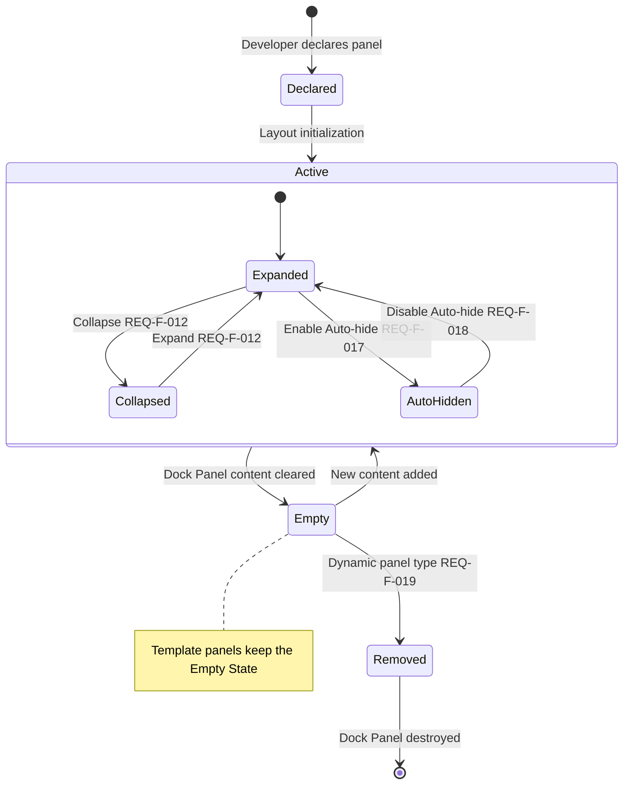
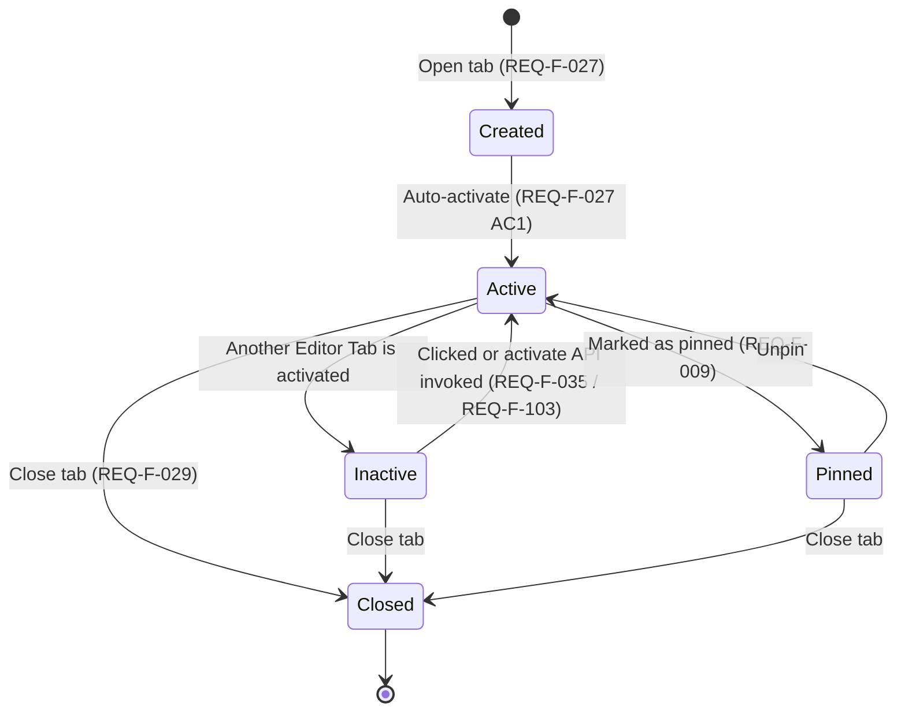
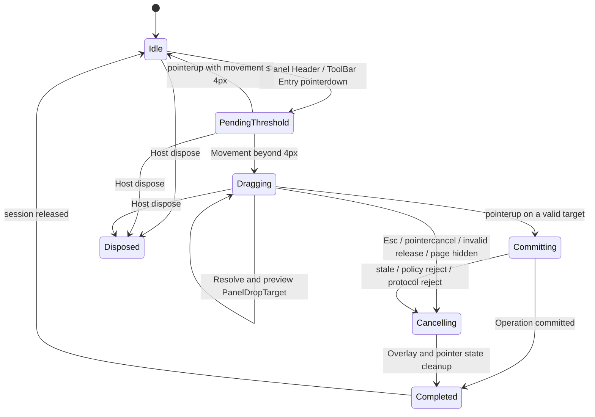

# High-Level Design Specification (HLD)

**Reading Guide**

- **Document nature**: high-level design — describes Atlas's internal architecture, explaining **how** the product behavior defined in [SRS.md](./SRS.md) is implemented.
- **Prerequisite document**: [SRS.md](./SRS.md) (product requirements specification). This document uses exactly the same terminology system as the SRS.
- **If you are an integration developer**: read the SRS only. This document contains framework-internal design details.
- **If you are a framework developer**: this document is the first entry point — understand the architectural skeleton first, then confirm in the SRS the user-behavior details to be implemented.
- **If you are a development agent**: in addition to the SRS and the main body of this document, you must execute the §10 decision gates, contract freeze, and phase acceptance;
  `Designed` does not mean you may bypass an unresolved Open Issue.
- **Design entries**: this document is organized into numbered design entries (`DES-XXX-###`) using the same format as SRS requirement entries. Every design decision is traceable to specific requirements in the SRS.

---

## 1 Design Basis

The following design goals derive directly from the SRS requirement constraints.

| Design Goal | Source (SRS) | Rationale |
|----------|------------|------|
| Spatial structure extensibility | F-001~004, F-049 | The current 9-region layout must not become an architectural constraint — future arbitrarily nested splits must be supported |
| Dock Panel and Editor Tab share infrastructure | F-019, F-145, F-069, F-050~068 | The two are highly isomorphic in behaviors such as open/close/move/dedup/activate; two code paths must not be maintained |
| Documented state changes | F-110~115, F-047 | Layout change events must carry full context and support reset to the initial state |
| Atomicity guarantee | F-133, F-014 | Rapid consecutive operations must be serialized; space reallocation involves multiple Panels — a mid-way failure must not produce inconsistency |
| Persistence/runtime decoupling | F-085~088, F-091~098 | Export/import formats are versioned; runtime model changes must not break existing persisted data |
| High-performance drag | NF-004, F-050~068, F-073~078 | Drag frame rate ≥ 30fps; high-frequency JS-layer preview must not round-trip back to .NET |
| Multi-instance isolation | F-109 | Multiple Layout Instances on the same page must be invisible to one another |
| Adaptive collapse of Dock containers | F-154 | When the side/Bottom Dock has no visible Panel, it collapses automatically, freeing space for the Editor Area |
| Drag drop scaffold | F-155 | Hidden Dock Regions temporarily render a Drop Scaffold as a valid drop target during drag |
| Move operation undo | F-156 | Dock Panel moves across regions can be undone and restored |

### 1.1 Requirements-to-Design Constraints

The SRS is the single specification source for Atlas's user-observable behavior; the HLD explains the state model, module interfaces,
interaction protocols, failure semantics, and verification approach used to implement that behavior. The HLD does not duplicate
Acceptance Criteria, nor may it weaken requirements for implementation convenience.

Every design entry follows the following contract:

1. `Source` lists the SRS requirements the design directly serves; range references must be expandable to actual requirement IDs
2. committed state, derived projection, and transient interaction state must be clearly distinguished
3. all mutations must specify their semantics for success, failure, cancellation, NoChange, and concurrent conflicts
4. designs spanning Core / Blazor / TypeScript must state the state owner and the direction of data flow
5. when a design cannot satisfy conflicting requirements simultaneously, it must be registered as an Open Issue and must not silently choose in the implementation
6. every design entry must be verifiable by at least one layer among Core unit, Blazor component, Interop, or E2E

Requirement traceability uses four status values: `Designed`, `Partial`, `Deferred`, `Open`. `Open` means the SRS is ambiguous or
an ADR/Spike is required to settle the implementation contract; it does not mean the requirement may be skipped.

### 1.2 Known Open Issues

| ID | SRS Basis | Issue | HLD Handling |
|------|----------|------|----------|
| OI-001 | F-069, F-140, F-150, F-155 | The descriptions of Panel drop eligibility across visible Dock Regions, ToolBar, and Drop Scaffold are inconsistent | **Closed**: ADR-0007 adopts ToolBar-first + hidden Scaffold; a visible RegionBody rejects by default |
| OI-002 | F-070, DES-RND-005 | The SRS requires component internal state to be preserved after cross-region moves, but Blazor re-mounting under a different parent cannot guarantee instance identity | **Closed**: ADR-0012 limits the contract to content identity and externalized business state; remount is allowed across Groups |
| OI-003 | SRS §5, Appendix A | The formal requirement block count is 150, but the appendix previously stated 152 | **Closed**: ADR-0014 fixes 150 = F142 + NF8; the appendix has been synchronized with the main text |
| OI-004 | AGENTS.md, DES-PRJ-001 | Target Framework, PackageId, and the project structure need to be unified | **Closed**: ADR-0001/0016/0017 adopt .NET 6.0, dual packages Atlas.Core/Atlas.Blazor, a standalone NuGet consumer sample, and Node 24 LTS + npm; the sample is not part of the dual-package implementation layers and is not added to the main solution |
| OI-005 | SRS Appendix A §3.10 | Edge cases such as F-129 and F-131 previously appeared in indexes/references but had no formal requirement block and AC | **Closed**: ADR-0014 classifies the 9 IDs as non-normative design/test inputs, not counted toward requirement status or coverage |
| OI-006 | NF-006, DES-RND-001 | A Blazor RenderFragment in the same DOM cannot prevent content from accessing other DOM nodes, and ErrorBoundary is not a security sandbox either | **Closed**: ADR-0013 keeps TrustedComponent as the default and clarifies it is not a security sandbox; untrusted content uses SandboxedFrame |

---

## 2 Architecture Overview

```
DES-ARCH-001
Layered architecture
The system is divided into three layers — UI layer (Blazor Components), interaction layer (JS Interop), and core layer (Atlas.Core).
Each layer has clear responsibility boundaries and dependency direction.

┌──────────────────────────────────────────────────────────────────────────────────────┐
│  Blazor UI Layer (Components)                                                        │
│  AtlasWorkspaceHost / SplitNodeView / GroupNodeView / …                              │
│  Read-only rendering + event forwarding only; holds no mutable state                 │
├──────────────────────────────────────────────────────────────────────────────────────┤
│  JS Interaction Layer (Interop)                                                      │
│  Drag preview, Splitter live resize, pointer events → structured intent              │
│  intent                                                                              │
├──────────────────────────────────────────────────────────────────────────────────────┤
│  Core Layer (pure C#, no Blazor dependency)                                          │
│  ┌──────────────────┐ ┌──────────────────┐ ┌──────────────────┐ ┌──────────────────┐ │
│  │   Layout State   │ │ Operation Engine │ │   Persistence    │ │ Content Registry │ │
│  │    (Snapshot)    │ │   (Operation)    │ │   (Serializer)   │ │   (ContentReg)   │ │
│  └──────────────────┘ └──────────────────┘ └──────────────────┘ └──────────────────┘ │
└──────────────────────────────────────────────────────────────────────────────────────┘

The Core layer does not reference Blazor, JSRuntime, or DOM — all layout logic can be unit-tested outside the browser environment.
The JS layer only handles high-frequency interaction geometry and does not directly modify committed state. Blazor components are
read-only projections of the state.

Core project references are limited to the BCL and depend on no UI framework; state changes flow only through the Core-layer
Operation pipeline; Blazor components learn which parts need updating via ChangeSet and do not decide re-rendering on their own.

Source: F-001~004, NF-004, F-109
```

---

```
DES-ARCH-002
Core design idea: immutable aggregate root + atomic operations + read-only projection
All layout state converges into a single immutable aggregate root (WorkspaceSnapshot); changes are committed through atomic
operations (Operation), and the UI is a read-only projection of that aggregate root.

"Layout state" = a complete snapshot of the structure, position, size, activation relationships, and collapse/auto-hide state of
all current Regions, Dock Panels, Editor Views, Editor Tabs, and ToolBar Entries. "Atomic operation" = one Tab open, one Panel
move, one Splitter drag end — an operation either takes effect completely or not at all. "Read-only projection" = Blazor
components do not modify state; they only render the current snapshot into the DOM and forward user interactions to the operation
engine.

This design eliminates the intermediate-state window of "change A first, then B" — no failure leaves residual partially-modified
state. Rendering components learn which parts need updating only via ChangeSet, avoiding invalid full-tree re-renders.

The Snapshot is read-only to consumers; internally it uses immutable collections or copy-on-write. There is no mutation bypass
that "directly modifies Model properties". Rendering components implement ShouldRender based on an explicit projection
dependency stamp.

Source: F-133, F-047, F-110~115
```

---

```
DES-ARCH-003
Boundary rules
The following cross-boundary rules are enforced in all designs:

1. Core must not reference Blazor, RenderFragment, JSRuntime, or DOM types — violating this makes Core untestable in isolation
2. Blazor depends on Core and is responsible for RenderTree, component lifetime, CSS, and JS interop — violating this creates a dependency cycle
3. TypeScript may only submit structured user intent and must not directly modify committed layout state — violating this creates multiple sources of state
4. Application business state must not enter Workspace serialization — violating this leaks runtime objects into persistence
5. Razor components must not directly modify the Snapshot or internal Model — violating this makes bypass mutations untraceable
6. Workspace mutation may only go through IAtlasWorkspace.ExecuteAsync — violating this makes operations untraceable
7. One successful Operation publishes exactly one ChangeSet — violating this causes inconsistent rendering

Each rule corresponds to a known V1 architecture problem — multiple mutation paths, per-element JS registration, runtime object
persistence, and so on. V2 eliminates the possibility of these problems through hard boundary rules.

Rules 5 and 6 are enforced by API design: the Snapshot exposes no mutable collections, and Components hold no handle to mutable
state other than the IAtlasWorkspace reference. Rule 3 is enforced by the versioned interaction protocol: the JS commit payload
is a discriminated union with a fixed schema.

Source: F-109, F-133, NF-006
```

---

```
DES-ARCH-004
State ownership and unidirectional data flow
Atlas divides state into three categories and forbids copying mutable state with the same semantics across categories:

  Committed Domain State (Core)
    WorkspaceSnapshot, Layout Tree, DockItem, Group selection, ToolBar visibility, Auto-hide placement, History, and Revision.

  Derived Render Projection (Blazor)
    ToolBar Entry, visible Panels, Tab headers, CSS track, ARIA attributes, and local render stamps. Projections may be cached,
    but must be rebuildable from the Snapshot + render options alone.

  Transient Interaction State (TypeScript / Host)
    pointer capture, drag session, geometry snapshot, hover/flyout timer, Drop Scaffold, preview, focus request, and
    ResizeObserver invalidation.

The data flow is fixed as:

  user input → TypeScript intent → IAtlasWorkspace.ExecuteAsync
    → WorkspaceSnapshot + LayoutChangeSet → Blazor projection → DOM

TypeScript holds no committed layout copy; Blazor does not write projections back into domain state; Core does not read DOM
geometry. Interaction commits carry a BaseRevision, which Core re-validates before the linearization point, preventing stale
geometry from other operations during a drag from overwriting newer state.

Source: F-100, F-109~115, F-133, NF-004~005
```

---

## 3 Domain Model

```
DES-DOM-001
Mapping SRS concepts to internal models
The product concepts defined in the SRS are expressed in the internal implementation by the following mapping:

| SRS Concept       | Internal Model                         | Notes                                                       |
|------------------|----------------------------------------|-------------------------------------------------------------|
| Layout Instance  | Workspace + WorkspaceSnapshot          | Aggregate root of a Layout Instance                         |
| Region           | LayoutNode (SplitNode / GroupNode)     | Layout tree node; replaces the fixed named Regions         |
| Dock Panel       | DockItem (Kind = Tool)                 | Content item of Tool kind                                   |
| Editor Tab       | DockItem (Kind = Document)             | Content item of Document kind                               |
| Editor View      | GroupNode (Kind = Document)            | Document group container                                    |
| Content Identifier | ContentReference                     | Content renderer kind + business resource identity          |
| ToolBar Entry    | ToolBarProjectionEntry                 | Not stored independently; derived from Tool Item placement  |
| LT / RT          | ToolBarState + ToolBarProjection       | Fixed navigation chrome; not a Dock Region                  |
| Auto-hide State  | AutoHideStripState                     | A committed placement of Tool Items                         |
| Bottom Dock      | SplitNode child of WorkArea            | Expressed through child-node relationships in the Layout Tree |

Dock Panel and Editor Tab share DockItem as the unified content-item model. Their differences are expressed through DockItemKind,
Capabilities, and DockingPolicy; two separate model hierarchies are not maintained. ToolBar Entry is not persisted
independently — it is derived in real time from DockItem ownership relationships, avoiding a second source of truth. LT/RT are
not "panel containers" but navigation entry points — they do not participate in Panel moves (F-020~024).

The ToolBar provides a unified entry point for all Tool Items; it is not the same as the AutoHideStrip. Every Expanded, Collapsed,
and AutoHidden Panel produces exactly one ToolBar Entry; the AutoHideStrip stores only the placement and dock-back bookmark of
AutoHidden Items. ToolBar Entry is render-layer derived data — the WorkspaceSnapshot does not store a ToolBar entry table.
Derived-projection updates are recomputed when triggered by Node/Item/ToolBar updates in the ChangeSet. Fixed named Regions are no
longer a domain type — IDE presets generate the corresponding SplitNode/GroupNode structure through the Layout Tree builder.

Source: §1.7 Spatial Concepts, §1.3 System Architecture, F-020~024, F-149
```

---

```
DES-DOM-002
Workspace aggregate root
WorkspaceSnapshot is the single public snapshot of committed state, read-only to consumers:

  WorkspaceSnapshot = {
      Id,                   // unique identifier of the Layout Instance
      Revision,             // monotonically increasing concurrency version (+1 per successful operation)
      RootNodeId,           // root node of the layout tree (null = empty layout)
      Nodes,                // dictionary of LayoutNodes (SplitNode / GroupNode)
      Items,                // dictionary of DockItems
      ToolBars,             // committed ToolBar visibility per LogicalSide
      ToolBarOrders,        // ToolBar-only ordering; does not change Panel logical order within a Group
      AutoHideStrips,       // Auto-hide strip state (per WorkspaceEdge)
  }

Ownership rules:

1. RootNodeId + Nodes, Items, ToolBars, ToolBarOrders, and AutoHideStrips are committed authoritative state (F-002)
2. ToolBar Entry lists, Item ordering indexes, and similar are derived projections — not persisted and not a second source of truth (F-021)
3. RootNodeId = null is the only representation of an empty layout; EmptyNode is not introduced (F-003; historical edge case F-131)
4. Every open Item must have exactly one placement: a Group or an Auto-hide Strip (F-069, F-017)
5. A newly created Workspace starts with Revision 0; the first successful mutation publishes Revision 1
6. The Snapshot is immutable to consumers; internally, immutable collections or copy-on-write may be used (F-133)

The Snapshot is exposed via IReadOnlyDictionary and IReadOnlyList and exposes no mutable collections.
The internal Store maintains Node/Item indexes for fast Renderer lookups; indexes and the Snapshot are updated atomically.
Revision uses a checked increment and refuses to commit on overflow.

Source: F-001~004, F-109, F-047
```

---

```
DES-DOM-003
Layout Tree (spatial tree)
The fixed 9-region hierarchy tree of SRS §1.3 is expressed internally by the Layout Tree, composed of two sealed node types.

SplitNode — describes the spatial division between two child nodes:
  Axis: InlineChildren (horizontal arrangement) | BlockChildren (vertical arrangement)
  Anchor: when FixedPixels, constrains the First or Second child
  Basis: FixedPixels (pixel value) | Proportional (ratio)
  Constraints: min/max size constraints
  FirstId, SecondId: the two child node IDs

GroupNode — holds an ordered set of DockItems and owns a single committed selection:
  Kind: Tool | Document
  RetentionPolicy: Persistent (template) | Dynamic
  Visibility: Expanded | Collapsed
  ItemIds: ordered list of DockItem IDs
  SelectedItemId: the currently selected Item (null means an empty Group)

Split sizing rules: IDE preset outer tool docks use FixedPixels, while editor-local splits default to Proportional (F-015~016,
F-144). Proportional means the First child takes a ratio of the available space. min/max are expressed by the SplitConstraints
value object (F-015~016, F-078). When the sum of the two children's minimum sizes exceeds the container, the committed basis is
not modified; the Renderer uses a deterministic clamp policy (F-078). A resize drag commits only one history entry on pointerup
(F-074, NF-004).

Spatial tree representation of the SRS 9-region layout:

  Root (Split, BlockChildren)
  ├── TopToolbar Fixed Slot (not in the tree)
  ├── WorkArea (Split, BlockChildren)
  │   ├── MainRow (Split, InlineChildren)
  │   │   ├── LeftDock (Split, BlockChildren)
  │   │   │   ├── GroupNode: Left Dock Upper (Tool, Persistent)
  │   │   │   └── GroupNode: Left Dock Lower (Tool, Persistent)
  │   │   ├── GroupNode: Editor Area (Document, Persistent)
  │   │   └── RightDock (Split, BlockChildren)
  │   │       ├── GroupNode: Right Dock Upper (Tool, Persistent)
  │   │       └── GroupNode: Right Dock Lower (Tool, Persistent)
  │   └── BottomDock (Split, InlineChildren)
  │       ├── GroupNode: Bottom Left Dock (Tool, Persistent)
  │       └── GroupNode: Bottom Right Dock (Tool, Persistent)
  └── StatusBar Fixed Slot (not in the tree)

The Top Toolbar and Status Bar are not in the spatial tree — they are Fixed Slots (fixed decorative regions) and do not
participate in hosting or moving Dock Panels (F-002). Only nodes hosting Dock Panels or Editor Views enter the Layout Tree.
SplitAxis describes child arrangement (Inline/Block), not separator orientation — ARIA separator orientation is derived inversely
by the renderer.

Rendering rules for adaptive Dock container collapse (F-154): when neither the Upper nor the Lower child Group of a side Dock
has an expanded Panel, that side's Dock content column and Splitter are not rendered and the Editor Area receives the freed
space; when neither the Left nor the Right child Group of the Bottom Dock has an expanded Panel, the Bottom Dock row and
Splitter are not rendered; when only one child Group has an expanded Panel, the other empty child Groups are hidden and the
visible child Group fills the container; in all of the above cases the ToolBar Entry is retained (F-021) for re-expansion or the
Auto-hide Flyout.

First release closed hierarchy: only SplitNode and GroupNode are allowed; LeafNode and EmptyNode are not introduced.
SplitAxis.InlineChildren = children arranged along the inline axis; BlockChildren = arranged along the block axis. In the first
release, Collapsed is only allowed for Tool Groups; Document Groups must be Expanded. Auto-hide is an Item placement and does
not share state with Collapsed.

Source: F-001~004, F-049, F-025~026, F-154
```

---

```
DES-DOM-004
Unified Dock Item model
Dock Panel (Tool) and Editor Tab (Document) are unified as DockItem:

  DockItem = {
      Id,                  // unique within the Workspace
      Kind,                // Tool | Document
      Title,               // display title (F-143)
      Icon,                // icon, optional (F-143)
      Content,             // ContentReference (F-006~008)
      Capabilities,        // can close / can move / can pin / can AutoHide / can split
      DocumentState,       // Document-specific state (IsPinned, IsPreview); valid only for Document
  }

Tool and Document share: identity, title/icon, content identity, group ordering, selection, move/reorder, close, and rendering
outlet. Differences are expressed through DockItemKind, kind-specific state, Capabilities, and DockingPolicy.

Capabilities express the stable inherent abilities of an Item (F-036~037, F-009, F-017):
  Tool:            CanClose, CanMove, CanAutoHide
  PermanentTool:   CanMove, CanAutoHide  (CanClose = false)
  Document:        CanClose, CanMove, CanSplit, CanPinDocument
  PreviewDocument: CanClose, CanMove     (CanPinDocument = false)

"Whether it can currently be moved to this target" is computed by the Docking Policy from the Snapshot and the target context;
it is not stored in Capabilities. Capabilities express only the Item's own inherent abilities — avoiding the confusion of "why
Panel A is sometimes movable and sometimes not". DocumentState is valid only for Kind = Document; Tool pin/unpin semantics are
expressed by the Auto-hide mechanism and do not reuse Document pin — avoiding the same field having different semantics under
different kinds.

Capabilities are derived from the runtime definition/provider and do not trust persisted input. Placeholders without a provider
use conservative capabilities (all false). Static factory methods for common presets are provided so developers do not have to
assign values item by item.

Source: F-019, F-145, F-143, F-006~009, F-036~037
```

---

```
DES-DOM-005
Content Reference
ContentReference consists of Kind (renderer kind) and ResourceId (business resource identity):

  ContentReference = {
      Kind,        // which renderer/provider renders it (e.g. "explorer", "document-editor")
      ResourceId,  // current business resource identity (e.g. "main-solution", "42")
  }

Semantics: Kind = who is responsible for rendering; ResourceId = what content is rendered. ContentReference does not contain
title, event callbacks, parameter dictionaries, view models, service instances, or UI occurrence identity.

Multiple DockItemIds may reference the same ContentReference — business shared state is managed by ResourceId, while per-view
state such as cursor/scroll is managed by DockItemId.

Dedup (F-046) uses Kind + ResourceId as the default identity and supports four modes: ActivateExisting (activates the existing
Item without creating a new one), AllowMultiple (allows multiple DockItems to reference the same ContentReference),
ReplaceExisting (keeps the original DockItemId and placement, replacing the ContentReference), and RejectDuplicate (returns a
typed error).

Separating the renderer identity (Kind) from the business resource identity (ResourceId) lets the application layer render
different resources with the same renderer, and different views of the same resource with different renderers, avoiding the
ambiguity of ContentKey assuming both responsibilities in V1.

ContentReference is an immutable value object that rejects null/empty at construction. Dedup decisions are made by
IContentIdentityPolicy, which uses Kind + ResourceId by default. Under AllowMultiple, multiple DockItemIds share a ResourceId —
the application layer manages the shared state itself.

Source: F-006~007, F-046, F-095
```

---

```
DES-DOM-006
Separating Auto-hide from Collapsed
Auto-hide placement is committed state:

  AutoHideStripState = { Edge, Entries }
  where Edge is InlineStart (left) / InlineEnd (right) / BlockEnd (bottom)
  AutoHideEntry = { ItemId, DockBack }
  DockBack = { PreferredGroupId, PreferredIndex, FallbackEdge }

Constraint: Auto-hide accepts only Items with CanAutoHide and Kind = Tool. On restore, the still-existing PreferredGroupId is
used first; when the target has disappeared, the Docking Policy selects or creates a valid Tool Group. The following states are
transient UI state and are not persisted: hover item, flyout open/closed, the 300ms close timer, pointer position, and drag
preview.

A Collapsed Tool Group is committed state: a Collapsed Group remains in the Layout Tree but occupies no normal content space and
receives no hover flyout. A Collapsed Group's ancestor Split keeps its original committed basis as the restore value for
expansion. The Renderer treats the resolved content extent of a collapsed child as 0 and hides the adjacent splitter.

Expanded ↔ Collapsed (F-012) and Auto-hide placement (F-017) are two independent state sets. Collapsed is a Group's visibility
state — the Group remains in the tree but takes no space; Auto-hide is an Item's placement state — the Item is moved out of the
Group onto the strip. Merging these two state sets causes the semantic conflict of "whether a hover flyout should appear after
collapsing".

When restoring from Auto-hide, if PreferredGroupId has disappeared, the Docking Policy selects or creates a Tool Group on
FallbackEdge. Dragging an auto-hidden Item, deleting the original Group, and restore/migration must explicitly update the
bookmark. When all Groups are Collapsed, the Workspace empty-content surface is displayed while recoverable Toolbar entries
continue to render.

Source: F-017~018, F-012, F-154
```

---

```
DES-DOM-007
Strongly typed IDs
All entity identities use strongly typed value types, never bare strings:

  WorkspaceId   — unique identifier of a Layout Instance
  LayoutNodeId  — unique identifier of a layout tree node
  DockItemId    — unique identifier of a content item

Construction rejects null, empty, and whitespace; equality is ordinal; IEquatable<T>, ==, and != are implemented. ToString() is
for diagnostics only and does not serve the serialization protocol. JSON/XML mapping is handled by explicit converters/DTOs.

Bare string IDs make it impossible to distinguish "is this a Node ID or an Item ID" at compile time, provide no guarantee of ID
format validity, and couple the serialization protocol to domain identity. Strongly typed IDs prevent ID confusion at the
type-system level.

Implemented as a readonly struct to guarantee zero heap allocation. Internally stored as a readonly string _value. The DTO layer
uses string, mapped to and from the domain layer through explicit conversions.

Source: F-109, F-028, F-124
```

---

```
DES-DOM-008
Invariants
The following invariants must be validated before every transaction commit. Any failure rolls back the entire transaction,
leaving no partial modifications.

1. Every NodeId is unique
2. Every DockItemId is unique (F-124)
3. The Layout Tree has no cycles
4. Every open DockItem must belong to exactly one Group or one Auto-hide Strip (F-069, F-017)
5. A non-empty Group's SelectedItemId must point to an Item in that Group; an empty Group's SelectedItemId must be null (F-022)
6. A Group contains no duplicate ItemIds
7. Every Item's Kind in a Group must be compatible with the Group Kind; mixed Groups are not allowed in the first release (F-019, F-145)
8. Document Items do not enter the Auto-hide Strip; Collapsed is allowed only for Tool Groups (F-017~018)
9. Split child IDs must resolve and be distinct; the Layout Tree has no shared children
10. A Persistent Group may be empty; a Dynamic Group is automatically deleted when empty (F-019, F-031, F-145)
11. After deleting an empty Dynamic Group, the sibling of a single-child Split must be promoted recursively
12. No failed operation changes the published Snapshot, Revision, or History (F-133)
13. ContentReference kind/resourceId are non-empty; no Strong ID may be default (F-006)
14. RootNodeId = null is the only representation of an empty layout; EmptyNode is not introduced (F-003; historical edge case F-131)
15. At most one ToolBarState per InlineStart / InlineEnd; ToolBarState does not create a third physical side
16. Each ToolBarOrderState references only Tool Items of the same LogicalRegion; the ItemIds are unique and form a complete
    permutation with the placement set; an AutoHidden Item's LogicalRegion resolves through a valid DockBack

Invariants are the last line of defense against state corruption. Each invariant corresponds to a known class of V1 state bugs —
duplicate selection, orphaned Items, half-applied changes, and so on. The Validator runs before every transaction commit and is
tightly coupled with the Operation Planner: the Planner produces a candidate, the Validator validates it, and both share the
same invariant rule engine.

The Validator is a pure function: it takes a candidate Snapshot and returns pass/fail plus a violation list. Topology
normalization runs from leaves to root. When a sibling is promoted, the sibling NodeId is preserved; the original Node,
placement, basis, selection, and visibility of a deleted Split/Group must enter the reverse patch. The Core compatibility matrix
is a closed rule: the first-release Docking Policy may only tighten, never relax, Core invariants.

Source: F-133, F-019, F-031~032, F-069, F-017~018
```

---

```
DES-DOM-009
ToolBar state and derived projection
The ToolBar is the fixed navigation chrome on either side of the Work Area; it is not part of the Layout Tree and is not a
DockItem placement. Each logical side maintains minimal committed state:

  ToolBarState = {
      Side,                 // InlineStart | InlineEnd; mapped by the Renderer to physical Left / Right
      Visibility,           // Expanded | Collapsed
  }

ToolBar Entry is not persisted as an entity. The Renderer builds it through a pure projection function:

  BuildToolBarProjection(snapshot, side) -> ToolBarProjection

  ToolBarProjection = {
      Side,
      Visibility,
      UpperSection: {
          UpperDockEntries,
          LowerDockEntries,
      },
      BottomSection: {
          BottomDockEntries,
      },
  }

  ToolBarProjectionEntry = {
      ItemId,
      SourceGroupId,        // resolved from DockBack.PreferredGroupId when AutoHidden
      LogicalRegion,
      Order,
      Title,
      Icon,
      IsActive,
      DisplayState,         // Expanded | Collapsed | AutoHidden
  }

Projection rules:

1. Every Tool Item must produce exactly one Entry; Document Items produce no Entry
2. Group placement and AutoHide placement are mutually exclusive; when merging projections, dedupe by ItemId and treat duplicates as an invariant failure
3. The Upper / Lower / Bottom sections are determined by the Group semantic slots of the IDE preset, not inferred from DOM positions
4. ItemIds within a Group express Panel logical order; ToolBar-only presentation order is stored in a separate
   `ToolBarOrderState` and does not modify Group ItemIds (F-140 AC2 and F-142)
5. After a cross-side move, Side and section are re-derived from the target placement; title, icon, and click identity remain unchanged
6. Empty logical sections generate no virtual Entries at rest; drag reachability is expressed by the transient PanelDropTarget
7. RTL only swaps the mapping from LogicalSide to physical edges; it does not modify the persisted Side and ordering
8. The ToolBar is not rendered when it has no Entry; when the ToolBar is Collapsed, recoverable entry points are retained and no Entry is deleted

ToolBarProjection is a read model in Core that can be tested as a pure function; Atlas.Blazor is responsible for rendering it
into buttons, separators, and section containers. The projection must not hold DOM references, focus, hover, Flyout open state,
or drag placeholders.

Source: F-020~024, F-140, F-149~153
```

---

```
DES-DOM-010
Size constraints, collapse, and space reallocation
Spatial sizes in the Layout Tree are expressed only by SplitNode; DockItem does not store current pixel sizes directly. The
initial ratios and min/max declared by developers for Panels are converted into stable sizing metadata:

  ToolSizingDefinition = {
      InitialRatio?,        // (0, 1]; used at initialization and Reset
      MinExtent?,           // CSS px, finite and >= 0
      MaxExtent?,           // CSS px, finite and >= MinExtent
      CollapsedExtent,      // collapsed size given by theme/options
  }

  ResolvedSplitLayout = {
      FirstExtent,
      SecondExtent,
      EffectiveConstraints,
      IsClamped,
  }

ToolSizingDefinition belongs to the declaration/runtime definition and is not overridden from untrusted persisted documents.
Current sizes are still stored as SplitBasis; ResetWorkspaceOperation rebuilds the basis from the initial definition. When a Tool
Group has multiple Panels, the sizing definition of the currently Active Item determines the Group's effective constraints;
unspecified values fall back to Group/preset defaults.

Space allocation rules:

1. Expanded → Collapsed does not delete the Group nor rewrite its restore basis; the Renderer sets its resolved content extent to CollapsedExtent and the freed space goes to the sibling
2. Collapsed → Expanded restores the original committed basis; when the container is insufficient, clamp deterministically per min/max
3. After a Dynamic Group is deleted, the sibling is promoted and occupies all of the original Split's available space; the reverse patch preserves the original tree
4. When multiple adjacent visible children need reallocation, distribute proportionally to their original resolved extents; the rounding remainder goes deterministically to the last one
5. When the min sum exceeds the container, the committed basis is not modified; render with the minimum available extent + overflow policy and log a warning
6. When max leaves remaining space, allocate it preferentially to the Editor Area or to siblings below max; no negative sizes or NaN are produced
7. When all Tool Groups are collapsed, the Editor Area may receive the remaining space; ToolBar Entries remain usable
8. The Splitter collapse button and programmatic collapse go through the same SetGroupVisibilityOperation

Container resize, Splitter preview, and the final commit all call the same pure `ResolveSplitLayout` algorithm, avoiding CSS,
TypeScript, and Core each implementing their own clamp rules. Preview uses the same inputs but does not write the Snapshot.

Source: F-014~016, F-033, F-047, F-078, F-082, F-104, F-141, F-144, F-148
```

---

```
DES-DOM-011
Editor Tab ordering, selection, and recently-visited state
On top of GroupNode, a Document Group maintains Editor behavior configuration:

  EditorGroupState = {
      OverflowMode,         // Scroll | Menu | Wrap
      ActivationPolicy,     // Adjacent | MostRecentlyVisited
      RecentlyVisitedIds,   // ItemIds most recently clicked by the user in this Group, newest first
  }

Group.ItemIds is the single Tab logical order. DocumentState.IsPinned forms a stable prefix:

  [Pinned Items...] [Unpinned Items...]

Insertion, drag, and restore must maintain this prefix invariant. A newly created unpinned Tab is inserted into the unpinned
section; when a drag crosses the pin boundary, the target index is clamped into the owning section, and IsPinned is not
implicitly changed by the drag. Pin/unpin is an independent operation that moves the Item to a deterministic position in the
corresponding section upon commit.

Selection planner after closing the Active Tab:

1. When ActivationPolicy = MostRecentlyVisited, select the first item in the MRU that still exists and belongs to the current Group
2. Otherwise, select the new Item at the same index to the right of the closed index
3. When nothing exists on the right, select the last item on the left
4. When the Group is empty, SelectedItemId = null, then keep or delete the Group per RetentionPolicy

"Visit" is produced only by End User clicks on a Tab; programmatic activate, restore, open auto-activation, and close fallback
do not write RecentlyVisitedIds. Invalid MRU references are cleaned up when Items are closed/moved; the list is truncated to the
option cap.

OverflowMode and logical ordering are committed/configured state; which Tabs are currently invisible, scrollLeft, menu open,
and row-collapse measurements are transient render state. DockItem.Title is the single source of the title; custom title
updates publish an Item change through UpdateItemPresentationOperation.

Source: F-034, F-038~040, F-042~045, F-048, F-138
```

---

## 4 Operation Engine

```
DES-OP-001
Operation model
All layout changes are encapsulated as operations (Operation) — an atomic instruction describing "what needs to be done to go
from the current snapshot to the target snapshot". There is no "modify properties one by one" bypass.

The first batch of operations:

  OpenItemOperation              — F-027, F-101 (open Tab/Panel)
  CloseItemOperation             — F-029, F-102 (close Tab/Panel)
  SelectItemOperation            — F-035, F-103 (activate Tab/Panel)
  MoveItemOperation              — F-069, F-140 (cross-region Panel move)
  ReorderItemOperation           — F-142, F-151 (reorder within a region)
  SplitItemOperation             — F-049, F-055 (split / directional docking)
  ResizeSplitOperation           — F-073~078 (Splitter drag resize)
  SetGroupVisibilityOperation     — F-012, F-104 (collapse/expand)
  SetAutoHideOperation           — F-017 (enable Auto-hide)
  RestoreAutoHiddenItemOperation — F-018 (disable Auto-hide)
  UpdateItemPresentationOperation — F-143 (update title/icon)
  ReplaceContentReferenceOperation — F-006 (replace content reference)
  ResetWorkspaceOperation        — F-047 (reset layout)
  RestoreWorkspaceOperation      — F-086, F-092, F-097 (restore/import layout)

The effect of a user operation in the SRS often spans multiple entities. For example, closing an Editor Tab (F-029) involves
removing the Tab + activating another Tab per policy + removing the View if it was the last Tab of a Dynamic View + reallocating
space if the View is removed. Modifying properties one by one would produce inconsistency when an intermediate step fails. The
Operation pattern guarantees "all succeed or all roll back".

The convenience APIs OpenToolAsync / OpenDocumentAsync are operation facades and create no bypass. All operations are immutable
value objects. Adding a new operation type requires no changes to existing operation logic — the Planner dispatches by operation
type.

Source: F-027~029, F-069, F-049, F-073~078, F-012, F-017, F-047, F-086
```

---

```
DES-OP-002
Transaction Pipeline
Operation execution flow:

  API call → build a Candidate Snapshot from the current Snapshot
    → run Guard (e.g. the close-before callback F-041) ── rejected → return failure; current state unchanged
    → run Validator (checks all invariants, size constraints, dedup conflicts)
    → atomic replacement: old Snapshot → new Snapshot (Revision + 1)
    → publish Changed event (F-110~115)

Commit contract:

1. Build the candidate Snapshot, forward/reverse patch, candidate History, and ChangeSet from the current Snapshot
2. Run full invariant validation on the candidate (F-133)
3. The atomic replacement of Snapshot + History is the single linearization point (F-133)
4. Revision increases monotonically on every successful Execute/Undo/Redo/Restore commit; Undo does not roll back Revision
5. failed/no-op/cancelled/stale operations do not swap state, do not increment Revision, and publish no events (F-133)
6. Changed events are published outside the lock; subscriber exceptions are isolated and logged one by one and do not block subsequent subscribers (F-110)
7. Re-entrant ExecuteAsync from a subscriber may commit a new Revision, but the new events are queued after all subscribers of the current event

Key design: Guard (possibly async) runs outside the transaction; Validator and the state swap complete inside a short
transaction. This avoids the deadlock and ABA problems of "awaiting a consumer callback while holding the lock". Changed is
published outside the lock, preventing re-entrant operations in subscribers from blocking each other with the current
transaction.

Internal commits use WorkspaceStoreState (Snapshot + History replaced as one atomic reference). The event dispatcher makes no
SynchronizationContext promise to consumers; the Blazor Host marshals to the renderer context via InvokeAsync. ExecuteAsync
success depends only on the commit, not on whether subscribers succeed.

Source: F-133, F-041, F-110~115
```

---

```
DES-OP-003
Async Guard (close-before callback)
Close/save confirmation may be asynchronous (F-041). The first release uses a strict Workspace Revision to prevent ABA problems:

  1. run the async guard outside the transaction
  2. record BaseRevision before the guard
  3. enter a short transaction after the guard completes
  4. if current Revision ≠ BaseRevision, return StaleOperation without automatically retrying the guard
  5. build and atomically apply the patch
  6. publish one change set

Executing guards, providers, migration hooks, or any consumer callback inside the Workspace lock is forbidden. Two concurrent
Closes must not silently trigger two save/confirmations — the second call should share the existing decision or return a typed
conflict. The first release uses a strict Revision rather than entity-level versions, prioritizing simplicity and verifiability.

Guard interface: IDockItemCloseGuard.CanCloseAsync(DockItemCloseContext, CancellationToken). The domain does not hold delegates;
the application associates guards with Content Kinds or Items through DI/registration. An in-flight coordinator keyed by
operation/session guarantees that a CloseItemOperation runs its guard at most once. Cancellation takes effect only before the
linearization point; after the state swap, the real committed result must be returned.

Source: F-041, F-029
```

---

```
DES-OP-004
Reversible Patch
Every successful operation generates both a forward patch and a reverse patch. History does not understand business semantics
such as Open, Move, or Split — it understands only patch steps:

  ForwardPatch  = the change steps from the current Snapshot to the target Snapshot
  ReversePatch  = the change steps from the target Snapshot back to the current Snapshot

First-release patch step types:
  ReplaceRoot(expectedBefore, after)
  ReplaceNode(nodeId, expectedBefore, after)
  ReplaceGroupItems(groupId, expectedBefore, after)
  ReplaceItem(itemId, expectedBefore, after)
  ReplaceAutoHideStrip(edge, expectedBefore, after)

Every step carries an expected-before and addresses state by stable IDs, never relying on bare indexes that earlier steps might
change. Reverse is derived automatically from the before/after of the same steps.

Move example (corresponding to F-069):
  Forward:
    1. remove item-x from Group A
    2. restore Group A's selected item
    3. insert item-x into Group B
    4. Group B selected = item-x
    5. clean up empty Dynamic Group A (if applicable)
  Reverse:
    1. rebuild Group A and its original placement if necessary
    2. remove item-x from Group B
    3. insert item-x back into Group A at its original position
    4. restore the original selected item of Group A / Group B
    5. restore the cleaned-up Split/Group topology

Patch steps carry an expected-before — if the current state does not match the expected-before, a concurrent modification or
bug exists and the application should be rejected (fail-fast). This avoids the silent state corruption in V1 caused by undo
restoring from a stale snapshot.

All steps apply only to a private candidate builder; intermediate states are never published. Patches must pass a round-trip
invariant test: apply forward, then apply reverse, and the snapshot must be semantically equivalent to the initial one. The
Operation Planner generates both Forward and Reverse together — two independent hand-written logic paths are not used.

Source: F-133, F-069, F-156
```

---

```
DES-OP-005
Undo / Redo
Undo/Redo rules:

1. Only successfully committed patches enter history
2. Undo = execute the ReversePatch (producing a new Revision); Redo = execute the ForwardPatch (F-156)
3. failed/cancelled/no-op/stale operations do not enter history
4. A new operation after Undo clears the redo branch
5. Restore/Reset are explicit history barriers — by default they commit a new empty History together with the Snapshot (F-047, F-086)
6. A resize drag commits only one history entry on pointerup (F-074)
7. Consecutive keyboard resizes are coalesced by (SplitNodeId, input kind) and a configured time window
8. History has an entry-count cap; the oldest entries are evicted when the cap is exceeded
9. When a single entry exceeds the byte budget, the operation may still commit but becomes a history barrier

Undo/Redo guarantee only committed Workspace layout state; they do not undo consumer saves, file handles, business stores, or
the side effects of already-executed guards. Close Undo re-resolves content through the ContentReference and allows remounting —
this is more reliable than trying to restore a disposed component instance.

History options: MaxEntries (default 100), ApproximateMaxBytes, ResizeCoalescingWindow (default 500ms). A new operation first
clears the redo branch, then evicts starting from the oldest undo entry. When a single entry exceeds the byte budget, success
is returned with a HistoryNotRecorded warning; old entries must not masquerade as undoable on top of new state.

Source: F-156, F-047
```

---

```
DES-OP-006
IAtlasWorkspace public interface and LayoutChangeSet
Public interface:

  public interface IAtlasWorkspace : IAsyncDisposable
  {
      WorkspaceId Id { get; }
      WorkspaceSnapshot Current { get; }
      bool CanUndo { get; }
      bool CanRedo { get; }
      event EventHandler<WorkspaceChangedEventArgs>? Changed;
      ValueTask<WorkspaceResult<LayoutChangeSet>> ExecuteAsync(
          LayoutOperation operation, CancellationToken cancellationToken = default);
      ValueTask<WorkspaceResult<LayoutChangeSet>> UndoAsync(
          CancellationToken cancellationToken = default);
      ValueTask<WorkspaceResult<LayoutChangeSet>> RedoAsync(
          CancellationToken cancellationToken = default);
  }

LayoutChangeSet is the renderer's precise, targeted invalidation input (F-110), containing AddedNodes / RemovedNodes /
UpdatedNodes, AddedItems / RemovedItems / UpdatedItems, UpdatedToolBars / UpdatedToolBarOrders / UpdatedAutoHideStrips,
BeforeRevision / AfterRevision, and ChangeKind. The collections carry only stable IDs/sides — never RenderFragment or DOM
references.

Typed result (WorkspaceResult<T>): when Succeeded is true, Value is always present; when false, Error is always present. A
valid operation with no semantic change returns a NoChange result (empty ChangeSet, not entering History, not incrementing
Revision, not raising Changed).

Expected failures (item not found, target not found, target rejected by policy, duplicate content identity, close cancelled,
stale operation, invalid restore document) return typed results. Programming errors and unexpected failures keep the exception
and full logging context.

WorkspaceSnapshot is immutable to consumers. The internal implementation may use copy-on-write, structural sharing, and lookup
indexes, but must not expose mutable collections in the public API. The Workspace owns the Core state, history, the in-flight
guard coordinator, save-queue cancellation, and its own events; DOM listeners, the JS controller, DotNetObjectReference, and
transient view state are owned by AtlasWorkspaceHost.

DisposeAsync must reject new operations, cancel guard/save waits that have not yet reached the linearization point, wait for
current callbacks/notifications to drain, and guarantee that no Changed is published after it returns. Dispose does not save
implicitly; consumers that need persistence call FlushAsync explicitly first. WorkspaceError provides a stable Code, the
Operation kind, and optional Node/Item IDs; user-displayable messages are separated from the internal exception/stack.

Source: F-110~115, F-101~103
```

---

```
DES-OP-007
Tool Panel move, reorder, and ToolBar operation contract
Panel Headers and ToolBar Entries can trigger different semantics; a single untyped reorder based only on the final index is
not acceptable:

  MoveToolOperation
    ItemId, TargetGroupId, TargetIndex?, BaseRevision
    — cross-Group/Region move; the target Panel expands and becomes Active

  ReorderItemOperation
    ItemId, GroupId, TargetIndex, BaseRevision
    — reorder within the same Group via Panel Header; adjusts Group.ItemIds and synchronizes the order within the ToolBar section

  ReorderToolBarEntryOperation
    ItemId, LogicalRegion, TargetIndex, BaseRevision
    — adjusts only ToolBarOrderState; does not change Group.ItemIds or Panel placement

  SetToolBarVisibilityOperation
    LogicalSide, Visibility
    — collapse/expand LT or RT; does not delete Entries

MoveToolOperation planning order:

1. Validate BaseRevision, Item existence, Kind = Tool, CanMove, and the target Tool Group
2. Capture the source Group/Strip, source index, DisplayState, Active state, DockBack, and the source/target ToolBar order
3. Remove the Item from its source placement; handle empty Groups and ancestor Split normalization per RetentionPolicy
4. Insert at a deterministic position in the target Group; when no index is specified, append to the end of the target logical order
5. Convert the Item to Expanded and set it as the target Group.SelectedItemId
6. Convert the target's previous Active Item to non-Active; its committed DisplayState is handled per the SRS Panel-switching rules
7. Update ToolBarOrderState; on a cross-side move, remove from the source-side section and insert into the target-side section
8. Generate the forward/reverse patch, validate all invariants on the candidate, then commit atomically

NoChange is returned when the original position, the same index, or resolver normalization leaves the semantics unchanged.
Fixed Regions, Document Groups, nonexistent targets, CanMove = false, and policy rejections return typed failures; none of them
increment Revision, write History, or publish events. One successful move publishes exactly one ChangeSet, containing the Item
placement, source/target Group selection, ToolBar projection invalidation, and any topology change.

The reverse patch must restore the source placement/index, source DisplayState/Active, the target's previous
Active/DisplayState, ToolBarOrderState, DockBack, any removed Dynamic Group, any promoted sibling, and the related Split bases.
Undo does not re-run the docking policy, nor does it guess the source state from the current UI.

Source: F-022, F-069~071, F-140, F-142, F-151, F-156
```

---

```
DES-OP-008
Declarative layout definitions and atomic Reconciliation
Atlas.Blazor declarative child components only collect an immutable definition; they do not create or modify the Workspace
directly:

  AtlasWorkspaceDefinition = {
      WorkspaceId,
      FixedSlots,
      ToolDefinitions,
      DocumentGroupDefinitions,
      SplitDefinitions,
      Options,
  }

After declaration collection completes within a render batch, the Host generates a DefinitionRevision and calls the Core
ReconcileDefinitionOperation. Inside the candidate, Core performs ID/ContentReference validation, IDE preset Layout Tree
construction, initial selection, initial sizing, and ToolBar order; everything is committed in one go once all succeed.

When the first definition is empty, an empty Workspace with RootNodeId = null is created, and Blazor renders a drop-accepting
empty surface without errors. Later parameter changes are diffed by stable declaration identity: additions/updates/removals
must form a single ChangeSet; Razor children are not allowed to perform item-by-item mutations in Dispose/OnParametersSet that
would cause half-updates.

When a declared definition conflicts with restored data, an explicit InitializationPolicy is used:

- DefinitionOnly: use only the declaration
- RestoreIfAvailable: after a successful restore, the document is the committed state; on failure, fall back to the declaration
- MergeDefinitions: only the runtime definition may supplement presentation/capabilities; restored topology is not modified

The InitialDefinition is saved by the Workspace as the reset blueprint. ResetWorkspaceOperation re-runs the same builder,
restoring the F-144 InitialRatio, default selection, and ToolBar order; the "initial state" is never reverse-engineered from
the current Snapshot. Duplicate declaration identity, illegal sizes, and incompatible Group kinds return typed failures,
leaving the original Workspace unchanged.

Source: F-001~005, F-010, F-047, F-099~100, F-122, F-144
```

---

```
DES-OP-009
Command, Query, and domain event interfaces
The convenience commands for Application Developers are facades over IAtlasWorkspace and are all converted into operations:

  OpenDocumentAsync / CloseItemAsync / ActivateItemAsync
  SetToolVisibilityAsync / SetToolBarVisibilityAsync
  SavePresetAsync / ApplyPresetAsync / DeletePresetAsync

Close/Activate return an `ITEM_NOT_FOUND` typed result when the Item does not exist, without throwing. SetToolVisibility maps
visible to Expanded and hidden to Collapsed; it uses the same operation as the Panel Header, ToolBar Entry, and Splitter
collapse button.

Queries do not enter the mutation pipeline:

  TryGetItem(DockItemId) -> DockItemSnapshot?
  EnumerateItems(ItemQuery) -> immutable result

Custom predicates execute outside the lock as `WorkspaceSnapshot` extensions; Core never calls consumer delegates inside the
lock. ActivateFirstAsync first resolves the ItemId from an immutable Snapshot, then executes SelectItemOperation with that
Revision; concurrent changes return STALE_OPERATION instead of silently activating another matching item.

A successful operation first publishes the generic Changed, then derives strongly typed domain events from the same
LayoutChangeSet:

  ItemOpened, ItemClosed, ItemActivated, ToolCreated, ToolRemoved, WorkspaceRestored

Each event carries WorkspaceId, ItemId, Before/AfterRevision, ChangeKind, and the necessary previous/current placement; it
never carries a mutable model. An Item triggers each event type at most once per ChangeSet. Subscribers are invoked outside
the lock, in subscription order, from the dispatcher queue; exceptions are isolated and logged without changing the command
result. NoChange, failed, and cancelled operations publish no domain events.

Source: F-030, F-101~104, F-106~115, F-121, F-141, F-146
```

---

## 5 Interaction Architecture

```
DES-INT-001
JS / .NET Boundary Split
Interaction processing flow:

  User input (pointer/keyboard)
    ↓
  JS layer (high-frequency, real-time processing)
    - Drag preview rendering (F-051)
    - Splitter live dragging (F-073, F-077)
    - Dock indicator region highlighting (F-063~064)
    - Direction/position determination (F-052~053)
    - ToolBar drop preview (F-150~151)
    ↓ When the interaction completes, a structured intent is sent
  Core layer (.NET)
    - Validity checks, Docking Policy
    - Construct Operation → commit (F-133)
    ↓
  Blazor layer (read-only rendering)
    - Update the DOM from the new Snapshot + ChangeSet

JS is responsible for: pointer capture, drag threshold, root-scoped source/target DOM lookup,
geometry snapshot, target intent resolution, preview/indicator/overlay, scroll/resize/visibility
cancellation, requestAnimationFrame-coalesced visual writes, commit/cancel callbacks.

.NET is responsible for: ID and target validation, Tool/Document docking policy, topology mutation,
committed selection and Group visibility, auto-hide placement, history, persistence, public events.

Division of labor: JS handles interaction geometry (high-frequency, stateless), .NET handles layout
semantics (low-frequency, stateful). .NET is never called back during pointermove — this directly
determines whether NF-004 (30fps) is achievable.

The JS commit payload is a discriminated union with a fixed schema: DockItemCommit /
ResizeSplitCommit / AutoHideCommit. When an interaction is cancelled (Esc, window resize, browser
Tab moved to background), JS clears all previews and sends no commit. The checked-in protocol
schema/golden fixtures are read by both C# and TypeScript tests.

Source: NF-004, F-050~068, F-073~078
```

---

```
DES-INT-002
Root-Level Interaction Controller
Each interactive Host registers exactly one root-level JS controller; in the first release, a
Workspace binds to at most one interactive Host.

The DOM is described via data-atlas-* metadata:
  <button data-atlas-drag-kind="tool-panel" data-atlas-item-id="explorer">
  <section data-atlas-drop-target="group" data-atlas-group-id="left-tools">

TypeScript resolves source and target via closest() and does not attach a separate listener to
every element. All lookups are scoped to the controller root, and the hostId that owns the metadata
is validated.

Controller session state machine:
  Idle → PendingThreshold → Dragging → Committing/Cancelling → Completed
                                                      ↘ Disposed

Each session may undergo exactly one terminal transition. pointercancel, lostpointercapture,
Escape, page visibility/pagehide, source disconnect, a second pointer, root disposal, and rejected
.NET promises must all be handled.

This replaces the per-element drag handler registration pattern of V1, where Tab, ToolBar Entry,
Panel Header, and Drop Target each attached/detached JS handlers, causing scattered lifecycles,
memory-leak risk, and duplicated drag session logic.

attachWorkspaceAsync registers atomically by WorkspaceId and HostId; a second interactive attach
for the same Workspace returns a typed failure. After controller dispose completes, the registry
holds no HostId, document/window listener and observer counts are restored, all pointer sessions
are terminal, all overlays are removed, and subsequent promise/observer callbacks never reach
.NET. Interaction sessions of multiple Workspaces are isolated from each other; no global singleton
is used.

Source: NF-004, F-109
```

---

```
DES-INT-003
Drag & Drop Model
Two drag models coexist in parallel with different behaviors.

Editor Tab drag docking (F-050~068):
- Divides the target Editor View area into 5 hit zones: the edge 25% is the directional docking
  zone (top/bottom/left/right), and the central 50%×50% is the center docking zone
- Center docking (F-058): the dragged Tab is appended to the end of the target Editor View's Tab
  list
- Directional docking (F-055): a new split Editor View is created on the corresponding side of the
  target Editor View
- A Dynamic View that is dragged empty is removed automatically (F-061); a Template View remains
  empty (F-062)

Dock Panel drag move (F-069, F-150~153, F-155):
- No directional distinction — a target only expresses a logical Region and an insertion index, and
  no split is created
- ToolBar Entry, ToolBar logical slot, Drop Scaffold, and Dock Region Body share one unified target
  description
- Which target surfaces are enabled by default is decided by PanelTargetPolicy; Fixed Regions are
  always invalid
- An insertion preview is shown inside the ToolBar (a highlight block pushes adjacent entries
  apart); logical regions (Upper/Lower/Bottom) act as valid drop slots
- Drop Scaffold (F-155): a hidden Dock Region temporarily renders a drop scaffold during a drag so
  an empty Region can receive a dropped-in Panel
- Fixed Regions (Editor Area, Top ToolBar, Status Bar) do not accept Dock Panel drops (F-071)

Editor Tab dragging requires directional determination (split direction); Dock Panel dragging does
not (Tools do not participate in splitting). The two models must not be mixed — dragging a Dock
Panel into the Editor Area must not pop up a directional indicator, and dragging an Editor Tab onto
the ToolBar must not show logical region slots.

The JS layer distinguishes the two drag types via the value of data-atlas-drag-kind
("tool-panel" vs "document-tab"). Document docking intents use the DockingZone enum
(Center/Before/After/InlineStart/InlineEnd/BlockStart/BlockEnd) instead of the ambiguous Left/Right.
Panel drop intents use PanelDropTarget and do not reuse DockingZone.

ADR-0007 has closed OI-001: the Target Resolver recognizes ToolBar, Scaffold, and RegionBody; the
default PanelTargetPolicy enables only PanelHeaderInsertion, ToolBarInsertion, ToolBarRegion, and
hidden-Region Scaffolds; a visible RegionBody remains recognizable but is rejected by default. Hit
priority is PanelHeaderInsertion > ToolBarInsertion > ToolBarRegion > DropScaffold. Fixed Regions
and other Hosts never produce valid targets.

Source: F-050~068, F-069, F-150~153, F-155, F-071
```

---

```
DES-INT-004
Performance Invariants
The following are hard performance constraints that must never regress:

1. 0 JS → .NET calls during pointermove (browser devtools profiling)
2. At most 1 notification per drag start; at most 1 notification per commit/cancel (interaction
   tests)
3. During a resize drag, pointermove only updates the preview; the Workspace operation is committed
   on pointerup (interaction tests)
4. The same resolved intent never mutates the DOM twice (DOM mutation observer)
5. Geometry is rebuilt only after drag start or invalidation (interaction tests)
6. Controller dispose cleans up all listeners, observers, overlays, and DotNet references in one
   pass (unit tests)
7. Interaction sessions of multiple Workspaces are isolated (multi-instance tests)
8. Post-dispose callback count of a disposed host = 0 (unit tests)

These invariants form the core performance contract of the V2 interaction architecture. Violating
any one of them means the architecture has regressed to the V1 pattern — per-event .NET callbacks,
listener leaks, and so on. Each invariant must have a corresponding automated assertion in CI.

Invariants 1–3 are enforced by the JS controller's session state machine. Invariants 4–5 are
guaranteed by requestAnimationFrame-coalesced visual writes. Invariants 6–8 are covered by
controller dispose + workspace isolation unit tests.

Source: NF-004, NF-005
```

---

```
DES-INT-005
Panel Drag Session and Commit Protocol
Panel dragging is managed by the root-scoped Interaction Controller; a Workspace has at most one
active pointer session at a time:

  Idle → PendingThreshold → Dragging → Committing | Cancelling → Completed
                                                \→ Disposed

pointerdown is handled by a pre-loaded native listener, which calls setPointerCapture
synchronously in the original event call stack. Dragging is entered only after the primary pointer
moves more than 4px; a pointerup within the threshold is still treated as a click. A second
pointer, non-primary buttons, and Fixed Region sources do not start a session.

  PanelDragSession = {
      SessionId,
      WorkspaceId,
      HostId,
      PointerId,
      ItemId,
      SourceKind,           // PanelHeader | ToolBarEntry
      SourceGroupId,
      SourceIndex,
      BaseRevision,
      GeometrySnapshot,
      CurrentTarget,
  }

pointermove performs hit tests only within TypeScript and coalesces preview writes via
requestAnimationFrame. When pointerup hits a valid target, at most one commit is sent to .NET:

  PanelDropIntent = {
      ProtocolVersion,
      SessionId,
      WorkspaceId,
      HostId,
      ItemId,
      SourceKind,
      BaseRevision,
      TargetKind,
      TargetGroupId,
      LogicalRegion,
      InsertionIndex,
  }

An Intent carries no DOM references, coordinates, Panel objects, DisplayState results, or
"target is valid" flags. The Host first validates protocol/session/workspace, then converts it into
a DES-OP-007 operation; Core must re-validate Revision, identity, capability, target, and policy.
A STALE_OPERATION or policy rejection is treated as a rejected commit: transient UI is cleaned up
and the latest Snapshot is re-rendered, without auto-replay or redirection to an approximate
target.

Escape, pointercancel, lostpointercapture, pagehide, visibility hidden, root/source disconnect,
resize invalidation that cannot safely rebuild geometry, Host dispose, or release at an invalid
position all cancel the session. Cancellation only cleans up interaction state; it does not call
ExecuteAsync and does not publish a layout event. Each session has exactly one terminal transition;
late promises/callbacks are discarded via SessionId + Host generation.

Source: F-068~071, F-133, F-140, F-142, F-147, F-153, NF-004
```

---

```
DES-INT-006
Panel Target Resolver, Drop Scaffold, and Preview
The Target Resolver is a pure-function module that takes GeometrySnapshot + pointer position +
current target as input and outputs a stable PanelDropTarget:

  PanelDropTarget = {
      Kind,                 // PanelHeaderInsertion | ToolBarInsertion | ToolBarRegion |
                            // DropScaffold | RegionBody
      LogicalSide,
      LogicalRegion,
      TargetGroupId,
      TargetItemId?,         // ToolBar Entry target identity
      InsertionIndex,
      Priority,
  }

After filtering by SourceKind, hit priority is PanelHeaderInsertion > ToolBarInsertion >
ToolBarRegion > DropScaffold > RegionBody. The DOM of the Editor Area, Top Toolbar, Status Bar, and
other Workspaces never produces a PanelDropTarget. Semantically identical targets must be
normalized to the same key even when hit through overlapping DOM, to avoid preview jitter and
duplicate DOM mutations.

Panel Header reordering within the same Group must hit the before/after zones of the target ToolBar
Entry. The resolver provides both the ToolBar wire InsertionIndex and TargetItemId in the intent;
the Host uses only the wire slot to determine before/after relative to the target Entry, then maps
TargetItemId to the logical index in Group.ItemIds, commits a ReorderItemOperation, and syncs the
ToolBar projection. Using the ToolBar wire index directly as a Group index is prohibited. Dropping
at the Entry's original position resolves to NoChange; ToolBar Region/DropScaffold within the same
Group do not perform Panel logical reorders. This interaction is compatible with AtlasGroupView's
model of projecting only one Active Panel Header; multiple simultaneously visible Headers are not
required.

ToolBar resolver rules:

1. Entry before/after uses a hysteresis midline threshold; CurrentTarget is kept while the pointer
   is in the ambiguous middle
2. Adjacent Entry pairs sharing a boundary must resolve to the same insertion index
3. The bottom of the last Entry and the virtual trailing slot resolve to the same trailing index
4. Dividers are not part of the geometry target set
5. Empty Upper/Lower/Bottom slots provide a hit area of at least one Entry's size only while
   Dragging
6. ToolBar-only reorders and Panel logical reorders are explicitly distinguished by SourceKind +
   TargetKind

The Workspace Host provides a dedicated atlas interaction overlay root on first render. TypeScript
creates previews, placeholders, indicators, and Drop Scaffolds only inside this container and never
modifies the structural DOM managed by Blazor. Scaffolds are generated from the geometry of
predefined Region anchors; they do not expand real Groups or modify Split basis. Drag
terminal/dispose must clear the overlay root in one pass.

The GeometrySnapshot is built at drag start; scroll, ResizeObserver, device scale, or DOM topology
changes mark it invalid. It is re-snapshotted when it can be safely rebuilt within the same
animation frame; otherwise the session is cancelled. The target registry resolves against an
immutable array snapshot; registering/unregistering the same collection during enumeration is
prohibited.

Source: F-069, F-071, F-148, F-150~155, NF-004~005
```

---

```
DES-INT-007
Splitter Advanced Interaction and Control
Each SplitNodeView renders a SplitterProjection:

  SplitterProjection = {
      SplitNodeId,
      Orientation,
      IsLocked,
      CanCollapseFirst,
      CanCollapseSecond,
      CssClass,
      ResolvedPosition,
  }

The native pointerdown listener first checks IsLocked; when locked, it does not setPointerCapture,
does not create a resize session, and renders the locked visual / aria-disabled=true. When
unlocked, a ResizeSession saves the pointerdown anchor, container extent, start basis, constraints,
and BaseRevision. pointermove calls the same ResolveSplitLayout used by DES-DOM-010 to produce a
CSS preview, and pointerup commits exactly one ResizeSplitOperation.

Double-click uses EqualizeSplitOperation; the collapse button uses SetGroupVisibilityOperation and
never changes basis directly in Razor. After collapsing, the SplitNode retains the restore basis
and the button switches to expand semantics. If the corresponding child is not collapsible or has
been removed by topology normalization, a NoChange/typed stale is returned and the new sibling is
not affected.

The Splitter itself is keyboard-focusable and uses role="separator". Arrow keys adjust by
SplitterOptions.KeyboardStepPixels according to orientation; Home/End move to the valid min/max;
consecutive key repeats are coalesced into a single History entry within ResizeCoalescingWindow.
Every keyboard adjustment still commits a ResizeSplitOperation and syncs aria-valuenow/min/max —
no CSS-only bypass is established.

Custom styling accepts only a developer-provided list of CSS class tokens; tokens that are invalid
beyond whitespace separation are rejected, and arbitrary style strings are never written to the
DOM. Atlas reserves structural classes such as hit target, cursor, focus ring, locked, and
dragging; custom classes may only be added, never remove accessibility states.

When the container resizes, the active ResizeSession is cancelled per DES-INT-005; at rest, the
resolved position is recomputed without changing the committed basis. IsLocked, collapse
capability, and custom classes come from the runtime definition; a persisted document cannot grant
additional capability.

Source: F-073~078, F-080~082, F-104, F-148, NF-003~004, NF-007
```

---

```
DES-INT-008
Keyboard Commands, Focus Navigation, and Shortcut Configuration
AtlasWorkspaceHost handles keyboard events at the root level and maps them to semantic commands via
KeyboardCommandMap:

  NextDocumentTab       Ctrl+Tab
  PreviousDocumentTab   Ctrl+Shift+Tab
  CloseActiveDocument   Ctrl+W | Ctrl+F4
  FocusToolInlineStart  Alt+ArrowLeft (LTR)
  FocusToolInlineEnd    Alt+ArrowRight (LTR)
  FocusToolBlockStart   Alt+ArrowUp
  FocusToolBlockEnd     Alt+ArrowDown

Shortcuts are configured with KeyboardChord (code + ctrl/alt/shift/meta), not localized key text.
Under RTL, directions are first converted to logical direction before resolving ToolBar/Group.
Developer overrides are validated at Host initialization: conflicts within the same scope return a
configuration error; unconfigured commands may be disabled; Atlas never overrides
browser/OS-reserved combinations.

Command scopes:

1. Ctrl+Tab traverses only the ItemIds of the current Active Document Group, skipping unavailable
   items
2. Close uses CloseItemOperation and fully executes CanClose and the async guard
3. Tool focus selects a visible Tool Group by Layout Tree geometric adjacency and logical
   direction; if the target is collapsed, its most recent/selected Item is activated first, then
   content focus is requested after the ChangeSet
4. Events originating from input/textarea/select/contenteditable are not intercepted unless the
   chord is explicitly declared global
5. With no valid target, preventDefault is not called and NoChange is returned

Focus is not part of WorkspaceSnapshot. The Host maintains a one-shot FocusRequest(ItemId,
AfterRevision) that executes only after the outlet of the corresponding revision has finished
rendering; a new operation, Item removal, or Host dispose cancels the old request. Tab/ToolBar/
ContextMenu must also support the standard Tab/Shift+Tab, Enter, Space, and Escape keyboard
semantics and cannot rely solely on global shortcuts.

Source: F-035, F-041, F-116~118, NF-003, NF-007
```

---

## 6 Content Rendering

```
DES-RND-001
ContentTemplate (Default Path)
Application Developers define content rendering through ContentTemplate — this is the default,
recommended path:

  <AtlasWorkspaceHost Workspace="@_workspace">
      <ContentTemplate Context="content">
          <WorkspaceContent Content="@content" />
      </ContentTemplate>
  </AtlasWorkspaceHost>

The application's routing component dispatches to concrete business components based on
Content.Reference.Kind:

  @switch (Content.Reference.Kind)
  {
      case "explorer":
          <SolutionExplorer State="@ExplorerStore.Get(Content.Reference.ResourceId)" />
          break;
      case "document-editor":
          <DocumentEditor State="@DocumentStore.Get(Content.Reference.ResourceId)" />
          break;
  }

This path provides compile-time parameter checking, compile-time EventCallback checking, Razor
language tooling, no string parameter names, and no reflection-based parameter map — compared with
the V1 DynamicComponent + Dictionary<string, object?> path, it eliminates all runtime binding
risks.

ContentTemplate is a Blazor RenderFragment<AtlasContentContext> template. Inside the template, the
application dispatches by Kind via a switch or dictionary; DynamicComponent is not mandatory.
Content resolution order: the Host ContentTemplate takes priority when it explicitly handles a
Kind → provider registry → placeholder or typed failure.

Source: F-006~008, F-105
```

---

```
DES-RND-002
ContentProvider (Plugin Path)
Runtime modules or third-party plugins register via ContentProvider:

  services.AddAtlasContent<ExplorerContent>("explorer");

Components follow the single-parameter protocol:

  public abstract class AtlasContentComponent : ComponentBase
  {
      [Parameter, EditorRequired]
      public AtlasContentContext Content { get; set; } = null!;
  }

DynamicComponent may be used internally, but only the fixed Content parameter is passed.
Re-exposing Dictionary<string, object?> Parameters or SetParameter(string, object?) is prohibited.

The Provider path provides runtime registration for plugin/modular scenarios, while the
single-parameter protocol constraint ensures no regression to V1's arbitrary parameter
dictionaries. Duplicate registration of the same Kind is a composition-root failure by default;
last-write-wins is not used.

The Content resolution order is unique: the Host ContentTemplate takes priority when it explicitly
handles a Kind; otherwise the provider registry is consulted; if still missing, a placeholder or
typed failure is produced per the respective open/restore policy. Late registration by a Provider
only triggers rendering resolution invalidation; it never modifies the Workspace Snapshot or
History.

Source: F-006, F-119
```

---

```
DES-RND-003
AtlasContentContext
Every content outlet receives a stable AtlasContentContext:

  AtlasContentContext = {
      ItemId,       // Identifier of the current DockItem
      Reference,    // ContentReference (Kind + ResourceId)
      Item,         // Read-only projection of the current Revision
      Commands,     // Bound operations valid for the current Item (select/close/update title)
  }

Boundaries: mutable Workspace State is not exposed; concrete consumer component types are not
exposed. Commands capture only ItemId and re-validate the current Revision/state at execution time,
never relying on stale snapshot objects. Business services continue to use standard DI.

Commands do not expose IAtlasWorkspace.ExecuteAsync directly — they expose only the operations
valid for the current Item (e.g., the Close command is not exposed when the Item cannot be closed).
This prevents content components from misusing the Workspace API (such as closing other Items or
modifying the layout structure).

Item is a read-only projection of the Revision that Reference belongs to. Commands re-validate the
current Revision on every call — if the Item has been removed or its state has changed, a typed
failure is returned. Context objects are created by the Renderer at render time; their references
are never shared between components.

Source: F-007~008, F-035
```

---

```
DES-RND-004
ErrorBoundary
Every selected content outlet requires its own ErrorBoundary:

  Group chrome remains normal
  Content A crashes
  Only Content A's outlet is replaced
  Workspace and other Groups keep working

Each outlet uses @key=(ItemId, ContentReference, ErrorGeneration) as the ErrorBoundary identity.
An unregistered Content Identifier (F-119) shows an error notice instead of crashing. A component
rendering exception (F-128) surfaces the ErrorBoundary without affecting other Panels/Tabs. The
Error UI does not show exception messages, stack traces, or type names; diagnostic information
goes to the log. Retry increments the transient error generation via a bound command and does not
reuse the faulted boundary. The boundary is rebuilt when the identity changes.

In V1, a content exception could crash the entire Layout. In V2, the per-outlet ErrorBoundary +
@key mechanism ensures errors are isolated within a single item, Retry rebuilds the component
instance instead of reusing crashed state, and switching Tabs rebuilds the boundary to avoid
cross-content state pollution.

ErrorBoundary is a wrapper around Blazor's standard ErrorBoundary component. ErrorGeneration is a
monotonically increasing counter that a bound command increments on Retry. Log records include
ItemId, ContentReference, Exception type, and message.

Source: F-119~120, F-128
```

---

```
DES-RND-005
Content Lifetime
Three-tier policy:

Default: inactive content is unmounted. Business state is externalized by the application store per
ResourceId; per-view state is externalized per DockItemId. Suitable for most scenarios.

KeepAliveWithinGroup: instances may be retained when switching tabs within the same Group. Inactive
outlets use hidden + aria-hidden + inert and must not retain keyboard focus. Remounting is still
allowed on cross-Group move/split. Close or Group deletion must dispose cached component instances
exactly once. The cache size is bounded by WorkspaceContentLifetimeOptions. Suitable for
state-heavy Tabs.

WorkspaceWideKeepAlive: not implemented in the first release. RenderTree ownership, focus, ARIA,
DOM order, and disposal must first be validated via a portal/centralized host spike.

No promise is made that "a component instance is never rebuilt after an Item is dragged between
arbitrary Groups" — Blazor @key cannot guarantee instance retention when reparenting across
parents. V2 offers a reliable alternative through externalized state (the Default policy).

ADR-0012 closed OI-002 via a Tool content move spike: a cross-Group move remounts/disposes the
component, but ResourceId/DockItemId-externalized state can be restored. The F-070 contract is
therefore user-observable business state rather than arbitrary component instance identity;
WorkspaceWideKeepAlive is not part of the first release.

Source: F-027~029, F-031~032, F-069~070
```

---

```
DES-RND-006
ToolBar Rendering and Interaction Projection
AtlasWorkspaceHost renders LT/RT from the ToolBarProjection of DES-DOM-009. Razor components do
not traverse the Layout Tree to derive a second set of Entries on their own, nor do they keep
ordering in component-local state.

Static structure:

  <nav data-atlas-toolbar-side="inline-start|inline-end">
    <section data-atlas-toolbar-region="upper">...</section>
    <separator />
    <section data-atlas-toolbar-region="lower">...</section>
    <section data-atlas-toolbar-region="bottom">...</section>
  </nav>

Each Entry uses a stable @key=DockItemId and <button role="tab"> semantics, presenting title,
icon, and active/expanded/auto-hidden states. Dividers carry only visual/ARIA grouping semantics
and no drag target metadata.

Empty regions do not render empty buttons at rest; the DES-INT-006 overlay provides virtual slots
when a drag hits them.

Entry clicks only send bound commands:

- closed/collapsed → expand and activate the target Tool Item
- expanded + active → collapse and release space per layout rules
- expanded + inactive → activate and request content focus

The focus request is a transient effect applied after the ChangeSet is consumed: the Host focuses
once the target content outlet has rendered, and a failure does not roll back the committed
operation. Hovering an AutoHidden Entry starts a Flyout; after the pointer leaves the combined
Entry + Flyout hit region, the Flyout waits 300ms before collapsing. A new hover, focus entering
the Flyout, drag start, Item move, and Host dispose must cancel the timer.

The ToolBarProjection dependency stamp includes at least the relevant Group ItemIds/SelectedItemId,
Tool Item presentation, ToolBarOrderState, AutoHideStrip, and ToolBarState. Changes in other
Editor Groups must not unconditionally re-render either ToolBar.

Source: F-020~024, F-022, F-140, F-149~153, NF-003, NF-007
```

---

```
DES-RND-007
Content Identity and State Retention During Panel Moves
A move operation only changes DockItem placement, Group selection, and presentation state; it
never replaces DockItemId or ContentReference. The rendering layer always uses DockItemId as the
UI occurrence identity and connects to application business state via ContentReference.ResourceId.

The first release must guarantee:

1. move/reorder does not call the close guard and does not trigger content removed/disposed
   semantics
2. ContentReference, DockItemId, title/icon/capability are retained before and after a move
3. The Default lifetime allows components to remount, but providers must be able to restore
   business state from ResourceId + DockItemId
4. KeepAliveWithinGroup retains instances on same-Group reorders; no instance identity promise is
   made for cross-Group moves
5. If the WorkspaceWideKeepAlive spike is approved, Tool Items may be upgraded to an explicit
   cross-Group instance-retention policy
6. Rendering exceptions before a move commit do not affect Core atomicity; exceptions in the new
   outlet after the commit are isolated by the per-outlet ErrorBoundary

ADR-0012 has closed OI-002. Tests must verify identity/business state retention and whether
component instances remount separately; business-state restoration must not be passed off as an
instance-retention test.

Source: F-069~070, F-120, F-128
```

---

```
DES-RND-008
Panel / Editor View Empty State
The Empty State is the rendering projection of a Group whose content is empty; no fake DockItems,
default Tabs, or EmptyNodes are created:

  EmptyStateContext = {
      WorkspaceId,
      GroupId,
      GroupKind,
      RetentionPolicy,
      CanAcceptDrop,
  }

AtlasWorkspaceHost provides ToolEmptyTemplate and DocumentEmptyTemplate; a built-in safe
placeholder is used when none is provided. Templates may receive only a read-only context and
explicit command callbacks; they never get a mutable GroupNode. Template exceptions are isolated
by a dedicated ErrorBoundary and must not cause the Group to be treated as non-empty.

A Persistent/Template Group that is empty is retained and shows the Empty State; Dynamic Groups
are usually deleted during transaction normalization, so they produce no visible Empty State. When
the entire Workspace has RootNodeId=null, a workspace-level empty surface is shown.

An empty Document Group still registers a DocumentDropTarget: after receiving a Center docking, the
dropped Tab is inserted at index 0, SelectedItemId is set, and the Empty State is removed. Whether
an empty Tool Region is visible at rest is decided by the container auto-fit rules; during a drag,
targets are provided through the Drop Scaffold rather than by creating fake Panels to keep it
reachable.

Source: F-003, F-005, F-010~011, F-019, F-031~032, F-061~062, F-155
```

---

```
DES-RND-009
Editor Tab Strip, Overflow, and Context Menu
The Tab Strip renders from DES-DOM-011's ItemIds, Pinned state, selection, and OverflowMode. Every
header uses @key=DockItemId, button/tab semantics, a full accessible name, and an independent
close affordance; long titles use CSS ellipsis while title/accessible name keep the full text.

Overflow strategies:

- Scroll (default): single line, no-wrap; wheel delta is translated to horizontal scroll; the
  optional scrollbar serves only as position feedback
- Menu: single line; ResizeObserver computes ItemIds that cannot be fully displayed, and the menu
  button lists all or hidden items with the active one marked
- Wrap: multiple lines allowed, logical order preserved; container height changes enter layout
  measurement without modifying the Snapshot

Visibility, scroll offset, menu open state, and measured hidden IDs are transient view state.
ResizeObserver callbacks are coalesced per animation frame, and an ItemIds + container width
generation prevents stale measurements from overwriting newer renders.

Same-Group Tab drags resolve to Before/After indices and are committed via ReorderItemOperation;
Pinned Items may only move within the pinned prefix, and Unpinned Items only after it. Releasing
at the original position is NoChange. The drag preview never changes the real ItemIds; after the
commit, rendering is refreshed from the Snapshot.

The context menu is built by TabCommandProvider as command descriptors based on Item capability;
the first release ships Activate, Close, CloseOthers, CloseToRight, and Pin/Unpin. Showing the
menu never writes to the Workspace. Executing a menu item enters the corresponding operation; the
Close family still runs the guard. Escape, focusout, Item removal, and Host dispose close the
menu.

Source: F-009, F-035, F-038~045, F-048, F-105, F-138, NF-003, NF-007
```

---

## 7 Persistence

```
DES-PER-001
Serialization Scope
May be persisted: schema version, Workspace identity, Layout Tree topology (Node ID, Split
axis/anchor/basis/constraints, Group kind/retention/visibility/item ordering/selected item),
ToolBar visibility and ToolBar-only ordering, Auto-hide edge/ordering and dock-back bookmark,
DockItem ID/kind/ContentReference, and kind-specific committed state (e.g., DocumentState.IsPinned).

Must not be persisted: RenderFragment, EventCallback, Delegate, DI services, ViewModels, arbitrary
object parameters, component instances, transient state such as open flyout/hover/drag/focus,
Workspace Revision/History/Patch/ChangeSet, and derived indexes.

The items above are runtime objects or transient UI state: they cannot be serialized reliably and
should not be restored across sessions. In V1, persisting Dictionary<string, object?> Parameters
caused type loss, unserializable delegates, and object type mismatches after deserialization. V2
persists only topology and content identity; runtime behavior is re-resolved via ContentReference.

Persistence DTOs are separated from the domain model — domain model changes do not affect existing
persisted data. After a successful Restore, a new Snapshot is published with the next value after
the current Revision. Persisted documents never carry a forgeable runtime concurrency Revision.

Source: F-085~088, F-091~092
```

---

```
DES-PER-002
XML Schema
The V2 persistence format is XML. An empty Workspace uses an empty <Layout />; no implicit default
Group or EmptyNode is introduced.

  <AtlasWorkspace xmlns="urn:atlas:workspace:2"
                  schemaVersion="2.0" workspaceId="main">
    <Items>
      <Item id="explorer" kind="Tool" title="Explorer">
        <Content kind="explorer" resourceId="main-solution" />
      </Item>
      <Item id="document-42" kind="Document" title="Document 42">
        <Content kind="document-editor" resourceId="42" />
      </Item>
    </Items>
    <Layout>
      <Split id="root" axis="InlineChildren" anchor="First">
        <Basis kind="FixedPixels" value="280" />
        <First>
          <Group id="left-tools" kind="Tool" visibility="Expanded"
                 selectedItemId="explorer">
            <ItemRef id="explorer" />
          </Group>
        </First>
        <Second>
          <Group id="documents" kind="Document" visibility="Expanded"
                 selectedItemId="document-42">
            <ItemRef id="document-42" />
          </Group>
        </Second>
      </Split>
    </Layout>
    <ToolBars>
      <ToolBar side="InlineStart" visibility="Expanded">
        <RegionOrder region="InlineStartUpper">
          <ItemRef id="explorer" />
        </RegionOrder>
      </ToolBar>
      <ToolBar side="InlineEnd" visibility="Expanded" />
    </ToolBars>
    <AutoHide>
      <Strip edge="InlineStart">
        <Entry itemId="properties" preferredGroupId="left-tools"
               preferredIndex="1" fallbackEdge="InlineStart" />
      </Strip>
    </AutoHide>
  </AtlasWorkspace>

XML supports schema validation, versioned namespaces, and human-readable hierarchical structure —
well suited to naturally nested data such as layout topology. Advantages over JSON: the schema
version can be declared on the root element's attributes, element order is semantically aligned
with Item ordering, and comments are supported (helpful for manual debugging and golden file
review).

The XML schema has been approved by ADR-0010 and golden files. The strict XSD disallows unknown
elements/attributes; the canonical writer uses a fixed element order; the reader accepts 2.x
minors that pass the same XSD and rejects other majors. SplitAxis enum values use the same
definitions as the SRS and the TypeScript wire values. Items are listed independently of Layout to
avoid duplicate definitions when the same Item is referenced from multiple places. ToolBars
persist only committed visibility and independent presentation ordering; an Entry's title, icon,
active state, and DisplayState are still derived from the Item/placement and are not duplicated in
XML.

Source: F-021, F-085~088, F-140, F-149
```

---

```
DES-PER-003
Restore Pipeline
Flow: Parse DTO → Check Version → Run Schema Migration → Resolve Content Identity & Capabilities →
Validate Limits & Invariants → Apply Allowlisted Repair → Build Candidate Store State → Atomic
Publish & History Barrier → Return Restore Report.

Key constraints:

1. Restore must complete on a temporary document without modifying the current Workspace (F-088,
   F-123)
2. Only after all steps succeed is a new Snapshot + empty History constructed and published via
   atomic swap
3. On failure, the current Snapshot, Revision, History, and event stream all remain unchanged
   (F-094, F-123)
4. Repair is strict by default — only unambiguous selection fallbacks, known legacy edge-name
   mappings, and schema defaults are allowed
5. Duplicate IDs, cycles, multiple parents, unresolvable placements, invalid numeric values, and
   over-limit documents must fail (F-123)

Missing Content Policy (F-095):
  PreservePlaceholder (default): keeps the Item and placement, renders a safe placeholder, and
    uses conservative capabilities
  DropUnknownItems: silently removes unknown Items
  FailRestore: fails as a whole

Restore's "temporary document + atomic swap" pattern is consistent with the Operation pipeline —
a "half-restored" state is never exposed to consumers. Strict-by-default Repair avoids the
unpredictable topologies caused by V1's "restore as best you can" approach.

The persisted workspaceId must match the restore target WorkspaceId by default. Explicit
Clone/Import scenarios supply a new WorkspaceId via a separate request and remap deterministically
during candidate construction. Restore publishes exactly one ChangeSet.

Source: F-086, F-088, F-094~095, F-123
```

---

```
DES-PER-004
V1 Migration
Migration mapping:

  V1                       → V2
  Region + Panel list      → corresponding Tool Group + Item ordering in the IDE preset
  EditorViews flat list    → a set of horizontal Document Groups
  ContentKey               → ContentReference.Kind
  Panel/Tab ID             → DockItemId / ResourceId fallback
  Active flags             → Group.SelectedItemId (via deterministic conflict repair)
  Size ratios/pixels       → SplitBasis
  AutoHidden display state → AutoHideStrip placement
  Parameters               → no generic migration; consumer-explicit migration hook

Compatibility policy: Atlas 1.x receives necessary fixes; Atlas 2.0 uses the standalone
schemaVersion 2.0; V2 can read the namespace-less AtlasLayout 1.0 narrow-compatibility input
frozen by ADR-0010; because no real V1 artifacts exist, general V1 compatibility is not claimed.
V2 writes only V2; V1 reading V2 is unsupported; a migration failure returns a structured report
and leaves the original state unchanged.

If legacy Parameters contain business state, the framework cannot guess their types and semantics
— only consumers can migrate them via explicit migration hooks. Confirmed V1 defects must not be
encoded as V2 compatibility contracts; two-dimensional topology that cannot be reliably derived
from V1 data must not have semantics fabricated — a deterministic fallback that records warnings
must be used.

Legacy migration hooks must run outside the Workspace lock and output pure migration data. The
framework then re-runs identity, capability, and invariant validation on the candidate. The V1
importer lives in an explicit Compatibility.V1 boundary of Core and can be deleted wholesale once
the compatibility window ends.

Source: F-085~088
```

---

```
DES-PER-005
Resource Limits and Security
Persisted input is treated as untrusted. The Parser must enforce the following limits (checked
before allocation):

  MaxDocumentBytes, MaxDepth, MaxNodeCount, MaxItemCount,
  MaxItemsPerGroup, MaxStringLength, MaxMigrationSteps

XML must disable DTDs, external entities, and external resource resolution; NaN/Infinity, negative
sizes, integer overflow, duplicate attributes, future schema versions, and over-limit collections
are rejected.

Save ordering: use a single-writer queue or generation-based latest-write-wins per storage key; a
slow write from an older Revision must not overwrite a newer Revision. Page unload can only be
best-effort; consumers that need durable guarantees must explicitly await SaveAsync/FlushAsync.

V1 had no parser resource limits; malicious or corrupted layout data could cause OOM or unbounded
recursion. V2 enforces limit checks before allocation, and fuzz/adversarial tests verify that the
parser produces no unbounded recursion or memory amplification.

Serializer failures, storage write failures, and Workspace mutation failures use distinct error
codes and never modify the current state. Save atomically captures an immutable Snapshot and
Revision at call time and serializes outside the lock.

Source: F-088, F-123
```

---

```
DES-PER-006
Layout Preset Lifecycle
A Preset is a named, complete persisted workspace document, not a mutable reference to the current
Snapshot:

  LayoutPresetDescriptor = {
      Name,
      SchemaVersion,
      SavedRevision,
      SavedAt?,
  }

  ILayoutPresetStore
    SaveAsync(name, document)
    TryLoadAsync(name)
    DeleteAsync(name)
    ListAsync()

Names are validated for length, whitespace, and storage-key encoding; comparison rules are defined
by the store and default to ordinal. SavePreset atomically captures the Snapshot + committed state
allowed by the runtime definitions at call time, serializes outside the Workspace lock, and then
enters a per-key single-writer queue. A later write with the same name overwrites the earlier one;
a slow write from an older Revision must not overwrite a newer value.

ApplyPreset uses the DES-PER-003 Restore Pipeline; after all steps succeed, it publishes
atomically as a single RestoreWorkspaceOperation, clears Undo/Redo to form a History Barrier, and
publishes WorkspaceRestored. Read failures, invalid documents, or content-resolution failures do
not change the current Snapshot. A Preset's workspaceId must match by default; only an explicit
ClonePreset request may remap deterministically to a new WorkspaceId.

DeletePreset only deletes the persisted object and never modifies the current Workspace; a
non-existent name returns a NoChange/NotFound typed result, made explicit by the public interface.
Auto-save uses a separate retention key; it does not impersonate a named Preset and does not
appear in the user's Preset list.

Source: F-096~098
```

---

```
DES-PER-007
Restore Identity Remap and Report
Restore builds all identity indexes over the temporary DTO graph before resolving conflicts. If a
persisted Document Item ID conflicts with a runtime identity that must be preserved in the target
Workspace, IdentityAllocator generates a new DockItemId and rewrites all references in one pass
before candidate construction:

  IdentityRemap = {
      OldItemId,
      NewItemId,
      Reason,               // Conflict | CloneImport | LegacyMigration
  }

  RestoreReport = {
      IdentityRemaps,
      Warnings,
      DroppedItems,
      PlaceholderItems,
      AppliedRepairs,
      SourceSchemaVersion,
      TargetRevision,
  }

The allocator uses a deterministic suffix/counter within the target Workspace scope, and its
output must again pass strongly typed ID, length, and uniqueness validation. Group.ItemIds,
SelectedItemId, ToolBarOrderState, AutoHideEntry, DockBack, history-independent references, and
provider occurrence state keys must all be updated with the same remap table. Merely changing the
Item dictionary key and leaving dangling references is prohibited.

A given old ID maps to exactly one new ID within a single restore; duplicate IDs inside the
persisted document itself are INVALID_LAYOUT_DATA and are not masked by remap. On success, the
report is returned together with the ChangeSet; on failure, a diagnostic report may be returned,
but TargetRevision is empty and the current state is unchanged.

Source: F-086, F-089~090, F-123~124
```

---

```
DES-PER-008
Storage Degradation, Allowlisted Repair, and Fatal-Error Fallback
Unavailable, quota, permission, serialization, and write failures of the persistence adapter use
distinct error codes and are separated from Workspace mutation failures. When storage is
unavailable at initialization:

1. Log a structured warning (WorkspaceId, adapter kind, error category; no layout content)
2. Create the Workspace normally using the declared InitialDefinition
3. Mark persistence health = Degraded, suspend auto-save, and use bounded retry/backoff
4. All layout commands remain available; explicit Save/Flush returns a typed failure

Restore repair handles only unambiguous cases: fields derivable from defaults, selection fallbacks
pointing to an existing sibling, and known legacy enum mappings. Duplicate IDs, cycles, multiple
parents, invalid placements, and out-of-range numeric values always fail.

Runtime committed state corruption uses the narrower WorkspaceConsistencyRecovery:

- Group references a non-existent Item: remove the invalid reference and re-select a valid Item
- Item has no placement: remove the orphaned Item and release its runtime definition/cache
- Derived indexes are inconsistent: rebuild them from the immutable Snapshot

Repair runs on an isolated candidate of the current state and re-validates all invariants; on
success it publishes exactly one Recovery ChangeSet and clears any History that might reference
the old topology. Any repair with more than one plausible interpretation is prohibited.

Unrepairable tree corruption triggers ResetToInitialDefinition: the initial candidate is validated
first, then replaced atomically; if the reset fails, the Workspace enters a Faulted read-only
state that keeps a safe error UI and never retries in a loop. Internal violations are kept in the
log; the user-facing error UI never shows exceptions/stacks. Degradation, repair, and reset must
never expose half-states on failure paths.

Source: F-093~095, F-123, F-125~127
```

---
## 8 Error Handling and Quality Attributes

```
DES-ERR-001
Typed Failure, Content Registry, and Diagnostic Boundary
Expected failures do not use exceptions for control flow. WorkspaceError contains at
least a stable Code, OperationKind, WorkspaceId, optional ItemId/NodeId, a localizable
MessageKey, and a non-public DiagnosticId:

  ITEM_NOT_FOUND
  CONTENT_ALREADY_REGISTERED
  CONTENT_NOT_REGISTERED
  CAPABILITY_REJECTED
  TARGET_REJECTED_BY_POLICY
  STALE_OPERATION
  INVALID_LAYOUT_DATA
  PERSISTENCE_UNAVAILABLE
  WORKSPACE_FAULTED

Close/Activate/Get on a non-existent Item return a typed failure or null respectively
(per the public interface contract), without throwing. The Content Registry's Register
uses ordinal Kind identity and compare-and-add; a duplicate Kind returns
CONTENT_ALREADY_REGISTERED and the original provider remains unchanged, with no
dispose/replace performed. If an explicit ReplaceProvider is ever needed in the future,
it must be a separate interface that defines migration semantics for existing outlets;
Register must not be reused.

Programming errors (null internal dependency, impossible enum, disposed object misuse)
and unexpected failures may be thrown and logged, but the Atlas Host's user-triggered
command adapter must convert them into a safe UI state and must not output exception
messages, types, or stacks to the DOM. Logs correlate WorkspaceError via DiagnosticId;
sensitive ContentReference.ResourceId values are redacted per the logging policy.

Source: F-030, F-119, F-121~124, F-128
```

---

```
DES-NFR-001
Ownership, Release, and Memory Bounds
Runtime resources use a single-owner tree:

  AtlasWorkspaceHost
    ├── IAtlasWorkspace
    ├── JS module/controller + DotNetObjectReference
    ├── Resize/Mutation/MediaQuery observer
    ├── transient overlay, timer, focus requests
    └── content lifetime cache / ErrorBoundary generation

Item close/remove first atomically commits the domain state, and then the ChangeSet
drives the release of render outlets/cache; the same Item may only be disposed
exactly-once even if it simultaneously appears in the RemovedItems, Group removal, and
Host dispose paths. The KeepAlive cache uses DockItemId as key with entry/byte caps and
LRU eviction; a closed Item must not continue to occupy the cache.

The Host DisposeAsync order:

1. Mark the generation disposed and reject new interaction callbacks
2. Cancel pointer sessions, timers, focus, save waits, and observer callbacks
3. Dispose the JS controller/module reference and DotNetObjectReference
4. Dispose content cache/outlets, then dispose the Workspace
5. Clear event subscriptions and the root-scoped registry

Static DOM registries, static Workspace instances, and document listeners that cannot be
released per-Host are forbidden. Multi-instance tests require that destroying one Host
does not affect other Hosts. Memory verification uses repeated open/close/move
scenarios, listener/observer counts, post-dispose callback counts, and browser heap
trends; GC timing is not used as the sole assertion of exactly-once behavior.

Source: F-029, F-114, F-147, NF-001
```

---

```
DES-NFR-002
Reduced Motion
AtlasWorkspaceHost listens to `matchMedia("(prefers-reduced-motion: reduce)")` and
projects the result into a root `data-atlas-reduced-motion` state. The MediaQuery
listener is owned by the Host and removed on Dispose.

When Reduced Motion is enabled:

- Transition/animation durations for collapse/expand, Flyout, Tab/Panel preview, and
  size changes are set to 0
- Smooth scrolling is not used; Tab scroll uses instant positioning
- Drag highlights, focus rings, active states, and the Drop Scaffold still display
  instantly; feedback must not be lost because animations are disabled
- Operation timing, the Auto-hide 300ms interaction delay, and async guard semantics
  remain unchanged

System preference changes during runtime immediately update the render projection,
without writing a WorkspaceSnapshot or entering History/persistence. CSS uses the media
query as the no-script default; Host state is used for preview renderers that need a
JavaScript branch.

Source: NF-008
```

---

```
DES-NFR-003
WAI-ARIA Semantics and Focus Contract
Key interactive elements use stable native/ARIA semantics:

| Element | Semantics | Key attributes |
|------|------|----------|
| LT/RT Entry collection | `tablist` | `aria-orientation="vertical"`, accessible name |
| ToolBar Entry | `button role="tab"` | `aria-label`, `aria-selected`, `aria-controls` |
| Editor Tab Strip | `tablist` | `aria-orientation`, current Group label |
| Editor Tab | `button role="tab"` | `aria-selected`, `aria-controls`, roving tabindex |
| Panel Header | heading + controls | heading association, close/collapse button labels |
| Splitter | `separator` | `aria-orientation`, `aria-valuemin/max/now`, `aria-disabled` |
| Context/Overflow Menu | `menu/menuitem` | expanded, controls, active descendant |

DOM order must match the visual logical order; using only CSS `order` to separate focus
order from visual order is forbidden. The Tab key enters each interactive region in DOM
order, and roving tabindex is used within a region to reduce redundant stop points. All
focusable elements use `:focus-visible` to provide a visible indicator that meets at
least the theme's contrast requirements; custom styles must not remove it without
providing a replacement.

Focus restoration after a Snapshot commit follows:

1. Activated Item → the corresponding tab/entry stays selected; the content receives
   focus only when an explicit command requires it
2. Closed focused Item → focus the new active header per the selection planner; if a
   Group is removed, focus the nearest ancestor
3. Collapsed Panel → focus returns to the corresponding ToolBar Entry
4. Opened menu/Flyout → focus enters its first valid item; Escape returns to the source
5. move/reorder → restore using DockItemId in the new projection; ElementReference is
   not saved

Keyboard-only E2E covers Tab/Shift+Tab, Ctrl+Tab, Ctrl+W, Alt+Arrow, Splitter
Arrow/Home/End, and Escape; accessibility tree assertions cover role, name, state, and
controls associations.

Source: F-022, F-035, F-116~118, NF-003, NF-007
```

---

```
DES-NFR-004
Content Trust Model and Security Isolation
Atlas distinguishes two content-hosting contracts that must not be confused:

  TrustedComponent
    The Application provides RenderFragment/DynamicComponent, sharing the document, DI
    scope, and process with Atlas. Atlas provides ErrorBoundary, a read-only
    AtlasContentContext, and state interface isolation, but cannot prevent components
    from actively querying the document or accessing application-shared singletons, so
    it does not constitute the security sandbox described in NF-006.

  SandboxedFrame
    Content runs in a separate iframe using the sandbox attribute, an independent
    origin/CSP, and a versioned postMessage protocol. By default, allow-same-origin,
    top-navigation, popups, or arbitrary parent DOM capabilities are not granted;
    content identity, focus, and resize collaboration are obtained only through
    allowlisted message commands.

Only SandboxedFrame can serve as the security seam for cross-panel script access. Frame
messages must validate origin (when applicable), Workspace/Item identity,
ProtocolVersion, payload size, and the command allowlist; unknown messages are ignored
and logged. If a frame crashes or refuses to respond, only the corresponding outlet is
replaced; the Workspace is unaffected.

ADR-0013 has closed OI-006: Atlas must not claim in documentation or public interfaces
that TrustedComponent is "sandboxed"; the malicious-script isolation of NF-006 applies
only to SandboxedFrame. Frames use a fixed deny-by-default sandbox, and the protocol
receiver validates source, opaque origin, identity, version, size, and allowlist; the
independent origin/CSP is the consumer's responsibility.

Source: F-120, F-128, NF-006
```

---

## 9 Project Structure

```
DES-PRJ-001
Module Partitioning and Dependency Direction
Project structure:

  src/
    Atlas.Core/              ← pure C#, NuGet package Atlas.Core (net6.0)
      Model/                   Nodes/ SplitNode, GroupNode
      │                        Items/ DockItem, ContentReference
      │                        Content/
      Operations/              OpenItem / CloseItem / SelectItem / MoveItem / ...
      Policies/                DockingPolicy, ContentIdentityPolicy
      History/                 LayoutPatch, PatchPlan, History
      Persistence/             Serializer, RestorePipeline, Migration
      Results/                 WorkspaceResult<T>, WorkspaceError

    Atlas.Blazor/            ← NuGet package Atlas.Blazor (net6.0), depends on Atlas.Core
      Components/              Workspace/ AtlasWorkspaceHost
      │                        Nodes/ SplitNodeView, GroupNodeView
      │                        Groups/ GroupHeaderView, DockContentOutlet
      │                        Content/
      │                        Chrome/
      Interop/                 RootInteractionController, IJSAtlasInterop
      ClientScripts/           interaction-controller.ts, drag-session.ts, ...
      wwwroot/

  tests/
    Atlas.Core.Tests/        ← pure logic tests (no Blazor dependency)
    Atlas.Blazor.Tests/      ← bUnit component tests
    browser/                 ← static real-browser verification fixtures

  samples/
    Atlas.Demo/              ← standalone Blazor WASM NuGet consumer (separate solution)

Dependency direction: Atlas.Core ← Atlas.Blazor ← Atlas.Demo; test projects depend only
on the artifact under test. Reverse dependencies are forbidden. `Atlas.Demo` is not part
of `Atlas.sln`, does not belong to the Atlas dual-package implementation layer, and does
not reference source projects; it only consumes `Atlas.Core` / `Atlas.Blazor` from the
Release pack feed, so a clean restore of the main solution does not depend on locally
pre-built packages. See ADR-0017 for details.

V1/V2 coexistence rules:

| Layer | Atlas 1.x | Atlas 2.0 |
|-----------------|-------------------------|----------------------------------------|
| NuGet PackageId | Atlas | Atlas.Core, Atlas.Blazor |
| Namespace root | Existing Atlas.* | Atlas.Core.*, Atlas.Blazor.* |
| DI extension | Existing AddAtlas | AddAtlasWorkspace |
| Static assets | _content/Atlas/... | _content/Atlas.Blazor/... |

V2 JS/CSS file names, module exports, and CSS root classes use the atlas-v2 prefix or
PackageId paths and do not overwrite V1 assets. The same solution may reference both V1
and V2 to run migration tooling, but mounting both versions in the same DOM subtree at
the same time is not a supported scenario.

Target framework: net6.0. This version was explicitly specified by the maintainers based
on compatibility constraints; the risk of its ended official support is recorded in
ADR-0001, and dependency updates and security verification must not be degraded as a
result. The project builds TypeScript with Node 24 LTS + npm. The Atlas 1.x maintenance
branch is maintained independently.

Two projects rather than finer-grained splitting: the Core/Blazor boundary is the most
important architectural boundary (testability, dependency direction); further splitting
into Model/Operations/Services projects would only increase solution maintenance burden
and package reference complexity without an independent release need. Core does not
reference Blazor, ASP.NET DI, or Demo.

Source: F-109, NF-002
```

---

```
DES-PRJ-002
TypeScript Module Partitioning
TypeScript modules are split by responsibility:

  ClientScripts/
    public-api.ts
    interaction-controller.ts
    drag-session.ts
    geometry-snapshot.ts
    target-resolver.ts
    panel-target-resolver.ts
    split-target-resolver.ts
    toolbar-target-resolver.ts
    preview-renderer.ts
    drag-overlay.ts
    keyboard-controller.ts
    reduced-motion.ts
    frame-bridge.ts
    protocol.ts

CI requirements: TypeScript CI must separately run tsc --noEmit, pure-function/controller
tests, and the bundle. A successful esbuild run does not replace typecheck.

V1's index.ts mixed responsibilities such as drag session, geometry, toolbar resolver,
preview, overlay, observer, DOM mutation, and .NET callbacks. After splitting by
responsibility, each module can be tested independently, and the controller only
orchestrates session lifecycles.

protocol.ts defines the versioned wire protocol types — C# and TypeScript share golden
fixtures. Pure-function modules (geometry-snapshot, target-resolver, preview-renderer)
do not depend on the DOM and can be tested in a Node.js environment. Controller and
session modules require a jsdom or browser environment for testing.

Source: NF-003~004, NF-006, NF-008
```

---

```
DES-PRJ-003
ToolBar and Panel Drag Verification Matrix
The related designs must be verified in layers by state semantics; E2E does not replace
pure-function and Core transaction tests:

| Verification layer | Primary subject | Must cover |
|-------|---------|---------|
| Atlas.Core.Tests | ToolBarProjection | Entry 1:1, partitions, RTL logical side, Group/Strip dedup, independent ordering |
| Atlas.Core.Tests | Move/Reorder operations | empty/non-empty targets, Active switching, Dynamic Group, NoChange, stale, policy reject, Undo |
| Atlas.Interop.Tests | panel-target-resolver | before/after thresholds, shared boundaries, empty slots, Divider exclusion, target priority, cross-instance isolation |
| Atlas.Interop.Tests | drag-session/controller | 4px threshold, pointer capture, all cancel paths, single terminal, late callbacks, dispose |
| Atlas.Blazor.Tests | ToolBar rendering | partitions/Divider, button/ARIA, projection stamp, Flyout timer, focus effects |
| Atlas.E2E.Tests | user journey | Header/Entry drag, cross-side moves, Scaffold, Esc, Fixed Region rejection, Undo, content state |
| Performance profile | drag hot path | pointermove 0 interop, ≥30fps, 0 duplicate DOM mutations for the same target |

Golden fixtures also verify ProtocolVersion, enum wire values, required/optional fields,
and unknown-version rejection between the TypeScript `PanelDropIntent` and the C# DTO.
Tests must not depend on private collection types; Core behavior is observed through the
IAtlasWorkspace interface and the public Snapshot/ChangeSet, and resolvers are verified
through pure input/output.

The policy combinations of OI-001 continue to be parameterized and tested separately.
Per ADR-0012, content tests report business state preservation and component instance
preservation separately; they must not be merged into a vague "content preserved"
assertion.

Source: F-020~024, F-069~071, F-140, F-142, F-147, F-150~156, NF-004~005, NF-007
```

---

## 10 Development Execution Contract (Agent Implementation Contract)

This section is not a new product requirement, nor does it change the SRS Acceptance
Criteria; it converts the preceding designs into an engineering contract that
subsequent development Agents can execute, be blocked by, and be accepted against.
`DEV-*` IDs do not count toward SRS-DES coverage, but they are normative for
implementation work:

- `MUST`: violation means non-conformance with this HLD and must not be merged
- `SHOULD`: follow in principle; deviations must record the rationale and verification
  evidence
- `MAY`: optional, as long as the public contract and user-perceivable behavior are
  unchanged

`Designed` only means the requirement has an assigned design responsibility; it does not
automatically mean all prerequisite decisions are closed. An Agent must not implement
one branch of an Open Issue as a de facto standard, nor complete product decisions on
the user's behalf through default values, skipped tests, or documentation wording.

### 10.1 Decision and Implementation Gates

| Gate | Must be closed | Blocked scope | Closure evidence | Work allowed before closure |
|------|---------------|----------|----------|------------------|
| DEV-GATE-001 Repository Baseline | OI-004 | solution, TargetFramework, PackageId, namespace, CI, NuGet dependencies | Repository baseline ADR + runnable SDK/CI configuration | Documentation-only, TFM-independent model Spikes |
| DEV-GATE-002 Panel Drop Policy | OI-001 | Panel target resolver default policy, Panel drag E2E, user documentation | **Closed**: ADR-0007 Accepted; the SRS has unified the enabled set, priority, failure semantics, and default policy | Parameterized resolver, pure-function tests for all candidate policies |
| DEV-GATE-003 Content Lifetime | **Closed**: ADR-0012; cross-Group remount/dispose + external business state restore Spike | Cross-Group instance-preservation claims and Workspace-wide keep-alive | Blazor Spike + Accepted ADR clarifying the business state contract | Default, KeepAliveWithinGroup, external state restore |
| DEV-GATE-004 Content Trust | **Closed**: ADR-0013; [threat model](../zh/security/content-threat-model.md) | External security commitments, SandboxedFrame public API, threat model E2E | Product decision + threat model + Accepted ADR; browser E2E remains a P7 Exit condition | TrustedComponent + ErrorBoundary, but must not claim a security sandbox |
| DEV-GATE-005 Persistence Schema | **Closed**: ADR-0010 Accepted; namespace/version/order/default/limits/unknown policy and V1 narrow compatibility are frozen | V2 Serializer, V1 importer, Preset compatibility | Schema ADR, XSD, V1/V2 golden files, schema validation tests | DTO/validator interfaces and adversarial parser tests |
| DEV-GATE-006 Traceability Baseline | **Closed**: ADR-0014; 150 = F142 + NF8 | Automated coverage statistics and "all requirements complete" claims | SRS/appendix set consistency tests; historical removals and non-canonical IDs already have an explicit disposition | Maintain the matrix with the 150 formal requirement blocks |

Gates only block the scope listed in the table; they do not block modules without
dependencies. For example, while DEV-GATE-002 is open, Core transactions, geometry
snapshots, and the parameterized target resolver may be completed, but the default Panel
drop policy must not be chosen, nor may the related E2E be marked as finally passing.
Before DEV-GATE-001 closes, no full project skeleton bound to an unapproved framework or
package topology may be created.

Each gate's status only allows `Open`, `Evidence Ready`, and `Closed`. An Agent may
produce Spikes and decision materials but must not change the status to `Closed` on its
own; closure requires maintainer approval and must be synchronized in the HLD's OI
table, the relevant ADRs, and the traceability matrix.

### 10.2 Normative Public API Surface Manifest

The public API must be generated or validated from a version-controlled manifest; the
examples in this HLD are not pseudocode that may be renamed arbitrarily. After
DEV-GATE-001 closes, the first project scaffolding commit must also establish an API
compatibility baseline (e.g., `PublicAPI.Shipped.txt` / `PublicAPI.Unshipped.txt` or an
equivalent mechanism).

The following symbol families are the V2 baseline; namespaces may be adjusted to match
the final PackageId, but responsibilities, input/output semantics, and public/internal
boundaries must not change:

| Owner | Public symbol family | Contract that must be provided | Forbidden |
|-------|----------------------|----------------|----------|
| Core | `IAtlasWorkspace` | `Id`, immutable `Current`, Undo/Redo, `ExecuteAsync`, `Changed`, `DisposeAsync` | Exposing mutable collections or DOM/Blazor types |
| Core | `IAtlasWorkspaceFactory` | Creating instances from a validated `AtlasWorkspaceDefinition`; failures return a typed result | Creating a half-initialized Workspace or registering global mutable state |
| Core | `AtlasWorkspaceCommands` | Open/Close/Activate, Panel visibility, Reset, Preset facade; all converted to Operations | Commands directly modifying the Snapshot |
| Core | `AtlasWorkspaceQueries` | `TryGetItem`, immutable enumerate/filter, placement queries by ID | Executing consumer predicates inside the Workspace lock |
| Core | `WorkspaceResult<T>` / `WorkspaceError` | Success, NoChange, Expected Failure, stable ErrorCode, DiagnosticId | Expected failures using exception control flow |
| Core | `WorkspaceSnapshot` / `LayoutChangeSet` | Immutable read model, Revision, stable ID sets | Exposing internal builders, patches, or mutable indexes |
| Core | `IAtlasLayoutSerializer` | Export, Restore request/report, schema version, resource limits | Serializing RenderFragment, delegates, services, or business objects |
| Core | `ILayoutPresetStore` | Save/TryLoad/Delete/List, per-key write ordering, cancellation | An implicit static store or last-completing-write-wins |
| Blazor | `AtlasWorkspaceHost` | Workspace/definition initialization modes, templates, options, safe error callback | Enabling two authoritative initialization sources at once |
| Blazor | definition components | Immutable definitions for Workspace, Split, Tool Group, Document Group, Tool Item, Document Item | Mutating the Workspace item-by-item in lifecycle callbacks |
| Blazor | content contracts | `AtlasContentContext`, `AtlasContentComponent`, content/empty/header templates | Arbitrary string parameter dictionaries |
| Blazor | `AddAtlasWorkspace` | Registers stateless factory, registry, options, serializer adapter; documents service lifetimes | Registering the Workspace or JS controller as a Singleton |
| Interop | C# facade | Root controller initialize/update/dispose, single semantic commit callback | Publicly exposing `IJSObjectReference`, DOM handles, or coordinate DTOs |

The API freeze must answer and fix via compile-time contract tests:

1. A symbol's namespace, generic arity, nullability, default values, and cancellation
   behavior
2. The Success / NoChange / Failure distinction of results, and the failure code
3. Event ordering, thread context, non-reentrancy guarantees, and subscriber exception
   isolation
4. The ordering relationship between `DisposeAsync`, `FlushAsync`, and in-flight
   callbacks
5. Whether options are create-time immutable, runtime replaceable, or only effective for
   the next operation
6. Public enum values and wire names; whether unknown values are rejected, ignored, or
   fall back

`FlushAsync` already appears in the lifecycle contract of DES-OP-006, so the API freeze
MUST place it under an explicit owner (a Workspace persistence facade or a separate
coordinator); it must not exist only in prose. The convenience commands of DES-OP-009
must also appear as definite public symbols on an extension/facade; implementing only the
low-level `ExecuteAsync` and then claiming F-101~108 complete is not sufficient.

### 10.3 Blazor Initialization and Component Parameter Contract

`AtlasWorkspaceHost` supports only the following two initialization modes and validates
their mutual exclusivity before the first valid render:

| Mode | Authoritative input | Workspace owner | Parameter changes |
|------|---------------------|-----------------|----------|
| Declarative | `AtlasWorkspaceDefinition` produced by child definition components | Host creates and disposes via the factory | Generates one `ReconcileDefinitionOperation` per DES-OP-008 |
| Programmatic | `IAtlasWorkspace` provided by the Application | Application; the Host does not dispose by default unless ownership is explicitly set | Host only subscribes/renders and does not write child definitions back |

Providing a Programmatic Workspace together with declarative layout children is a
composition error; the Host shows a safe error boundary and logs a typed diagnostic, and
does not adopt "later declarations override earlier ones". Declaration components only
participate in definition collection and do not render structural DOM themselves. If a
stable declaration key is missing, duplicated, or changes within a single render, the
reconciliation fails as a whole and the previous Revision is kept.

All public component parameters must fall into one of the following categories:

- **Identity**: must not silently change after first materialization; changing it is
  equivalent to remove + add
- **Definition**: enters the next atomic reconciliation
- **Presentation**: only changes the derived projection and does not enter History
- **Template/Callback**: does not enter the Snapshot; invoked outside the Workspace lock
- **Transient interaction option**: only affects the Host/JS controller and is not
  persisted

Component API documentation and contract tests must state each parameter's category,
default value, whether it is `EditorRequired`, and whether runtime changes are allowed.
An Agent must not persist presentation parameters for implementation convenience, nor
treat identity parameters as ordinary `OnParametersSet` updates.

### 10.4 Cross-Boundary Contract Artifacts

Contracts spanning C#, TypeScript, XML, and CSS cannot rely on two implementations
merely "staying consistent". Before the corresponding implementations begin, the
following artifacts must be checked in and consumed by tests:

| Contract | Canonical artifact | Mirrors / Consumers | Must verify |
|----------|--------------------|---------------------|----------|
| Interaction protocol | `ClientScripts/protocol.ts` | C# interop DTO, golden JSON fixtures | ProtocolVersion, discriminator, required/optional fields, enum wire names, unknown version |
| Persistence V2 | `Persistence/Schema/atlas-workspace-v2.xsd` | Serializer DTO, V2 golden XML | Namespace, element order, defaults, limits, unknown element/attribute |
| V1 migration | V1 input fixtures + expected V2/report | Importer, migration tests | Deterministic ID remap, warnings, unsupported parameters, failure atomicity |
| Public .NET API | API compatibility baseline | Core/Blazor assemblies, API diff CI | Symbol, visibility, nullability, default values, obsolete policy |
| Error catalog | `WorkspaceErrorCode` enum + appendix B | Command facade, interop mapping, docs | Stable codes, operation applicability, safe MessageKey |
| DOM metadata | selector manifest used by controller tests | Razor markup, TypeScript resolver | Host scoping, required attributes, no cross-instance matches |

Change rules:

1. The canonical artifact and all mirrors must be updated in the same commit; "change
   TypeScript first, fix C# later" is forbidden
2. Protocol and persistence only allow additive backward-compatible changes, or a major
   schema/version bump
3. Unknown fields may be ignored only when the schema explicitly allows it; unknown
   discriminators/versions must be rejected
4. Golden fixtures are a compatibility contract and must not be overwritten to
   accommodate a new implementation; behavior changes require an ADR or SRS basis
5. Build outputs must not become the only source of truth; code review must be able to
   see the canonical diff

Before DEV-GATE-005 closes, parser limits and DTO validation may be implemented, but the
example XML in DES-PER-002 must not be treated as the final schema. The first version of
the interaction protocol must cover drag, split resize, focus requests, and the
controller lifecycle, not only happy-path Panel drops.

### 10.5 Key Lifecycle Sequences

The following sequences are normative summaries of module boundaries and callback
ordering; details remain governed by the corresponding DES entries.

#### 10.5.1 Declarative Host Initialization

```mermaid
sequenceDiagram
    participant App as "Application"
    participant Host as "AtlasWorkspaceHost"
    participant Def as "Definition Collector"
    participant Core as "Workspace Factory / Core"
    participant UI as "Render Projection"
    participant JS as "Root JS Controller"

    App->>Host: "Render parameters + declaration children"
    Host->>Def: "Begin DefinitionRevision"
    Def-->>Host: "Immutable AtlasWorkspaceDefinition"
    Host->>Host: "Validate initialization mode"
    Host->>Core: "Create / Reconcile candidate"
    Core->>Core: "Validate identity, topology, sizing, invariants"
    alt "Candidate valid"
        Core-->>Host: "Snapshot + one ChangeSet"
        Host->>UI: "Render immutable projection"
        UI-->>Host: "Root DOM ready"
        Host->>JS: "Initialize once with HostId + ProtocolVersion"
    else "Candidate invalid"
        Core-->>Host: "Typed failure; committed state unchanged"
        Host->>UI: "Keep previous projection or safe initialization error"
    end
```

JS controller initialization may only happen after the root DOM is available; repeated
renders call `update` and must not re-register document listeners. If Host
initialization fails, no partial Workspace, DotNetObjectReference, or observer may
remain.

#### 10.5.2 Operation Commit and Event Publication

```mermaid
sequenceDiagram
    participant Caller as "UI / Application / Interop Adapter"
    participant WS as "IAtlasWorkspace"
    participant Guard as "Consumer Guard / Provider"
    participant Store as "Committed Snapshot"
    participant Host as "Blazor Host"
    participant Events as "Event Dispatcher"

    Caller->>WS: "ExecuteAsync(Operation, CancellationToken)"
    WS->>WS: "Capture BaseRevision and plan"
    opt "External decision required"
        WS->>Guard: "Invoke outside Workspace lock"
        Guard-->>WS: "Decision"
    end
    WS->>WS: "Re-enter linearization point; revalidate Revision"
    alt "Valid and changed"
        WS->>Store: "Atomic snapshot swap + History entry"
        WS-->>Caller: "Success(ChangeSet)"
        WS->>Host: "Changed(ChangeSet)"
        Host->>Host: "Render affected projections"
        WS->>Events: "Queue typed events after Changed"
    else "No semantic change"
        WS-->>Caller: "NoChange(empty ChangeSet)"
    else "Cancelled / stale / expected failure"
        WS-->>Caller: "Typed failure; no state/event/history change"
    end
```

No consumer callback may run inside the Workspace lock. When the Caller receives
Success, the committed Snapshot is already readable; UI renders and consumer event
handlers may complete later, but a successfully committed operation must not be rolled
back.

#### 10.5.3 Pointer Drag Session

```mermaid
sequenceDiagram
    participant Pointer as "Browser Pointer Events"
    participant JS as "Root Interaction Controller"
    participant Resolver as "Geometry / Target Resolver"
    participant Host as "Blazor Commit Adapter"
    participant Core as "Operation Pipeline"

    Pointer->>JS: "pointerdown"
    JS->>JS: "Native setPointerCapture + create session"
    JS->>Resolver: "Build GeometrySnapshot once"
    loop "pointermove before terminal"
        Pointer->>JS: "coordinates"
        JS->>Resolver: "Resolve semantic target"
        Resolver-->>JS: "Normalized intent key"
        JS->>JS: "Update preview only when key changes"
    end
    alt "pointerup on valid target"
        JS->>Host: "One versioned commit intent"
        Host->>Core: "Execute operation with BaseRevision"
        Core-->>Host: "Success / NoChange / typed failure"
        Host-->>JS: "Terminal acknowledgement"
    else "Escape / pointercancel / lost capture / dispose"
        JS->>JS: "Cancel locally; no Core mutation"
    end
    JS->>JS: "Clear preview, overlay, capture and session exactly once"
```

The `pointermove` hot path must not call .NET. All terminal paths share one idempotent
cleanup; late callbacks are rejected by Host generation/session ID and must not revive an
ended session.

#### 10.5.4 Restore and Host Dispose

The Restore order is fixed as: read the immutable document → schema/version check →
migration/remap → limits/invariant validation → allowlisted repair → candidate
construction → one atomic swap → History Barrier → ChangeSet / RestoreReport. Failure of
any preceding step must not touch the current Snapshot.

The Host Dispose order is fixed as: mark the generation disposed → reject/cancel new
interactions → stop observers, timers, and focus effects → dispose the JS
controller/module/DotNetObjectReference → drain render/event callbacks → release the
content cache and Workspace per ownership. After Dispose completes, the callback/event
count must be 0.

### 10.6 Stable DOM, CSS and Overlay Contract

Razor markup is the internal protocol between Blazor and TypeScript. JS may only rely on
the stable metadata listed in the table below; it must not rely on arbitrary
component-generated hierarchy, text content, CSS module hashes, or consumer custom
classes:

| Element | Required stable metadata | Owner / Purpose |
|---------|--------------------------|-----------------|
| Workspace root | `data-atlas-host-id`, `data-atlas-protocol-version`, direction, reduced-motion state | root-scoped lookup and instance isolation |
| Layout node | `data-atlas-node-id`, node kind | geometry snapshot; not a public API |
| Group | `data-atlas-group-id`, group kind, logical slot | group target and focus restoration |
| Dock item occurrence | `data-atlas-item-id`, item kind | source identity; the only visible occurrence within the same Host |
| ToolBar | `data-atlas-toolbar-side`, region container metadata | Entry projection and Panel target resolver |
| Tab strip / entry | group/item ID, command capability | reorder, overflow, roving tabindex |
| Splitter | `data-atlas-split-id`, axis, locked state | resize session and keyboard contract |
| Overlay root | session ID, host ID | preview, indicator, scaffold; unique within the Host |

DOM metadata carries only opaque stable IDs, enum wire names, and capability bits; it
does not carry serialized models, titles, ContentReference.ResourceId, or consumer data.
All queries start from the Workspace root; `document.querySelector` lookups for Atlas
elements not qualified by HostId are forbidden.

Structural classes use the `atlas-v2-*` prefix and are divided into:

- **layout class**: root, split, group, content outlet, toolbar, tab strip
- **interaction class**: drag-source, drop-target, preview, splitter-hover/dragging/locked
- **state class/data state**: active, selected, collapsed, auto-hidden, faulted,
  reduced-motion
- **consumer class**: appended only to allowed elements; must not replace
  structural/ARIA classes

Layout must express direction with CSS logical properties (inline/block), and DOM
logical order must match focus order. Basis/constraints in the Snapshot are projected
through controlled CSS custom properties or grid/flex tracks; CSS must not re-implement
the Core sizing policy. Overflow, min-content, and scrollbars may only affect
presentation; they must not feed back into the committed size.

Layering uses a set of root-scoped tokens; components must not hard-code competing
z-index values individually:

| Layer | Default order | Content |
|-------|---------------|------|
| content | 0 | Group content, Empty State |
| chrome | 10 | Header, Tab Strip, ToolBar, Splitter |
| flyout | 20 | Auto-hide Flyout, context/overflow menu |
| drag | 30 | Drag preview, indicator, Drop Scaffold |
| fatal overlay | 40 | Workspace-level fault UI; must not cover application-level modals |

The Overlay root must live inside the Workspace root's controlled stacking context and
must not portal to `document.body` by default. If a portal is introduced in the future
for overflow clipping, it must carry HostId, a focus return target, and dispose
ownership, and this contract must be amended via an ADR. Reduced Motion only changes
animations; it does not change layers, hit targets, or visible feedback.

DOM contract tests must verify at least:

1. No cross-instance hits for the same ItemId across multiple Hosts
2. Changing consumer classes/content text does not affect resolvers
3. Old Elements/geometry are not used after a rerender
4. Overlays, Flyouts, menus, and observers are all removed after Dispose
5. DOM order, ARIA controls, and visible logical order are consistent

### 10.7 Phased Implementation and Acceptance Gates

All development must proceed via a runnable tracer bullet. Modules that do not share
files may be developed in parallel within the same phase, but entry gates must not be
bypassed, nor may downstream work copy a temporary model/protocol first and wait for
upstream to "unify later".

| Phase | Scope | Entry gate | Exit gate (all must be satisfied) |
|-------|------|------------|---------------------------|
| P0 Baseline | Decision materials, solution, projects, CI, format, API baseline | DEV-GATE-001 Closed | restore/build/test/format run in a clean environment; no product functionality |
| P1 Core Model | Strongly-typed IDs, Snapshot, Layout Tree, Item, invariants, sizing pure functions | P0 | Core has no Blazor references; invariant/property tests cover empty trees, cycles, multi-parent, selection, constraints |
| P2 Operation Engine | Planner/validator, transaction, ChangeSet, events, history, command/query facades | P1 + API surface frozen | Success/no-change/failure/stale/cancel/undo behavior tests; all callbacks outside the lock |
| P3 Blazor Projection | Host, definition reconciliation, Group/Tab/ToolBar/Empty/Error rendering, content registry | P2 | bUnit covers declarative updates, partial rendering, content resolution, focus requests, multi-instance |
| P4 Splitter & Keyboard | JS root controller basics, resize, keyboard commands, ARIA | P3 + interaction protocol frozen | Node/controller/component/E2E layers pass; pointermove 0 interop |
| P5 Drag & Dock | Tab drag, Panel drag, target resolver, preview, cancel, undo | P4 + DEV-GATE-002 Closed | Resolver matrix, all terminal paths, cross-instance, stale, 30fps profile pass |
| P6 Persistence | V2 XML, restore, Preset, V1 migration, repair/degradation | P2 + DEV-GATE-005 Closed | XSD/golden/fuzz/atomicity/single-writer tests pass |
| P7 Content Lifetime & Security | Keep-alive policy, SandboxedFrame, threat model | P3 + DEV-GATE-003/004 Closed | Lifecycle/heap/browser/security E2E pass; public claims match actual boundaries |
| P8 System Hardening | Full traceability, a11y, RTL deferred guard, performance, packaging, demo | P3~P7 | Each of the 150 formal requirements has an implementation status and test evidence; Open/Deferred are not disguised as complete |
| Consumer Demo | Portable SRS §3.1 IDE workspace, consumer boundary, and real-browser re-verification | P8 + ADR-0017 Accepted | Dual-package Release pack; standalone solution restore/build/test/format; out-of-repo restore/build/test/run; current-browser evidence recorded separately and not replacing P7/P8 historical evidence |

P5 and P6 may run in parallel after P2/P4 stabilize, but the shared ID, Result,
Revision, protocol enums, and public API must be frozen first. ADR-0013 has closed
DEV-GATE-004; the SandboxedFrame protocol, public API, and security claims must strictly
follow that ADR and the threat model.

The Exit gate of every phase must also satisfy:

- `dotnet build`, `dotnet test`, format checks, and the related TypeScript
  typecheck/test/bundle all pass
- No weakened assertions, skipped CI, or expanded public API for the sake of passing
  tests
- New behavior has an SRS Requirement ID, DES ID, owner module, and test evidence
- Changes to the public API, protocol, schema, or architectural boundaries update the
  contract artifacts; an ADR when necessary
- Interaction hot path changes provide performance evidence; resource ownership changes
  provide dispose/leak evidence

### 10.8 Agent Work Package Contract

Every development task must be an independently acceptable work package describing:

| Field | Requirement |
|------|------|
| Scope | Clearly states what is included and excluded; unbounded phrasing like "complete the layout system" is not allowed |
| Trace | At least one `REQ-F-*` / `REQ-NF-*` and the `DES-*` taking design responsibility |
| Owner | A single primary project/directory; list boundary DTOs when spanning Core/Blazor/Interop |
| Preconditions | Required DEV-GATEs, upstream public/protocol/schema versions |
| Public impact | New / Modified / None; attach an API diff when there is impact |
| Failure semantics | Success, NoChange, cancel, stale, expected failure, unexpected exception |
| Tests | Test layers, observable behaviors, fixtures; writing only "add unit tests" is not enough |
| Verification | The commands actually needed among build/test/typecheck/E2E/performance |
| Traceability update | Write the requirement → code → test status after implementation completes |

An Agent must stop extending the implementation scope and report — rather than guess —
when it encounters:

1. A user-perceivable semantic conflict between SRS and HLD with no closed ADR
2. A need to modify the frozen public API, wire protocol, persistence schema, or error
   codes
3. A need to introduce new global state, a cross-Host registry, a large third-party
   dependency, or new security capabilities
4. Tests can only pass by relaxing ACs, skipping failing scenarios, or relying on
   non-deterministic timing
5. The current phase's upstream models are not yet merged, forcing copies of temporary
   DTOs/enums/invariants

Implementation status uses `Not Started`, `In Progress`, `Implemented`, `Verified`, and
`Blocked`. Only code that has been merged with its automated tests passing may be marked
`Verified`; `Designed` in this HLD must not be converted directly to `Implemented`.

---

## Appendix A: Lifecycle State Diagrams

### A.1 Panel Lifecycle



### A.2 Editor Tab Lifecycle



### A.3 Editor Tab Drag State Machine

```mermaid
stateDiagram-v2
    [*] --> Idle: Initial state
    Idle --> Dragging: Mouse pressed and moved beyond 4px (REQ-F-050)
    Dragging --> OverTarget: Drag enters the target Editor View (REQ-F-052)
    OverTarget --> DirectionDetected: Dock direction determined (REQ-F-052)
    DirectionDetected --> DirectionChanged: Mouse moves to a new direction region
    DirectionChanged --> DirectionDetected: Direction re-determined
    DirectionDetected --> Committed: Mouse released → execute docking (REQ-F-054~056, REQ-F-058~063)
    DirectionDetected --> Cancelled: Esc key / release outside bounds / release in place
    Dragging --> Cancelled: Esc key / release outside bounds
    OverTarget --> Cancelled: Esc key / release outside bounds
    Committed --> Idle: Docking completed
    Cancelled --> Idle: Drag cancelled; Editor Tab returns to its original position
```



### A.4 Dock Panel Drag State Machine



The Panel Drag Session only manages transient interaction state; only the successful
`Committing → Completed` path may produce a Workspace Revision, History, and ChangeSet.

---

## Appendix B: Error Code Definitions

| Error code | Trigger condition | Basis |
|--------|---------|:--:|
| `LAYOUT_VERSION_INCOMPATIBLE` | The imported layout data's major version is incompatible with the current system | F-088 |
| `CONTENT_ALREADY_REGISTERED` | A duplicate registration of an existing Content Identifier; the original provider is unchanged | F-122 |
| `INVALID_LAYOUT_DATA` | The imported layout data structure does not meet the requirements | F-123 |
| `DUPLICATE_TAB_ID` | The specified identifier already exists when opening an Editor Tab | F-124 |
| `ITEM_NOT_FOUND` | The Item specified by a Close/Activate command does not exist | F-030, F-121 |
| `STALE_OPERATION` | The operation's BaseRevision does not match the current Revision | DES-OP-003 |
| `CONTENT_NOT_REGISTERED` | ContentReference.Kind is not found in the provider registry | F-119 |
| `TARGET_REJECTED_BY_POLICY` | The Docking Policy rejects the target placement | F-069 |
| `CAPABILITY_REJECTED` | Item capability forbids operations such as close/move/pin/auto-hide | F-036~037 |
| `CLOSE_CANCELLED_BY_GUARD` | The pre-close callback returns a rejection | F-041 |
| `PERSISTENCE_UNAVAILABLE` | The storage adapter is unavailable, denies access, or fails to write | F-093 |
| `WORKSPACE_FAULTED` | The state is unrecoverable and the InitialDefinition reset fails | F-127 |
| `INTERACTION_PROTOCOL_INVALID` | The JS commit payload's version, fields, or Host/Workspace identity is invalid | DES-INT-005 |
| `DRAG_SESSION_EXPIRED` | The SessionId has ended, the Host generation has changed, or a callback reaches a disposed Host | DES-INT-005 |
| `TARGET_NOT_FOUND` | The target Group, View, or Layout Node specified by the operation does not exist | F-101, DES-OP-006 |
| `DUPLICATE_CONTENT_IDENTITY` | The RejectDuplicate dedup mode detects an identical ContentReference identity | F-046, DES-DOM-005 |

> F-030 and F-121 uniformly return `ITEM_NOT_FOUND`; the non-closable capability of F-037
> is returned as `CAPABILITY_REJECTED` by operation capability validation, without
> throwing an exception. `TARGET_NOT_FOUND` is not used for a missing Dock Item.

---

## Appendix C: Design Entry Index

| ID | Title | Source |
|------|------|------|
| DES-ARCH-001 | Layered Architecture | F-001~004, NF-004, F-109 |
| DES-ARCH-002 | Core Design Principles | F-133, F-047, F-110~115 |
| DES-ARCH-003 | Boundary Rules | F-109, F-133, NF-006 |
| DES-ARCH-004 | State Ownership and Unidirectional Data Flow | F-100, F-109~115, F-133, NF-004~005 |
| DES-DOM-001 | Mapping of SRS Concepts to the Internal Model | §1.7, §1.3 |
| DES-DOM-002 | Workspace Aggregate Root | F-001~004, F-109, F-047 |
| DES-DOM-003 | Layout Tree (Spatial Tree) | F-001~004, F-049, F-025~026, F-154 |
| DES-DOM-004 | Unified Dock Item Model | F-019, F-145, F-143, F-006~009, F-036~037 |
| DES-DOM-005 | Content Reference | F-006~007, F-046, F-095 |
| DES-DOM-006 | Auto-hide and Collapsed | F-017~018, F-012, F-154 |
| DES-DOM-007 | Strongly-Typed IDs | F-109, F-028, F-124 |
| DES-DOM-008 | Invariants | F-133 et al. |
| DES-DOM-009 | ToolBar State and Derived Projections | F-020~024, F-140, F-149~153 |
| DES-DOM-010 | Size Constraints, Collapse, and Space Reallocation | F-014~016, F-033, F-047, F-078, F-082, F-104, F-141, F-144, F-148 |
| DES-DOM-011 | Editor Tab Order, Selection, and Most-Recently-Used State | F-034, F-038~040, F-042~045, F-048, F-138 |
| DES-OP-001 | Operation Model | F-027~029, F-069, F-049 et al. |
| DES-OP-002 | Transaction Pipeline | F-133, F-041, F-110~115 |
| DES-OP-003 | Async Guard | F-041, F-029 |
| DES-OP-004 | Reversible Patch | F-133, F-069, F-156 |
| DES-OP-005 | Undo / Redo | F-156, F-047 |
| DES-OP-006 | IAtlasWorkspace Public Interface | F-110~115, F-101~103 |
| DES-OP-007 | Tool Panel Move, Reorder, and ToolBar Operation Contract | F-022, F-069~071, F-140, F-142, F-151, F-156 |
| DES-OP-008 | Declarative Layout Definition and Atomic Reconciliation | F-001~005, F-010, F-047, F-099~100, F-122, F-144 |
| DES-OP-009 | Command, Query, and Domain Event Interfaces | F-030, F-101~104, F-106~115, F-121, F-141, F-146 |
| DES-INT-001 | JS / .NET Boundary Partitioning | NF-004, F-050~068, F-073~078 |
| DES-INT-002 | Root-Level Interaction Controller | NF-004, F-109 |
| DES-INT-003 | Drag and Drop Model | F-050~068, F-069, F-150~153, F-155, F-071 |
| DES-INT-004 | Performance Invariants | NF-004, NF-005 |
| DES-INT-005 | Panel Drag Session and Commit Protocol | F-068~071, F-133, F-140, F-142, F-147, F-153, NF-004 |
| DES-INT-006 | Panel Target Resolver, Drop Scaffold, and Preview | F-069, F-071, F-148, F-150~155, NF-004~005 |
| DES-INT-007 | Splitter Advanced Interaction and Control | F-073~078, F-080~082, F-104, F-148, NF-003~004, NF-007 |
| DES-INT-008 | Keyboard Commands, Focus Navigation, and Shortcut Configuration | F-035, F-041, F-116~118, NF-003, NF-007 |
| DES-RND-001 | ContentTemplate | F-006~008, F-105 |
| DES-RND-002 | ContentProvider | F-006, F-119 |
| DES-RND-003 | AtlasContentContext | F-007~008, F-035 |
| DES-RND-004 | ErrorBoundary | F-119~120, F-128 |
| DES-RND-005 | Content Lifetime | F-027~029, F-031~032, F-069~070 |
| DES-RND-006 | ToolBar Rendering and Interaction Projection | F-020~024, F-022, F-140, F-149~153, NF-003, NF-007 |
| DES-RND-007 | Content Identity and State Preservation During Panel Movement | F-069~070, F-120, F-128 |
| DES-RND-008 | Panel / Editor View Empty State | F-003, F-005, F-010~011, F-019, F-031~032, F-061~062, F-155 |
| DES-RND-009 | Editor Tab Strip, Overflow, and Context Menu | F-009, F-035, F-038~045, F-048, F-105, F-138, NF-003, NF-007 |
| DES-PER-001 | Serialization Scope | F-085~088, F-091~092 |
| DES-PER-002 | XML Schema | F-021, F-085~088, F-140, F-149 |
| DES-PER-003 | Restore Pipeline | F-086, F-088, F-094~095, F-123 |
| DES-PER-004 | V1 Migration | F-085~088 |
| DES-PER-005 | Resource Limits and Security | F-088, F-123 |
| DES-PER-006 | Layout Preset Lifecycle | F-096~098 |
| DES-PER-007 | Restore Identity Remap and Report | F-086, F-089~090, F-123~124 |
| DES-PER-008 | Storage Degradation, Allowlisted Repair, and Severe-Error Fallback | F-093~095, F-123, F-125~127 |
| DES-ERR-001 | Typed Failure, Content Registry, and Diagnostic Boundary | F-030, F-119, F-121~124, F-128 |
| DES-NFR-001 | Ownership, Release, and Memory Bounds | F-029, F-114, F-147, NF-001 |
| DES-NFR-002 | Reduced Motion | NF-008 |
| DES-NFR-003 | WAI-ARIA Semantics and Focus Contract | F-022, F-035, F-116~118, NF-003, NF-007 |
| DES-NFR-004 | Content Trust Model and Security Isolation | F-120, F-128, NF-006 |
| DES-PRJ-001 | Module Partitioning and Dependency Direction | F-109, NF-002 |
| DES-PRJ-002 | TypeScript Module Partitioning | NF-003~004, NF-006, NF-008 |
| DES-PRJ-003 | ToolBar and Panel Drag Verification Matrix | F-020~024, F-069~071, F-140, F-142, F-147, F-150~156, NF-004~005, NF-007 |

---

## Appendix D: SRS-HLD Full Traceability Matrix

This matrix covers the 150 formal requirement blocks in the SRS body. Consecutive
requirements that share the same design responsibility and status are merged into one
row; the `Source` field and this matrix are validated by the same ID-expansion rule. IDs
that appear only in the SRS index/change log, without a formal requirement block and
ACs, do not count toward coverage.

Status meanings:

- `Designed`: explicit state, interfaces, failure semantics, and verification
  responsibility exist
- `Partial`: the main design exists, but user-perceivable contracts are still to be
  confirmed
- `Open`: an SRS conflict has not been adjudicated; related implementations must not
  choose on their own
- `Deferred`: the SRS explicitly places it outside the current Phase

The traceability status describes "whether the requirement already has a design
responsibility", not the code implementation status. Subsequent Agents must satisfy both
the DEV-GATEs and Phase Exit gates of §10; `Designed` in this table must not be
interpreted directly as `Implemented` or `Verified`.

### D.1 Status Exceptions and Key Verifications

| SRS requirement | Primary design entries | Verification layer | Status / Notes |
|----------|-------------|-------|----------|
| REQ-F-020 | DES-DOM-009, DES-RND-006 | Core/Blazor/E2E | Designed |
| REQ-F-021 | DES-DOM-009, DES-RND-006, DES-PER-001~002 | Core/Blazor/Persistence | Designed |
| REQ-F-022 | DES-NFR-003, DES-OP-007, DES-RND-006 | Core/Blazor/E2E | Designed |
| REQ-F-023 | DES-DOM-006, DES-DOM-009, DES-RND-006 | Core/Blazor/E2E | Designed |
| REQ-F-024 | DES-DOM-009, DES-RND-006 | Core/Blazor/E2E | Deferred, consistent with the overall RTL requirements |
| REQ-F-069 | DES-OP-007, DES-INT-003, DES-INT-005~006 | Core/Interop/E2E | Designed; OI-001 closed by ADR-0007 |
| REQ-F-070 | DES-RND-005, DES-RND-007 | Blazor/E2E | Designed; OI-002 closed by ADR-0012 |
| REQ-F-071 | DES-INT-003, DES-INT-006 | Interop/E2E | Designed |
| REQ-F-140 | DES-DOM-009, DES-OP-007, DES-INT-005 | Core/Interop/E2E | Designed; OI-001 closed by ADR-0007 |
| REQ-F-142 | DES-DOM-009, DES-OP-007, DES-INT-005 | Core/Interop/E2E | Designed |
| REQ-F-147 | DES-INT-002, DES-INT-005, DES-PRJ-003 | Interop/Blazor | Designed |
| REQ-F-148 | DES-INT-006, DES-DOM-003 | Interop/E2E | Designed |
| REQ-F-149 | DES-DOM-009, DES-RND-006 | Core/Blazor | Designed |
| REQ-F-150 | DES-INT-003, DES-INT-006 | Interop/E2E | Designed; OI-001 closed by ADR-0007 |
| REQ-F-151 | DES-OP-007, DES-INT-006 | Core/Interop/E2E | Designed |
| REQ-F-152 | — | — | Deferred; Floating Window is not in the current Phase |
| REQ-F-153 | DES-INT-005~006, DES-PRJ-003 | Interop/E2E | Designed |
| REQ-F-154 | DES-DOM-003, DES-DOM-006, DES-INT-006 | Core/Interop/E2E | Designed |
| REQ-F-155 | DES-INT-003, DES-INT-006 | Interop/E2E | Designed; OI-001 closed by ADR-0007 |
| REQ-F-156 | DES-OP-004~005, DES-OP-007 | Core/E2E | Designed |
| REQ-NF-003 | DES-INT-007~008, DES-NFR-003 | Blazor/E2E | Designed |
| REQ-NF-004 | DES-INT-001~006, DES-PRJ-003 | Interop/Performance | Designed |
| REQ-NF-005 | DES-INT-004, DES-INT-006, DES-PRJ-003 | Interop/Performance | Designed |
| REQ-NF-006 | DES-ARCH-003, DES-NFR-004, DES-PRJ-002 | Security/E2E | Designed; OI-006 closed by ADR-0013 |
| REQ-NF-007 | DES-NFR-003, DES-RND-006, DES-RND-009 | Blazor/E2E | Designed |

### D.2 Full Requirement Mapping

| SRS requirement | Design entries | Status |
|----------|----------|------|
| REQ-F-001~002, REQ-F-004 | DES-ARCH-001, DES-DOM-002, DES-DOM-003, DES-OP-008 | Designed |
| REQ-F-003 | DES-ARCH-001, DES-DOM-002, DES-DOM-003, DES-OP-008, DES-RND-008 | Designed |
| REQ-F-005, REQ-F-010 | DES-OP-008, DES-RND-008 | Designed |
| REQ-F-006 | DES-DOM-004, DES-DOM-005, DES-RND-001, DES-RND-002 | Designed |
| REQ-F-007 | DES-DOM-004, DES-DOM-005, DES-RND-001, DES-RND-003 | Designed |
| REQ-F-008 | DES-DOM-004, DES-RND-001, DES-RND-003 | Designed |
| REQ-F-009 | DES-DOM-004, DES-RND-009 | Designed |
| REQ-F-011 | DES-RND-008 | Designed |
| REQ-F-012 | DES-DOM-006, DES-OP-001 | Designed |
| REQ-F-014~016, REQ-F-033 | DES-DOM-010 | Designed |
| REQ-F-017 | DES-DOM-006, DES-DOM-008, DES-OP-001 | Designed |
| REQ-F-018 | DES-DOM-006, DES-DOM-008 | Designed |
| REQ-F-019 | DES-DOM-004, DES-DOM-008, DES-RND-008 | Designed |
| REQ-F-020, REQ-F-023 | DES-DOM-001, DES-DOM-009, DES-PRJ-003, DES-RND-006 | Designed |
| REQ-F-021 | DES-DOM-001, DES-DOM-009, DES-PER-002, DES-PRJ-003, DES-RND-006 | Designed |
| REQ-F-022 | DES-DOM-001, DES-DOM-009, DES-NFR-003, DES-OP-007, DES-PRJ-003, DES-RND-006 | Designed |
| REQ-F-024 | DES-DOM-001, DES-DOM-009, DES-PRJ-003, DES-RND-006 | Deferred |
| REQ-F-025~026 | DES-DOM-003 | Designed |
| REQ-F-027 | DES-OP-001, DES-RND-005 | Designed |
| REQ-F-028 | DES-DOM-007, DES-OP-001, DES-RND-005 | Designed |
| REQ-F-029 | DES-NFR-001, DES-OP-001, DES-OP-003, DES-RND-005 | Designed |
| REQ-F-030, REQ-F-121 | DES-ERR-001, DES-OP-009 | Designed |
| REQ-F-031~032 | DES-DOM-008, DES-RND-005, DES-RND-008 | Designed |
| REQ-F-034 | DES-DOM-011 | Designed |
| REQ-F-035 | DES-INT-008, DES-NFR-003, DES-RND-003, DES-RND-009 | Designed |
| REQ-F-036~037, REQ-F-143, REQ-F-145 | DES-DOM-004 | Designed |
| REQ-F-038~040, REQ-F-042~045, REQ-F-048, REQ-F-138 | DES-DOM-011, DES-RND-009 | Designed |
| REQ-F-041 | DES-INT-008, DES-OP-002, DES-OP-003, DES-RND-009 | Designed |
| REQ-F-046 | DES-DOM-005 | Designed |
| REQ-F-047 | DES-ARCH-002, DES-DOM-002, DES-DOM-010, DES-OP-001, DES-OP-005, DES-OP-008 | Designed |
| REQ-F-049 | DES-DOM-003, DES-OP-001 | Designed |
| REQ-F-050~060, REQ-F-063~067 | DES-INT-001, DES-INT-003 | Designed |
| REQ-F-061~062 | DES-INT-001, DES-INT-003, DES-RND-008 | Designed |
| REQ-F-068 | DES-INT-001, DES-INT-003, DES-INT-005 | Designed |
| REQ-F-069 | DES-DOM-008, DES-INT-003, DES-INT-005, DES-INT-006, DES-OP-001, DES-OP-004, DES-OP-007, DES-PRJ-003, DES-RND-005, DES-RND-007 | Designed |
| REQ-F-070 | DES-INT-005, DES-OP-007, DES-PRJ-003, DES-RND-005, DES-RND-007 | Designed |
| REQ-F-071 | DES-INT-003, DES-INT-005, DES-INT-006, DES-OP-007, DES-PRJ-003 | Designed |
| REQ-F-073~077 | DES-INT-001, DES-INT-007, DES-OP-001 | Designed |
| REQ-F-078 | DES-DOM-010, DES-INT-001, DES-INT-007, DES-OP-001 | Designed |
| REQ-F-080~081 | DES-INT-007 | Designed |
| REQ-F-082 | DES-DOM-010, DES-INT-007 | Designed |
| REQ-F-085, REQ-F-087 | DES-PER-001, DES-PER-002, DES-PER-004 | Designed |
| REQ-F-086 | DES-OP-001, DES-PER-001, DES-PER-002, DES-PER-003, DES-PER-004, DES-PER-007 | Designed |
| REQ-F-088 | DES-PER-001, DES-PER-002, DES-PER-003, DES-PER-004, DES-PER-005 | Designed |
| REQ-F-089~090 | DES-PER-007 | Designed |
| REQ-F-091~092 | DES-PER-001 | Designed |
| REQ-F-093, REQ-F-125~127 | DES-PER-008 | Designed |
| REQ-F-094 | DES-PER-003, DES-PER-008 | Designed |
| REQ-F-095 | DES-DOM-005, DES-PER-003, DES-PER-008 | Designed |
| REQ-F-096~098 | DES-PER-006 | Designed |
| REQ-F-099 | DES-OP-008 | Designed |
| REQ-F-100 | DES-ARCH-004, DES-OP-008 | Designed |
| REQ-F-101~103 | DES-OP-006, DES-OP-009 | Designed |
| REQ-F-104 | DES-DOM-010, DES-INT-007, DES-OP-009 | Designed |
| REQ-F-105 | DES-RND-001, DES-RND-009 | Designed |
| REQ-F-106~108, REQ-F-146 | DES-OP-009 | Designed |
| REQ-F-109 | DES-ARCH-001, DES-ARCH-003, DES-ARCH-004, DES-DOM-002, DES-DOM-007, DES-INT-002, DES-OP-009, DES-PRJ-001 | Designed |
| REQ-F-110~113, REQ-F-115 | DES-ARCH-002, DES-ARCH-004, DES-OP-002, DES-OP-006, DES-OP-009 | Designed |
| REQ-F-114 | DES-ARCH-002, DES-ARCH-004, DES-NFR-001, DES-OP-002, DES-OP-006, DES-OP-009 | Designed |
| REQ-F-116~118 | DES-INT-008, DES-NFR-003 | Designed |
| REQ-F-119 | DES-ERR-001, DES-RND-002, DES-RND-004 | Designed |
| REQ-F-120 | DES-NFR-004, DES-RND-004, DES-RND-007 | Designed |
| REQ-F-122 | DES-ERR-001, DES-OP-008 | Designed |
| REQ-F-123 | DES-ERR-001, DES-PER-003, DES-PER-005, DES-PER-007, DES-PER-008 | Designed |
| REQ-F-124 | DES-DOM-007, DES-ERR-001, DES-PER-007 | Designed |
| REQ-F-128 | DES-ERR-001, DES-NFR-004, DES-RND-004, DES-RND-007 | Designed |
| REQ-F-133 | DES-ARCH-002, DES-ARCH-003, DES-ARCH-004, DES-DOM-008, DES-INT-005, DES-OP-002, DES-OP-004 | Designed |
| REQ-F-140 | DES-DOM-009, DES-INT-005, DES-OP-007, DES-PER-002, DES-PRJ-003, DES-RND-006 | Designed |
| REQ-F-141 | DES-DOM-010, DES-OP-009 | Designed |
| REQ-F-142 | DES-INT-005, DES-OP-007, DES-PRJ-003 | Designed |
| REQ-F-144 | DES-DOM-010, DES-OP-008 | Designed |
| REQ-F-147 | DES-INT-005, DES-NFR-001, DES-PRJ-003 | Designed |
| REQ-F-148 | DES-DOM-010, DES-INT-006, DES-INT-007 | Designed |
| REQ-F-149 | DES-DOM-001, DES-DOM-009, DES-PER-002, DES-RND-006 | Designed |
| REQ-F-150 | DES-DOM-009, DES-INT-003, DES-INT-006, DES-PRJ-003, DES-RND-006 | Designed |
| REQ-F-151 | DES-DOM-009, DES-INT-003, DES-INT-006, DES-OP-007, DES-PRJ-003, DES-RND-006 | Designed |
| REQ-F-152 | DES-DOM-009, DES-INT-003, DES-INT-006, DES-PRJ-003, DES-RND-006 | Deferred |
| REQ-F-153 | DES-DOM-009, DES-INT-003, DES-INT-005, DES-INT-006, DES-PRJ-003, DES-RND-006 | Designed |
| REQ-F-154 | DES-DOM-003, DES-DOM-006, DES-INT-006, DES-PRJ-003 | Designed |
| REQ-F-155 | DES-INT-003, DES-INT-006, DES-PRJ-003, DES-RND-008 | Designed |
| REQ-F-156 | DES-OP-004, DES-OP-005, DES-OP-007, DES-PRJ-003 | Designed |
| REQ-NF-001 | DES-NFR-001 | Designed |
| REQ-NF-002 | DES-PRJ-001 | Designed |
| REQ-NF-003 | DES-INT-007, DES-INT-008, DES-NFR-003, DES-PRJ-002, DES-RND-006, DES-RND-009 | Designed |
| REQ-NF-004 | DES-ARCH-001, DES-ARCH-004, DES-INT-001, DES-INT-002, DES-INT-004, DES-INT-005, DES-INT-006, DES-INT-007, DES-PRJ-002, DES-PRJ-003 | Designed |
| REQ-NF-005 | DES-ARCH-004, DES-INT-004, DES-INT-006, DES-PRJ-003 | Designed |
| REQ-NF-006 | DES-ARCH-003, DES-NFR-004, DES-PRJ-002 | Designed |
| REQ-NF-007 | DES-INT-007, DES-INT-008, DES-NFR-003, DES-PRJ-003, DES-RND-006, DES-RND-009 | Designed |
| REQ-NF-008 | DES-NFR-002, DES-PRJ-002 | Designed |
