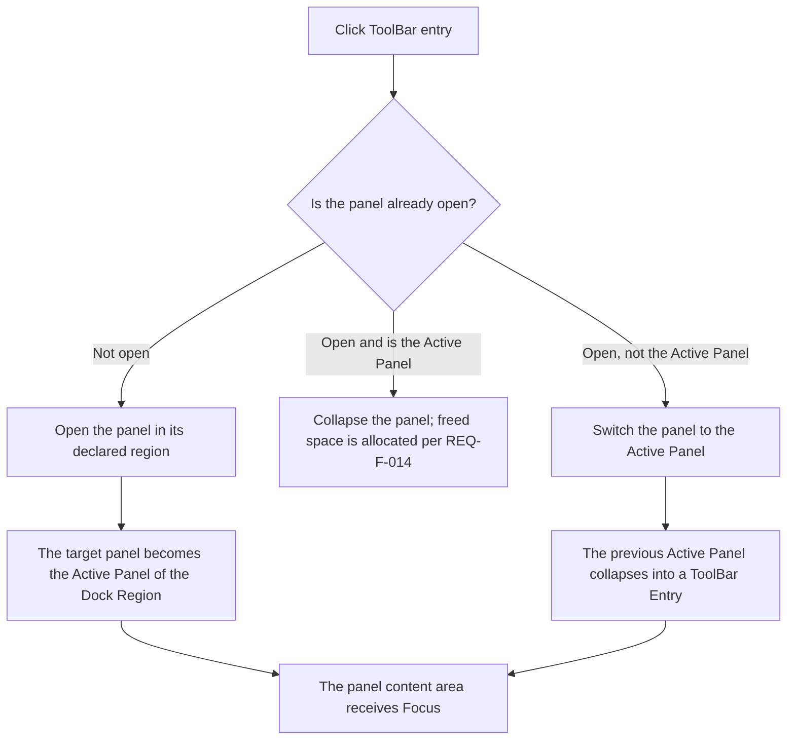

# Software Requirements Specification (SRS)

> **Reading Guide**
> 
> - **Document nature**: A product requirements specification — defines what Atlas **does** (user-observable behavior).

# 1 Introduction

## 1.1 Purpose

**Atlas (Dock hierarchy layout)** is a front-end UI component that provides Web applications with tool-window docking, editor splitting, and panel switching capabilities. Application Developers integrate the component through declarative or programmatic interfaces, and End Users operate panels and tabs through drag-and-drop, clicks, keyboard shortcuts, and other interactions.

This document defines Atlas's functional and non-functional requirements, serving as the basis for the following activities:

- **Design** — inputs and constraint boundaries for architecture decisions
- **Development** — implementation scope and acceptance criteria
- **Testing** — coverage targets for test cases
- **Acceptance** — the criteria for judging whether a delivery is complete

**Target readers**: Application Developers who integrate Atlas, QA Engineers responsible for testing, and architects and project managers who need to understand the system's behavior.

## 1.2 Scope

### In Scope

This document covers the full functional scope of Atlas, organized by module as follows:

| Module | Requirement Section | Core Content |
| ------------- |:----:| ------------------------------------------------------ |
| Layout templates and region definitions | §3.3 | Layout declaration, Region mapping, prerequisite concepts, Dock Panel states and constraints, LT/RT/Bottom Dock |
| Editor Tab management | §3.4 | Open/close/activate/overflow/dedup/pin/split/drag-dock |
| Dock Panel movement | §3.5 | Cross-region Dock Panel movement, Drop Scaffold, move undo |
| Splitter interaction | §3.6 | Drag-resize, double-click equalize, size constraints, locking, container auto-fit |
| Layout save and restore | §3.7 | Export/import, persistence, preset management, version compatibility |
| Developer interface and events | §3.8 | Declarative/programmatic API, event notifications, keyboard shortcuts |
| Error handling and fault tolerance | §3.9 | Error isolation, graceful degradation, self-healing, operation serialization |
| Non-functional requirements | §4 | Performance, compatibility, security, accessibility, memory management |

### Out of Scope

The following items are **not** within the scope of this document:

- Touch device interaction support (the current version only supports mouse/trackpad pointer devices)
- The concrete implementation of content components (such as a code editor, terminal, or file browser) — provided by the Application Developer
- Server-side state synchronization and multi-user collaboration
- Framework-specific binding solutions (React / Vue / Angular, etc.) — determined in the detailed design phase
- Theming and internationalization (i18n) — deferred to a later release (RTL mirroring: see deferred requirements in Appendix B)
- Floating Window — deferred to a later release (see deferred requirements in Appendix B)

### Design References

Designs of general-purpose editors such as Rider and VSCode.

## 1.3 System Architecture

The Dock hierarchy layout consists of three vertically stacked regions: Top Toolbar, Work Area, and Status Bar; the Work Area in the middle hosts all Dock Panels.

### Hierarchy Tree

```
Application Window
├── Top Toolbar                     ← fixed, full width at the top
├── Work Area                       ← flexible middle region
│   ├── Left ToolBar (LT)           ← navigation bar, covers full height
│   ├── Left Dock                   ← Dock Region
│   │   ├── Left Dock Upper
│   │   └── Left Dock Lower
│   ├── Editor Area                 ← fixed main work area (Editor Tabs + Editor)
│   ├── Right Dock                  ← Dock Region
│   │   ├── Right Dock Upper
│   │   └── Right Dock Lower
│   ├── Bottom Dock                 ← Dock Region
│   │   ├── Bottom Left Dock
│   │   └── Bottom Right Dock
│   └── Right ToolBar (RT)          ← navigation bar, covers full height
└── Status Bar                      ← fixed, full width at the bottom
```

> **Detailed structure (including size specifications and Splitter positions)**: see [§3.1 Hierarchy](#31-hierarchy).

**Key architecture constraints:**

> For the detailed properties and constraints of each concept (Region, Dock Panel, Editor View, Editor Tab, ToolBar Entry), see [§1.7 Spatial Concepts](#17-spatial-concepts).

| Constraint | Description |
| ---------------------- | ------------------------------------------------------------------ |
| A Dock Region supports multiple Dock Panels | In the same region, only one Active Panel is expanded at a time; other Dock Panels are switched via ToolBar entries |
| Fixed regions do not participate in docking | Top Toolbar, Editor Area, and Status Bar are fixed positions and cannot be docking targets |
| LT/RT cover the full height of the Work Area | Left ToolBar and Right ToolBar vertically cover the full height of all Dock Regions |
| Multi-instance isolation | A single page can contain multiple independent Layout Instances that do not affect each other |

## 1.5 Terminology

### 1.5.1 Term Definitions

| Term | Chinese | Definition |
| ---------------------------- | -------------------------------------- | ------------------------------------------------------------------------------------------------------------------------------------------------------------ |
| Atlas | Atlas | Product name; the Dock hierarchy layout component library |
| Dock Area Hierarchy Layout | Dock 层级布局 | A general layout model based on a hierarchy tree of Regions, in which Regions have parent–child and sibling relationships |
| Region | 区域 | A spatial slot in the layout used to define the positional relationships of Fixed Regions and Dock Regions. A Region itself does not carry business content and has no content lifecycle such as open, close, or activate |
| Fixed Region | 固定区域 | A fixed slot that cannot host Dock Panels, including Top Toolbar, Editor Area, and Status Bar. Top Toolbar and Status Bar are pure display regions; the Editor Area hosts Editor Views |
| Dock Region | Dock 区域 | A region slot that can host Dock Panels, including Left Dock Upper / Left Dock Lower, Right Dock Upper / Right Dock Lower, Bottom Left Dock / Bottom Right Dock |
| Dock Panel | Dock 面板 | A tool-window container located in a Dock Region; it can be moved, collapsed, or auto-hidden, and is switched via the ToolBar Entries of LT/RT |
| Editor View | 视图 / 编辑器视图 | An editor sub-container inside the Editor Area that hosts a set of Editor Tabs and displays the content of one active Tab; splitting creates multiple Editor Views |
| Editor Tab | 标签页 / 编辑器标签页 | A content switching unit inside an Editor View, comprising a DockItemId view identity, ContentReference, title, and presentation state |
| Splitter | 分割条 | A draggable separator between adjacent regions, panels, or views, used to adjust sizes |
| Content Identifier | 内容标识 | Historical alias for `ContentReference.Kind`; new contracts use Kind directly to select one Content Registration/Renderer |
| ContentReference | 内容引用 | The persistable `Kind + ResourceId` pair held by a Dock Item; it identifies how content is resolved and which application resource/session the view represents, but does not contain runtime bindings |
| Kind | 内容种类 | The ordinal string in ContentReference that selects one Content Registration/Renderer in the effective Content Catalog |
| ResourceId | 资源标识 | The application-defined string in ContentReference that identifies a business resource or session within one Kind |
| Runtime Binding | 运行时绑定 | A non-persisted strongly typed component value, callback, delegate, or fragment supplied by the application and applied through the Blazor Renderer lifecycle |
| Template Panel | 模板面板 | A lifecycle type of Dock Panel; when the panel's content is cleared, it is kept as an empty panel |
| Dynamic Panel | 动态面板 | A lifecycle type of Dock Panel; when the panel's content is cleared, it is automatically removed from the layout |
| Template View | 模板视图 | A lifecycle type of Editor View; when the last Tab is removed, the view is kept as an empty view |
| Dynamic View | 动态视图 | A lifecycle type of Editor View; when the last Tab is removed, the view is automatically removed from the Editor Area |
| ToolBar | LT (Left ToolBar) / RT (Right ToolBar) | A permanent vertical sidebar on the left and right sides of the Work Area, covering the full height of the Work Area. LT serves the left-side Dock Panels (Left Dock + Bottom Left Dock), and RT serves the right-side Dock Panels (Right Dock + Bottom Right Dock). LT and RT do not participate in movement |
| ToolBar Entry | ToolBar 条目 | An icon-and-title combination in the ToolBar representing one Dock Panel, in a 1:1 relationship. Clicking a ToolBar Entry expands and activates the corresponding Dock Panel; clicking it again collapses the Dock Panel |
| Region Name | 区域名称 | A predefined region identifier in the layout (e.g., "Left Dock Upper"), used to render a Dock Panel into the corresponding Dock Region or to identify a Fixed Region |
| Active State | 激活状态 | The state in which a Tab, Editor View, or Dock Panel is in the foreground and interactive |
| Active Panel | 活跃面板 | The Dock Panel currently expanded and displayed in a Dock Region. Only one Active Panel exists per Dock Region at a time |
| Collapsed State | 折叠状态 | The state in which a Dock Panel is reduced to the Collapsed Size |
| Collapsed Size | 折叠尺寸 | The fixed minimum display size of a Dock Panel in the Collapsed State; the exact value is determined in detailed design |
| Auto-hide State | 自动隐藏状态 | The state in which a Dock Panel automatically collapses into a ToolBar Entry when the mouse leaves it and expands as a Flyout on hover |
| Flyout | 浮层 | The floating panel that expands when the mouse hovers over a ToolBar Entry in the Auto-hide state, overlaid on top of adjacent panels |
| Docking | 停靠 | The operation of dragging an Editor Tab into a target Editor View, or dragging a Dock Panel into a target Dock Region |
| Directional Docking | 方向停靠 | Creating a new Editor View in a specific direction (top/bottom/left/right) of a target Editor View and moving the dragged Editor Tab into it |
| Center Docking | 中心停靠 | Appending the dragged Editor Tab to the end of the Tab list of the target Editor View |
| Panel Move | 面板移动 | The operation of dragging a Dock Panel to another Dock Region. After the move, the panel's content and active state remain unchanged, and its ToolBar Entry migrates accordingly. The move can be undone after completion (REQ-F-156) |
| Editor Area | Editor Area | The fixed region at the center of the Work Area, containing Editor Tabs and the Editor content area |
| Work Area | Work Area | The flexible region between the Top Toolbar and the Status Bar, containing LT, Left Dock, Editor Area, Right Dock, Bottom Dock, and RT |
| Bottom Dock | Bottom Dock | The lower region of the Work Area, containing Bottom Left Dock and Bottom Right Dock |
| Dedup Key | 去重键 | The basis for Editor Tab deduplication, composed of Content Identifier + Dedup Parameter |
| Dedup Parameter | 去重参数 | A developer-specified parameter for finer deduplication granularity (e.g., a file path); together with the Content Identifier it forms the Dedup Key |
| Layout Preset | 布局预设 | A named layout-state snapshot saved by the developer that can be switched to and restored at any time |
| Layout Instance | 布局实例 | An independent Atlas component instance on a page; instances are fully isolated from each other |
| Drop Scaffold | 投放骨架 | The drop target temporarily rendered by a hidden Dock Region during Panel dragging, allowing an empty Region to receive a dragged-in Panel (REQ-F-155) |
| Move Undo | 移动撤销 | The operation of restoring a Dock Panel that was moved across regions to its source Region, original DisplayState, and original Active state (REQ-F-156) |
| Dock Container Auto-Collapse | Dock 容器自适应折叠 | The automatic collapse of a Dock container (Left Dock / Right Dock / Bottom Dock) when no panel is expanded, releasing space to the Editor Area (REQ-F-154) |
| RTL | RTL (Right-to-Left) | Right-to-left language reading and layout direction |
| DPI | DPI (Dots Per Inch) | The number of pixels per inch of a display |
| Empty State | 空状态 | The placeholder display state when a Dock Panel or Editor View does not host any content component |
| Error Boundary | 错误边界 | The isolation display mechanism used when a content component fails to render |

> **Note:** In this document, entity names such as `Dock Panel`, `Editor Tab`, and `Editor View` can be used directly in English in the prose, with the Chinese term annotated where necessary. Region Names (e.g., `Left Dock Upper`) are uniformly in English to stay consistent with the code implementation.

### 1.5.2 Role Definitions

| Role | English | Definition |
| --------------------- | --------------------- | --------------------------------------- |
| Application Developer | Application Developer | The developer who integrates the Dock hierarchy layout component and uses the layout features through declarative or programmatic interfaces |
| End User | End User (终端用户) | The end user of an application built on the Dock hierarchy layout, who operates the layout through UI interactions |
| System | System (系统) | The automated behavior of the Dock hierarchy layout component itself, not directly triggered by the developer or the End User |

> **Subcategories of the System Actor:** the System label covers three types of behavior —

- **Rendering behavior** (space allocation after layout initialization, size calculation, container auto-collapse, etc.; in practice the rendering-contract verification facing the Developer),
- **Interaction response** (drag indicators, docking highlights, Drop Scaffold, etc.; in practice the visual feedback facing the End User),
- **Internal mechanisms** (persistence, error handling, data-consistency self-healing, etc.; true system-internal behavior).
  Although the first two types are labeled System, their acceptance criteria are written from the observable results of the corresponding role.

## 1.6 Document Conventions

### 1.6.1 Requirement Numbering Rules

Each functional requirement uses a unique number `REQ-F-XXX`:

- **REQ**: Requirement
- **F**: Functional (functional requirement)
- **XXX**: three-digit sequential number (F: 001~156; NF: 001~008)

### 1.6.2 Priority Definitions

| Priority | Symbol | Meaning |
|:---:|:---:| --------------------- |
| P0 | 🔴 | Must implement — core functionality; the system is unusable without it |
| P1 | 🟡 | Should implement — important functionality; its absence significantly reduces usability |
| P2 | 🟢 | May implement — enhancement; improves the user experience |

### 1.6.3 Requirement Format

Each requirement contains the following fields:

- **Number and priority**: `REQ-F-XXX` + priority symbol (🔴🟡🟢) + `[Actor: role]`
- **Title**: the requirement title
- **Description**: the requirement description
- **Acceptance Criteria**: acceptance criteria in Given/When/Then format

---

## 1.7 Spatial Concepts

This system involves four spatial concepts that must be strictly distinguished: **Region (区域)**, **Dock Panel (Dock 面板)**, **Editor View (视图)**, and **Editor Tab (标签页)**. They correspond respectively to layout slots, Dock Tool Panels, Editor split sub-containers, and content switching units.

### 1.7.1 Region

A Region is a spatial slot in the layout used to define the positional relationships of the Top Toolbar, Editor Area, Dock Regions, and the Status Bar. A Region itself is not a business content object and has no open, close, or activate lifecycle.

| Property | Description |
| ------------ | ---------------------------------------------------------------------------------------------------------- |
| Nature | Layout spatial slot |
| Type | Fixed Region / Dock Region |
| Fixed Region | Top Toolbar, Editor Area, Status Bar |
| Dock Region | Left Dock Upper / Left Dock Lower, Right Dock Upper / Right Dock Lower, Bottom Left Dock / Bottom Right Dock |
| Hostable objects | Dock Regions host Dock Panels; the Editor Area hosts Editor Views |
| Movable | No — Regions are defined by the layout template |

### 1.7.2 Dock Panel

Functional Tool Panels that appear in **Dock Regions** (Left Dock Upper / Left Dock Lower, Right Dock Upper / Right Dock Lower, Bottom Left Dock / Bottom Right Dock), such as Explorer, Search, and Terminal. A Dock Panel does not host Editor Tabs; its content is determined by the content components provided by the Application Developer.

| Property | Description |
| ----- | ------------------------------------------------------------------------------------------ |
| Location | Dock Region |
| Switching | **Clicking a ToolBar Entry in LT/RT** |
| Multiple panels coexisting | A single Dock Region can hold multiple Dock Panels; only one Active Panel is expanded and displayed at a time, and other Dock Panels are switched via ToolBar Entries |
| Drag reordering | Drag the Panel Header to before/after ToolBar Entries of the same group, or drag it to another Dock Region |
| Close | Via the close button on the Panel Header; after closing, the ToolBar Entry is kept (Template Panel) or removed together with the panel (Dynamic Panel) |
| Overflow handling | Not applicable — a Dock Panel is always full-width and switched via ToolBar Entries |
| Dedup | Not applicable — each Dock Panel is an independent tool-window instance |
| Cross-region movement | Yes — drag the Header to another Dock Region |

### 1.7.3 Editor View

An Editor View is an editor sub-container inside the **Editor Area** that hosts a set of Editor Tabs and displays the content of one active Tab. When not split, the Editor Area contains at least one default Editor View; splitting or directional docking of Tabs creates new Editor Views.

| Property | Description |
| --------------- | ------------------------------------------------------- |
| Location | Only within the Editor Area |
| Switching | By activating an Editor Tab inside it or via keyboard Focus |
| Hosted content | A set of Editor Tabs |
| Splitting | Supports horizontal/vertical splitting |
| Directional docking | Dragging an Editor Tab to the edges of an Editor View creates a new split Editor View |
| Center docking | Dragging an Editor Tab to the center of an Editor View appends it to that Editor View's Tab list |
| Belongs to a Dock Panel | No |

### 1.7.4 Editor Tab

Tabs that appear inside an **Editor View**, representing open content instances. The Tab bar can hold multiple Editor Tabs, and users switch between them by clicking or with keyboard shortcuts.

| Property | Description |
| ----- | -------------------- |
| Location | Only within an Editor View |
| Switching | Click the Tab / Ctrl+Tab |
| Arrangement | Multiple Tabs are arranged horizontally in the Tab bar |
| Drag reordering | Yes |
| Close | Yes (each Tab has a close button) |
| Overflow handling | Required (when there are too many Tabs: scroll/menu/wrap) |
| Dedup | Required (the same content is not re-created as a new Tab) |
| Pin marker | Supported (Pinned) |
| Cross-view dragging | Supports center docking or directional docking |

### 1.7.5 ToolBar Entry

Icon entries that appear in **LT / RT**; each ToolBar Entry represents one Dock Panel and is used to switch the visibility and activation state of that Dock Panel.

| Property | Description |
| ---------------- | ----------------------------------------------- |
| Location | LT (Left ToolBar), RT (Right ToolBar) |
| Represents | A navigation entry for one Dock Panel |
| Count | Equal to the number of Dock Panels on the corresponding side |
| Relationship with Dock Panel | 1:1; when a Dock Panel moves, its ToolBar Entry migrates to the ToolBar of the target side |
| Applicable scope | REQ-F-020~024, REQ-F-149~153 |

### 1.7.6 Spatial Concepts Overview

The diagram below shows the positional relationships among regions, panels, Editor Views, Editor Tabs, and ToolBar Entries in the layout (colors are consistent with §3.1):

<svg xmlns="http://www.w3.org/2000/svg" width="100%" viewBox="0 0 760 365" font-family="sans-serif" fill="none">
  <defs>
    <style>
      .dock-hd  { fill: #d6eaf8; stroke: #333; stroke-width: 1; }
      .dock-bd  { fill: #f8fbff; stroke: #333; stroke-width: .7; }
      .editor-hd { fill: #c8e6c9; stroke: #2e7d32; stroke-width: 1; }
      .editor-bd { fill: #f1f8e9; stroke: #2e7d32; stroke-width: .7; }
      .toolbar   { fill: #e3f2fd; stroke: #1976d2; stroke-width: 1.2; }
      .tab-off   { fill: #fff; stroke: #c8e6c9; stroke-width: 1; }
      .tab-on    { fill: #e8f5e9; stroke: #2e7d32; stroke-width: 1.5; }
      .panel     { fill: #fff; stroke: #333; }
      .entry-hi  { fill: #bbdefb; stroke: #1976d2; stroke-width: 1.5; }
      .callout   { stroke: #aaa; stroke-width: 1; stroke-dasharray: 4,3; }
      .legend-bg { fill: #fafafa; stroke: #eee; stroke-width: 1; }
      .view-split { stroke: #c8e6c9; stroke-width: 1; stroke-dasharray: 5,3; }
    </style>   
  </defs>
  <!-- Left Dock (Region) -->
  <rect x="50" y="52" width="160" height="195" class="dock-hd" rx="2"/>
  <text x="130" y="68" text-anchor="middle" stroke="none" fill="#333" font-size="10" font-weight="bold">Dock Region</text>
  <text x="130" y="80" text-anchor="middle" stroke="none" fill="#ef6c00" font-size="7">Region</text>
  <rect x="50" y="86" width="160" height="161" class="dock-bd"/>
  <rect x="60" y="96" width="140" height="55" class="panel" rx="2"/>
  <text x="130" y="118" text-anchor="middle" stroke="none" fill="#333" font-size="10" font-weight="bold">Dock Panel</text>
  <text x="130" y="133" text-anchor="middle" stroke="none" fill="#888" font-size="8">Tool window</text>
  <rect x="60" y="159" width="140" height="26" rx="1" fill="#f5f5f5" stroke="#ddd" stroke-dasharray="3,3"/>
  <text x="130" y="176" text-anchor="middle" stroke="none" fill="#bbb" font-size="7">Other Dock Panels in the region collapse into ToolBar entries</text>
  <!-- Editor Area (Region) -->
  <rect x="224" y="52" width="280" height="195" class="editor-hd" rx="2"/>
  <text x="364" y="68" text-anchor="middle" stroke="none" fill="#2e7d32" font-size="10" font-weight="bold">Editor Area</text>
  <text x="364" y="80" text-anchor="middle" stroke="none" fill="#ef6c00" font-size="7">Region</text>
  <rect x="224" y="86" width="280" height="161" class="editor-bd"/>
  <!-- View 1 -->
  <rect x="234" y="92" width="125" height="148" class="view-split" rx="2"/>
  <text x="296" y="106" text-anchor="middle" stroke="none" fill="#2e7d32" font-size="8" font-weight="bold">Editor View 1</text>
  <rect x="238" y="112" width="117" height="14" fill="#e8f5e9" stroke="none"/>
  <rect x="240" y="114" width="34" height="10" class="tab-off" rx="1"/>
  <text x="257" y="121" text-anchor="middle" stroke="none" fill="#666" font-size="6">Tab A</text>
  <rect x="276" y="114" width="34" height="10" class="tab-on" rx="1"/>
  <text x="293" y="121" text-anchor="middle" stroke="none" fill="#2e7d32" font-size="6" font-weight="bold">Tab B</text>
  <line x1="240" y1="148" x2="340" y2="148" stroke="#ddd" stroke-width="1.5"/>
  <line x1="240" y1="162" x2="340" y2="162" stroke="#ddd" stroke-width="1.5"/>
  <!-- View 2 -->
  <rect x="364" y="92" width="130" height="148" class="view-split" rx="2"/>
  <text x="429" y="106" text-anchor="middle" stroke="none" fill="#2e7d32" font-size="8" font-weight="bold">Editor View 2</text>
  <rect x="368" y="112" width="122" height="14" fill="#e8f5e9" stroke="none"/>
  <rect x="370" y="114" width="34" height="10" class="tab-off" rx="1"/>
  <text x="387" y="121" text-anchor="middle" stroke="none" fill="#666" font-size="6">Tab C</text>
  <line x1="370" y1="148" x2="470" y2="148" stroke="#ddd" stroke-width="1.5"/>
  <line x1="370" y1="162" x2="430" y2="162" stroke="#ddd" stroke-width="1.5"/>
  <!-- Right Dock (Region) -->
  <rect x="518" y="52" width="160" height="195" class="dock-hd" rx="2"/>
  <text x="598" y="68" text-anchor="middle" stroke="none" fill="#333" font-size="10" font-weight="bold">Dock Region</text>
  <text x="598" y="80" text-anchor="middle" stroke="none" fill="#ef6c00" font-size="7">Region</text>
  <rect x="518" y="86" width="160" height="161" class="dock-bd"/>
  <rect x="528" y="96" width="140" height="55" class="panel" rx="2"/>
  <text x="598" y="118" text-anchor="middle" stroke="none" fill="#333" font-size="10" font-weight="bold">Dock Panel</text>
  <text x="598" y="133" text-anchor="middle" stroke="none" fill="#888" font-size="8">Tool window</text>
  <!-- LT / RT -->
  <rect x="22" y="52" width="22" height="195" class="toolbar" rx="2"/>
  <text x="33" y="155" text-anchor="middle" stroke="none" fill="#1565c0" font-size="9" font-weight="bold" transform="rotate(-90 33 155)">LT</text>
  <rect x="684" y="52" width="22" height="195" class="toolbar" rx="2"/>
  <text x="695" y="155" text-anchor="middle" stroke="none" fill="#1565c0" font-size="9" font-weight="bold" transform="rotate(90 695 155)">RT</text>
  <!-- ToolBar Entry highlight -->
  <rect x="18" y="64" width="30" height="20" class="entry-hi" rx="2"/>
  <text x="33" y="78" text-anchor="middle" stroke="none" fill="#1565c0" font-size="7" font-weight="bold">Entry</text>
  <!-- ===== Callouts ===== -->
  <!-- ToolBar Entry -->
  <line x1="18" y1="74" x2="8" y2="74" class="callout"/>
  <line x1="8" y1="74" x2="8" y2="18" class="callout"/>
  <line x1="8" y1="18" x2="110" y2="18" class="callout"/>
  <text x="114" y="15" text-anchor="start" stroke="none" font-size="10" fill="#1976d2" font-weight="bold">ToolBar Entry</text>
  <text x="114" y="28" text-anchor="start" stroke="none" font-size="8" fill="#777">1:1 with a Dock Panel</text>
  <text x="114" y="40" text-anchor="start" stroke="none" font-size="8" fill="#777">Click to switch · migrates on move</text>
  <!-- Editor Tab -->
  <line x1="293" y1="114" x2="293" y2="18" class="callout"/>
  <line x1="293" y1="18" x2="272" y2="18" class="callout"/>
  <text x="276" y="15" text-anchor="start" stroke="none" font-size="10" fill="#2e7d32" font-weight="bold">Editor Tab</text>
  <text x="276" y="28" text-anchor="start" stroke="none" font-size="8" fill="#777">Horizontal · click/Ctrl+Tab to switch</text>
  <text x="276" y="40" text-anchor="start" stroke="none" font-size="8" fill="#777">Overflow · dedup · pin · split · close</text>
  <!-- Region -->
  <line x1="224" y1="62" x2="224" y2="18" class="callout"/>
  <line x1="224" y1="18" x2="388" y2="18" class="callout"/>
  <text x="392" y="15" text-anchor="start" stroke="none" font-size="10" fill="#ef6c00" font-weight="bold">Region</text>
  <text x="392" y="28" text-anchor="start" stroke="none" font-size="8" fill="#777">Layout slot · Fixed / Dock</text>
  <text x="392" y="40" text-anchor="start" stroke="none" font-size="8" fill="#777">No content · not movable</text>
  <!-- Editor View -->
  <line x1="429" y1="92" x2="429" y2="18" class="callout"/>
  <line x1="429" y1="18" x2="502" y2="18" class="callout"/>
  <text x="506" y="15" text-anchor="start" stroke="none" font-size="10" fill="#2e7d32" font-weight="bold">Editor View</text>
  <text x="506" y="28" text-anchor="start" stroke="none" font-size="8" fill="#777">Sub-container inside the Editor Area</text>
  <text x="506" y="40" text-anchor="start" stroke="none" font-size="8" fill="#777">Hosts Editor Tabs · split creates more Views</text>
  <!-- Dock Panel -->
  <line x1="130" y1="151" x2="130" y2="318" class="callout"/>
  <text x="130" y="303" text-anchor="middle" stroke="none" font-size="10" fill="#333" font-weight="bold">Dock Panel</text>
  <text x="130" y="318" text-anchor="middle" stroke="none" font-size="8" fill="#777">Tool window · appears in a Dock Region</text>
  <text x="130" y="331" text-anchor="middle" stroke="none" font-size="8" fill="#777">LT/RT Entry switch · cross-region move</text>
  <!-- Legend -->
  <rect x="490" y="308" width="245" height="48" class="legend-bg" rx="2"/>
  <rect x="498" y="318" width="8" height="8" rx="1" fill="#e8f5e9" stroke="#2e7d32"/>
  <text x="510" y="326" stroke="none" fill="#333" font-size="8">Editor Area</text>
  <rect x="578" y="318" width="8" height="8" rx="1" fill="#f8fbff" stroke="#333"/>
  <text x="590" y="326" stroke="none" fill="#333" font-size="8">Dock</text>
  <rect x="620" y="318" width="8" height="8" rx="1" fill="#e3f2fd" stroke="#1976d2"/>
  <text x="632" y="326" stroke="none" fill="#333" font-size="8">LT/RT</text>
  <rect x="662" y="318" width="8" height="8" rx="1" fill="#fff3e0" stroke="#ef6c00"/>
  <text x="674" y="326" stroke="none" fill="#333" font-size="8">Region</text>
  <rect x="498" y="336" width="8" height="8" rx="1" fill="#fafdfa" stroke="#c8e6c9"/>
  <text x="510" y="344" stroke="none" fill="#333" font-size="8">Editor View</text>
</svg>

# 2 Overall Description

## 2.1 Product Perspective

Atlas is a front-end UI component that provides Web applications with tool-window docking, editor splitting, and panel switching capabilities. The component is integrated by Application Developers through declarative or programmatic interfaces, and End Users operate Dock Panels and Editor Tabs through interactions such as drag-and-drop and clicks.

The Dock hierarchy layout runs in the browser environment as a pure client-side component and does not depend on a server.

## 2.2 Functional Navigation (by Role)

> The following is a quick index of the requirements in this document for each role.

| Role | Main Focus | Quick Links |
| ------------------------- | -------------------------------------------- | ----------------------------------------------- |
| **Application Developer** | Declaring layouts, opening tabs, API, events | §3.3 Layout templates → §3.4 Editor Tabs → §3.8 API |
| **End User** | Dragging panels, switching tabs, Splitter, keyboard shortcuts, Auto-hide | §3.4 Editor Tab → §3.5 Dock Panel movement → §3.6 Splitter |
| **System** | Lifecycle, boundary conditions, error isolation, dedup validation | §3.4 Overflow/dedup → §3.9 Error handling |

> See [§1.2 Scope](#12-scope) for the coverage of core functionality.

## 2.3 User Characteristics

| User Type | Characteristics | Technical Capability |
| --------------------- | ------------------------ | ----------------------- |
| Application Developer | Developer who integrates the component, using declarative tags or the programmatic API | Familiar with front-end frameworks; understands component-based development |
| End User | End user of the final application | Has basic desktop application operating experience (drag, click, keyboard shortcuts) |

## 2.4 Constraints

- The runtime environment is a browser
- The component is a pure client-side implementation and does not depend on server-side state
- Layout persistence relies on the browser's local storage capabilities (e.g., localStorage / IndexedDB)
- Custom templates and content components are provided by the Application Developer

## 2.5 Assumptions and Dependencies

- Target browsers support ES6 and above
- End Users interact using pointer devices such as a mouse/trackpad (touch device support is out of scope for the current version)
- The Application Developer is responsible for implementing content components and declaring Content Identifiers

---

# 3 Functional Requirements

> This document defines a general **Dock hierarchy layout** model applicable to web/desktop application UIs that need tool-window docking, editor splitting, and panel switching. The core characteristic of this model is the specific hierarchy-tree relationship among Dock Regions, rather than flat partitioning.

## 3.1 Hierarchy

> See [§1.3 System Architecture](#13-system-architecture) for the hierarchy tree.

<svg xmlns="http://www.w3.org/2000/svg" viewBox="0 0 760 390" font-family="sans-serif" fill="none">
  <defs>
    <style>
      .fixed   { fill: #f5f5f5; stroke: #bbb; stroke-width: 1; }
      .toolbar { fill: #e3f2fd; stroke: #1976d2; stroke-width: 1.2; }
      .dock-hd { fill: #d6eaf8; stroke: #333; stroke-width: 1; }
      .dock-bd { fill: #f8fbff; stroke: #333; stroke-width: .8; }
      .editor-hd { fill: #c8e6c9; stroke: #2e7d32; stroke-width: 1; }
      .editor-bd { fill: #f1f8e9; stroke: #2e7d32; stroke-width: .8; }
      .bottom-hd { fill: #ffe0b2; stroke: #333; stroke-width: 1; }
      .bottom-bd { fill: #fff8f0; stroke: #333; stroke-width: .8; }
      .sep { stroke: #ddd; stroke-width: .6; }
      .legend-box { fill: #fafafa; stroke: #eee; stroke-width: 1; }
    </style>
  </defs>
  <!-- Top Toolbar -->
  <rect x="2" y="2" width="756" height="30" rx="0" class="fixed"/>
  <text x="380" y="21" text-anchor="middle" stroke="none" fill="#999" font-size="11">Top Toolbar</text>
  <!-- Status Bar -->
  <rect x="2" y="358" width="756" height="30" rx="0" class="fixed"/>
  <text x="380" y="378" text-anchor="middle" stroke="none" fill="#999" font-size="11">Status Bar</text>
  <!-- LT -->
  <rect x="2" y="32" width="32" height="326" class="toolbar"/>
  <text x="18" y="200" text-anchor="middle" stroke="none" fill="#1565c0" font-size="11" font-weight="bold" transform="rotate(-90 18 200)">LT</text>
  <!-- RT -->
  <rect x="726" y="32" width="32" height="326" class="toolbar"/>
  <text x="742" y="200" text-anchor="middle" stroke="none" fill="#1565c0" font-size="11" font-weight="bold" transform="rotate(90 742 200)">RT</text>
  <!-- Left Dock -->
  <rect x="34" y="32" width="170" height="210" class="dock-hd"/>
  <text x="119" y="48" text-anchor="middle" stroke="none" fill="#333" font-size="11" font-weight="bold">Left Dock</text>
  <rect x="34" y="52" width="170" height="190" class="dock-bd"/>
  <line x1="34" y1="147" x2="204" y2="147" class="sep"/>
  <text x="119" y="115" text-anchor="middle" stroke="none" fill="#777" font-size="10">Left Dock Upper</text>
  <text x="119" y="200" text-anchor="middle" stroke="none" fill="#777" font-size="10">Left Dock Lower</text>
  <!-- Editor Area -->
  <rect x="204" y="32" width="312" height="210" class="editor-hd"/>
  <text x="360" y="48" text-anchor="middle" stroke="none" fill="#2e7d32" font-size="11" font-weight="bold">Editor Area</text>
  <rect x="204" y="52" width="312" height="190" class="editor-bd"/>
  <line x1="204" y1="68" x2="516" y2="68" stroke="#a5d6a7" stroke-width=".6"/>
  <text x="360" y="82" text-anchor="middle" stroke="none" fill="#999" font-size="9">Editor Tabs</text>
  <line x1="220" y1="110" x2="400" y2="110" stroke="#ddd" stroke-width="2"/>
  <line x1="220" y1="126" x2="460" y2="126" stroke="#ddd" stroke-width="2"/>
  <line x1="220" y1="142" x2="340" y2="142" stroke="#ddd" stroke-width="2"/>
  <line x1="220" y1="158" x2="430" y2="158" stroke="#ddd" stroke-width="2"/>
  <line x1="220" y1="174" x2="380" y2="174" stroke="#ddd" stroke-width="2"/>
  <line x1="220" y1="190" x2="260" y2="190" stroke="#ddd" stroke-width="2"/>
  <text x="360" y="225" text-anchor="middle" stroke="none" fill="#bbb" font-size="9">Editor content area</text>
  <!-- Right Dock -->
  <rect x="516" y="32" width="210" height="210" class="dock-hd"/>
  <text x="621" y="48" text-anchor="middle" stroke="none" fill="#333" font-size="11" font-weight="bold">Right Dock</text>
  <rect x="516" y="52" width="210" height="190" class="dock-bd"/>
  <line x1="516" y1="147" x2="726" y2="147" class="sep"/>
  <text x="621" y="115" text-anchor="middle" stroke="none" fill="#777" font-size="10">Right Dock Upper</text>
  <text x="621" y="200" text-anchor="middle" stroke="none" fill="#777" font-size="10">Right Dock Lower</text>
  <!-- Bottom Dock -->
  <rect x="34" y="242" width="692" height="116" class="bottom-hd"/>
  <text x="380" y="258" text-anchor="middle" stroke="none" fill="#333" font-size="10" font-weight="bold">Bottom Dock</text>
  <rect x="34" y="262" width="692" height="96" class="bottom-bd"/>
  <line x1="380" y1="262" x2="380" y2="358" stroke="#ccc" stroke-width=".6"/>
  <text x="207" y="316" text-anchor="middle" stroke="none" fill="#777" font-size="10">Bottom Left Dock</text>
  <text x="553" y="316" text-anchor="middle" stroke="none" fill="#777" font-size="10">Bottom Right Dock</text>
  <!-- Legend -->
  <rect x="610" y="366" width="138" height="20" rx="3" class="legend-box"/>
  <rect x="616" y="372" width="8" height="8" rx="1" fill="#e3f2fd" stroke="#1976d2"/>
  <text x="628" y="380" stroke="none" fill="#1976d2" font-size="8">Navigation</text>
  <rect x="656" y="372" width="8" height="8" rx="1" fill="#e8f5e9" stroke="#2e7d32"/>
  <text x="668" y="380" stroke="none" fill="#2e7d32" font-size="8">Main work area</text>
  <rect x="704" y="372" width="8" height="8" rx="1" fill="#f8fbff" stroke="#333"/>
  <text x="716" y="380" stroke="none" fill="#555" font-size="8">Dock Region</text>
</svg>

**Dock Regions support multiple Dock Panels**: Left Dock Upper, Left Dock Lower, Right Dock Upper, Right Dock Lower, Bottom Left Dock, Bottom Right Dock. In the same region, only one Active Panel is expanded at a time; other Dock Panels are switched via ToolBar Entries.

This hierarchy model supports future extensions: Tool Window drag docking (Dock), Auto Hide, Floating Window, Split Editor (editor splitting), etc., can all be naturally extended on this model.

**Region properties at a glance:**

| Region | Location | Hosts Dock Panels | Description |
| ----------------- | -------------- |:-------------:| ------------------------------ |
| Top Toolbar | Full width at the top of the container | No | Fixed position, e.g., navigation bar/toolbar |
| Left Dock Upper | Upper half of the left column of the Work Area | Yes | Supports Dock Panels |
| Left Dock Lower | Lower half of the left column of the Work Area | Yes | Supports Dock Panels |
| Editor Area | Center of the Work Area | No | Main content area (Editor Tab + Editor), fixed position |
| Right Dock Upper | Upper half of the right column of the Work Area | Yes | Supports Dock Panels |
| Right Dock Lower | Lower half of the right column of the Work Area | Yes | Supports Dock Panels |
| Bottom Left Dock | Left side of the Bottom Dock | Yes | Supports Dock Panels |
| Bottom Right Dock | Right side of the Bottom Dock | Yes | Supports Dock Panels |
| Status Bar | Full width at the bottom of the container | No | Fixed position, displays status information |

**Left ToolBar (LT) / Right ToolBar (RT) properties:**

| Property | Description |
| ------ |:------------------------------------------------------------------------------------------------------------------------------------------------------------------------- |
| Position | LT is on the left side of the Work Area; RT is on the right side of the Work Area |
| Coverage | Covers the full height of the Work Area (including the Bottom Dock) |
| Responsibility | LT serves the Dock Panels of Left Dock (Left Dock Upper / Left Dock Lower) and Bottom Left Dock; RT serves the Dock Panels of Right Dock (Right Dock Upper / Right Dock Lower) and Bottom Right Dock |
| Participates in panel movement | No — LT/RT are navigation bars rather than panel containers and do not participate in Dock Panel movement |

> **Note on section numbering:** this chapter has no §3.2; that number is a historical gap. To keep existing section references (including `requirements-traceability.md`) stable, sections are not renumbered.
## 3.3 Layout Templates and Region Structure

```
REQ-F-001 🔴 [Actor: Application Developer]

Title
Full declaration of the Dock hierarchy layout

Description
The system should use the Dock hierarchy layout and support the developer in declaring all regions
(Top Toolbar, Left Dock Upper, Left Dock Lower, Editor Area, Right Dock Upper,
Right Dock Lower, Bottom Left Dock, Bottom Right Dock, Status Bar). After layout initialization,
each region is rendered as the corresponding Dock Panel according to the hierarchy-tree relationships.

Acceptance Criteria

AC1: Declaring all regions

Given the developer declares all regions
When layout initialization completes
Then the system should render the Dock Panel corresponding to each region according to the hierarchy-tree relationships
And the Dock Panels correspond respectively to each region (Top Toolbar, Left Dock Upper, Left Dock Lower, Editor Area,
Right Dock Upper, Right Dock Lower, Bottom Left Dock, Bottom Right Dock, Status Bar)

AC2: Initializing without panels

Given the developer does not declare any panels when initializing the Dock hierarchy layout
When layout initialization completes
Then the system should display empty container regions
And the system should not report errors
```

```
REQ-F-002 🔴 [Actor: Application Developer]

Title
Spatial structure of the Dock hierarchy layout

Description
The system should arrange the regions according to the hierarchy-tree relationships of the Dock hierarchy layout:

- Top Toolbar spans the full width at the top of the container.
- Status Bar spans the full width at the bottom of the container.
- Work Area is located between Top Toolbar and Status Bar, containing LT, Left Dock, Editor Area, Right Dock, Bottom Dock, and RT.
- Left ToolBar (LT) is on the left side of the Work Area, covering the full height of the Work Area (including the Bottom Dock).
- Right ToolBar (RT) is on the right side of the Work Area, covering the full height of the Work Area (including the Bottom Dock).
- Left Dock contains Left Dock Upper and Left Dock Lower, arranged vertically.
- Right Dock contains Right Dock Upper and Right Dock Lower, arranged vertically.
- Editor Area is at the center of the Work Area, containing Editor Tabs and the Editor.
- Bottom Dock contains Bottom Left Dock and Bottom Right Dock, separated by a vertical Splitter.

Among these, the six regions Left Dock Upper, Left Dock Lower, Right Dock Upper, Right Dock Lower, Bottom Left Dock,
and Bottom Right Dock are Dock Panels and support Dock Panel movement;
Top Toolbar, Editor Area, and Status Bar are fixed-position regions that do not participate in movement.

Acceptance Criteria

AC1: Rendering the Dock hierarchy layout structure

Given the developer declares all regions
When layout initialization completes
Then Top Toolbar should span the full width at the top of the container
And Status Bar should span the full width at the bottom of the container
And Left ToolBar should be on the left side of the Work Area, vertically covering the full height of the Work Area
And Right ToolBar should be on the right side of the Work Area, vertically covering the full height of the Work Area
And Left Dock Upper and Left Dock Lower should be arranged vertically inside Left Dock
And Left Dock Upper and Left Dock Lower should be separated by a horizontal Splitter
And Right Dock Upper and Right Dock Lower should be arranged vertically inside Right Dock
And Right Dock Upper and Right Dock Lower should be separated by a horizontal Splitter
And Editor Area should be at the center of the Work Area and occupy the remaining space
And Editor Area contains Editor Tabs and the Editor
And Left Dock and Editor Area should be separated by a vertical Splitter
And Right Dock and Editor Area should be separated by a vertical Splitter
And Bottom Dock should be below the Work Area
And Work Area and Bottom Dock should be separated by a horizontal Splitter
And Bottom Left Dock and Bottom Right Dock should be separated by a vertical Splitter

AC2: Declaring only the Editor Area

Given the developer declares only the Editor Area
When layout initialization completes
Then the Editor Area should occupy the entire container space
And the other regions should be placeholders with zero size and invisible
```

```
REQ-F-003 🔴 [Actor: Application Developer]

Title
Partial declaration of the Dock hierarchy layout

Description
The system should support the developer in declaring only some of the regions in the Dock hierarchy layout; undeclared regions are placeholders with zero size.

Acceptance Criteria

AC1: Declaring only some regions

Given the developer does not declare all regions
When layout initialization completes
Then the system should create an empty Dock Panel in each missing region
And that Dock Panel should have zero height or width and be invisible
```

```
REQ-F-004 🔴 [Actor: Application Developer]

Title
Dock Panel Region Name mapping

Description
The system should support the developer in specifying a Region Name for a Dock Panel, rendering the Dock Panel at the Dock Region position corresponding to that name. The Region Names supported by the Dock hierarchy layout are: Top Toolbar, Left Dock Upper, Left Dock Lower, Editor Area, Right Dock Upper, Right Dock Lower, Bottom Left Dock, Bottom Right Dock, Status Bar. Among them, only Dock Regions can host Dock Panels; a Fixed Region cannot be the target region of a Dock Panel.

Acceptance Criteria

AC1: Specifying a valid Dock Region name

Given the developer specifies a valid Dock Region name for a Dock Panel
When layout initialization completes
Then the system should render the Dock Panel at the Dock Region position corresponding to that name

AC2: Multiple Dock Panels declaring the same Dock Region name

Given the developer declares the same Dock Region name for multiple Dock Panels
When layout initialization completes
Then the system should render these Dock Panels into the same Dock Region
And the system should render them into the same Dock Region, with only the Active Panel expanded and the other Dock Panels switched via ToolBar Entries
```

```
REQ-F-005 🔴 [Actor: Application Developer]

Title
Dock Panel Empty State display

Description
The system should display the Empty State when a Dock Panel does not host any content component.

Acceptance Criteria

AC1: Dock Panel without content

Given the layout has been initialized
When a Dock Panel does not host any content component
Then the system should display the Empty State in that Dock Panel
And the Empty State should include the Dock Panel container and the Empty State hint text.
```

```
REQ-F-006 🔴 [Actor: Application Developer]

Title
Unified Content Registration and Resolution

Description
The system should support the developer in associating a stable ContentReference.Kind with one content renderer for a Dock Panel or Editor Tab. Startup DI registrations, Host-local declarative routes, and Host-local functional mappings contribute to one effective Content Catalog rather than separate fallback rendering pipelines.

Acceptance Criteria

AC1: Registering content from supported sources

Given the developer associates a Kind with a renderer through startup DI, a Host-local declarative route, or a Host-local functional mapping
When the system renders a Dock Panel or Editor Tab whose ContentReference holds that Kind
Then the system should resolve the Kind through one effective Content Catalog
And the system should render the associated content lazily through the owning outlet

AC2: Stable content and view identities

Given two Dock Items hold the same ContentReference.Kind and ContentReference.ResourceId
When the system renders both Dock Items
Then both Items may resolve through the same catalog registration
And each Item keeps its own DockItemId as the concrete view identity
And the catalog does not store either component instance or business resource state
```

```
REQ-F-007 🔴 [Actor: Application Developer]

Title
Editor Tab content rendering

Description
The system should render the component selected by a valid ContentReference.Kind as the Tab content when the Tab holds that reference. Content Identifier is retained only as the historical name for Kind.

Acceptance Criteria

AC1: Valid ContentReference.Kind

Given the Tab holds a ContentReference with a valid Kind
And the developer has declared the association between that Kind and the component
When the system renders the Tab
Then the system should render the component selected by that Kind as the Tab content
```

```
REQ-F-008 🔴 [Actor: Application Developer]

Title
Content Component Runtime Binding

Description
The system should support the developer in supplying strongly typed runtime values and interaction callbacks to content components. Runtime bindings are application-owned and are separate from the persistable ContentReference and DockItemId identities.

Acceptance Criteria

AC1: Applying runtime values and callbacks

Given the developer binds ordinary values, EventCallback values, delegates, or RenderFragments to a content component
When the system mounts or updates that content component
Then Blazor should apply the current values through the normal component parameter lifecycle
And the content component should be able to invoke callbacks owned by the containing application

AC2: Applying state changed while content is unmounted

Given a content component is not currently mounted
And another Panel changes application-owned shared state
When the content component is mounted later
Then it should receive or read the latest shared state
And the system should not create a temporary component instance merely to deliver that state change

AC3: Runtime bindings are not persisted

Given a content registration captures callbacks, delegates, RenderFragments, or application-owned state
When the system exports a Snapshot or records Undo/Redo history
Then the system should persist only the layout identities and ContentReference values
And it should not serialize the captured runtime objects
```

```
REQ-F-009 🟡 [Actor: End User | Application Developer]

Title
Editor Tab Pinned

Description
The system should support the developer or the End User in marking a Tab as pinned. Pinned Tabs are always arranged
before non-pinned Tabs in the Tab bar and display a pin indicator icon.

Acceptance Criteria

AC1: Marking a Tab as pinned

Given multiple Tabs exist in the Editor View and none of them is pinned
When the End User clicks the pin button of a Tab or the developer calls the pin API
Then the system should mark the Tab as pinned
And the Tab should display the pin indicator icon
And the Tab should move before all non-pinned Tabs in the Tab bar

AC2: Unpinning a Tab

Given the Tab is pinned
When the End User clicks the pin button again or the developer calls the unpin API
Then the system should unpin the Tab
And the Tab should remove the pin indicator icon
And the Tab should be arranged after the pinned Tabs
```

```
REQ-F-010 🟡 [Actor: Application Developer]

Title
Custom Empty State template

Description
The system should support the developer in defining an Empty State template to replace the default Empty State hint.

Acceptance Criteria

AC1: Empty State template defined

Given the developer defines an Empty State template
When a Dock Panel is in the Empty State
Then the system should use the developer-defined template content instead of the default Empty State hint
```

```
REQ-F-011 🔴 [Actor: End User]

Title
Dragging an Editor Tab into an empty Editor View

Description
The system should support the End User in dragging a Tab into an empty view and displaying the dragged-in content.

Acceptance Criteria

AC1: Dragging a Tab into an empty view

Given an empty view exists in the Editor Area
When the End User drags a Tab into the empty view and releases it
Then the system should display the dragged-in content in that view
And the dragged-in Tab should become the active Tab of that view
```

### 3.3.1 Dock Panel States and Constraints

> Covers Dock Panel collapse/expand, space reallocation, size constraints, Auto-hide, type declaration, title and icon, and initial ratio.

```
REQ-F-012 🟡 [Actor: End User | Application Developer]

Title
Dock Panel collapse and expand

Description
The system should support switching a Dock Panel between the expanded state and the collapsed state through user actions or programmatic calls.
Collapsing reduces the Dock Panel's size to the Collapsed Size; expanding restores the size it had before collapsing.
The exact value of the Collapsed Size is determined in detailed design.

Acceptance Criteria

AC1: End User clicks the collapse button

Given the Dock Panel is in the expanded state
When the End User clicks the Dock Panel's collapse button
Then the system should reduce the Dock Panel's display size to the Collapsed Size

AC2: Developer calls the collapse API

Given the Dock Panel is in the expanded state
When the developer calls the Dock Panel collapse API
Then the system should reduce the Dock Panel's display size to the Collapsed Size

AC3: End User clicks the expand button

Given the Dock Panel is in the Collapsed State
When the End User clicks the Dock Panel's expand button
Then the system should restore the Dock Panel's display size to the size it had before collapsing

AC4: Developer calls the expand API

Given the Dock Panel is in the collapsed state
When the developer calls the Dock Panel expand API
Then the system should restore the Dock Panel's display size to the size it had before collapsing
```

```
REQ-F-014 🟡 [Actor: Application Developer]

Title
Space reallocation after collapsing a Dock Panel

Description
When a Dock Panel is collapsed, the system should allocate the freed space proportionally to adjacent Dock Panels.

Acceptance Criteria

AC1: Space reallocation after a Dock Panel is collapsed

Given multiple adjacent Dock Panels exist in the layout
When a Dock Panel is collapsed
Then adjacent Dock Panels should automatically receive the space freed by the collapsed Dock Panel
And the space should be allocated in proportion to the current sizes of the adjacent visible Dock Panels
```

```
REQ-F-154 🟡 [Actor: Application Developer]

Title
Dock container empty-state auto-collapse

Description
The system should automatically collapse a Dock container to release space to the Editor Area in the following cases:

- Neither the Upper nor the Lower sub-Region of a side Dock (Left Dock / Right Dock) has an expanded Dock Panel
- Neither the Left nor the Right sub-Region of the Bottom Dock has an expanded Dock Panel
- When only one sub-Region within the same Dock container has an expanded Panel, hide the other empty sub-Regions

After collapsing, the corresponding ToolBar Entries are kept (REQ-F-021), for re-expanding or for the Auto-hide Flyout.

Acceptance Criteria

AC1: Collapsing a side Dock when no panel is visible

Given neither the Upper Dock nor the Lower Dock of Left Dock or Right Dock has an expanded Dock Panel
And the Dock Panels on that side do not exist, are collapsed, or are in the Auto-hide state
When the system renders the Work Area
Then the system should not render the Left/Right Dock content column on that side or its column Splitter
And the Editor Area should receive the space freed by the Dock content column on that side
And the ToolBar Entries on that side should be kept per REQ-F-021, for re-expanding or displaying the Auto-hide Flyout

AC2: Collapsing the Bottom Dock when no panel is visible

Given neither Bottom Left Dock nor Bottom Right Dock has an expanded Dock Panel
And the Dock Panels associated with the Bottom Dock do not exist, are collapsed, or are in the Auto-hide state
When the system renders the Work Area
Then the system should not render the Bottom Dock row or its row Splitter
And the Work Area above should receive the vertical space freed by the Bottom Dock
And the ToolBar Entries associated with the Bottom Dock should be kept per REQ-F-021, for re-expanding or displaying the Auto-hide Flyout

AC3: Hiding a sub-Dock-Region without visible panels within a Dock container

Given only one sub-Dock-Region of Left Dock, Right Dock, or Bottom Dock has an expanded Dock Panel
And no other sub-Dock-Region within the same Dock container has an expanded Dock Panel
When the system renders that Dock container
Then the system should hide the sub-Dock-Regions without an expanded Dock Panel
And the system should not render the Splitter between a hidden sub-Dock-Region and a visible sub-Dock-Region
And the remaining visible sub-Dock-Regions should fill the available content space of that Dock container
```

```
REQ-F-015 🔴 [Actor: Application Developer]

Title
Dock Panel minimum size constraint

Description
The system should support the developer in setting a minimum size for a Dock Panel; the actual size of the Dock Panel should not be smaller than that minimum.

Acceptance Criteria

AC1: Dragging the Splitter to the minimum size

Given the developer sets a minimum size for the Dock Panel
When the End User drags the Splitter or a layout adjustment reduces the Dock Panel's size
Then the actual size of the Dock Panel should not be smaller than that minimum
```

```
REQ-F-016 🟡 [Actor: Application Developer]

Title
Dock Panel maximum size constraint

Description
The system should support the developer in setting a maximum size for a Dock Panel; the actual size of the Dock Panel should not exceed that maximum.

Acceptance Criteria

AC1: Dragging the Splitter to the maximum size

Given the developer sets a maximum size for the Dock Panel
When the End User drags the Splitter or a layout adjustment increases the Dock Panel's size
Then the actual size of the Dock Panel should not exceed that maximum
```

```
REQ-F-017 🟡 [Actor: End User | Application Developer]

Title
Dock Panel Auto-hide mode

Description
The system should support setting a Dock Panel to Auto-hide mode; the Dock Panel automatically collapses into a ToolBar Entry after the End User's mouse leaves it. When the window size changes, the system should keep the ToolBar entries visible and adapt the Flyout size.
Hovering over a ToolBar Entry automatically expands the Flyout to display the Dock Panel content.

Acceptance Criteria

AC1: Enabling Auto-hide

Given the Dock Panel is in the expanded state
When the End User clicks the Auto-hide button or the developer calls the Auto-hide API
Then the system should collapse the Dock Panel into a ToolBar entry
And the ToolBar entry should display the panel icon and title
And the Dock Panel state should be marked as Auto-hide

AC2: Expanding on mouse hover

Given the Dock Panel is in the Auto-hide state
When the End User's mouse hovers over the ToolBar entry
Then the system should expand the Dock Panel content as a Flyout
And the Flyout should be overlaid on top of adjacent Dock Panels

AC3: Collapsing when the mouse leaves

Given the Auto-hide Dock Panel's Flyout is expanded
When the End User's mouse leaves the Dock Panel Flyout area
Then the system should collapse the Dock Panel back into a ToolBar entry after a 300ms delay

AC4: Auto-hide ToolBar entry adaptation when the window shrinks

Given an Auto-hide panel exists and its ToolBar entry is visible
When the End User shrinks the browser window
Then the system should keep the ToolBar entry visible
And the ToolBar entry should not exceed the container boundary

AC2: Flyout size adaptation when the window shrinks

Given the Auto-hide panel's Flyout is expanded
When the End User shrinks the browser window
Then the system should adjust the Flyout size so that it does not exceed the container boundary
And the Flyout content should reflow correctly
```

```
REQ-F-018 🟡 [Actor: End User | Application Developer]

Title
Canceling the Auto-hide of a Dock Panel

Description
The system should support restoring an Auto-hide Dock Panel to a permanently expanded state.

Acceptance Criteria

AC1: Canceling Auto-hide

Given the Dock Panel is in the Auto-hide state
When the End User clicks the Auto-hide button while the Dock Panel Flyout is expanded, or the developer calls the cancel-Auto-hide API
Then the system should restore the Dock Panel to a permanently expanded state
And the Dock Panel should re-occupy its original space in the layout
And adjacent Dock Panels should shrink proportionally to make room
```

```
REQ-F-019 🔴 [Actor: Application Developer]

Title
Dock Panel type declaration

Description
The system should support the developer in declaring a Dock Panel's type in the Dock hierarchy layout as Template Dock Panel or Dynamic Dock Panel. A Template Dock Panel is kept as an empty Dock Panel when its content is cleared; a Dynamic Dock Panel is automatically removed from the layout when its content is cleared.

Acceptance Criteria

AC1: Declaring a Template Dock Panel

Given the developer declares the Dock Panel type as Template Dock Panel in the Dock hierarchy layout
When that Dock Panel's content is cleared
Then the system should keep the Dock Panel as an empty Dock Panel
And the system should not remove the Dock Panel

AC2: Declaring a Dynamic Dock Panel

Given the developer declares the Dock Panel type as Dynamic Dock Panel in the Dock hierarchy layout
When that Dock Panel's content is cleared
Then the system should remove that Dynamic Dock Panel
AC3: Default value when the Dock Panel type is not declared

Given the developer does not declare the Dock Panel type in the Dock hierarchy layout
When the layout is initialized
Then the system should set the Dock Panel to Template Dock Panel by default
```

> **Template Dock Panel vs Dynamic Dock Panel comparison:**
> 
> <svg xmlns="http://www.w3.org/2000/svg" width="100%" viewBox="0 0 760 260" font-family="sans-serif" fill="none">
>   <defs>
>     <marker id="arrow-panel-type" markerWidth="8" markerHeight="8" refX="7" refY="4" orient="auto" markerUnits="strokeWidth">
>       <path d="M0,0 L8,4 L0,8 Z" fill="#666"/>
>     </marker>
>   </defs>
>   <!-- Template Panel -->
>   <rect x="28" y="28" width="330" height="190" rx="6" fill="#f8fbff" stroke="#333" stroke-width="1"/>
>   <rect x="28" y="28" width="330" height="34" rx="6" fill="#d6eaf8" stroke="#333" stroke-width="1"/>
>   <text x="193" y="50" text-anchor="middle" stroke="none" fill="#333" font-size="13" font-weight="bold">Template Panel</text>
>   <rect x="58" y="90" width="110" height="54" rx="3" fill="#ffffff" stroke="#1976d2" stroke-width="1.3"/>
>   <text x="113" y="114" text-anchor="middle" stroke="none" fill="#1976d2" font-size="11" font-weight="bold">Dock Panel with content</text>
>   <text x="113" y="130" text-anchor="middle" stroke="none" fill="#777" font-size="9">Active Panel</text>
>   <rect x="218" y="90" width="110" height="54" rx="3" fill="#f5f5f5" stroke="#999" stroke-width="1.3" stroke-dasharray="4,3"/>
>   <text x="273" y="114" text-anchor="middle" stroke="none" fill="#555" font-size="11" font-weight="bold">Empty Dock Panel kept</text>
>   <text x="273" y="130" text-anchor="middle" stroke="none" fill="#777" font-size="9">Empty Kept</text>
>   <line x1="170" y1="117" x2="214" y2="117" stroke="#666" stroke-width="1.4" marker-end="url(#arrow-panel-type)"/>
>   <text x="192" y="104" text-anchor="middle" stroke="none" fill="#666" font-size="9">Content cleared</text>
>   <path d="M273 148 C273 186,113 186,113 148" stroke="#777" stroke-width="1.2" stroke-dasharray="4,3" marker-end="url(#arrow-panel-type)"/>
>   <text x="193" y="196" text-anchor="middle" stroke="none" fill="#666" font-size="9">Restored to a Dock Panel with content when new content is added</text>
>   <!-- Dynamic Panel -->
>   <rect x="402" y="28" width="330" height="190" rx="6" fill="#fff8f0" stroke="#333" stroke-width="1"/>
>   <rect x="402" y="28" width="330" height="34" rx="6" fill="#ffe0b2" stroke="#333" stroke-width="1"/>
>   <text x="567" y="50" text-anchor="middle" stroke="none" fill="#333" font-size="13" font-weight="bold">Dynamic Panel</text>
>   <rect x="432" y="90" width="110" height="54" rx="3" fill="#ffffff" stroke="#ef6c00" stroke-width="1.3"/>
>   <text x="487" y="114" text-anchor="middle" stroke="none" fill="#ef6c00" font-size="11" font-weight="bold">Dock Panel with content</text>
>   <text x="487" y="130" text-anchor="middle" stroke="none" fill="#777" font-size="9">Active Panel</text>
>   <rect x="592" y="90" width="110" height="54" rx="3" fill="#fff3e0" stroke="#ef6c00" stroke-width="1.3" stroke-dasharray="5,3"/>
>   <text x="647" y="112" text-anchor="middle" stroke="none" fill="#bf360c" font-size="11" font-weight="bold">Dock Panel removed</text>
>   <text x="647" y="128" text-anchor="middle" stroke="none" fill="#777" font-size="9">Removed</text>
>   <line x1="544" y1="117" x2="588" y2="117" stroke="#666" stroke-width="1.4" marker-end="url(#arrow-panel-type)"/>
>   <text x="566" y="104" text-anchor="middle" stroke="none" fill="#666" font-size="9">Content cleared</text>
>   <text x="567" y="181" text-anchor="middle" stroke="none" fill="#666" font-size="10">A Dynamic Panel does not keep an empty container; instead it triggers a Dock Panel removal event</text>
> </svg>

```
REQ-F-143 🟡 [Actor: Application Developer]

Title
Dock Panel title and icon declaration

Description
The system should support the developer in specifying a title text and an icon for a Dock Panel. The title is displayed in the Panel Header and the ToolBar Entry; the icon is displayed in the ToolBar Entry.

Acceptance Criteria

AC1: Specifying the title

Given the developer specifies a title text for the Dock Panel
When the system renders the Panel Header and the ToolBar Entry
Then the Panel Header should display that title text
And the ToolBar Entry should display that title text

AC2: Specifying the icon

Given the developer specifies an icon for the Dock Panel
When the system renders the ToolBar Entry
Then the ToolBar Entry should display that icon

AC3: Default value when not specified

Given the developer does not specify a title
When the system renders the Panel Header and the ToolBar Entry
Then the system should use the Dock Panel's unique identifier as the default title

AC4: Runtime updates

Given the developer calls the API to update the Dock Panel title or icon
When the update completes
Then the displayed content of the Panel Header and the ToolBar Entry should be updated accordingly
```

```
REQ-F-144 🟡 [Actor: Application Developer]

Title
Dock Panel initial size ratio

Description
The system should support the developer in specifying a Dock Panel's initial size ratio within its Dock Region when declaring it. The size ratio is used to determine the Panel's size during layout initialization and layout reset (REQ-F-047).

Acceptance Criteria

AC1: Specifying the initial size ratio

Given the developer specifies an initial size ratio for the Dock Panel (e.g., 40% of its region)
When layout initialization completes
Then the Dock Panel's size should match the declared ratio
And the other Panels in the same region should be allocated the remaining proportion

AC2: Default behavior when not specified

Given multiple Dock Panels exist in the same Dock Region and the developer does not specify size ratios
When layout initialization completes
Then each Panel should divide the region's available space equally

AC3: A single panel fills the region by default

Given a Dock Region contains only one Dock Panel and no size ratio is specified
When layout initialization completes
Then the Panel should fill all the available space of that region
```

### 3.3.2 ToolBar (Dock Panel Switcher Bar)

> **💡 Design Rationale:** LT/RT are navigation entries for panels rather than Dock Regions — they do not participate in panel docking or dragging and are only used to switch between the panels on their side. Dock is responsible for hosting; ToolBar is responsible for navigation.

```
REQ-F-020 🔴 [Actor: Application Developer]

Title
Left ToolBar / Right ToolBar structure declaration

Description
The system should render Left ToolBar (LT) on the left side of the Work Area and Right ToolBar (RT) on the right side,
for switching the Dock Panels of the corresponding side. LT and RT are vertical sidebar elements covering the full
height of the Work Area and the Bottom Dock, and are rendered when the corresponding side has panels.
Users can control ToolBar collapse and expand via buttons.

Acceptance Criteria

AC1: Rendering Left ToolBar when left-side panels are declared

Given the developer declares Left Dock Upper, Left Dock Lower, or Bottom Left panels
When layout initialization completes
Then the system should render a vertical Left ToolBar on the left side of the Work Area
And Left ToolBar should cover the full height of the Work Area and the Bottom Dock
And Left ToolBar should not participate in panel movement

AC2: Rendering Right ToolBar when right-side panels are declared

Given the developer declares Right Dock Upper, Right Dock Lower, or Bottom Right panels
When layout initialization completes
Then the system should render a vertical Right ToolBar on the right side of the Work Area
And Right ToolBar should cover the full height of the Work Area and the Bottom Dock

AC3: Spatial relationship between ToolBar and content regions

Given the Dock hierarchy layout is initialized and a ToolBar exists
When the system renders the layout
Then Left ToolBar should be on the left side of the Work Area and Right ToolBar on the right side of the Work Area
And the ToolBar's vertical coverage should span from the bottom edge of Top Toolbar to the top edge of Status Bar, without overlapping Top Toolbar or Status Bar
And the ToolBar should vertically cover the full height of the Work Area and the Bottom Dock
And the ToolBar should not take up the sizes of Top Toolbar, Editor Area, or Status Bar

AC4: No panels declared on a side

Given the developer does not declare any panels on the left or right side
When layout initialization completes
Then the system should not render the ToolBar on that side
And the layout behavior should be the same as without a ToolBar
```

```
REQ-F-021 🔴 [Actor: Application Developer]

Title
ToolBar Entry and Dock Panel synchronization

Description
The system should render one ToolBar entry for each panel on the ToolBar's side; the entry displays the panel icon and title, and no duplicate entries are created for the same panel.
An entry is a persistent switch of the panel and is not created or destroyed when the panel expands or collapses. When a panel changes its region through panel movement,
the ToolBar entry should migrate to the ToolBar of the target side; when a dynamic panel is removed, its entry is removed accordingly.

Acceptance Criteria

AC1: Entry display

Given one or more panels exist on a side
When layout initialization completes
Then the ToolBar on that side should render one ToolBar entry for each panel
And the entry should display the panel icon and title

AC2: Entry migration after panel movement

Given the panels of Left Dock Upper and Right Dock Upper perform a move
When the move completes
Then the ToolBar entry of that panel in the original Left ToolBar should migrate to Right ToolBar
And the ToolBar entry of the corresponding panel in the original Right ToolBar should migrate to Left ToolBar

AC3: Dynamic panel add/remove synchronization

Given dynamic panels exist on a side
When a dynamic panel is created or removed
Then the ToolBar on that side should add or remove the corresponding ToolBar entry accordingly

AC4: Synchronization when panel ownership changes across Work Area / Bottom

Given the panels of Left Dock Upper and Bottom Left Dock perform a move
When the move completes
Then the ToolBar entry states of the two panels in Left ToolBar should stay synchronized
And the side the entries belong to should not change (both remain on the left side)

AC5: ToolBar entries grouped by Dock Region

Given the ToolBar on a side contains ToolBar Entries from different Dock Regions
When the system renders the ToolBar on that side
Then ToolBar Entries should be arranged in groups by their Dock Region
And groups should be separated by a visual Divider
And the group order should be: Upper Dock → Lower Dock → Bottom Dock
And entries within a group should be arranged in order of addition
```

```
REQ-F-149 🟡 [Actor: Application Developer]

Title
ToolBar spatial zoning layout

Description
The system should divide LT/RT vertically into an upper and a lower physical section,
organizing ToolBar Entries by spatial zoning:
the upper section hosts the entries of Left/Right Dock Upper and Left/Right Dock Lower,
and the lower section hosts the entries of Bottom Left Dock and Bottom Right Dock.
The spatial zoning of entries makes the region ownership of Dock Panels visually apparent
through their positions in the ToolBar, and the sections are distinguished by a visual Divider.

Acceptance Criteria

AC1: Upper section — Up Dock and Lower Dock entry zones

Given the ToolBar on a side contains entries from Left/Right Dock Upper and Left/Right Dock Lower
When the system renders the ToolBar on that side
Then the ToolBar's upper section should contain two vertical sub-zones
And the upper sub-zone should arrange the entries belonging to the Upper Dock Region (in order of addition)
And the lower sub-zone should arrange the entries belonging to the Lower Dock Region (in order of addition)
And the upper and lower sub-zones should be separated by a visual Divider

AC2: Lower section — Bottom Dock entry zone

Given the ToolBar on a side contains entries from Bottom Left Dock or Bottom Right Dock
When the system renders the ToolBar on that side
Then the ToolBar's lower section should arrange the entries belonging to the Bottom Dock Region
And the entries should stack upward starting from the bottom of the ToolBar's lower section
And the upper and lower sections should be separated by a visual Divider

AC3: Only Up/Lower Dock entries (no Bottom Dock entries)

Given the ToolBar on a side contains only entries from Up Dock or Lower Dock and no Bottom Dock entries
When the system renders the ToolBar on that side
Then the ToolBar's upper section should render the Up/Lower Dock entry sub-zones normally
And the ToolBar's lower section should be an empty placeholder
And the Divider between the upper and lower sections should not be displayed

AC4: Only Bottom Dock entries (no Up/Lower Dock entries)

Given the ToolBar on a side contains only entries from Bottom Dock and no Up Dock or Lower Dock entries
When the system renders the ToolBar on that side
Then the ToolBar's upper section should be an empty placeholder
And the ToolBar's lower section should render the Bottom Dock entries (stacking upward from the bottom)
And the Divider between the upper and lower sections should not be displayed

AC5: Zones updated after panel movement

Given a Dock Panel moves from an Up Dock Region to the Bottom Dock Region
When the system updates the ToolBar after the move completes
Then the Panel's ToolBar Entry should move from the upper section (Up/Lower sub-zones) to the lower section (Bottom zone)
And the entry should be re-arranged according to the target zone rules
And if the source zone becomes empty and both sides have entries, the Divider should be handled per the AC3/AC4 rules
```

```
REQ-F-150 🔴 [Actor: End User]

Title
Drag target area flyout highlight indicator

Description
During a Panel or ToolBar Entry drag, the system should show valid drop-target previews only in the ToolBar.
The ToolBar is the primary interaction target for placing and ordering Dock Panels; the six Dock Regions are not direct release targets for Panels and do not show dockable previews of Dock Regions.
Left / Right ToolBar each contain two docking preview areas: UpperArea (continuously hosting the two logical slots of Upper Dock and Lower Dock) and BottomArea (hosting the Bottom Dock slot alone).

Acceptance Criteria

AC1: ToolBar-only docking preview

Given the user is dragging a Panel or a ToolBar Entry
When the drag preview enters a ToolBar Entry or a ToolBar region slot
Then the ToolBar should display the corresponding insertion preview
And no dockable preview area should be displayed in Dock Regions
And the highlight style should be a semi-transparent theme-color background + theme-color border
And the highlight should disappear after the drag leaves the valid ToolBar targets

AC2: Dock Regions are not direct release targets

Given the user is dragging a Panel or ToolBar Entry and is currently over a Dock Region
When the user releases inside the Dock Region
Then the system should not treat that Dock Region as a direct release target
And the drag operation should be canceled and the Panel/ToolBar Entry should return to its original position

AC3: Highlighting positions between entries in the ToolBar

Given the user is dragging a Panel or ToolBar Entry to the ToolBar region
When the drag preview moves within the ToolBar
Then a highlight indicator block the same size as a ToolBarEntry should be displayed between adjacent entries
And the highlight indicator block should be inserted as a real layout placeholder, visually pushing adjacent ToolBar Entries apart
And when dragging continues to other positions, the placeholder block should snap between Entries or region slots rather than sliding continuously with the mouse coordinates
And the ToolBar's UpperArea should continuously host the two logical slots Upper / Lower, divided by a divider line
And the ToolBar's BottomArea should host the Bottom slot as an independent region
And when the target Dock Region currently has no Panel, the ToolBar should not keep a visible empty Icon slot for that region at rest
And when the drag enters the corresponding ToolBar region, the system should still provide that logical slot as a valid release target, showing the insertion placeholder only on hit

AC4: The flyout does not affect the layout

Given the drag highlight flyout is being displayed
Then the sizes and positions of all regions in the layout (Dock Region, EditorView, ToolBar, StatusBar) should remain unchanged
And hidden Dock Regions should not expand because of ToolBar previews

AC5: Highlights disappear after ESC cancellation

Given the drag flyout is being displayed
When the user presses ESC
Then all highlight flyouts should disappear immediately
And the drag operation should be canceled and the Panel/ToolBar Entry should return to its original position
```

```
REQ-F-151 🟡 [Actor: End User]

Title
Dragging a Panel to the ToolBar region for ordering

Description
The user can drag a Panel or ToolBar Entry to the ToolBar region, move it between ToolBar entries, and release it;
the system inserts the Panel into the entry order at the release position.
The ToolBar is organized into UpperArea and BottomArea: UpperArea is a continuous region internally divided by a divider line into the two logical slots of Upper Dock and Lower Dock; BottomArea is an independent region. Even if a Dock Region currently has no Panel, the region should keep its drag-release capability in the ToolBar, but no permanent empty Icon slot is displayed at rest.

Acceptance Criteria

AC1: Releasing between ToolBar entries → ordering

Given Left ToolBar contains Entries B, C, D in order
And the user is dragging Entry A (corresponding to Panel A)
When the user releases at the highlight indicator block between Entry B and Entry C
Then the entry order should become B, A, C, D
And the insertion preview should push adjacent ToolBar Entries apart as a placeholder during the drag

AC2: Releasing at the very front/back of the ToolBar

Given same as AC1
When the user releases at the highlight block above Entry B or below Entry D
Then the entry order should become A, B, C, D or B, C, D, A

AC3: Releasing within the same region → ordering, Dock Region unchanged

Given Entry A and Entry B belong to the same Dock Region
When the user drags Entry A and releases it below Entry B
Then Panel A's order should be adjusted to after Panel B, and the Dock Region should remain unchanged

AC4: Releasing into an empty region slot → moving to the target Dock Region

Given Left Lower Dock currently has no Entry in Left ToolBar
And the user is dragging Entry A (corresponding to Panel A)
When the user releases on the empty ToolBar slot corresponding to Left Lower Dock
Then Panel A should move to Left Lower Dock
And Panel A's ToolBar Entry should appear in the Left Lower Dock group
```

```
REQ-F-152 🟢 [Actor: End User]

Title
Dragging a Panel to the EditorView region to float it as a window (reserved)

Description
In a future version, the user can drag a Panel or ToolBar Entry to the EditorView region,
and the Panel will be displayed as a floating window (a freely draggable window independent of Dock Regions).

> This requirement is recorded in the SRS only and is not implemented in the current Phase.

AC1: Releasing in the EditorView → floating window

Given the user is dragging a Panel's Header or a ToolBar Entry
When the user releases in the EditorView region
Then the Panel should be displayed as a floating window
And the floating window should be freely draggable independently of Dock Regions

AC2: The floating window can be re-docked

Given a Panel is in the floating-window state
When the user drags it to a Dock Region or the ToolBar
Then the Panel should be restored and docked at the target position
```

```
REQ-F-153 🔴 [Actor: End User | System]

Title
ToolBar drag-and-drop interaction stability

Description
When a Panel or ToolBar Entry is dragged to the ToolBar region, the system should provide stable, predictable, and non-intrusive drop feedback.
The ToolBar's visual Divider is only used to express the group boundaries of ToolBar Entries and should not act as a permanent entry slot or cause layout jumps.
Drag previews and insertion placeholders should snap to valid drop targets and remain stable during the drag; rendering updates, target registration, and target unregistration related to ToolBar dragging should not trigger unhandled exceptions or critical-level rendering errors.

Acceptance Criteria

AC1: Stable drag preview

Given the user is dragging a Panel or ToolBar Entry near the Upper / Lower / Bottom logical slots of the ToolBar
When the mouse moves within the same valid drop target
Then the drag preview and insertion placeholder should remain stable
And there should be no jumping up/down, jitter, or repeated switching between adjacent logical slots
And the target slot should change only after the mouse crosses a clear semantic boundary

AC2: The visual Divider does not occupy an entry slot

Given the ToolBar renders the Upper / Lower / Bottom group boundaries
When the system displays the divider or drag feedback
Then the divider should serve only as a visual boundary
And the divider should not appear as a permanent slot equivalent to a ToolBar Entry
And the divider should not make users mistakenly think there is an extra empty Icon slot

AC3: Drag reachability of empty logical slots

Given a ToolBar logical slot currently has no ToolBar Entry
When the user drags a Panel or ToolBar Entry near that logical slot
Then the system should provide a valid drop target with sufficient tolerance
And the insertion placeholder or highlight feedback should be displayed only when the drag hits it
And no visible empty Icon slot should be kept for that empty logical slot at rest

AC4: No unhandled exceptions during drag rendering and registration

Given the ToolBar drag process triggers component re-rendering or drag-target registration or unregistration
When the system updates the ToolBar's drag-target collection
Then the system should not modify the same collection while enumerating it
And it should not throw unhandled exceptions
And no critical-level rendering errors should appear in the browser console

AC5: Highlighting logical drop areas

Given the user is dragging a Panel or ToolBar Entry to the ToolBar
When the mouse enters the Upper, Lower, or Bottom logical drop area of the ToolBar
Then the system should highlight the current logical drop area
And the highlight should help the user identify the Dock Region corresponding to the release
And the highlighted area should expand dynamically according to the number of ToolBar Entries already in the current area
And an empty logical area should show at least one dockable position of Entry size
And a non-empty logical area should additionally show one virtual tail slot
And the highlight should not change the ToolBar's static layout slots

AC6: Entry insertion threshold stability

Given the user is dragging a Panel or ToolBar Entry near an existing ToolBar Entry
When the mouse is in the middle of that Entry and the insertion intent is unclear
Then the system should keep the current area highlight or the current insertion state
And it should not switch frequently between the before / after insertion positions
And hits on the same insertion boundary from adjacent Entries should produce a consistent insertion position
And the tail virtual slot and the bottom of the last entry should map to the same insertion position
```

```
REQ-F-022 🔴 [Actor: End User | Application Developer]

Title
ToolBar Dock Panel switching

Description
The system should support the End User in controlling the open/collapse/activate of the corresponding panel by clicking a ToolBar Entry. Clicking the entry of a panel that is not open should open and activate the panel; clicking the entry of an open, active panel should collapse the panel; clicking the entry of an open panel obscured by other panels should switch it to the active panel and give it Focus.

Acceptance Criteria

AC1: Clicking an entry opens and activates the panel

Given a ToolBar entry for a panel exists in the ToolBar on a side and that panel is currently not open
When the End User clicks that entry
Then the system should open the panel
And the panel should become the Active Panel of its Dock Region
And the panel's content area should receive Focus

AC2: Clicking the entry of an open and active panel

Given a panel is currently open and is the Active Panel of its Dock Region
When the End User clicks the panel's entry in the ToolBar
Then the system should collapse the panel
And the freed space should be allocated to adjacent visible Dock Panels per the REQ-F-014 rules
And the panel's ToolBar Entry should be kept in the ToolBar

AC3: Clicking the entry of an open but inactive panel

Given a panel is currently open but obscured by other panels in the same region (not the Active Panel)
When the End User clicks the panel's entry in the ToolBar
Then the system should switch the panel to the Active Panel
And the panel's content area should receive Focus
And the previous Active Panel should collapse into a ToolBar Entry, and the region space should be occupied by the new Active Panel

AC4: Developer calls the open/activate API

Given a ToolBar entry for a panel exists in the ToolBar on a side
When the developer calls the panel open/activate API and specifies the target panel
Then the system should open the panel (if not open) and activate its Tab
```

> **ToolBar entry switching logic:**



```
REQ-F-023 🟡 [Actor: Application Developer]

Title
Unification of ToolBar and Auto-hide

Description
The ToolBar is the unified sidebar entry for the Dock Panels on its side. A panel in the Auto-hide state should exist as a ToolBar Entry;
the "ToolBar Entry" described in REQ-F-017 is exactly the entry of that Dock Panel in the ToolBar. When the End User hovers over the
ToolBar entry of an Auto-hide panel, the system should expand the panel content as a Flyout; when the mouse leaves, it collapses after the delay.

Acceptance Criteria

AC1: An Auto-hide panel appears as a ToolBar entry

Given a panel is set to the Auto-hide state
When the system renders the ToolBar
Then the panel should exist as a ToolBar entry in the ToolBar of its side
And the entry should display the panel icon and title

AC2: Hovering over an Auto-hide entry expands the flyout

Given a panel is in the Auto-hide state
When the End User's mouse hovers over its entry in the ToolBar
Then the system should expand the panel content as a Flyout
And the Flyout should be overlaid on top of adjacent panels

AC3: Collapsing after leaving the flyout

Given the Auto-hide panel's Flyout is expanded
When the End User's mouse leaves the panel Flyout area
Then the system should collapse the panel back into a ToolBar entry after a 300ms delay
```

> **Auto-hide interaction sequence:**

```mermaid
sequenceDiagram
    participant User as End User
    participant TB as ToolBar entry
    participant Panel as Panel flyout

    User->>TB: Mouse hover
    TB->>Panel: Expand panel content in the flyout
    Panel-->>User: Displayed overlaid on top of adjacent panels
    User->>Panel: Operate content in the flyout
    User->>Panel: Mouse leaves the flyout area
    Panel->>Panel: Wait for the 300ms delay
    Panel->>TB: Collapse the flyout; panel returns to the ToolBar entry
```

```
REQ-F-024 🟢 [Actor: End User]

Title
ToolBar RTL (Right-to-Left) mirroring

Description
When the End User's browser is in RTL (Right-to-Left) language mode, the system should mirror the ToolBar positions, consistent with the
Dock hierarchy layout mirroring rules for non-conforming RTL boundary scenarios (historical number F-135).

Acceptance Criteria

AC1: ToolBar mirroring in RTL mode

Given the End User's browser language mode is RTL (right-to-left)
When the system renders the ToolBar
Then Left ToolBar should be mirrored to the right side of the Work Area
And Right ToolBar should be mirrored to the left side of the Work Area
And the arrangement direction of ToolBar Entries should adapt
```

```
REQ-F-140 🟡 [Actor: End User]

Title
Dragging a ToolBar Entry to move a Dock Panel

Description
The system should support the End User in dragging a ToolBar Entry in LT/RT to the ToolBar logical slot corresponding to another Dock Region;
when the target Dock Region is hidden because it has no expanded Panel, the entry can also be dragged to its Drop Scaffold. After the move completes, the
corresponding Dock Panel migrates to the target region, and the ToolBar Entry migrates to the target-side ToolBar and is re-arranged according to the grouping rules.

Acceptance Criteria

AC1: Dragging a ToolBar Entry to another Dock Region

Given a ToolBar Entry exists in LT
When the End User drags that ToolBar Entry to the logical slot corresponding to Right Dock Upper in RT and releases it
Then the corresponding Dock Panel should move to Right Dock Upper
And the ToolBar Entry should migrate from LT to RT
And the ToolBar Entry should be arranged in RT in the group order Upper Dock → Lower Dock → Bottom Dock

AC2: Dragging a ToolBar Entry within the same ToolBar to reorder

Given multiple ToolBar Entries exist in the ToolBar on a side
When the End User drags a ToolBar Entry to another position within the same ToolBar and releases it
Then the system should only adjust the order of that ToolBar Entry
And the position of the corresponding Dock Panel should remain unchanged
```

### 3.3.3 Bottom Dock

```
REQ-F-025 🔴 [Actor: Application Developer]

Title
Bottom Dock structure declaration

Description
The system should support declaring a Bottom Dock in the Work Area. The Bottom Dock is located below the Work Area and is a
child node of the Work Area. The Bottom Dock can contain two sub-regions, Bottom Left Dock and Bottom Right Dock, which are
separated by a vertical Splitter. The Bottom Dock's width equals the width of the Work Area above it.

Acceptance Criteria

AC1: Declaring the Bottom Dock

Given the developer declares a Bottom Dock in the Work Area
When layout initialization completes
Then the system should render the Bottom Dock below the Work Area
And the Bottom Dock and the Work Area should be separated by a horizontal Splitter
And the Bottom Dock can contain Bottom Left Dock and Bottom Right Dock
And Bottom Left Dock and Bottom Right Dock should be separated by a vertical Splitter

AC2: Declaring only Bottom Left Dock

Given the developer declares only Bottom Left Dock
When layout initialization completes
Then the system should render the Bottom Dock, with Bottom Left Dock occupying the full width of the Bottom Dock
And Bottom Right Dock should be a placeholder with zero size and invisible

AC3: Bottom Dock not declared

Given the developer does not declare a Bottom Dock
When layout initialization completes
Then the system should make the Bottom Dock a placeholder with zero size and invisible
And the Work Area should occupy all the remaining height
```

```
REQ-F-026 🔴 [Actor: Application Developer]

Title
Bottom Dock and Work Area parent–child relationship constraint

Description
The Bottom Dock is not a child node of the Editor Area, nor a child node of Left Dock or Right Dock. The Bottom Dock
is a child node of the Work Area. The system should guarantee that this hierarchy relationship remains unchanged
throughout operations such as layout initialization, panel movement, and layout restore.

Acceptance Criteria

AC1: The hierarchy relationship remains unchanged

Given the Dock hierarchy layout is initialized and a Bottom Dock exists
When the system performs panel movement, docking, or layout restore operations
Then the Bottom Dock should always be a direct child node of the Work Area
And the Bottom Dock should not become a child node of the Editor Area
And the Bottom Dock should not become a child node of Left Dock or Right Dock

AC2: Space allocation between Work Area and Bottom Dock

Given both the Work Area and a Bottom Dock exist in the Work Area
When the system renders the layout
Then the Work Area and the Bottom Dock should share the Work Area's height
And they should be separated by a horizontal Splitter
And the End User can drag the horizontal Splitter to adjust the height ratio between them
```

### 3.3.4 Dock Panel Show/Hide Control

> **Scope:** the requirements in this subsection address the show/hide behavior of Dock Panels. The collapse logic of ToolBar Entry click switching is covered in REQ-F-022 (Option A); this subsection covers two entry points: the Panel Header close button and the programmatic API.

```
REQ-F-141 🔴 [Actor: End User | Application Developer]

Title
Dock Panel show/hide control

Description
The system should support the End User in collapsing a Dock Panel via the close button on the Panel Header, and the developer in controlling Dock Panel show and hide through the programmatic API.
After a Panel is collapsed, its ToolBar Entry is kept; the freed space is allocated to adjacent visible Dock Panels per the REQ-F-014 rules.
After a Panel is expanded, space is allocated per the REQ-F-018 AC1 rules (adjacent Panels shrink proportionally to make room).

Acceptance Criteria

AC1: End User clicks the Panel Header close button

Given the Dock Panel is in the expanded state
When the End User clicks the close button on the Panel Header
Then the system should collapse the Dock Panel (without destroying it)
And the ToolBar Entry corresponding to that Panel should be kept in the ToolBar of its side
And the freed space should be allocated per the REQ-F-014 rules

AC2: Developer calls the Panel expand API

Given the specified Dock Panel is in the collapsed state
When the developer calls the Panel expand API
Then the system should expand the Panel and make it the Active Panel of its Dock Region
And space should be allocated per the REQ-F-018 AC1 rules

AC3: Developer calls the Panel collapse API

Given the specified Dock Panel is in the expanded state
When the developer calls the Panel collapse API
Then the system should collapse the Panel
And space should be allocated per the REQ-F-014 rules

AC4: Operating on a Panel already in the target state

Given the specified Dock Panel is already in the expanded (or collapsed) state
When the developer calls the expand (or collapse) API
Then the system should keep the Panel's current state unchanged
And it should not produce errors
```

---

## 3.4 Editor Tab Management

> **Requirement index for this section (44):** REQ-F-027~068, REQ-F-138, REQ-F-145

> **Scope:** All requirements in this section apply only to tabs within the **Editor Area** (Editor Tabs).
> Dock Panel switching is done through LT/RT and does not involve ToolBar operations.
> For the difference between Regions, Panels, Editor Views, and Editor Tabs, see [§1.7 Spatial Concepts](#17-spatial-concepts).

```
REQ-F-027 🔴 [Actor: Application Developer]

Title
Opening an Editor Tab

Description
The system should allow the Application Developer to open a new tab in a specified Editor View.

Acceptance Criteria

AC1: Opening a tab normally

Given the layout has been initialized and the target view exists
When the Application Developer calls the open-tab API and specifies the target view and a Content Identifier
Then the system should add a new tab to the target view
And the tab automatically becomes the active tab of its view

> **Boundary behavior (formerly REQ-F-132):** Editor Tab titles that are too long are truncated

AC2: Title exceeds the visible width

Given the tab title length exceeds the visible width of the tab header
When the system renders the tab header
Then the system should truncate the title and show an ellipsis

AC2: Hover shows the full title

Given the tab title has been truncated
When the End User hovers the mouse over the tab
Then the system should show a Tooltip containing the full title text
```

```
REQ-F-028 🔴 [Actor: Application Developer]

Title
Editor Tab identifier auto-generation

Description
The system should automatically generate a globally unique identifier when the Application Developer does not specify a tab identifier.

Acceptance Criteria

AC1: No tab identifier specified

Given the Application Developer calls the open-tab API
When the Application Developer does not specify a tab identifier
Then the system should generate a globally unique identifier
```

```
REQ-F-029 🔴 [Actor: End User | Application Developer]

Title
Closing an Editor Tab

Description
The system should support closing closable tabs through user actions or programmatic calls.

Acceptance Criteria

AC1: End User closes a closable tab

Given a valid closable tab exists
When the End User clicks the tab close button
Then the system should remove the tab
AC2: Application Developer closes a closable tab

Given a valid closable tab exists
When the Application Developer calls the close-tab API
Then the system should remove the tab
```

```
REQ-F-030 🔴 [Actor: Application Developer]

Title
Closing a non-existent Editor Tab

Description
The system should return a failure result, without throwing an exception, when the Application Developer closes a non-existent tab.

Acceptance Criteria

AC1: Invalid tab identifier

Given the layout has been initialized
When the Application Developer calls the close-tab API and the tab identifier does not exist
Then the system should return a failure result
And the system does not throw an exception
```

```
REQ-F-145 🟡 [Actor: Application Developer]

Title
Editor View type declaration

Description
The system should allow the Application Developer to declare the lifetime type of an Editor View as Template View or Dynamic View. A Template View remains as an empty view after its last Editor Tab is removed; a Dynamic View is automatically removed from the Editor Area after its last Editor Tab is removed. This is symmetric in design with the Dock Panel type declaration (REQ-F-019).

Acceptance Criteria

AC1: Declaring a Template View

Given the Application Developer declares the Editor View type as Template View
When the view's last tab is closed or dragged out
Then the system should retain the view as an empty view (REQ-F-032)
And the system does not remove the view

AC2: Declaring a Dynamic View

Given the Application Developer declares the Editor View type as Dynamic View
When the view's last tab is closed or dragged out
Then the system should remove the view (REQ-F-031)
AC3: Default when no type is declared

Given the Application Developer does not declare an Editor View type
When the layout is initialized or a view is created
Then the system should default the Editor View to Template View
```

```
REQ-F-031 🔴 [Actor: System]

Title
Automatic removal of Dynamic Views

Description
The system should remove a Dynamic View when its last Editor Tab is closed or dragged out. This rule also applies to the scenario where an End User drags a tab out of a Dynamic View (see the cross-reference in REQ-F-061).

Acceptance Criteria

AC1: The last Editor Tab of a Dynamic View is closed

Given the Editor View type is Dynamic View
And the view has only one tab left
When that last tab is closed
Then the system should remove the Dynamic View
AC2: The last tab of a Dynamic View is dragged out

Given the view type is Dynamic View
And the view has only one tab left
When that last tab is dragged out
Then the system should remove the Dynamic View according to the REQ-F-061 rules
```

```
REQ-F-032 🔴 [Actor: System]

Title
Template View retains Empty State

Description
The system should retain the Editor View as an empty view when the last Editor Tab of a Template View is closed or dragged out.

Acceptance Criteria

AC1: The last tab of a Template View is closed

Given the view type is Template View
And the view has only one tab left
When that last tab is closed
Then the system should retain the view as an empty view
And the system does not remove the view

AC2: The last tab of a Template View is dragged out

Given the view type is Template View
And the view has only one tab left
When that last tab is dragged out
Then the system should retain the Editor View as an empty view according to the REQ-F-062 rules
And the system does not remove the view
```

```
REQ-F-033 🔴 [Actor: Application Developer]

Title
Space redistribution after view removal

Description
When an Editor View is removed, the system should distribute the freed space proportionally to adjacent views. The proportional rule stays consistent with the allocation strategy of REQ-F-014 (space redistribution after Dock Panel collapse).

Acceptance Criteria

AC1: Space redistribution after an Editor View is removed

Given multiple adjacent views exist in the Editor Area
When a view is removed
Then the adjacent views should automatically fill the space freed by the removed view
And the space is allocated according to the proportional rule defined in REQ-F-014
```

```
REQ-F-034 🔴 [Actor: Application Developer]

Title
Default activation policy after closing an Editor Tab

Description
When the active tab is closed, the system should activate an adjacent tab according to the default policy: prefer the first tab to the right; if there is no tab to the right, activate the first tab to the left.

Acceptance Criteria

AC1: Activate the right side when tabs exist on the right

Given the currently active tab is about to be closed
And other tabs exist to the right of that tab
And the activation policy is the default policy
When the active tab is closed
Then the system should activate the first tab to the right

AC2: Activate the left side when there are no tabs on the right

Given the currently active tab is about to be closed
And no tabs exist to the right of that tab
And other tabs exist to the left of that tab
And the activation policy is the default policy
When the active tab is closed
Then the system should activate the first tab to the left
```

```
REQ-F-035 🔴 [Actor: End User]

Title
Clicking to switch the active Editor Tab

Description
The system should allow the End User to switch the active tab of an Editor View by mouse click.

Acceptance Criteria

AC1: Clicking a non-active tab

Given a view contains multiple tabs and one of them is in the Active State
When the End User clicks another non-active tab
Then the system should activate the clicked tab
And the previously active tab switches to the non-active state
```

```
REQ-F-036 🟡 [Actor: Application Developer]

Title
Non-closable mark for Editor Tabs

Description
The system should allow the Application Developer to mark a tab as non-closable; once marked, no close button is shown on that tab.

Acceptance Criteria

AC1: Tab marked as non-closable

Given the Application Developer marks the tab as non-closable
When the system renders the tab header
Then the system should not show a close button on the tab
```

```
REQ-F-037 🔴 [Actor: End User | Application Developer]

Title
Closing non-closable Editor Tabs is forbidden

Description
The system should refuse to close tabs marked as non-closable, whether through user actions or programmatic calls.

Acceptance Criteria

AC1: End User tries to close a non-closable tab

Given the tab is marked as non-closable
When the End User tries to close the tab via a keyboard shortcut
Then the system should return a failure result
And the system does not remove the tab

AC2: Application Developer tries to close a non-closable tab

Given the tab is marked as non-closable
When the Application Developer calls the close-tab API
Then the system should return a failure result
And the system does not remove the tab
```

```
REQ-F-038 🟡 [Actor: Application Developer]

Title
Editor Tab overflow handling

Description
The system should allow the Application Developer to configure the tab overflow mode; when the number of tabs exceeds the visible width of the Editor View, the system handles it according to the configured mode. Supported modes
include: scroll mode (default), menu mode, and wrap mode.

Acceptance Criteria

AC1: The number of tabs exceeds the visible width

Given the number of tabs in a view exceeds the visible width of the view
When the system renders the tab bar
Then the system should handle it according to the configured overflow mode
And the default mode is scroll mode
```

```
REQ-F-039 🔴 [Actor: Application Developer]

Title
Editor Tab custom title

Description
The system should allow the Application Developer to set a custom title for a tab, and the tab header should display that title text.

Acceptance Criteria

AC1: Setting a custom title

Given the Application Developer has set a custom title for the tab
When the system renders the tab header
Then the tab header should display that title text
```

```
REQ-F-040 🟡 [Actor: System]

Title
Most-recently-accessed activation policy

Description
The system should allow the Application Developer to enable the most-recently-accessed activation policy, activating the most recently accessed tab after the active Editor Tab is closed.
"Access" is defined as the End User clicking to switch tabs. Access records are kept in reverse chronological order, and the system retains the most
recent records.

Acceptance Criteria

AC1: Enabling the most-recently-accessed policy

Given the Application Developer has enabled the most-recently-accessed activation policy
And recent access records exist
When the currently active tab is closed
Then the system should activate the most recently accessed tab

AC2: Fallback when the most-recently-accessed policy has no records

Given the Application Developer has enabled the most-recently-accessed activation policy
And no access records exist
When the currently active tab is closed
Then the system should fall back to the default activation rule (REQ-F-034)

AC3: Default policy

Given the activation policy is the default policy
When the currently active Editor Tab is closed
Then the system should use the default activation rule (REQ-F-034)
```

```
REQ-F-041 🟡 [Actor: Application Developer]

Title
Before-close callback for Editor Tabs

Description
The system should allow the Application Developer to configure a before-close callback for a tab; when the callback rejects, the tab is retained.

Acceptance Criteria

AC1: Callback rejects the close

Given the Application Developer has configured a before-close callback for the tab
When an attempt is made to close the tab
And the callback returns a rejection
Then the system should retain the tab
```

```
REQ-F-042 🟡 [Actor: End User]

Title
Editor Tab overflow menu mode

Description
When the tab overflow mode is menu mode, the system should show an overflow menu button, allowing the End User to access tabs that are not fully visible.

Acceptance Criteria

AC1: Menu overflow mode

Given the overflow mode is configured as menu mode
And the number of tabs exceeds the visible area
When the system renders the tab bar
Then the system should show an overflow menu button on the tab bar

AC2: Clicking the overflow menu button

Given the overflow menu button is displayed
When the End User clicks the button
Then the system should show a list of all tabs that are not fully visible
```

```
REQ-F-043 🟡 [Actor: End User]

Title
Editor Tab overflow scroll mode

Description
When the tab overflow mode is scroll mode, the system should allow the End User to access all tabs by scrolling horizontally with the mouse wheel,
and may show a horizontal scroll bar as a position indicator.

Acceptance Criteria

AC1: Mouse wheel scrolling

Given the overflow mode is configured as scroll mode
And the number of tabs exceeds the visible area
When the system renders the tab bar
Then the End User should be able to scroll horizontally with the mouse wheel to access all tabs
And the system may optionally show a horizontal scroll bar as an indicator of the current scroll position
```

```
REQ-F-044 🟡 [Actor: System]

Title
Editor Tab overflow wrap mode

Description
When the tab overflow mode is wrap mode, the system should display the tabs wrapped so that all tabs remain visible.

Acceptance Criteria

AC1: Wrap overflow mode

Given the overflow mode is configured as wrap mode
And the number of tabs exceeds the visible area
When the system renders the tab bar
Then the system should display the tabs wrapped
And all tabs are visible
```

```
REQ-F-045 🟡 [Actor: End User]

Title
Drag-reordering Editor Tabs within an Editor View

Description
The system should allow the End User to drag a tab to the position of another tab within a view to adjust the ordering.

Acceptance Criteria

AC1: Drag-reordering tabs

Given multiple tabs exist within a view
When the End User drags a tab to the position of another tab within the view and releases
Then the system should adjust the ordering of the tabs
And the dragged tab moves to the target position
```

```
REQ-F-046 🟡 [Actor: Application Developer]

Title
Editor Tab deduplication policy

Description
The system should allow the Application Developer to configure the tab deduplication mode. Deduplication is determined by the tab's Dedup Key: the Dedup Key defaults to the Content Identifier, and the Application Developer can refine the deduplication granularity by specifying a Dedup Parameter
(such as a file path, a terminal name, etc.). When the Dedup Keys are identical, whether a new tab is created is decided by the mode; when they differ, a new tab is always created.

Acceptance Criteria

AC1: Activate Existing mode

Given the tab deduplication mode is Activate Existing
And a tab with the same Dedup Key already exists in the same Editor View
When the Application Developer opens a tab with the same Dedup Key
Then the system should activate the existing tab
And the system does not create a new tab

AC2: Allow Duplicates mode

Given the tab deduplication mode is Allow Duplicates
And a tab with the same Content Identifier already exists in the same view
When the Application Developer opens a tab with the same Content Identifier
Then the system should create a new tab

AC3: Same Content Identifier but different Dedup Parameter

Given the tab deduplication mode is Activate Existing
And a tab with contentId "text-editor" and Dedup Parameter path "/src/a.md" already exists in the same view
When the Application Developer opens a new tab with contentId "text-editor" and Dedup Parameter path "/src/b.md"
Then the system should create a new tab
And since the Dedup Keys differ, the existing tab should not be matched
```

```
REQ-F-047 🟡 [Actor: Application Developer]

Title
Resetting the layout

Description
The system should allow the Application Developer to restore the layout to the state initially defined by the Dock hierarchy layout.

Acceptance Criteria

AC1: Resetting the layout

Given the layout contains dynamic Dock Panels, dynamically created Editor Views, or dynamically created Editor Tabs
When the Application Developer calls the reset-layout API
Then the system should restore the layout to the state initially defined by the Dock hierarchy layout
And the system removes all dynamic panels
And the system removes all dynamically created Editor Views and Editor Tabs
And the system restores panels to their initially declared positions
```

```
REQ-F-048 🟡 [Actor: Application Developer]

Title
Pinned Editor Tabs ordered first

Description
The system should ensure that tabs in the pinned state are always ordered before non-pinned tabs in the tab bar, and newly added non-pinned tabs must not be inserted
before pinned tabs.

Acceptance Criteria

AC1: Pinned tabs ordered first

Given an Editor View contains pinned tabs and non-pinned tabs
When the system renders the tab bar
Then all pinned tabs should be ordered before all non-pinned tabs

AC2: Position of a newly added non-pinned tab

Given pinned tabs already exist in the view
When a non-pinned tab is added
Then the new tab should be inserted after all pinned tabs
And the new tab is at the end of the non-pinned tab area

AC3: Ordering among pinned tabs

Given multiple pinned tabs exist in the view
When the End User drags to reorder the pinned tabs
Then the system should allow reordering among pinned tabs
And the pinned tabs remain as a whole before the non-pinned tabs
```

```
REQ-F-049 🟡 [Actor: End User | Application Developer]

Title
Editor Area split-screen Editor Views

Description
The system should support split-screen operations within the Editor Area, dividing the currently edited content into two sub-views, horizontal or vertical.
The split-screen operation targets the content of the currently active tab.

Acceptance Criteria

AC1: Horizontal split

Given the Editor Area has an active tab
When the End User performs a horizontal split operation or the Application Developer calls the split API specifying the horizontal direction
Then the system should create two sub-views, one above the other, within the Editor Area
And the two sub-views are separated by a horizontal Splitter

AC2: Vertical split

Given the Editor Area has an active tab
When the End User performs a vertical split operation or the Application Developer calls the split API specifying the vertical direction
Then the system should create two sub-views, side by side, within the Editor Area
And the two sub-views are separated by a vertical splitter

AC3: Closing the split

Given the Editor Area is in a split state
When the End User closes one of the sub-views or the Application Developer calls the close-split API
Then the system should remove the closed sub-view
And the remaining sub-view expands to fill the Editor Area
```

```
REQ-F-138 🟡 [Actor: End User]

Title
Editor Tab right-click context menu

Description
The system should show a context menu when the End User right-clicks a tab.

Acceptance Criteria

AC1: Right-clicking a closable tab

Given the End User right-clicks a closable tab
When the system detects the right-click
Then the system should show a context menu
And the menu contains Close, Close Others, Close All to the Right, Close All

AC2: Right-clicking a non-closable tab

Given the End User right-clicks a non-closable tab
When the system detects the right-click
Then the system should show a context menu
And the close items in the menu are disabled
```

### 3.4.1 Editor Tab Drag-Docking

> The following requirements define the drag behavior of tabs within the Editor Area: starting a drag, directional docking (creating a split-screen view),
> center docking (joining the tab list of an existing view), and canceling the operation. These concepts do not apply to Dock Panels (see §3.5 for panel movement).

```
REQ-F-050 🔴 [Actor: End User]

Title
Starting an Editor Tab drag

Description
The system should start a drag and show a drag preview when the End User presses the mouse on the tab header and moves beyond the minimum trigger distance (4px).

Acceptance Criteria

AC1: Starting the drag

Given the End User presses the mouse on the tab header
When the mouse movement distance exceeds the minimum trigger threshold
Then the system should show the drag preview
And the drag preview follows the mouse movement

AC2: Page goes to the background

Given the End User is using the layout feature
When the page goes to the background (the browser tab switches to an inactive state)
Then the system should pause the drag operation

AC3: Page returns to the foreground

Given the page is in the background state
When the page returns to the foreground (the browser tab switches to an active state)
Then the system should respond to the drag operation normally
```

```
REQ-F-051 🔴 [Actor: End User]

Title
Drag preview identifiability

Description
The system should include the Editor Tab title and icon in the drag preview so that the End User can identify the tab currently being dragged.

Acceptance Criteria

AC1: Preview contains tab information

Given the End User is dragging a tab and the drag preview is displayed
When the drag preview renders
Then the preview should contain the tab title and icon
And the title text in the preview matches the title in the source tab's header
And the icon in the preview matches the icon in the source tab's header
```

```
REQ-F-052 🔴 [Actor: End User]

Title
Dock direction recognition

Description
When the End User drags an Editor Tab into the area of a target Editor View, the system should recognize the dock direction based on the mouse's relative position within the view. Direction determination rule: divide the target view into five regions — the outer 25% forms the directional dock zone (left/right/top/bottom), and the center 50%×50% forms the center dock zone.

Acceptance Criteria

AC1: Recognizing the dock direction

Given the End User is dragging a tab
When the drag preview enters the target view area
Then the system should recognize the dock direction
And the directions include five kinds: left, right, top, bottom, and center
And the direction is determined by the mouse's relative position within the view
```

```
REQ-F-053 🔴 [Actor: End User]

Title
Center dock direction recognition

Description
The system should recognize center docking when the End User drags over the center region of an Editor View (the central 50% of the view in both the width and height directions).

Acceptance Criteria

AC1: Mouse is in the view's center region

Given the End User is dragging an Editor Tab and the drag preview is over the target view
When the mouse is within the view's center region
Then the system should recognize the direction as center docking
```

**Dock direction detection regions illustration:** Divide the target view into thirds along both the horizontal and vertical directions, forming five detection regions. The center region (50%×50%) triggers center docking, and the four edge regions trigger directional docking.

<svg xmlns="http://www.w3.org/2000/svg" viewBox="0 0 440 270" font-family="sans-serif" fill="none" stroke="#333" stroke-width="1.5">
  <!-- Outer frame -->
  <rect x="20" y="20" width="400" height="220" rx="4"/>
  <!-- Top Dock Region 25% -->
  <rect x="20" y="20" width="400" height="55" rx="4" fill="#e8f4fd"/>
  <text x="220" y="52" text-anchor="middle" stroke="none" fill="#333" font-size="13">Top Dock (25%)</text>
  <line x1="20" y1="75" x2="420" y2="75"/>
  <!-- Left Dock Region 25% -->
  <rect x="20" y="75" width="100" height="110" fill="#fef3e2"/>
  <text x="70" y="135" text-anchor="middle" stroke="none" fill="#333" font-size="12">Left (25%)</text>
  <!-- Center Dock Region -->
  <rect x="120" y="75" width="200" height="110" fill="#e8f5e9"/>
  <text x="220" y="125" text-anchor="middle" stroke="none" fill="#333" font-size="13" font-weight="bold">Center Dock</text>
  <text x="220" y="145" text-anchor="middle" stroke="none" fill="#666" font-size="11">(50% × 50%)</text>
  <!-- Right Dock Region 25% -->
  <rect x="320" y="75" width="100" height="110" fill="#fef3e2"/>
  <text x="370" y="135" text-anchor="middle" stroke="none" fill="#333" font-size="12">Right (25%)</text>
  <!-- Bottom Dock Region 25% -->
  <rect x="20" y="185" width="400" height="55" rx="4" fill="#e8f4fd"/>
  <text x="220" y="217" text-anchor="middle" stroke="none" fill="#333" font-size="13">Bottom Dock (25%)</text>
  <!-- Bottom caption -->
  <text x="220" y="260" text-anchor="middle" stroke="none" fill="#999" font-size="10">Releasing the mouse over the corresponding colored region triggers Docking in that direction</text>
</svg>

```
REQ-F-054 🟡 [Actor: End User]

Title
Dock indicator stability

Description
When the End User is dragging an Editor Tab and the dock direction has not changed, the system should keep the dock indicator stable without flickering or jumping.

Acceptance Criteria

AC1: Indicator stable when the direction is unchanged

Given the End User is dragging a tab
And a dock direction has been recognized and the dock indicator is highlighted
When the End User moves the mouse within the same directional region
Then the dock indicator should remain displayed stably
And no flickering or jumping occurs
```

```
REQ-F-055 🔴 [Actor: End User]

Title
Directional docking

Description
The system should allow the End User to create a new split-screen view in the corresponding direction and move the dragged Editor Tab into it when releasing the mouse over the four directional regions (left/right/top/bottom) of the target Editor View. See REQ-F-052 for the direction determination rules.

Acceptance Criteria

AC1: Docking to the right

Given the End User is dragging an Editor Tab
When the End User releases the mouse over the right region of the Editor View
Then the system should create a new split-screen view to the right of the target view
And the system moves the dragged tab into the new view

AC2: Docking below

Given the End User is dragging a tab
When the End User releases the mouse over the region below the view
Then the system should create a new split-screen view below the target view
And the system moves the dragged tab into the new view

AC3: Docking to the left

Given the End User is dragging a tab
When the End User releases the mouse over the region to the left of the view
Then the system should create a new split-screen view to the left of the target view
And the system moves the dragged tab into the new view

AC4: Docking above

Given the End User is dragging a tab
When the End User releases the mouse over the region above the view
Then the system should create a new split-screen view above the target view
And the system moves the dragged tab into the new view
```

```
REQ-F-056 🔴 [Actor: End User]

Title
Source Editor View content preserved after directional docking

Description
The system should keep the remaining content of the source view unchanged after directional docking completes.

Acceptance Criteria

AC1: Source view unchanged after directional docking

Given the End User completes directional docking
When the Docking completes
Then the remaining content in the source view should remain unchanged
And the list of Editor Tabs in the source view that were not dragged should remain unchanged
```

```
REQ-F-057 🔴 [Actor: End User]

Title
Editor Tab Active State after docking

Description
After docking completes, the system should make the dragged tab the active tab of the target Editor View.

Acceptance Criteria

AC1: Tab activated after docking

Given the End User completes the Docking
When the docking operation completes
Then the dragged tab should be in the active state of the target view
```

```
REQ-F-058 🔴 [Actor: End User]

Title
Center-docked Editor Tab joins the target Editor View

Description
The system should append the dragged tab to the end of the target view's tab list when the End User releases the mouse over the view's center region.

Acceptance Criteria

AC1: Center docking appends to the tab list

Given the End User is dragging a tab
When the End User releases the mouse over the view's center region, completing a center docking
Then the dragged tab should be appended to the end of the target view's tab list
```

```
REQ-F-059 🔴 [Actor: End User]

Title
Editor Tab activated after center docking

Description
After center docking completes, the system should make the dragged tab the active tab of the target Editor View.

Acceptance Criteria

AC1: Activated after center docking

Given the center Docking completes
When the system processes the center docking result
Then the dragged tab should become the active tab of the target view
```

```
REQ-F-060 🔴 [Actor: End User]

Title
Source Editor View removes the Editor Tab after center docking

Description
After center docking completes, the system should remove the dragged tab from the source view's tab list.

Acceptance Criteria

AC1: Source view updated after center docking

Given the center Docking completes
When the system processes the center docking result
Then the dragged tab should be removed from the source view's tab list
```

```
REQ-F-061 🔴 [Actor: System]

Title
Dynamic View removed after being dragged empty

Description
The system should remove the source Dynamic View when the End User drags the last Editor Tab out of a Dynamic View. The specific behavior follows REQ-F-031 AC2 (the automatic removal rule when the last Editor Tab of a Dynamic View is dragged out).

Acceptance Criteria

AC1: Dynamic View dragged empty

Given the source Editor View is a Dynamic View
And the view has only one tab left
When the End User drags the last tab out of the view
Then the system should remove the source Dynamic View
```

```
REQ-F-062 🔴 [Actor: System]

Title
Template View retained after being dragged empty

Description
The system should retain the source Editor View as an empty view when the End User drags the last Editor Tab out of a Template View. The specific behavior follows REQ-F-032 AC2 (the retention rule when the last Editor Tab of a Template View is dragged out).

Acceptance Criteria

AC1: Template View dragged empty

Given the source Editor View is a Template View
And the view has only one tab left
When the End User drags the last tab out of the view
Then the system should retain the source view as an empty view
And the system does not remove the view
```

```
REQ-F-063 🔴 [Actor: End User]

Title
Dock indicator region display

Description
The system should display dock indicator regions on the view when the End User's drag hits the target Editor View.

Acceptance Criteria

AC1: Displaying the dock indicator regions

Given the End User is dragging an Editor Tab
When the drag preview enters the target view's bounds
Then the system should display the dock indicator regions on the view
And the five semi-transparent regions correspond to left, right, top, bottom, and center

AC2: Window changes during the drag

Given the End User is dragging an Editor Tab
When the End User resizes the browser window
Then the system should cancel the current drag operation
And the tab returns to its original position
And the system recalculates the panel proportions based on the new window size
```

```
REQ-F-064 🔴 [Actor: End User]

Title
Dock direction highlight

Description
When the dock direction is determined, the system should highlight the dock indicator region of the corresponding direction.

Acceptance Criteria

AC1: Highlighting the current direction

Given the End User is dragging an Editor Tab
And the dock indicator regions are displayed
When the dock direction is determined
Then the system should highlight the dock indicator region of the corresponding direction
```

```
REQ-F-065 🟡 [Actor: End User]

Title
Esc key cancels the drag

Description
The system should allow the End User to cancel the drag operation by pressing the Esc key during a drag.

Acceptance Criteria

AC1: Esc cancels the drag

Given the End User is dragging an Editor Tab
When the End User presses the Esc key
Then the system should cancel the drag operation
And the tab stays in its original position
And the system removes all drag previews and dock indicators
```

```
REQ-F-066 🟡 [Actor: End User]

Title
Release in an invalid area cancels the drag

Description
The system should cancel the drag operation when the End User releases the mouse outside the bounds of an Editor View.

Acceptance Criteria

AC1: Release outside the bounds

Given the End User is dragging an Editor Tab
When the End User releases the mouse outside the view's bounds
Then the system should cancel the drag operation
And the tab stays in its original position
```

```
REQ-F-067 🟡 [Actor: End User]

Title
Release at the original position cancels the drag

Description
The system should cancel the drag operation when the End User releases the mouse at the original position in the source Editor View.

Acceptance Criteria

AC1: Release at the original position

Given the End User is dragging an Editor Tab
When the End User releases the mouse at the original position in the source view
Then the system should cancel the drag operation
And the tab stays in its original position
```

```
REQ-F-068 🔴 [Actor: End User]

Title
Distinguishing click from drag

Description
When the mouse movement distance after pressing does not exceed the minimum trigger distance, the system should recognize the action as a click rather than a drag.

Acceptance Criteria

AC1: Insufficient movement distance

Given the End User presses the mouse on the header of an Editor Tab
When the mouse movement distance does not exceed the minimum trigger distance (4px)
Then the system should recognize the action as a click rather than a drag
And the system does not start the drag flow
```

## 3.5 Dock Panel Movement

> **Scope:** The requirements in this section cover moving **Dock Panels** (Tool Panels) between Dock Regions, as well as drag-reordering within the same Dock Region (REQ-F-142).
> Unlike Editor Tab drag-docking (§3.4.1), Dock Panel drag-docking does **not distinguish directions**. Visible Regions accept the drop through
> the corresponding ToolBar logic slot; Regions hidden because they have no expanded Panel accept the drop through a Drop Scaffold.
> The visible Dock Region Body itself is not a direct drop target and requires no direction-detection region.
> For the difference between Regions, Dock Panels, Editor Views, and Editor Tabs, see [§1.7 Spatial Concepts](#17-spatial-concepts).

```
REQ-F-069 🔴 [Actor: End User]

Title
Dock Panel cross-region movement

Description
The system should allow the End User to drag any Dock Panel between the six Dock Regions. During the drag, the system should provide visual feedback of the target region through
the ToolBar logic slot or the Drop Scaffold of a hidden Region.
Left Dock Upper, Left Dock Lower, Right Dock Upper, Right Dock Lower, Bottom Left Dock, Bottom Right Dock —
any two of these can be dragged across. When the target region already has an Active Panel,
the new panel expands as the Active Panel, and the existing Active Panel collapses to a ToolBar Entry.

Acceptance Criteria

AC1: Dock Panel moved to an empty region

Given the Left Dock Upper region in the layout is empty and hidden because it has no expanded Panel
When the End User drags the title bar of a Dock Panel in Left Dock Lower to the Drop Scaffold of Left Dock Upper and releases
Then the system should move the Dock Panel to the Left Dock Upper region
And the Dock Panel content and state remain unchanged
And the source region Left Dock Lower shows an empty state (an Empty State is displayed when no Dock Panel is visible)

AC2: Dock Panel moved to a region that already has a Dock Panel

Given the Right Dock Upper region already has Panel B in the expanded state
When the End User drags Panel A's title bar to the corresponding logic slot for Right Dock Upper in the RT and releases
Then Panel A should expand in that region and become the Active Panel
And Panel B collapses to a ToolBar Entry
And the corresponding ToolBar Entry updates accordingly

AC3: Dock Panel moved from Left Dock to Bottom Dock

Given the Bottom Left Dock Region in the layout is empty and hidden because it has no expanded Panel
When the End User drags the title bar of a Dock Panel in Left Dock Upper to the Drop Scaffold of Bottom Left Dock and releases
Then the system should move the Dock Panel to the Bottom Left Dock Region
And the Dock Panel content and state remain unchanged
And the corresponding ToolBar entry stays on the LT (both belong to the left side)

AC4: Dock Panel moved from Bottom Dock to Right Dock

Given the Right Dock Lower region in the layout is empty and hidden because it has no expanded Panel
When the End User drags the title bar of a Dock Panel in Bottom Right to the Drop Scaffold of Right Dock Lower and releases
Then the system should move the Dock Panel to the Right Dock Lower region
And the Dock Panel content and state remain unchanged
And the corresponding ToolBar entry stays on the RT (both belong to the right side)

AC5: Highlight indication of the drag target region

Given the End User is dragging the title bar of a Dock Panel
When the drag preview enters the ToolBar logic slot corresponding to a Dock Region or the Drop Scaffold of a hidden Region
Then the current ToolBar logic slot or Drop Scaffold should be displayed in a highlighted style
And the highlight indicates the target Dock Region for the drop
And the visible Dock Region Body should not be displayed as a direct drop target
And the highlight disappears after the drag leaves a valid target
```

```
REQ-F-155 🟡 [Actor: End User]

Title
Drop Scaffold for hidden Dock Regions during drag

Description
While the End User is dragging a Dock Panel, the system should temporarily render a Drop Scaffold for every Dock Region hidden because it has no expanded Panel,
making them valid drop targets. The Drop Scaffold disappears when the drag is canceled or ends.
After the Drop completes, that Dock Region automatically becomes visible because it has gained an expanded Dock Panel.

Acceptance Criteria

AC1: Hidden Dock Region shows the Drop Scaffold during the drag

Given a Dock Region is hidden in its normal state because it has no expanded Dock Panel
When the End User drags the title bar of a Dock Panel
Then the system should temporarily render the Drop Scaffold for that hidden Dock Region
And the Drop Scaffold should be registered as a valid drop target for the Dock Panel
And the Drop Scaffold should disappear when the drag is canceled or ends

AC2: Releasing onto the Drop Scaffold completes the move

Given a Dock Region is hidden in its normal state because it has no expanded Dock Panel
And the End User is dragging the title bar of a Dock Panel
When the End User releases the Dock Panel onto the Drop Scaffold of that Dock Region
Then the system should move the Dock Panel to that Dock Region
And after the Drop completes, that Dock Region should automatically become visible because it has gained an expanded Dock Panel
```

```
REQ-F-156 🟡 [Actor: End User]

Title
Undoing a Dock Panel move operation

Description
The system should allow the End User to undo a Dock Panel cross-region move after it completes, restoring the moved Dock Panel to its source Dock Region, its original DisplayState, and its original Active state.
The target Dock Region's original Active Panel is restored accordingly.

Acceptance Criteria

AC1: Undo restores after the move

Given the dragged Dock Panel is in the Collapsed or AutoHidden state in the source Dock Region
And the target Dock Region already has an Active Panel
When the End User releases the Dock Panel onto the target Dock Region
Then the moved Dock Panel should transition to Expanded and become the Active Panel
And the target Dock Region's original Active Panel should transition to Collapsed and lose its Active state
When the user undoes this move operation
Then the moved Dock Panel should be restored to the source Dock Region, its original DisplayState, and its original Active state
And the target Dock Region's original Active Panel should be restored to its original DisplayState and Active state
```

> **Dock Panel movement illustration:** Drag Panel A into the region that already holds Panel B; Panel A expands as the Active Panel and Panel B collapses to a ToolBar Entry. LT/RT entries migrate as the Dock Panel moves across sides.
> 
> <svg xmlns="http://www.w3.org/2000/svg" viewBox="0 0 760 300" font-family="sans-serif" fill="none" stroke="#333" stroke-width="1.2">
>   <defs>
>     <style>
>       .tb-bar    { fill: #e3f2fd; stroke: #1976d2; stroke-width: 1; }
>       .tb-entry  { fill: #bbdefb; stroke: #1976d2; stroke-width: 1.2; }
>       .tb-dim    { fill: #f5f5f5; stroke: #ccc; stroke-width: .8; }
>       .dock-bg   { fill: #f8fbff; }
>       .dock-bg-empty { fill: #fafafa; stroke: #ccc; stroke-dasharray: 4,3; }
>     </style>
>   </defs>
>   <!-- ====== Before Move ====== -->
>   <text x="185" y="22" text-anchor="middle" stroke="none" fill="#333" font-size="13" font-weight="bold">Before Move</text>
>   <!-- LT -->
>   <rect x="12" y="36" width="18" height="230" class="tb-bar" rx="2"/>
>   <text x="21" y="155" text-anchor="middle" stroke="none" fill="#1565c0" font-size="9" font-weight="bold" transform="rotate(-90 21 155)">LT</text>
>   <rect x="14" y="72" width="14" height="14" class="tb-entry" rx="2"/>
>   <text x="21" y="83" text-anchor="middle" stroke="none" fill="#1565c0" font-size="6" font-weight="bold">A</text>
>   <!-- Left Dock -->
>   <rect x="36" y="36" width="130" height="230" class="dock-bg" rx="3"/>
>   <text x="101" y="54" text-anchor="middle" stroke="none" fill="#333" font-size="11" font-weight="bold">Left Dock</text>
>   <rect x="46" y="66" width="110" height="194" rx="2" fill="#fff" stroke="#1976d2" stroke-width="1.5"/>
>   <text x="101" y="106" text-anchor="middle" stroke="none" fill="#1976d2" font-size="11" font-weight="bold">Panel A</text>
>   <text x="101" y="122" text-anchor="middle" stroke="none" fill="#999" font-size="9">[Content]</text>
>   <!-- Right Dock -->
>   <rect x="176" y="36" width="142" height="230" class="dock-bg" rx="3"/>
>   <text x="247" y="54" text-anchor="middle" stroke="none" fill="#333" font-size="11" font-weight="bold">Right Dock</text>
>   <rect x="186" y="66" width="122" height="194" rx="2" fill="#fff" stroke="#333"/>
>   <text x="247" y="106" text-anchor="middle" stroke="none" fill="#333" font-size="11">Panel B</text>
>   <text x="247" y="122" text-anchor="middle" stroke="none" fill="#999" font-size="9">[Content]</text>
>   <!-- RT -->
>   <rect x="326" y="36" width="18" height="230" class="tb-bar" rx="2"/>
>   <text x="335" y="155" text-anchor="middle" stroke="none" fill="#1565c0" font-size="9" font-weight="bold" transform="rotate(90 335 155)">RT</text>
>   <rect x="328" y="72" width="14" height="14" class="tb-dim" rx="2"/>
>   <text x="335" y="83" text-anchor="middle" stroke="none" fill="#999" font-size="6">B</text>
>   <!-- Arrow -->
>   <text x="390" y="160" text-anchor="middle" stroke="none" fill="#999" font-size="28">→</text>
>   <!-- ====== After Move ====== -->
>   <text x="575" y="22" text-anchor="middle" stroke="none" fill="#333" font-size="13" font-weight="bold">After Move</text>
>   <!-- LT (empty) -->
>   <rect x="400" y="36" width="18" height="230" rx="2" fill="#f5f5f5" stroke="#ccc" stroke-width="1"/>
>   <text x="409" y="155" text-anchor="middle" stroke="none" fill="#bbb" font-size="9" font-weight="bold" transform="rotate(-90 409 155)">LT</text>
>   <!-- Left Dock (empty) -->
>   <rect x="424" y="36" width="130" height="230" class="dock-bg-empty" rx="3"/>
>   <text x="489" y="54" text-anchor="middle" stroke="none" fill="#999" font-size="11">Left Dock</text>
>   <text x="489" y="165" text-anchor="middle" stroke="none" fill="#bbb" font-size="10">(Empty State)</text>
>   <!-- Right Dock -->
>   <rect x="564" y="36" width="142" height="230" class="dock-bg" rx="3"/>
>   <text x="635" y="54" text-anchor="middle" stroke="none" fill="#333" font-size="11" font-weight="bold">Right Dock</text>
>   <!-- Panel A expanded -->
>   <rect x="574" y="66" width="122" height="194" rx="2" fill="#e8f5e9" stroke="#2e7d32" stroke-width="1.5"/>
>   <text x="635" y="130" text-anchor="middle" stroke="none" fill="#2e7d32" font-size="11" font-weight="bold">Panel A</text>
>   <text x="635" y="148" text-anchor="middle" stroke="none" fill="#999" font-size="9">Active Panel (expanded)</text>
>   <text x="635" y="166" text-anchor="middle" stroke="none" fill="#999" font-size="9">[Content]</text>
>   <!-- RT -->
>   <rect x="714" y="36" width="18" height="230" class="tb-bar" rx="2"/>
>   <text x="723" y="155" text-anchor="middle" stroke="none" fill="#1565c0" font-size="9" font-weight="bold" transform="rotate(90 723 155)">RT</text>
>   <!-- Panel A entry on RT (migrated from LT) -->
>   <rect x="716" y="72" width="14" height="14" class="tb-entry" rx="2"/>
>   <text x="723" y="83" text-anchor="middle" stroke="none" fill="#1565c0" font-size="6" font-weight="bold">A</text>
>   <!-- Panel B entry on RT (panel hidden, entry remains) -->
>   <rect x="716" y="96" width="14" height="14" class="tb-dim" rx="2"/>
>   <text x="723" y="107" text-anchor="middle" stroke="none" fill="#999" font-size="6">B</text>
>   <!-- Annotations -->
>   <text x="635" y="276" text-anchor="middle" stroke="none" fill="#777" font-size="9">Panel B hidden · entry remains on RT</text>
>   <text x="635" y="292" text-anchor="middle" stroke="none" fill="#777" font-size="9">Panel A entry migrated from LT to RT</text>
> </svg>

```
REQ-F-142 🟡 [Actor: End User]

Title
Dock Panel drag-reordering within the same region

Description
The system should allow the End User to drag the Panel Header of the currently active Panel to before or after a ToolBar Entry of the same group within the same Dock Region, to adjust the logical ordering of the Dock Panels. The reordering result synchronously updates the within-group order of the ToolBar Entries (difference from REQ-F-140 AC2: directly dragging a ToolBar Entry only changes the ToolBar display order, not the Panel's logical order within the region). This interaction keeps only one Active Panel displayed at a time and does not require projecting multiple Panel Headers at once.

Acceptance Criteria

AC1: Dragging the Panel Header before a target ToolBar Entry of the same group

Given multiple Dock Panels exist in the same Dock Region and the ToolBar displays the corresponding entries
When the End User drags Panel A's Panel Header to before Panel B's ToolBar Entry and releases
Then Panel A's logical order should be adjusted to before Panel B
And the within-group order of the ToolBar entries in that region updates accordingly
And the Panel content and state remain unchanged

AC2: Dragging the Panel Header after a target ToolBar Entry of the same group

Given multiple Dock Panels exist in the same Dock Region and the ToolBar displays the corresponding entries
When the End User drags Panel A's Panel Header to after Panel B's ToolBar Entry and releases
Then Panel A's logical order should be adjusted to after Panel B
And the within-group order of the ToolBar entries in that region updates accordingly
And the Panel content and state remain unchanged

AC3: Releasing the dragged Panel Header at its original position

Given the End User is dragging the Panel Header of a Dock Panel
When the End User releases at the original position of the source Panel's corresponding ToolBar Entry
Then the Dock Panel order remains unchanged
And the operation is treated as canceled
```

```
REQ-F-070 🔴 [Actor: End User]

Title
Dock Panel content preservation after move

Description
After a Dock Panel move operation completes, the system should preserve the moved Dock Panel's content identity and user-observable business state. Business state is externalized by the application via ContentReference.ResourceId, and view state via DockItemId; moving across Groups may remount the content component, and component instance identity is not guaranteed. When a Dock Panel is moved to a region that already has a Dock Panel, the system should add the Dock Panel to that region and expand it as the Active Panel, rather than replacing the existing Dock Panel.

Acceptance Criteria

AC1: Dock Panel content integrity

Given a Dock Panel has a loaded content component and business/view state externalized by ResourceId or DockItemId
When the Dock Panel is moved to another Dock Region
Then the DockItemId and ContentReference should remain unchanged
And the new content instance should be able to restore that business/view state
And the Dock Panel content rendering is unaffected
And the system should not promise to preserve the original component instance identity across Groups

AC2: ToolBar Entry synchronization

Given a Dock Panel is moved from a left-side region (Left Dock / Bottom Left Dock) to a right-side region (Right Dock / Bottom Right Dock)
When the Dock Panel move completes
Then the ToolBar entry corresponding to the Dock Panel should migrate from the LT to the RT
And the entry icon and click behavior remain unchanged
```

```
REQ-F-071 🔴 [Actor: End User]

Title
Fixed Regions do not accept Dock Panel drops

Description
The system should forbid dragging Dock Panels into Fixed Regions such as the Editor Area, Top Toolbar, and Status Bar.

Acceptance Criteria

AC1: Dragging to the Editor Area does not trigger a move

Given the End User is dragging a Dock Panel
When the End User drags the Dock Panel to the Editor Area and releases
Then the system should not perform the Dock Panel move
And the system should return the dragged Dock Panel to its original position
And the Editor Area is unaffected

AC2: Dragging to the Status Bar does not trigger a move

Given the End User is dragging a Dock Panel
When the End User drags the Dock Panel to the Status Bar and releases
Then the system should not perform the Dock Panel move
And the system should return the dragged Dock Panel to its original position

AC3: Dragging to the Top Toolbar does not trigger a move

Given the End User is dragging a Dock Panel
When the End User drags the Dock Panel to the Top Toolbar and releases
Then the system should not perform the Dock Panel move
And the system should return the dragged Dock Panel to its original position

AC4: Starting a drag from a Fixed Region is not responded to

Given the Top Toolbar, Editor Area, or Status Bar region
When the End User tries to start a Dock Panel drag from these Fixed Regions
Then the system should not start the Dock Panel drag operation
```

## 3.6 Splitter

> **Requirement index for this section (10):** REQ-F-073~078, REQ-F-080~082, REQ-F-148

```
REQ-F-073 🔴 [Actor: End User]

Title
Dragging a Splitter to resize

Description
The system should allow the End User to resize the regions on both sides in real time by dragging the splitter.

Acceptance Criteria

AC1: Dragging the splitter

Given a splitter exists in the layout
When the End User drags the splitter
Then the system should resize the panels on both sides of the splitter in real time

AC2: Dragging outside the container bounds

Given the End User is dragging the splitter
When the End User drags the splitter outside the container bounds
Then the system should constrain the splitter position within the container bounds
And the splitter does not extend beyond the container
```

```
REQ-F-074 🔴 [Actor: End User]

Title
Splitter proportion retained after drag ends

Description
The system should retain the adjusted region proportions when the End User releases the mouse to end the splitter drag.

Acceptance Criteria

AC1: Drag ends

Given the End User is dragging the splitter
When the End User releases the mouse to end the drag
Then the system should retain the adjusted panel proportions
```

```
REQ-F-075 🟡 [Actor: End User]

Title
Double-clicking a Splitter to split evenly

Description
The system should allow the End User to double-click a splitter to split the space of the two regions on both sides evenly.

Acceptance Criteria

AC1: Double-click splits evenly

Given a splitter exists in the layout and the proportions of the panels on both sides are uneven
When the End User double-clicks the splitter
Then the system should split the space of the two regions on both sides evenly
```

```
REQ-F-076 🟡 [Actor: End User]

Title
Splitter hover feedback

Description
The system should provide visual feedback (such as a color change or highlight) when the End User hovers the mouse over the splitter, indicating that the splitter is interactive.

Acceptance Criteria

AC1: Mouse hover

Given the splitter is in its default state
When the End User hovers the mouse over the splitter
Then the system should provide visual feedback indicating that the splitter is interactive
```

```
REQ-F-077 🟡 [Actor: End User]

Title
Splitter drag state feedback

Description
The system should provide visual feedback indicating that the splitter is being dragged while the End User drags it, and switch the mouse cursor to the resize style for the corresponding direction.

Acceptance Criteria

AC1: Drag state feedback

Given the splitter is in an interactive state
When the End User starts dragging the splitter
Then the system should provide visual feedback indicating that the splitter is being dragged
And the mouse cursor shows the resize style for the corresponding direction (row-resize for a horizontal splitter, col-resize for a vertical splitter)
```

```
REQ-F-078 🔴 [Actor: End User]

Title
Splitter size constraints and drag rebound lag

Description
When dragging the splitter causes a region on either side to reach its minimum or maximum size limit, the system should stop resizing the constrained region, and the splitter must not continue moving toward the constrained direction.
After that, the splitter should not immediately rebound to follow the mouse — only after the mouse moves in the opposite direction and crosses the splitter's actual position does the splitter resume tracking the mouse and resizing the regions.

Acceptance Criteria

AC1: Stop when the minimum size is reached

Given the Application Developer has set a minimum size limit for the Dock Panel
When dragging the splitter causes a region on one side to reach its minimum size
Then the system should stop shrinking that side's region
And the splitter must not continue moving in that direction

AC2: Constrained rebound lag

Given the splitter stopped moving because it reached the minimum size limit
And the mouse has crossed the splitter's position and continues forward
When the End User moves the mouse in the opposite direction
Then until the mouse crosses back over the splitter's actual position, the splitter should remain stationary
And once the mouse crosses the splitter's actual position, the splitter resumes tracking the mouse and resizing the regions

AC3: Stop when the maximum size is reached

Given the Application Developer has set a maximum size limit for the Dock Panel
When dragging the splitter causes the current region to reach its maximum size
Then the system should stop enlarging that region
And the splitter must not continue moving in that direction

AC4: Maximum-size constrained rebound lag

Given the splitter stopped moving because the current region reached the maximum size limit
And the mouse has crossed the splitter's position and continues forward
When the End User moves the mouse in the opposite direction
Then until the mouse reaches the splitter's actual position, the splitter should remain stationary
And once the mouse reaches and crosses the splitter's actual position, the splitter resumes tracking the mouse and resizing the regions
```

```
REQ-F-080 🟡 [Actor: Application Developer]

Title
Splitter locking

Description
The system should allow the Application Developer to make a splitter non-draggable; once locked, a locked-state visual is displayed.

Acceptance Criteria

AC1: Locking the splitter

Given the Application Developer makes the splitter non-draggable
When the system renders the splitter
Then the system should display the locked-state visual
And the mouse cursor uses the default style
```

```
REQ-F-081 🟡 [Actor: Application Developer]

Title
Splitter custom styling

Description
The system should allow the Application Developer to define a custom style class name for the splitter.

Acceptance Criteria

AC1: Custom style class

Given the Application Developer has defined a custom style class name for the splitter
When the system renders the splitter
Then the system should apply that style class to the splitter element
```

```
REQ-F-082 🟡 [Actor: End User]

Title
Splitter collapse button

Description
The system should allow the End User to collapse the corresponding region by clicking the collapse button on the splitter.

Acceptance Criteria

AC1: Clicking the collapse button

Given a collapse button is displayed on the splitter
When the End User clicks the collapse button on the splitter
Then the system should collapse the corresponding region
```

```
REQ-F-148 🟡 [Actor: Application Developer]

Title
Layout adaptation on container resize

Description
When the layout container's size changes (such as browser window resizing or parent container scaling), the system should recompute the layout according to each region's current proportion, keeping the relative proportions of all Dock Panels and Editor Views unchanged. The recomputation is constrained by the minimum/maximum size limits (REQ-F-015, REQ-F-016).

Acceptance Criteria

AC1: Proportions retained after the container size changes

Given the layout has been initialized and the proportions of each region are determined
When the layout container's size changes
Then the system should recompute the sizes according to each region's current proportion
And the relative proportions of all Dock Panels and Editor Views remain unchanged

AC2: Proportional scaling conflicts with the minimum-size constraint

Given a Dock Panel has a minimum size set
When the container shrinks and the Panel's proportionally computed size falls below the minimum
Then the system should fix the Panel's size at the minimum
And the shortfall is deducted proportionally from other regions that have not reached their minimum

AC3: Proportions restored after the container recovers

Given the container previously shrank and some Panels were fixed at their minimum sizes
When the container size recovers to be large enough
Then the system should restore the declared or user-adjusted proportions of each region
```
## 3.7 Layout Save and Restore

> **Requirement index for this section (14 items):** REQ-F-085~098

```
REQ-F-085 🔴 [Actor: Application Developer]

Title
Export Layout

Description
The system should support the developer exporting the complete Dock hierarchy layout data as a serializable XML string. The exported data includes the region structure tree, the identifier/type/location/ratio/Collapsed State/Auto-hide state of each Dock Panel, the identifier/Content Identifier/title/parameters/closable flag/Pinned/Active State of each Editor Tab, the Bottom Dock structure and panel locations, and a version information field.

Acceptance Criteria

AC1: Normal Export

Given the current layout contains at least one panel
When the developer calls the export layout API
Then the system should export the complete Dock hierarchy layout data as an XML string
And the XML string includes the region structure, panel ratios, panel states (collapsed/auto-hidden), tab information, and version information
```

```
REQ-F-086 🔴 [Actor: Application Developer]

Title
Import Layout to Restore Structure

Description
The system should support the developer importing the exported layout data and restoring the same Dock hierarchy layout structure.

Acceptance Criteria

AC1: Normal Import

Given the developer holds exported layout data
When the developer calls the import layout API and passes in the data
Then the system should restore the same Dock hierarchy layout structure
And the number of Dock Panels, the region structure, and the region names are consistent
And the panel locations after moving are consistent
And the Bottom Dock structure and panel locations are consistent
And the panel collapsed/expanded states are consistent
And the panel Auto-hide states are consistent

AC2: Restore Editor Tab Information

Given the developer calls the import layout API to restore the layout
When layout restoration completes
Then the system should restore all tab information
And the tab information includes the Content Identifier, title, closable flag, and Pinned marker
And persistable business identity parameters are expressed via the kind/resourceId of ContentReference
And no runtime object parameters enter the layout document; they are restored by the application in content resolution or explicit migration hooks

AC3: Restore Panel Ratios

Given the developer calls the import layout API to restore the layout
When layout restoration completes
Then the system should restore the ratio information of all panels
And includes the height ratio between Work Area and Bottom Dock
And includes the width ratio between Bottom Left Dock and Bottom Right Dock
```

```
REQ-F-087 🔴 [Actor: System]

Title
Layout Data Includes Version Information

Description
The system should include a version information field when exporting layout data. The version number uses the semantic version format: major version.minor version.

Acceptance Criteria

AC1: Exported Data Includes the Version

Given the system exports layout data
When the export completes
Then the exported data should include a version information field
```

```
REQ-F-088 🔴 [Actor: System]

Title
Reject Loading Incompatible Layout Versions

Description
The system should return an error and not load the layout data when the developer passes in layout data with an incompatible version number.

Acceptance Criteria

AC1: Incompatible Major Version

Given the developer passes in layout data
When the major version of the data differs from the major version of the current system version
Then the system should return an error indicating that the layout data version is incompatible
And the system does not load the data
```

```
REQ-F-089 🟡 [Actor: System]

Title
Handling Editor Tab Identifier Conflicts During Layout Restoration

Description
When a tab identifier conflict occurs during layout restoration, the system should generate a new unique identifier for the conflicting tab.

Acceptance Criteria

AC1: Identifier Conflict

Given the developer calls the import layout API to restore the layout
When a tab identifier conflict occurs during restoration
Then the system should generate a new unique identifier for the conflicting tab
```

```
REQ-F-090 🟡 [Actor: System]

Title
Return Mapping of Rebuilt Identifiers

Description
When identifier rebuilding occurs, the system should return the mapping between old and new identifiers to the developer.

Acceptance Criteria

AC1: Return the Mapping

Given identifier rebuilding occurs
When layout restoration completes
Then the system should return the mapping between old and new identifiers to the developer
```

```
REQ-F-091 🟡 [Actor: System]

Title
Automatic Layout Persistence

Description
The system should support the developer enabling automatic persistence, which automatically triggers a save after layout changes. Multiple consecutive changes (e.g., continuously dragging a Splitter) should be merged into a single save operation after the changes stop. The default debounce delay is 500ms.

Acceptance Criteria

AC1: Automatic Save

Given the developer has enabled automatic persistence
When the layout changes and the changes stop
Then the system should automatically trigger a save
And multiple consecutive changes trigger only one save operation
```

```
REQ-F-092 🟡 [Actor: System]

Title
Automatically Restore Layout at Initialization

Description
When saved layout data exists and the developer has enabled initialization restore, the system should automatically restore the layout.

Acceptance Criteria

AC1: Initialization Restore

Given saved layout data exists
And the developer has enabled initialization restore
When the system initializes
Then the system should automatically restore the layout
```

```
REQ-F-093 🟡 [Actor: System]

Title
Degraded Operation When Persistence Is Unavailable

Description
When the persistence store is unavailable, the system should log a warning and continue operating normally without blocking end user operations.

Acceptance Criteria

AC1: Persistence Store Unavailable

Given the persistence store is unavailable
When the system attempts to persist the layout
Then the system should log a warning
And the system continues to use layout features normally
And the system does not block end user operations
```

```
REQ-F-094 🟡 [Actor: System]

Title
Fallback When Persisted Data Is Corrupted

Description
When persisted layout data is corrupted, the system should log an error and fall back to the initial Dock hierarchy layout state.

Acceptance Criteria

AC1: Data Parsing Failure

Given the persisted layout data is corrupted
When the system attempts to restore the layout
Then the system should log an error
And the system falls back to the initial Dock hierarchy layout state
And the system does not throw exceptions to the end user
```

```
REQ-F-095 🟡 [Actor: System]

Title
Persisted Data References an Unregistered Content Identifier

Description
When persisted layout data references an unregistered content identifier, the system should display an error message on the corresponding Editor Tab while other tabs load normally.

Acceptance Criteria

AC1: References an Unregistered Content Identifier

Given the persisted layout data references an unregistered content identifier
When the system restores the layout
Then the system should display an error message at the corresponding tab position
And other tabs load normally
```

```
REQ-F-096 🟡 [Actor: Application Developer]

Title
Saving a Layout Preset

Description
The system should support the developer saving the current complete Dock hierarchy layout state as a named preset. The preset includes the region structure, Dock Panel ratios, panel locations, Editor Tab information, and panel states (collapsed/Auto-hide).

Acceptance Criteria

AC1: Save a Layout Preset

Given the current layout contains at least one panel
When the developer calls the save preset API and specifies a preset name
Then the system should save the current Dock hierarchy layout state as a named preset
And the preset includes the region structure, panel ratios, panel locations, tab information, and panel states (collapsed/auto-hidden)
And the preset includes the Bottom Dock structure and panel locations

AC2: Overwrite a Preset with the Same Name

Given a layout preset with the same name already exists
When the developer calls the save preset API and specifies the same name
Then the system should overwrite the existing preset data
```

```
REQ-F-097 🟡 [Actor: End User | Application Developer]

Title
Switching Layout Presets

Description
The system should support the developer or the end user switching to a saved layout preset by preset name; switching restores all Dock hierarchy layout state contained in the preset.

Acceptance Criteria

AC1: Switch to an Existing Preset

Given a saved named preset exists in the system
When the developer or the end user calls the switch preset API and specifies a preset name
Then the system should restore the region structure of the preset
And the system restores the Dock Panel ratios
And the system restores the panel locations
And the system restores the Editor Tab information
And the system restores the panel states (collapsed/Auto-hide)
And the system restores the Bottom Dock structure and panel locations

AC2: Switch to a Nonexistent Preset

Given no preset with the specified name exists in the system
When the developer calls the switch preset API
Then the system should return a failure result
And the system does not change the current layout
```

```
REQ-F-098 🟢 [Actor: Application Developer]

Title
Deleting Layout Presets

Description
The system should support the developer deleting saved layout presets.

Acceptance Criteria

AC1: Delete an Existing Preset

Given a saved named preset exists in the system
When the developer calls the delete preset API and specifies a preset name
Then the system should delete the preset
And switching to that preset after deletion should return a failure

AC2: Delete a Nonexistent Preset

Given no preset with the specified name exists in the system
When the developer calls the delete preset API
Then the system should return a failure result
```
## 3.8 Developer Interface and Events

> **Requirement index for this section (22 items):** REQ-F-099~118, REQ-F-146~147

```
REQ-F-099 🔴 [Actor: Application Developer]

Title
Declarative Dock Hierarchy Layout Definition

Description
The system should support the developer defining the Dock Panels of a Dock hierarchy layout declaratively, automatically generating the corresponding Dock hierarchy layout structure.

Acceptance Criteria

AC1: Declarative Definition

Given the developer writes declarative component tags to define the panels of a Dock hierarchy layout
When the components render
Then the system should automatically generate the corresponding Dock hierarchy layout structure
```

```
REQ-F-100 🔴 [Actor: Application Developer]

Title
Re-render After Declarative Layout Changes

Description
When the developer modifies the declared Dock hierarchy layout structure, the system should re-render the new layout while preserving existing Editor Tab states.

Acceptance Criteria

AC1: Modify the Declared Structure

Given the developer modified the declared Dock hierarchy layout structure
When the system detects the declaration change
Then the system should re-render the new layout
And the system preserves existing tab states
And the system updates only the structurally different parts
```

```
REQ-F-101 🔴 [Actor: Application Developer]

Title
Programmatically Open an Editor Tab

Description
The system should support the developer programmatically opening a new tab in a specified Editor View; when the call returns, the tab already exists in the target view and is visible. After opening, the new tab is activated automatically (see REQ-F-027 AC1). If the target Editor View does not exist, the system should return an error.

Acceptance Criteria

AC1: Normally Open an Editor Tab

Given the layout is initialized and the target view exists
When the developer calls the open tab API and specifies the target view and Content Identifier
Then when the call returns, the new tab should already exist in the tab list of the target view
And the new tab is the active tab of its view
And the tab is visible in the UI without the caller needing to perform any additional refresh

AC2: Deduplication Policy Takes Effect

Given the tab deduplication mode is activate-existing (REQ-F-046)
And an Editor Tab with the same Dedup Key already exists in the target Editor View
When the developer calls the open tab API
Then the system should activate the existing tab (REQ-F-046 AC1)
And the system does not create a new Editor Tab
And the call result indicates that no new tab was created (an existing tab was activated)

AC3: Target Editor View Does Not Exist

Given the layout is initialized
When the developer calls the open tab API but the specified target view identifier does not exist
Then the system should return a failure result
And the system does not create a tab
And the system does not throw an exception

AC4: Tab Identifier Conflict

Given a tab identifier already exists in the Layout Instance
When the developer calls the open tab API and specifies the same tab identifier
Then the system should return an error indicating a tab identifier conflict (REQ-F-124)
And the system does not create an Editor Tab
```

```
REQ-F-102 🔴 [Actor: Application Developer]

Title
Programmatically Close an Editor Tab

Description
The system should support the developer programmatically closing a specified tab; when the call returns, the tab has been removed from the layout. After closing, the system activates the next Editor Tab in the same Editor View according to the activation policy (RE F-034, REQ-F-040). If the view has no remaining tabs after closing, the view type rules apply (REQ-F-031 dynamic view removal, REQ-F-032 template view retention).

Acceptance Criteria

AC1: Normally Close a Closable Editor Tab

Given a valid closable tab exists
When the developer calls the close tab API and specifies the tab identifier
Then when the call returns, the tab should already be removed from the tab list of its Editor View
And the system activates the next tab in the same view according to the activation policy (REQ-F-034/036/042)

AC2: Close the Last Editor Tab of a Dynamic View

Given the target tab is the only tab in a dynamic view
When the developer calls the close tab API to close the tab
Then the system should remove the dynamic view per REQ-F-031
And the system triggers the layout change event (REQ-F-110)

AC3: Close the Last Editor Tab of a Template View

Given the target tab is the only tab in a template view
When the developer calls the close tab API to close the tab
Then the system should keep the Editor View as an empty view per REQ-F-032
And the view displays the Empty State

AC4: Close a Non-closable Editor Tab

Given the tab is marked as non-closable
When the developer calls the close tab API
Then the system should return a failure result (REQ-F-037)
And the system does not remove the Editor Tab

AC5: Close a Nonexistent Tab

Given no tab with the specified identifier exists in the layout
When the developer calls the close tab API
Then the system should return a failure result (REQ-F-030)
And the system does not throw an exception
```

```
REQ-F-103 🔴 [Actor: Application Developer]

Title
Programmatically Activate an Editor Tab

Description
The system should support the developer programmatically activating a specified tab, making it the active tab of its Editor View and giving it Focus.

Acceptance Criteria

AC1: Normally Activate a Tab

Given the target tab exists and is not in the Active State
When the developer calls the activate tab API and specifies the tab identifier
Then the tab should become the active tab of its view
And the previously active tab switches to the inactive state

AC2: Activate an Editor Tab Already in the Active State

Given the target tab is already in the active state
When the developer calls the activate tab API
Then the system should keep the tab's active state unchanged

AC3: Activate a Nonexistent Tab

Given no tab with the specified identifier exists in the layout
When the developer calls the activate tab API
Then the system should return a failure result (REQ-F-121)
And the system does not throw an exception
```

```
REQ-F-104 🟡 [Actor: Application Developer]

Title
Programmatically Collapse a Dock Panel

Description
The system should support the developer programmatically collapsing an expanded panel to its Collapsed Size. The space released after collapsing is proportionally distributed to adjacent visible Dock Panels per REQ-F-014; if the target panel is the only expanded panel in the layout, the system should allow the collapse and distribute the space to the Editor Area.

Acceptance Criteria

AC1: Normally Collapse a Panel

Given the target panel exists and is in the expanded state
When the developer calls the collapse panel API
Then the system should reduce the panel's display size to its Collapsed Size (REQ-F-012)
And the released space is distributed to adjacent visible Dock Panels per REQ-F-014
And the panel collapse button state updates to the expand icon

AC2: Collapse a Panel Already in the Collapsed State

Given the target panel is already in the collapsed state
When the developer calls the collapse panel API
Then the system should keep the panel's collapsed state unchanged
And no error is produced

AC3: Collapse the Last Expanded Panel in the Layout

Given only one panel remains expanded in the layout
When the developer calls the collapse panel API to collapse the panel
Then the system should collapse the panel
And the released space is distributed to the Editor Area
And the corresponding ToolBar Entry of the panel remains in the ToolBar

AC4: Collapse a Nonexistent Panel

Given the specified target panel does not exist in the layout
When the developer calls the collapse panel API
Then the system should return a failure result
And the system does not throw an exception
```

```
REQ-F-105 🟡 [Actor: Application Developer]

Title
Custom Editor Tab Header Template

Description
The system should support the developer providing a custom tab header template to replace the default title text rendering.

Acceptance Criteria

AC1: Custom Template Rendering

Given the developer provided a custom tab header template
When the system renders the tab header
Then the system should render using the custom template
And replace the default title text
```

```
REQ-F-106 🔴 [Actor: Application Developer]

Title
Get an Editor Tab

Description
The system should support the developer getting the corresponding tab object by tab identifier. If the tab exists, the system returns the Tab object; otherwise it returns null.

Acceptance Criteria

AC1: Valid Identifier

Given a tab with the specified identifier exists in the layout
When the developer passes a valid tab identifier and calls the get tab API
Then the system should return the corresponding tab object

AC2: Invalid Identifier

Given no tab with the specified identifier exists in the layout
When the developer passes a nonexistent tab identifier and calls the get tab API
Then the system should return null
```

```
REQ-F-107 🟡 [Actor: Application Developer]

Title
Find Editor Tabs by Condition

Description
The system should support the developer finding the first tab that satisfies a custom matching condition.

Acceptance Criteria

AC1: A Tab Satisfying the Condition Exists

Given a tab satisfying the condition exists in the layout
When the developer passes the search condition and calls the find tab API
Then the system should return the first tab satisfying the condition

AC2: No Tab Satisfies the Condition

Given no tab satisfying the condition exists in the layout
When the developer passes the search condition and calls the find tab API
Then the system should return null
```

```
REQ-F-108 🟡 [Actor: Application Developer]

Title
Activate Editor Tabs by Condition

Description
The system should support the developer activating the first tab that satisfies the search condition.

Acceptance Criteria

AC1: Conditional Activation

Given a tab satisfying the condition exists in the layout
When the developer calls the activate tab API and passes the search condition
Then the system should activate the first tab satisfying the condition
And the system locates its Editor View
```

```
REQ-F-109 🔴 [Actor: Application Developer]

Title
Isolation of Multiple Layout Instances

Description
When the page contains multiple Layout Instances, the system should guarantee complete isolation between instances so that they do not affect each other.

Acceptance Criteria

AC1: Operation State Isolation

Given the page contains multiple Layout Instances
When an operation is performed on one of the instances (opening/closing Editor Tabs, collapsing/expanding Dock Panels, drag docking, etc.)
Then the layout states of other instances should not be affected

AC2: Tab Identifier Isolation

Given the same tab identifier exists in multiple Layout Instances
When a tab lookup or operation is performed in one instance
Then the system should guarantee that the operation only takes effect within its own scope
And does not affect other instances

AC3: Instance Destruction Isolation

Given the page contains multiple Layout Instances
When the developer calls the destroy API to destroy one of the instances
Then other instances should continue to work normally
And layout functionality is not affected
```

```
REQ-F-110 🔴 [Actor: Application Developer]

Title
Layout Change Event Notification

Description
When the Dock hierarchy layout structure changes, the system should notify developer callbacks that have subscribed to the layout change event.

Acceptance Criteria

AC1: Layout Change Notification

Given the developer has subscribed to the layout change event
When the Dock hierarchy layout structure changes
Then the system should notify the callback subscribed by the developer
And the event arguments include the change type and the identifiers of the affected Dock Panels
```

```
REQ-F-111 🔴 [Actor: Application Developer]

Title
Editor Tab Activation Event Notification

Description
When a tab is activated, the system should notify developer callbacks that have subscribed to the tab activation event.

Acceptance Criteria

AC1: Tab Activation Notification

Given the developer has subscribed to the tab activation event
When a tab is activated
Then the system should notify the callback subscribed by the developer
And the event arguments include the tab identifier and the identifier of its Editor View
```

```
REQ-F-112 🔴 [Actor: Application Developer]

Title
Editor Tab Close Event Notification

Description
When a tab is closed, the system should notify developer callbacks that have subscribed to the tab close event.

Acceptance Criteria

AC1: Tab Close Notification

Given the developer has subscribed to the tab close event
When a tab is closed
Then the system should notify the callback subscribed by the developer
And the event arguments include the identifier of the closed tab
```

```
REQ-F-146 🔴 [Actor: Application Developer]

Title
Editor Tab Open Event Notification

Description
When a tab is opened, the system should notify developer callbacks that have subscribed to the tab open event.

Acceptance Criteria

AC1: Tab Open Notification

Given the developer has subscribed to the tab open event
When a new tab is created and added to the tab list of the target Editor View
Then the system should notify the callback subscribed by the developer
And the event arguments include the identifier of the new tab and the identifier of its Editor View
```

```
REQ-F-113 🟡 [Actor: Application Developer]

Title
Dock Panel Creation Event Notification

Description
When a panel is created, the system should notify developer callbacks that have subscribed to the panel creation event.

Acceptance Criteria

AC1: Panel Creation Notification

Given the developer has subscribed to the panel creation event
When a panel is created
Then the system should notify the callback subscribed by the developer
And the event arguments include the new panel identifier and the creation source
```

```
REQ-F-114 🟡 [Actor: Application Developer]

Title
Dock Panel Removal Event Notification

Description
When a panel is removed, the system should notify developer callbacks that have subscribed to the panel removal event.

Acceptance Criteria

AC1: Panel Removal Notification

Given the developer has subscribed to the panel removal event
When a panel is removed
Then the system should notify the callback subscribed by the developer
And the event arguments include the identifier of the removed panel
```

```
REQ-F-115 🔴 [Actor: Application Developer]

Title
Layout Restoration Event Notification

Description
When Dock hierarchy layout restoration completes, the system should notify developer callbacks that have subscribed to the layout restoration event.

Acceptance Criteria

AC1: Layout Restoration Notification

Given the developer has subscribed to the layout restoration event
When Dock hierarchy layout restoration completes
Then the system should notify the callback subscribed by the developer
And the event arguments include whether the restoration succeeded and the identifier mapping table
```

```
REQ-F-116 🟡 [Actor: End User]

Title
Switch Editor Tabs with Keyboard Shortcuts

Description
The system should support the end user switching between the tabs of the current Editor View with keyboard shortcuts. The default shortcut for switching right is Ctrl+Tab, and the shortcut for switching left is Ctrl+Shift+Tab.

Acceptance Criteria

AC1: Switch Tabs to the Right with a Shortcut

Given the view contains multiple tabs
When the end user presses Ctrl+Tab (or a developer-customized switch-right shortcut)
Then the system should activate the first tab to the right of the currently active tab
And if the currently active tab is the last one, activate the first tab

AC2: Switch Tabs to the Left with a Shortcut

Given the view contains multiple tabs
When the end user presses Ctrl+Shift+Tab (or a developer-customized switch-left shortcut)
Then the system should activate the first tab to the left of the currently active tab
And if the currently active tab is the first one, activate the last tab
```

```
REQ-F-117 🟡 [Actor: End User]

Title
Close Editor Tabs with Keyboard Shortcuts

Description
The system should support the end user closing the currently active tab with a keyboard shortcut. The default shortcuts are Ctrl+W or Ctrl+F4. The shortcuts can be customized by the developer (the configuration mechanism is the same as REQ-F-116).

Acceptance Criteria

AC1: Close a Closable Editor Tab with a Shortcut

Given the currently active tab is a closable tab
When the end user presses Ctrl+W or Ctrl+F4 (or a developer-customized close shortcut)
Then the system should close the currently active tab

AC2: Close a Non-closable Tab with a Shortcut

Given the currently active tab is marked as non-closable
When the end user presses the close shortcut
Then the system should not perform the close operation
```

```
REQ-F-118 🟢 [Actor: End User]

Title
Switch Dock Panel Focus with Keyboard Shortcuts

Description
The system should support the end user switching focus between different panels with keyboard shortcuts. The default shortcut is Alt+arrow keys. The shortcuts can be customized by the developer (the configuration mechanism is the same as REQ-F-116).

Acceptance Criteria

AC1: Switch Dock Panel Focus with a Shortcut

Given the layout contains multiple panels and one of the panels is in the focused state
When the end user presses Alt+arrow keys (or a developer-customized panel switch shortcut)
Then the system should switch focus to the nearest adjacent panel in the corresponding direction
And the content area of the focused panel receives Focus

AC2: No Adjacent Panel

Given the current panel is in the focused state
When the end user presses Alt+an arrow key and no adjacent panel exists in that direction
Then the system should keep the focus on the current panel unchanged
```

```
REQ-F-147 🔴 [Actor: Application Developer]

Title
Layout Instance Destruction

Description
The system should support the developer calling the destroy API to destroy a specified Layout Instance. After destruction, all resources occupied by the instance (DOM nodes, event listeners, persistence timers) are released, and other instances are not affected.

Acceptance Criteria

AC1: Normal Destruction

Given the page contains multiple Layout Instances
When the developer calls the destroy API and specifies one of the instances
Then all DOM nodes of the instance should be removed from the document
And all event listeners of the instance should be unregistered
And other instances should continue to work normally (REQ-F-109 AC3)

AC2: Repeated Destruction

Given a Layout Instance has been destroyed
When the developer calls the destroy API again and specifies the same instance
Then the system should return a failure result
And the system does not throw an exception

AC3: Operations Refused After Destruction

Given a Layout Instance has been destroyed
When the developer performs any operation on the instance (opening/closing Tabs, collapsing Panels, etc.)
Then the system should return a failure result
And the system does not throw an exception
```
## 3.9 Error Handling and Fault Tolerance

```
REQ-F-119 🔴 [Actor: System]

Title
Error Handling for Unregistered Content Identifiers

Description
When the Kind of a Dock Panel or Editor Tab cannot be resolved from the effective Content Catalog, the system should preserve the Item and its ContentReference and display a safe unavailable placeholder in that Item's content area without throwing an exception.

Acceptance Criteria

AC1: ContentReference.Kind Not Registered

Given the ContentReference.Kind held by a Dock Item is not registered
When the system renders the Item content
Then the system should display a safe unavailable placeholder in the Item content area
And the system does not throw an exception
And the DockItemId, layout position, and ContentReference remain available for a later resolution attempt
```

```
REQ-F-120 🔴 [Actor: System]

Title
Content Resolution Errors Isolated by Failure Scope

Description
After an AtlasWorkspaceHost has been created, the system should isolate failures according to their owning scope. A missing or Host-local-conflicting Kind makes every Item using that Kind unavailable while unrelated Kinds remain operational. A Trust/Sandbox resolver, renderer, parameter-factory, or rendering-callback failure remains isolated to the corresponding Item outlet. Duplicate startup DI registration is a composition-root failure governed by REQ-F-122 and occurs before either Host isolation boundary exists.

Acceptance Criteria

AC1: Per-Outlet Execution Failure

Given a Workspace contains multiple Dock Items
And one Item has a faulting Trust/Sandbox resolver, renderer, parameter factory, or rendering callback
When the system renders the Workspace content
Then the content and functionality of other Items should not be affected
And the error should be isolated to the affected Item outlet

AC2: Missing or Conflicting Kind

Given one or more Dock Items reference the same missing or Host-local-conflicting Kind
When the Host resolves that Kind
Then every Item using that Kind should preserve its DockItemId, layout position, and ContentReference and display a safe unavailable state
And Items using unrelated Kinds should continue to resolve and operate normally
```

```
REQ-F-121 🔴 [Actor: Application Developer]

Title
Error Handling for Activating a Nonexistent Editor Tab

Description
When the developer activates a nonexistent tab, the system should return a failure result and not throw an exception.

Acceptance Criteria

AC1: Invalid Tab Identifier

Given the layout is initialized
When the developer calls the activate tab API and the tab identifier does not exist
Then the system should return a failure result
And the system does not throw an exception
```

```
REQ-F-122 🔴 [Actor: Application Developer]

Title
Error Handling for Conflicting Content Registration

Description
When more than one registration owns the same Kind, the system should report a deterministic conflict and must not choose an owner based on registration order. Duplicate startup DI registration is a composition-root error; a conflict involving a Host-local declarative Route or functional Map is isolated to that Kind after Host creation.

Acceptance Criteria

AC1: Duplicate Startup DI Registration

Given startup DI contains more than one content registration for the same Kind
When the composition root constructs the content registry
Then construction should fail with a deterministic conflict identifying that Kind
And the system should not select a registration by registration order

AC2: Host-local Catalog Conflict

Given an AtlasWorkspaceHost combines startup DI, declarative Route, and functional Map sources
When a Route or Map contribution conflicts with another registration for the same Kind
Then the Host should mark that Kind unavailable without overwriting either registration
And Items using the conflicting Kind should retain their DockItemId, layout position, and ContentReference
And Items with unrelated Kinds should continue to resolve normally
```

```
REQ-F-123 🔴 [Actor: System]

Title
Error Handling for Invalid Layout Data

Description
When the developer passes layout data whose structure does not meet the Dock hierarchy layout requirements, the system should return an error and not load the data.

Acceptance Criteria

AC1: Structure Does Not Meet Requirements

Given the developer passes layout data
And the data is well-formed but its structure does not meet the Dock hierarchy layout requirements
When the developer calls the import layout API
Then the system should return an error indicating that the layout data is invalid
And the system does not load the data

AC2: Specifying a Fixed Region Name (formerly F-004 AC3)

Given the developer assigns a fixed region name such as Top Toolbar, Editor Area, or Status Bar to a Dock Panel
When the layout initializes
Then the system should refuse to render the Dock Panel into the fixed region
And the system should return an error without affecting the rendering of other valid Dock Panels

AC3: Specifying a Nonexistent Region Name (formerly F-004 AC4)

Given the developer assigned a nonexistent region name to a Dock Panel
When the layout initializes
Then the system should return an error and not render the Dock Panel
```

```
REQ-F-124 🔴 [Actor: Application Developer]

Title
Error Handling for Editor Tab Identifier Conflicts

Description
When the developer opens a tab and the specified tab identifier already exists, the system should return an error and not create the tab.

Acceptance Criteria

AC1: Identifier Already Exists

Given a tab identifier already exists in the Layout Instance
When the developer opens a tab and specifies the same tab identifier
Then the system should return an error indicating a tab identifier conflict
And the system does not create the tab
```

```
REQ-F-125 🟡 [Actor: System]

Title
Self-repair of Internal Data Inconsistencies

Description
When the system detects internal data inconsistencies, it should log an error and attempt to repair them automatically. Repairable cases include: removing the invalid reference when an Editor View references a nonexistent Editor Tab; removing the orphan tab when the view that a tab belongs to does not exist. Cases that cannot be repaired are handled as severe errors (see REQ-F-127).

Acceptance Criteria

AC1: Editor View References a Nonexistent Editor Tab

Given the system's internal data has an inconsistency where a view references a nonexistent tab
When the system detects the inconsistency
Then the system should log an error
And the system should remove the invalid reference

AC2: The View a Tab Belongs To Does Not Exist

Given the system's internal data has an inconsistency where the view that a tab belongs to does not exist
When the system detects the inconsistency
Then the system should log an error
And the system should remove the orphan tab
```

```
REQ-F-126 🟡 [Actor: System]

Title
Degraded Handling of Non-fatal Issues

Description
When the following non-fatal issues occur at runtime, the system should guarantee that normal functionality is not affected and end user operations are not blocked: persistence write failure (see REQ-F-093), missing fields in layout data, and automatic persistence being temporarily disabled.

Acceptance Criteria

AC1: Persistence Write Failure

Given a persistence write failure occurs at runtime
When the system detects the issue
Then the system should continue to run normally
And layout functionality is not affected
And the system does not block end user operations

AC2: Some Fields Missing in Layout Data

Given the layout data loaded by the system is missing some fields but its structure is intact
When the system detects the issue
Then the system should fill the missing fields with default values
And the layout renders normally
And the system does not block end user operations
```

```
REQ-F-127 🔴 [Actor: System]

Title
Fall Back to the Initial Layout on Severe Errors

Description
When a severe error occurs, the system should log an error and fall back to the initial Dock hierarchy layout state. Severe errors include: a corrupted layout tree structure and unrecoverable internal state inconsistencies.

Acceptance Criteria

AC1: Corrupted Layout Tree Structure

Given the system experiences a corrupted layout tree structure
When the system detects the severe error
Then the system should log an error
And the system should fall back to the initial Dock hierarchy layout state
```

```
REQ-F-128 🔴 [Actor: System]

Title
Exception Isolation of Content Components

Description
When a Dock Panel or Editor Tab Trust/Sandbox resolver, content renderer, parameter factory, or rendering callback throws during one content projection, the system should display a safe Error Boundary in that Item's content area; other Items and Workspace chrome are not affected.

Acceptance Criteria

AC1: Component Rendering Exception

Given a Trust/Sandbox resolver, content renderer, parameter factory, or rendering callback has a defect
When it throws while projecting one Dock Item
Then the system should display a generic error summary and a DiagnosticId in that Item's content area
And the UI should not display the exception message, type, or stack trace
And other Items and Workspace chrome are not affected
And the system should log diagnostic details correlated by DiagnosticId

AC2: Safe Diagnostic Correlation

Given one content projection fails
When the system creates its error UI and internal diagnostic log
Then the system should generate a new opaque DiagnosticId for that failure occurrence
And the same DiagnosticId should correlate that displayed failure with its log record
And the DiagnosticId should not encode WorkspaceId, ResourceId, DockItemId, exception type, or other sensitive values
And a later failed Retry should receive a new DiagnosticId
```

```
REQ-F-133 🟡 [Actor: System]

Title
Serialization of Rapid Consecutive Operations

Description
When the end user or the developer rapidly performs consecutive Editor Tab operations, the system should guarantee that the operations are processed serially in the order received, and the final state matches the result of executing all operations one by one in sequence.

Acceptance Criteria

AC1: Race Conditions

Given the end user or the developer rapidly performs consecutive tab open or close operations
When the system receives multiple operation requests
Then the system should guarantee that the operations are processed serially in the order received
And the final number of Editor Views, number of tabs, and Active State should match the result of executing all operations one by one in sequence
And the DOM nodes and event listeners of all closed tabs should be cleaned up
```

# 4 Non-Functional Requirements

```
REQ-NF-001 🟡 [Actor: System]

Title
Memory Management

Description
After an Editor Tab is closed or a Dock Panel is removed, the system should release the related DOM nodes and event listeners to prevent memory leaks.

Acceptance Criteria

AC1: Release After a Tab Is Closed

Given a tab is closed
When the close operation completes
Then the related DOM nodes should be removed from the document
And the event listeners should be unregistered
And the number of DOM nodes and registered event listeners should not grow after the operation compared to before

AC2: Release After a Panel Is Removed

Given a panel is removed
When the removal operation completes
Then the related DOM nodes should be removed from the document
And the event listeners should be unregistered
And the number of DOM nodes and registered event listeners should not grow after the operation compared to before
```

```
REQ-NF-002 🟡 [Actor: System]

Title
Browser Compatibility

Description
The system should support the following browser versions: Chrome 90+, Firefox 90+, Edge 90+, Safari 15+.

Acceptance Criteria

AC1: Chrome Browser

Given the end user uses Chrome 90 or later
When the system runs
Then all functional requirements (all REQ-F requirements in §3) should work normally

AC2: Firefox Browser

Given the end user uses Firefox 90 or later
When the system runs
Then all functional requirements should work normally

AC3: Edge Browser

Given the end user uses Edge 90 or later
When the system runs
Then all functional requirements should work normally

AC4: Safari Browser

Given the end user uses Safari 15 or later
When the system runs
Then all functional requirements should work normally
```

```
REQ-NF-003 🟡 [Actor: End User]

Title
Keyboard Accessibility

Description
All Dock Panel switching, Editor Tab switching, and Splitter adjustments should support keyboard operation without relying on the mouse.

Acceptance Criteria

AC1: Switch Tabs with the Keyboard

Given the end user uses only the keyboard
When the end user presses Ctrl+Tab or Ctrl+Shift+Tab
Then the system should complete the tab switch (see REQ-F-116)

AC2: Close an Editor Tab with the Keyboard

Given the end user uses only the keyboard
When the end user presses Ctrl+W or Ctrl+F4
Then the system should close the currently active tab (see REQ-F-117)

AC3: Switch Dock Panel Focus with the Keyboard

Given the end user uses only the keyboard
When the end user presses Alt+arrow keys
Then the system should switch the panel focus (see REQ-F-118)

AC4: Adjust a Splitter with the Keyboard

Given the end user uses only the keyboard
When the end user operates the splitter with the keyboard
Then the system should support keyboard adjustment of the splitter
```

```
REQ-NF-004 🔴 [Actor: End User]

Title
Drag Interaction Performance

Description
The system should ensure that the frame rate is not lower than 30 FPS during Dock Panel drag operations to avoid visual stutter while dragging.

Acceptance Criteria

AC1: Frame Rate While Dragging a Panel

Given the end user is dragging a panel or an Editor Tab
When the drag operation is in progress
Then the system's drag rendering frame rate should be ≥ 30 FPS

AC2: Frame Rate While Resizing a Panel

Given the end user is dragging a Splitter to resize panels
When the drag operation is in progress
Then the system's rendering frame rate should be ≥ 30 FPS
```
```
REQ-NF-005 🔴 [Actor: Application Developer]

Title
Layout Initialization Performance

Description
The system should complete the first layout render within 500ms (including 20 Dock Panel declarations) to ensure a smooth application startup experience.

Acceptance Criteria

AC1: Basic Initialization

Given the developer declared a layout template with ≤ 20 panels
When the system initializes the layout for the first time
Then the time from the initialization call to the completion of the first render should be ≤ 500ms
```

```
REQ-NF-006 🔴 [Actor: System]

Title
Content Rendering Security

Description
The system should clearly distinguish between TrustedComponent and SandboxedFrame content modes. TrustedComponent shares the DOM/DI with the application, providing only rendering exception isolation and not constituting a security boundary against malicious scripts; untrusted content should use SandboxedFrame, which relies on the browser sandbox and a validated message protocol to prevent cross-panel DOM access and data leakage.

Acceptance Criteria

AC1: Content Isolation Between Panels

Given the layout contains multiple untrusted content panels rendered with SandboxedFrame
When a content script in any SandboxedFrame attempts to access the DOM or data of the parent or other panels
Then the system should block cross-panel access
And not throw uncaught exceptions
And forged, unknown, out-of-bounds, or identity-mismatched messages should fail closed

AC2: Content Component Crashes Do Not Affect the Layout

Given an unhandled exception occurs in a content component in a panel
When the exception occurs
Then the system should catch the exception and limit its impact scope
And other panels and layout functionality should continue to run normally
```

```
REQ-NF-007 🟡 [Actor: End User]

Title
WAI-ARIA Accessibility

Description
The system should provide correct WAI-ARIA attributes and keyboard Focus management for key interactive elements (ToolBar Entries, Panel Headers, Splitters, Editor Tabs).

Acceptance Criteria

AC1: ToolBar Entry Accessibility

Given the LT/RT in the layout contains panel entries
When a screen reader parses the page
Then each ToolBar entry should have a `role="tab"` and a correct `aria-label` attribute

AC2: Keyboard Focus Management

Given the end user navigates with the Tab key
When the focus passes through interactive elements in the layout
Then the focus should move correctly in DOM order
And the element currently receiving Focus should have a visible focus indicator
```

```
REQ-NF-008 🟢 [Actor: End User]

Title
Animation Preference Adaptation

Description
The system should detect the operating system's "reduce motion" (prefers-reduced-motion) preference and disable all transition animations (collapse/expand, resize, panel pop-out, etc.) when the user has enabled it.

Acceptance Criteria

AC1: Detect and Disable Animations

Given the end user's operating system "reduce motion" preference is enabled
When any interaction that may produce transition animations is triggered (collapsing a panel, dragging a Splitter, expanding an Auto-hide panel)
Then the operation should complete immediately without showing transition animations

AC2: Dynamic Switching

Given the end user toggles the "reduce motion" preference while the system is running
When the preference change is detected
Then the system should apply the new animation setting at the next interaction
```

# 5 Requirements Statistics

| Section                                        | Requirements | P0     | P1     | P2    |
| --------------------------------------------- | ------------ |:------:|:------:|:-----:|
| §3.3 Layout Templates and Region Structure    | 35           | 19     | 14     | 2     |
| §3.4 Editor Tab Management (incl. §3.4.1 Tab Drag Docking) | 44  | 26     | 18     | 0     |
| §3.5 Dock Panel Movement                      | 6            | 3      | 3      | 0     |
| §3.6 Splitter                                 | 10           | 3      | 7      | 0     |
| §3.7 Layout Save and Restore                  | 14           | 4      | 9      | 1     |
| §3.8 Developer Interface and Events           | 22           | 13     | 8      | 1     |
| §3.9 Error Handling and Fault Tolerance       | 11           | 8      | 3      | 0     |
| §4 Non-Functional Requirements                | 8            | 3      | 4      | 1     |
| **Total**                                     | **150**      | **79** | **66** | **5** |

## Appendix A: Requirements Statistics

<!-- atlas:requirements-index:start -->

### §3.3 Layout Templates and Region Structure

| ID          | Priority | Actor                            | Title                                                 |
| ----------- |:--------:| -------------------------------- | ---------------------------------------------------- |
| REQ-F-001 | 🔴 | Application Developer | Complete Declaration of the Dock Hierarchy Layout |
| REQ-F-002 | 🔴 | Application Developer | Spatial Structure of the Dock Hierarchy Layout |
| REQ-F-003 | 🔴 | Application Developer | Partial Declaration of the Dock Hierarchy Layout |
| REQ-F-004 | 🔴 | Application Developer | Dock Panel Region Name Mapping |
| REQ-F-005 | 🔴 | System | Dock Panel Empty State Display |
| REQ-F-006 | 🔴 | Application Developer | Unified Content Registration and Resolution |
| REQ-F-007 | 🔴 | Application Developer | Editor Tab Content Rendering |
| REQ-F-008 | 🔴 | Application Developer | Content Component Runtime Binding |
| REQ-F-009 | 🟡 | Application Developer / End User | Editor Tab Pinned |
| REQ-F-010 | 🟡 | Application Developer | Custom Empty State Template |
| REQ-F-011 | 🔴 | End User | Drag an Editor Tab into an Empty Editor View |
| REQ-F-012 | 🟡 | End User / Application Developer | Dock Panel Collapse |
| REQ-F-014 | 🟡 | System | Space Redistribution of Dock Panels After Collapse |
| REQ-F-015 | 🔴 | Application Developer | Dock Panel Minimum Size Constraint |
| REQ-F-016 | 🟡 | Application Developer | Dock Panel Maximum Size Constraint |
| REQ-F-017 | 🟡 | End User / Application Developer | Dock Panel Auto-hide Mode |
| REQ-F-018 | 🟡 | End User / Application Developer | Auto-hide Dock Panel Cancellation |
| REQ-F-019 | 🔴 | Application Developer | Dock Panel Type Declaration |
| REQ-F-143 | 🟡 | Application Developer | Dock Panel Title and Icon Declaration |
| REQ-F-144 | 🟡 | Application Developer | Dock Panel Initial Size Ratio |
| REQ-F-020 | 🔴 | Application Developer | Left ToolBar / Right ToolBar Structure Declaration |
| REQ-F-021 | 🔴 | System | ToolBar Entry and Dock Panel Synchronization |
| REQ-F-022 | 🔴 | End User / Application Developer | ToolBar Dock Panel Toggle |
| REQ-F-023 | 🟡 | System | Unification of ToolBar and Auto-hide |
| REQ-F-024 | 🟢 | System | ToolBar RTL (Right-to-Left) Mirroring |
| REQ-F-140 | 🟡 | End User | Drag a ToolBar Entry to Move a Dock Panel |
| REQ-F-141 | 🔴 | End User / Application Developer | Dock Panel Visibility Control |
| REQ-F-025 | 🔴 | Application Developer | Bottom Dock Structure Declaration |
| REQ-F-026 | 🔴 | System | Parent-Child Relationship Constraint Between Bottom Dock and Work Area |
| REQ-F-154 | 🟡 | Application Developer | Dock Container Adaptive Collapse |

### §3.4 Editor Tab Management (incl. §3.4.1 Tab Drag Docking)

| ID          | Priority | Actor                            | Title                                           |
| ----------- |:--------:| -------------------------------- | ---------------------------------------------- |
| REQ-F-027 | 🔴 | Application Developer | Open an Editor Tab |
| REQ-F-028 | 🔴 | Application Developer | Automatic Generation of Editor Tab Identifiers |
| REQ-F-029 | 🔴 | End User / Application Developer | Close an Editor Tab |
| REQ-F-030 | 🔴 | Application Developer | Close a Nonexistent Editor Tab |
| REQ-F-145 | 🟡 | Application Developer | Editor View Type Declaration |
| REQ-F-031 | 🔴 | System | Automatic Removal of Dynamic Views |
| REQ-F-032 | 🔴 | System | Template Views Keep the Empty State |
| REQ-F-033 | 🔴 | System | Space Redistribution After Editor View Removal |
| REQ-F-034 | 🔴 | System | Default Activation Policy After Closing an Editor Tab |
| REQ-F-035 | 🔴 | End User | Click to Switch the Active Editor Tab |
| REQ-F-036 | 🟡 | Application Developer | Editor Tab Non-closable Marker |
| REQ-F-037 | 🔴 | End User / Application Developer | Forbid Closing Non-closable Editor Tabs |
| REQ-F-038 | 🟡 | Application Developer | Editor Tab Overflow Handling |
| REQ-F-039 | 🔴 | Application Developer | Custom Editor Tab Titles |
| REQ-F-040 | 🟡 | System | Most Recently Used Activation Policy |
| REQ-F-041 | 🟡 | Application Developer | Before-Close Callback for Editor Tabs |
| REQ-F-042 | 🟡 | End User | Editor Tab Overflow Menu Mode |
| REQ-F-043 | 🟡 | End User | Editor Tab Overflow Scroll Mode |
| REQ-F-044 | 🟡 | System | Editor Tab Overflow Wrap Mode |
| REQ-F-045 | 🟡 | End User | Drag to Reorder Editor Tabs Within an Editor View |
| REQ-F-046 | 🟡 | Application Developer | Editor Tab Deduplication Policy |
| REQ-F-047 | 🟡 | Application Developer | Reset Layout |
| REQ-F-048 | 🟡 | System | Pinned Editor Tabs Arranged First |
| REQ-F-049 | 🟡 | End User / Application Developer | Split-Screen Editor Views in the Editor Area |
| REQ-F-050 | 🔴 | End User | Initiate Editor Tab Drag |
| REQ-F-051 | 🔴 | End User | Recognizability of the Drag Preview |
| REQ-F-052 | 🔴 | System | Dock Direction Detection |
| REQ-F-053 | 🔴 | System | Center Dock Direction Detection |
| REQ-F-054 | 🟡 | System | Dock Indicator Stability |
| REQ-F-055 | 🔴 | End User | Directional Docking |
| REQ-F-056 | 🔴 | System | Source Editor View Content Retained After Directional Docking |
| REQ-F-057 | 🔴 | System | Editor Tab Active State After Docking |
| REQ-F-058 | 🔴 | End User | Center Docking Adds an Editor Tab to the Target Editor View |
| REQ-F-059 | 🔴 | System | Editor Tab Activation After Center Docking |
| REQ-F-060 | 🔴 | System | Source Editor View Removes the Editor Tab After Center Docking |
| REQ-F-061 | 🔴 | System | Dynamic Views Removed After Being Dragged Empty |
| REQ-F-062 | 🔴 | System | Template Views Retained After Being Dragged Empty |
| REQ-F-063 | 🔴 | System | Display of the Dock Indicator Area |
| REQ-F-064 | 🔴 | System | Dock Direction Highlighting |
| REQ-F-065 | 🟡 | End User | Esc Key Cancels Drag |
| REQ-F-066 | 🟡 | End User | Dropping in an Invalid Area Cancels the Drag |
| REQ-F-067 | 🟡 | End User | Dropping at the Original Location Cancels the Drag |
| REQ-F-068 | 🔴 | System | Distinguish Click from Drag |

### §3.5 Dock Panel Movement

| ID          | Priority | Actor             | Title                                            |
| ----------- |:--------:| ----------------- | ----------------------------------------------- |
| REQ-F-069 | 🔴 | End User | Dock Panel Cross-Region Movement |
| REQ-F-142 | 🟡 | End User | Drag Reordering of Dock Panels Within the Same Region |
| REQ-F-149 | 🟡 | System | ToolBar Spatial Partition Layout |
| REQ-F-150 | 🔴 | End User | Floating-Layer Highlight Indicator for the Drag Target Region |
| REQ-F-151 | 🟡 | End User | Drag a Panel to the ToolBar Region to Reorder |
| REQ-F-152 | 🟢 | End User | Drag a Panel to the EditorView Region to Detach It as a Floating Window (Reserved) |
| REQ-F-153 | 🔴 | End User / System | ToolBar Drag-and-Drop Interaction Stability |
| REQ-F-070 | 🔴 | System | Content Retained After Dock Panel Movement |
| REQ-F-071 | 🔴 | System | Fixed Regions Do Not Accept Dock Panel Drops |
| REQ-F-155 | 🟡 | End User | Hidden Dock Region Drag-and-Drop Scaffold |
| REQ-F-156 | 🟡 | End User | Dock Panel Movement Undo |

### §3.6 Splitter

| ID          | Priority | Actor                 | Title                                     |
| ----------- |:--------:| --------------------- | ---------------------------------------- |
| REQ-F-073 | 🔴 | End User | Drag a Splitter to Resize |
| REQ-F-074 | 🔴 | System | Splitter Ratios Retained After Dragging Ends |
| REQ-F-075 | 🟡 | End User | Double-Click a Splitter to Split Evenly |
| REQ-F-076 | 🟡 | End User | Splitter Hover Feedback |
| REQ-F-077 | 🟡 | End User | Splitter Drag State Feedback |
| REQ-F-078 | 🔴 | System | Splitter Size Constraints and Drag Rebound Lag |
| REQ-F-080 | 🟡 | Application Developer | Splitter Locking |
| REQ-F-081 | 🟡 | Application Developer | Splitter Custom Styling |
| REQ-F-082 | 🟡 | End User | Splitter Collapse Button |

### §3.7 Layout Save and Restore

| ID          | Priority | Actor                            | Title                                         |
| ----------- |:--------:| -------------------------------- | -------------------------------------------- |
| REQ-F-085 | 🔴 | Application Developer | Export Layout |
| REQ-F-086 | 🔴 | Application Developer | Import Layout to Restore Structure |
| REQ-F-087 | 🔴 | System | Layout Data Includes Version Information |
| REQ-F-088 | 🔴 | System | Reject Loading Incompatible Layout Versions |
| REQ-F-089 | 🟡 | System | Handling Editor Tab Identifier Conflicts During Layout Restoration |
| REQ-F-090 | 🟡 | System | Return Mapping of Rebuilt Identifiers |
| REQ-F-091 | 🟡 | System | Automatic Layout Persistence |
| REQ-F-092 | 🟡 | System | Automatically Restore Layout at Initialization |
| REQ-F-093 | 🟡 | System | Degraded Operation When Persistence Is Unavailable |
| REQ-F-094 | 🟡 | System | Fallback When Persisted Data Is Corrupted |
| REQ-F-095 | 🟡 | System | Persisted Data References an Unregistered Content Identifier |
| REQ-F-096 | 🟡 | Application Developer | Saving a Layout Preset |
| REQ-F-097 | 🟡 | Application Developer / End User | Switching Layout Presets |
| REQ-F-098 | 🟢 | Application Developer | Deleting Layout Presets |

### §3.8 Developer Interface and Events

| ID          | Priority | Actor                 | Title                               |
| ----------- |:--------:| --------------------- | ---------------------------------- |
| REQ-F-099 | 🔴 | Application Developer | Declarative Dock Hierarchy Layout Definition |
| REQ-F-100 | 🔴 | System | Re-render After Declarative Layout Changes |
| REQ-F-101 | 🔴 | Application Developer | Programmatically Open an Editor Tab |
| REQ-F-102 | 🔴 | Application Developer | Programmatically Close an Editor Tab |
| REQ-F-103 | 🔴 | Application Developer | Programmatically Activate an Editor Tab |
| REQ-F-104 | 🟡 | Application Developer | Programmatically Collapse a Dock Panel |
| REQ-F-105 | 🟡 | Application Developer | Custom Editor Tab Header Template |
| REQ-F-106 | 🔴 | Application Developer | Get an Editor Tab |
| REQ-F-107 | 🟡 | Application Developer | Find Editor Tabs by Condition |
| REQ-F-108 | 🟡 | Application Developer | Activate Editor Tabs by Condition |
| REQ-F-109 | 🔴 | System | Isolation of Multiple Layout Instances |
| REQ-F-110 | 🔴 | Application Developer | Layout Change Event Notification |
| REQ-F-111 | 🔴 | Application Developer | Editor Tab Activation Event Notification |
| REQ-F-112 | 🔴 | Application Developer | Editor Tab Close Event Notification |
| REQ-F-146 | 🔴 | Application Developer | Editor Tab Open Event Notification |
| REQ-F-113 | 🟡 | Application Developer | Dock Panel Creation Event Notification |
| REQ-F-114 | 🟡 | Application Developer | Dock Panel Removal Event Notification |
| REQ-F-115 | 🔴 | Application Developer | Layout Restoration Event Notification |
| REQ-F-116 | 🟡 | End User | Switch Editor Tabs with Keyboard Shortcuts |
| REQ-F-117 | 🟡 | End User | Close Editor Tabs with Keyboard Shortcuts |
| REQ-F-118 | 🟢 | End User | Switch Dock Panel Focus with Keyboard Shortcuts |
| REQ-F-147 | 🔴 | Application Developer | Layout Instance Destruction |

### §3.9 Error Handling and Fault Tolerance

| ID          | Priority | Actor                 | Title                                        |
| ----------- |:--------:| --------------------- | ------------------------------------------- |
| REQ-F-119 | 🔴 | System | Error Handling for Unregistered Content Identifiers |
| REQ-F-120 | 🔴 | System | Content Resolution Errors Isolated by Failure Scope |
| REQ-F-121 | 🔴 | Application Developer | Error Handling for Activating a Nonexistent Editor Tab |
| REQ-F-122 | 🔴 | Application Developer | Error Handling for Conflicting Content Registration |
| REQ-F-123 | 🔴 | System | Error Handling for Invalid Layout Data |
| REQ-F-124 | 🔴 | Application Developer | Error Handling for Editor Tab Identifier Conflicts |
| REQ-F-125 | 🟡 | System | Self-repair of Internal Data Inconsistencies |
| REQ-F-126 | 🟡 | System | Degraded Handling of Non-fatal Issues |
| REQ-F-127 | 🔴 | System | Fall Back to the Initial Layout on Severe Errors |
| REQ-F-128 | 🔴 | System | Exception Isolation of Content Components |

### §3.10 Boundary Conditions and Exception Scenarios

| ID          | Priority | Actor    | Title                                        |
| ----------- |:--------:| -------- | ------------------------------------------- |
| REQ-F-148 | 🟡 | System | Layout Adaptation to Container Size Changes |
| REQ-F-133 | 🟡 | System | Serialization of Rapid Consecutive Operations |
| REQ-F-138 | 🟡 | End User | Editor Tab Right-Click Context Menu |

### §4 Non-Functional Requirements

| ID           | Priority | Actor                 | Title                          |
| ------------ |:--------:| --------------------- | ----------------------------- |
| REQ-NF-001 | 🟡 | System | Memory Management |
| REQ-NF-002 | 🟡 | System | Browser Compatibility |
| REQ-NF-003 | 🟡 | End User | Keyboard Accessibility |
| REQ-NF-004 | 🔴 | End User | Drag Interaction Performance |
| REQ-NF-005 | 🔴 | Application Developer | Layout Initialization Performance |
| REQ-NF-006 | 🔴 | System | Content Rendering Security |
| REQ-NF-007 | 🟡 | End User | WAI-ARIA Accessibility |
| REQ-NF-008 | 🟢 | End User | Animation Preference Adaptation |

> There are **150** formal requirements in total (F: 142 + NF: 8). Formal requirements are defined by the requirement blocks in the body that include an Actor and Acceptance Criteria; Appendix A corresponds one-to-one with the body.

### Handling of Non-normative Historical Identifiers

The following identifiers have no standalone formal requirement blocks or Acceptance Criteria and are not counted in the requirement count, status, or coverage. They serve only as design and test inputs for the related formal requirements:

| Historical Identifier | Scenario                                             | Formal Requirement Mapping                                   |
| --------------------- | ---------------------------------------------------- | ------------------------------------------------------------ |
| F-013                 | Dock Panel expansion                                 | REQ-F-012, REQ-F-022, REQ-F-104                              |
| F-129                 | Window resizing during drag                          | REQ-F-148 and the interaction cancel contract                |
| F-131                 | Empty layout with zero Dock Panels                   | REQ-F-003, REQ-F-005                                        |
| F-132                 | Editor Tab title truncated when too long             | REQ-F-027 AC2                                               |
| F-134                 | Splitter drag boundary constraints                   | REQ-F-078                                                   |
| F-135                 | RTL layout mirroring                                 | REQ-F-024                                                   |
| F-136                 | High DPI display adaptation                          | Browser and rendering hardening input; no standalone formal requirement |
| F-137                 | Pause dragging when the page is in the background    | REQ-F-065, REQ-F-068, REQ-F-147                             |
| F-139                 | Coordination of Auto-hide with window size changes   | REQ-F-017, REQ-F-018, REQ-F-148                             |

F-072, F-079, F-083, F-084, and F-130 are historical requirement identifiers explicitly deleted in Appendix C and are likewise not part of the current baseline.

<!-- atlas:requirements-index:end -->

## Appendix B: Deferred Requirements

The following requirements have been evaluated and decided to be deferred to later versions:

| ID                                | Priority | Title                                                       | Reason for Deferral                                           |
| --------------------------------- |:--------:| ----------------------------------------------------------- | ------------------------------------------------------------ |
| Historical F-136 (non-normative)  | 🟢       | High DPI (Dots Per Inch) display adaptation                 | DPI awareness requires careful design; not a core path        |
| REQ-F-024 (incl. historical F-135 scenarios) | 🟢 | RTL (Right-to-Left) layout mirroring                        | Requires i18n foundation support; the current version is LTR only |
| —                                 | 🟢       | Theme customization and internationalization (i18n)         | Requires a global theme engine and localization framework support |
| —                                 | 🟢       | Floating Window                                             | Requires an independent window management layer; not a core path; §3.1 marks it as a future extension |

## Appendix C: Requirements Change Log

> The following changes all occurred on **2026-07-17**.

| ID                                            | Requirement Name                              | Change Type | Change Description                                                                                                                                                             |
| --------------------------------------------- | --------------------------------------------- |:-----------:| ------------------------------------------------------------------------------------------------------------------------------------------------------------------------------ |
| REQ-F-020                                     | Left ToolBar / Right ToolBar Structure Declaration | Modified | The ToolBar always renders; users control collapse/expand via a button                                                                                                          |
| REQ-F-021                                     | ToolBar Entry and Dock Panel Synchronization  | Added AC5   | ToolBar Entries are grouped by Dock Region, with Divider separating the groups                                                                                                  |
| REQ-F-025                                     | Bottom Dock Structure Declaration              | Modified   | The relationship between Bottom Dock and Work Area changed from sibling nodes to child node                                                                                     |
| REQ-F-026                                     | Parent-Child Relationship Constraint Between Bottom Dock and Work Area | Modified | Title changed from "sibling relationship constraint" to "parent-child relationship constraint"                                                                                  |
| REQ-F-043                                     | Editor Tab Overflow Scroll Mode                | Modified   | The horizontal scrollbar was changed to mouse wheel scrolling; the scrollbar is degraded to an optional position indicator                                                       |
| REQ-F-052                                     | Dock Direction Detection                       | Corrected  | The erroneous term "directional Dock Region" corrected to "directional dock area"                                                                                              |
| REQ-F-069                                     | Dock Panel Cross-Region Movement               | Modified   | Explicitly lists dragging between the six Dock Regions; added AC5 highlight indicator for the drag target region                                                                |
| REQ-F-072                                     | Cross-Region Dragging of Bottom Dock with Left Dock / Right Dock | Deleted | Duplicates REQ-F-069                                                                                                                                                        |
| REQ-F-073~075                                 | Drag Splitter to Resize / Retain Ratio / Double-Click to Split Evenly | Modified | The Splitter adjustment target changed from "Dock Panel size" to "the sizes of the two adjacent regions"                                                                      |
| REQ-F-078                                     | Splitter Size Constraints and Drag Rebound Lag | Modified   | Added AC2/AC4 constraining the rebound lag; supplemented the behavior of dragging in the reverse direction after reaching the maximum size                                        |
| REQ-F-079                                     | Splitter Bidirectional Locking                 | Deleted    | The bidirectional locking scenario has no practical significance                                                                                                                |
| REQ-F-082                                     | Splitter Collapse Button                       | Modified   | The collapse target changed from "Dock Panel" to "region"                                                                                                                       |
| REQ-F-083                                     | Horizontal Splitter Dragging                   | Deleted    | Duplicates REQ-F-073                                                                                                                                                            |
| REQ-F-084                                     | Vertical Splitter Dragging                     | Deleted    | Duplicates REQ-F-073                                                                                                                                                            |
| REQ-F-085                                     | Export Layout                                  | Modified   | The export format changed from JSON to XML                                                                                                                                      |
| REQ-F-104                                     | Programmatically Collapse a Panel              | Modified   | AC3 changed from "refuse to collapse" to "allow collapse", with the space distributed to the Editor Area                                                                        |
| REQ-F-130                                     | Forbid Collapsing All Dock Panels              | Deleted    | Collapsing all panels should be a legal operation                                                                                                                               |
| REQ-F-140                                     | Drag a ToolBar Entry to Move a Dock Panel      | Added      | Dragging a ToolBar Entry moves a Dock Panel                                                                                                                                     |
| REQ-F-141                                     | Dock Panel Visibility Control                  | Added      | Panel Header close button + programmatic API show/hide; the ToolBar Entry click-to-collapse logic is covered by F-022 (Option A)                                                |
| REQ-F-142                                     | Drag Reordering of Dock Panels Within the Same Region | Added | Dragging an Active Panel Header before/after a ToolBar Entry in the same group adjusts the logical order of Panels and synchronizes the ToolBar entry order                    |
| REQ-F-143                                     | Dock Panel Title and Icon Declaration          | Added      | The developer specifies Panel titles and icons, with runtime updates supported                                                                                                  |
| REQ-F-144                                     | Dock Panel Initial Size Ratio                  | Added      | The developer declares the initial size ratio of a Panel; when unspecified, panels are evenly divided or fill the space                                                         |
| REQ-F-145                                     | Editor View Type Declaration                   | Added      | Lifecycle type declaration for Template View / Dynamic View, benchmarked against F-019                                                                                          |
| REQ-F-146                                     | Editor Tab Open Event Notification             | Added      | Symmetric event benchmarked against F-111 (activation) and F-112 (close)                                                                                                        |
| REQ-F-147                                     | Layout Instance Destruction                    | Added      | Destroy API + DOM/event cleanup + repeated destruction + operations refused after destruction                                                                                   |
| REQ-F-148                                     | Layout Adaptation to Container Size Changes    | Added      | Container resize adapts proportionally, including handling of minimum size constraint conflicts                                                                                 |
| REQ-F-153                                     | ToolBar Drag-and-Drop Interaction Stability    | Added      | ToolBar drag stability constraints added based on device testing feedback: the drag preview does not jump, Divider does not occupy a permanent slot, empty logical slots are reachable by drag, and the drag rendering and registration process has no Blazor crit-level errors |
| REQ-F-069, REQ-F-140, REQ-F-150, REQ-F-155  | Panel Drop Policy                              | Modified   | Unified to ToolBar-first + hidden Scaffold per ADR-0007 on 2026-07-31; the visible RegionBody is not a direct drop target                                                        |
| REQ-F-085~088                                | Persistence Schema                             | Modified   | Per ADR-0010 on 2026-07-31, fixed the V2 namespace, `2.0` version, strict unknown policy, and full committed topology; arbitrary object parameters are not persisted; when no real V1 samples exist, only the frozen narrow-compatibility input is supported |
| REQ-F-070                                     | Content Lifetime                              | Modified   | Per ADR-0012 on 2026-07-31, state retention is clarified as user-observable business/view state external to ResourceId/DockItemId; components may remount across Groups, and instance identity is not guaranteed |
| REQ-NF-006                                    | Content Trust                                 | Modified   | Per ADR-0013 on 2026-07-31, distinguishes TrustedComponent exception isolation from the SandboxedFrame malicious-script security boundary                                          |
| REQ-F-022                                     | ToolBar Dock Panel Toggle                      | Modified   | The switching model changed to Toggle (Option A): clicking the entry of an open and active Panel collapses the Panel; AC split (AC2 adds collapse / AC3 original inactive activation / AC4 original API); Flowchart adds the collapse branch |
| —                                             | Whole-Document Consistency                    | Errata     | Explicitly excluded themes/i18n/Floating Window from scope; removed "theme, internationalization" from the §1.2 scope table + §2.2 navigation; added Appendix D error code summary; added theme and Floating Window deferred rows in Appendix B |
| —                                             | Global Terminology                            | Global     | Terminology unified to the English (Chinese) bilingual format; removed the legacy Tab Group / Panel Tab model                                                                   |
| —                                             | Global Naming                                 | Global     | Region naming unified: Left/Right/Bottom Region → Left/Right/Bottom Dock                                                                                                         |
| REQ-F-002                                     | Spatial Structure of the Dock Hierarchy Layout | Errata     | AC3 fills in the missing Then step and fixes the incomplete Given sentence                                                                                                      |
| REQ-NF-002                                    | Browser Compatibility                         | Errata     | AC1 removes the hardcoded requirement identifier range (REQ-F-001 through REQ-F-139) and changes it to "all REQ-F requirements in §3" to avoid becoming stale as requirements are added or removed |
| —                                             | Whole-Document Consistency                    | Errata     | Per ADR-0014 on 2026-07-31, fixed the formal requirement count at 150 (F:142 + NF:8); Appendix A corresponds one-to-one with the formal requirement blocks; the 5 historically deleted identifiers and 9 non-normative boundary identifiers are not counted in coverage |
| REQ-F-006~008, REQ-F-119~120, REQ-F-122, REQ-F-128 | Content Catalog and Runtime Binding | Modified | On 2026-08-03, ADR-0018 unified DI, declarative Route, and functional Map as one effective Content Catalog; froze strongly typed runtime binding, application-owned shared-state coordination, deterministic Kind conflicts, retained missing Items, and safe scoped diagnostics |
