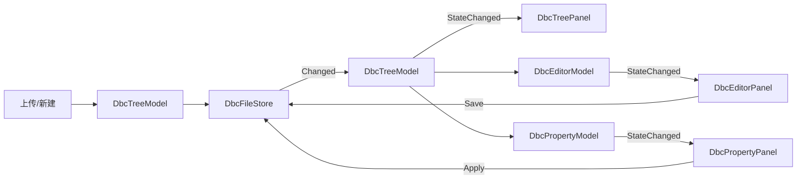

# DBC 文件管理业务 — Atlas.Demo MVVM (PanelModel) 实现方案（细化版）

> **Status:** 已审批（用户拍板：dbc-tree 替换现有内容；AtlasDemoWorkspace.razor 可改）
> **Date:** 2026-08-04
> **Branch:** feature/dbc-demo
> **Owner:** Ada / user

## Goal

在 `samples/Atlas.Demo` 实现完整 DBC (CAN database) 文件管理业务，作为
PanelModel (MVVM) 模式在 Atlas 消费方的参考实现：

1. 序列化 / 反序列化 `.dbc` 文件（往返保真）
2. Editor 两种阅读模式：原始文本 / 结构化表格
3. Left Dock 树结构：新建文件夹、显示文件、上传 `.dbc` 文件
4. 选中 `.dbc` 树节点 → 右侧属性栏显示并修改属性（消息/信号级）

## Approved Decisions

1. **dbc-tree 替换现有内容**：`leftUpper` group 的内容替换为 DBC Explorer
   （原 project 移出）；`rightUpper` 替换为属性栏（原 services 移出）；
   editor 文档组加入 DBC editor document。保留 leftLower（structure）、
   rightLower（database/products）、bottom 两个 group 作为其余 Atlas 演示。
2. **AtlasDemoWorkspace.razor 可改**：ContentRoutes 增删、@code 增删、
   布局定义调整全部允许（此前用户工作区限制解除）。

## Architecture

三层结构，对应 UA_Modeler PanelModel 模式在 Atlas 消费方的映射：

- **数据层**（纯 C#，无 Blazor 依赖，可单测）：`DbcParser` + 不可变领域模型
  `DbcDocument/DbcMessage/DbcSignal` + 内存文件树 `DbcFileStore`（事件源）。
- **视图模型层**（PanelModel）：`DbcTreeModel`（树）、`DbcEditorModel`（编辑器）、
  `DbcPropertyModel`（属性栏）。各自持有数据 + `StateChanged` 事件，面板订阅刷新。
- **视图层**（Razor）：`DbcTreePanel` / `DbcEditorPanel` / `DbcPropertyPanel`，
  订阅模型事件（等价 `BasePanel.OnModelStateChanged` → `InvokeAsync(StateHasChanged)`）。

**Atlas 集成方式**：不修改 `Atlas.Blazor` / `Atlas.Core` 任何代码。
只扩展 Demo 的 `ContentRoutes`（闭包捕获模型）与 `AtlasDemoWorkspaceDefinition`
（替换/新增 item，`contentKind` 与 `ContentRoute Kind` 对应）。

**刷新链路**：业务代码任意位置改数据 → `DbcFileStore.Changed` / 模型
`StateChanged` → 面板 `InvokeAsync(StateHasChanged)`。

## Tech Stack

- .NET 6 / Blazor WASM（Demo 现有基线）
- 无新增第三方 NuGet 依赖（DBC 解析纯手写）
- xUnit（Demo.Tests 现有基线）

---

## 布局映射（替换后）

| Atlas 区域 | 修改前 | 修改后 |
|---|---|---|
| leftUpper (InlineStartUpper) | project | **dbc-tree**（DBC Explorer） |
| leftLower (InlineStartLower) | structure | structure（保留） |
| editor (documents) | program/workspace/readme | program/workspace/readme + **dbc-editor**（DBC 文件，isPinned） |
| rightUpper (InlineEndUpper) | services | **dbc-property**（Properties） |
| rightLower (InlineEndLower) | database/products | database/products（保留） |
| bottom-left | terminal | terminal（保留） |
| bottom-right | problems | problems（保留） |

### 文件：`samples/Atlas.Demo/Components/AtlasDemoWorkspaceDefinition.cs`（修改）

```csharp
var dbcTree = Tool("dbc-tree", "DBC Explorer", contentKind: "dbc-tree");
var dbcEditor = Document("dbc-editor", "DBC Editor", isPinned: true);
var dbcProperty = Tool("dbc-property", "Properties", contentKind: "dbc-property");
// project 从 leftUpper 移除；services 从 rightUpper 移除
var leftUpper = ToolGroup("left-upper", LogicalRegion.InlineStartUpper, dbcTree.Id);
var rightUpper = ToolGroup("right-upper", LogicalRegion.InlineEndUpper, dbcProperty.Id);
// editor group 加入 dbcEditor.Id
var editor = new GroupNode(
    Id("editor"), DockItemKind.Document, GroupRetentionPolicy.Persistent,
    GroupVisibility.Expanded,
    new[] { dbcEditor.Id, program.Id, workspace.Id, readme.Id },
    dbcEditor.Id);
// items / toolBarOrders 同步增删
```

---

## 数据层设计

### 文件：`samples/Atlas.Demo/Models/Dbc/DbcDocument.cs`（新建）

```csharp
namespace Atlas.Demo.Models.Dbc;

public sealed class DbcDocument
{
    public required string Version { get; init; }
    public required IReadOnlyList<string> Nodes { get; init; }          // BU_
    public required IReadOnlyList<DbcMessage> Messages { get; init; }   // BO_
    public required string TrailingSections { get; init; }              // CM_/BA_/VAL_ 原文
}

public sealed class DbcMessage
{
    public required uint Id { get; init; }
    public required string Name { get; init; }
    public required byte Length { get; init; }
    public required string Transmitter { get; init; }
    public required IReadOnlyList<DbcSignal> Signals { get; init; }     // SG_
}

public sealed class DbcSignal
{
    public required string Name { get; init; }
    public required int StartBit { get; init; }
    public required int Length { get; init; }
    public required bool IsBigEndian { get; init; } // @0+ 小端 / @1+ 大端
    public required double Factor { get; init; }
    public required double Offset { get; init; }
    public required double Min { get; init; }
    public required double Max { get; init; }
    public required string Unit { get; init; }
    public required string Receiver { get; init; }
}
```

### 文件：`samples/Atlas.Demo/Services/DbcParser.cs`（新建）

```csharp
namespace Atlas.Demo.Services;

public static class DbcParser
{
    public static DbcDocument Parse(string content);
    public static string Serialize(DbcDocument doc);
}
```

解析规则（验收样本：`bmw_e9x_e8x.dbc` 325 BO_ / 33 CM_ / 3 VAL_）：
- `BU_:` 后整行节点名拆分（空格分隔）
- `BO_ <id> <name>: <length> <transmitter>` → message
- 后续两个空格缩进、`SG_` 开头 → 挂到当前 message
- `SG_ <name> : <start>|<len>@<byteorder><sign> (<factor>,<offset>) [<min>|<max>] "<unit>" <receiver>`
- 其余行原样累积到 `TrailingSections`（保真关键）

序列化规则：`VERSION` → `NS_` 块 → `BS_` → `BU_` → 每个 message
（`BO_` 行 + 空行 + 两空格缩进 `SG_` 行）→ `TrailingSections` 原样。
**message 间空行、SG_ 两空格缩进**（DBC 规范硬性要求）。

### 文件：`samples/Atlas.Demo/Services/DbcFileStore.cs`（新建）

```csharp
namespace Atlas.Demo.Services;

public sealed class DbcFileStore
{
    public sealed record DbcFolder(string Name);
    public sealed record DbcFile(string Name, string Content, DbcDocument? Parsed);

    public IReadOnlyList<DbcFolder> Folders { get; private set; } = [];
    public event Action? Changed;

    public void CreateFolder(string name);
    public void AddFile(string folder, string name, string content);
    public void RenameFile(string folder, string oldName, string newName);
    public void UpdateFileContent(string folder, string name, string content);
    public IReadOnlyList<DbcFile> FilesIn(string folder);
    public DbcFile? Find(string folder, string name);
}
```

---

## 视图模型层（PanelModel 模式）

### 文件：`samples/Atlas.Demo/ViewModels/DbcTreeModel.cs`（新建）

```csharp
namespace Atlas.Demo.ViewModels;

public sealed class DbcTreeModel
{
    private readonly DbcFileStore _store;
    private string? _selectedFolder;
    private string? _selectedFile;

    public DbcTreeModel(DbcFileStore store) { _store = store; _store.Changed += OnStoreChanged; }
    public IReadOnlyList<DbcFolder> Folders => _store.Folders;
    public string? SelectedFolder => _selectedFolder;
    public string? SelectedFile => _selectedFile;
    public event Action? StateChanged;

    public void Select(string? folder, string? file);
    public void NewFolder(string name);
    public void Upload(string fileName, string content);
    private void OnStoreChanged() => StateChanged?.Invoke();
}
```

### 文件：`samples/Atlas.Demo/ViewModels/DbcEditorModel.cs`（新建）

```csharp
namespace Atlas.Demo.ViewModels;

public sealed class DbcEditorModel
{
    public enum ViewMode { Text, Table }

    public string? Folder { get; private set; }
    public string? FileName { get; private set; }
    public string? RawContent { get; private set; }
    public DbcDocument? Document { get; private set; }
    public ViewMode Mode { get; private set; } = ViewMode.Table;
    public event Action? StateChanged;

    public void Open(string folder, string file, string content, DbcDocument? parsed);
    public void SetMode(ViewMode mode);
    public void Save(string newContent);   // 重新解析 → DbcFileStore.UpdateFileContent
    private void Notify() => StateChanged?.Invoke();
}
```

### 文件：`samples/Atlas.Demo/ViewModels/DbcPropertyModel.cs`（新建）

```csharp
namespace Atlas.Demo.ViewModels;

public sealed class DbcPropertyModel
{
    public string? TargetName { get; private set; }
    public string? TargetType { get; private set; }   // "Message" / "Signal" / "File"
    public string? Id { get; private set; }
    public string? Name { get; private set; }
    public string? Length { get; private set; }
    public string? Transmitter { get; private set; }
    public string? Factor { get; private set; }
    public string? Offset { get; private set; }
    public string? Min { get; private set; }
    public string? Max { get; private set; }
    public event Action? StateChanged;

    public void ShowFile(DbcFile file);
    public void ShowMessage(DbcMessage msg);
    public void ShowSignal(DbcSignal sig);
    public void Apply();
}
```

---

## 视图层（Razor）

### 文件：`samples/Atlas.Demo/Components/DbcTreePanel.razor`（新建）

- `[Parameter, EditorRequired] DbcTreeModel Model`
- 顶部操作栏：新建文件夹 + `<InputFile accept=".dbc">` 上传
- 树：文件夹 → 文件列表，选中高亮
- 订阅 `Model.StateChanged`（OnInitialized 订阅 / Dispose 退订）

```razor
@* 结构示意 *@
<div class="dbc-tree">
    <div class="dbc-tree-actions">
        <button @onclick="() => Model.NewFolder($"folder-{DateTime.Now.Ticks}")">新建文件夹</button>
        <InputFile accept=".dbc" OnChange="OnUpload" />
    </div>
    @foreach (var folder in Model.Folders)
    {
        <div class="dbc-folder">
            <strong>📁 @folder.Name</strong>
            @foreach (var file in Model.FilesFor(folder.Name))
            {
                <div class="dbc-file @(IsSelected(folder, file) ? "selected" : "")"
                     @onclick="() => Model.Select(folder.Name, file.Name)">
                    📄 @file.Name
                </div>
            }
        </div>
    }
</div>

@code {
    [Parameter, EditorRequired] public DbcTreeModel Model { get; set; } = null!;
    protected override void OnInitialized() => Model.StateChanged += OnModelChanged;
    private void OnModelChanged() => _ = InvokeAsync(StateHasChanged);
    public void Dispose() => Model.StateChanged -= OnModelChanged;
    // OnUpload: InputFileChangeEventArgs → GetMultipleFiles → ReadAsTextAsync → Model.Upload
}
```

### 文件：`samples/Atlas.Demo/Components/DbcEditorPanel.razor`（新建）

- 模式切换：文本 / 表格
- 文本模式：`<pre>` + 保存按钮
- 表格模式：消息表（Id/Name/Length/Transmitter）+ 展开信号行

### 文件：`samples/Atlas.Demo/Components/DbcPropertyPanel.razor`（新建）

- 按 `TargetType` 渲染表单 + 保存 → `Model.Apply()`

---

## Atlas 集成（ContentRoutes 修改）

### 文件：`samples/Atlas.Demo/Components/AtlasDemoWorkspace.razor`（修改，已授权）

```razor
<ContentRoutes>
    <AtlasContentRoute Kind="dbc-tree">
        <ChildContent Context="content"><DbcTreePanel Model="dbcTree" /></ChildContent>
    </AtlasContentRoute>
    <AtlasContentRoute Kind="dbc-editor">
        <ChildContent Context="content"><DbcEditorPanel Model="dbcEditor" /></ChildContent>
    </AtlasContentRoute>
    <AtlasContentRoute Kind="dbc-property">
        <ChildContent Context="content"><DbcPropertyPanel Model="dbcProperty" /></ChildContent>
    </AtlasContentRoute>
    @* 保留原 product-actions / bootstrap-table / atlas-demo-tool / atlas-demo-editor *@
</ContentRoutes>
```

```csharp
@code {
    private readonly DbcFileStore _store = new();
    private DbcTreeModel dbcTree = null!;
    private DbcEditorModel dbcEditor = null!;
    private DbcPropertyModel dbcProperty = null!;

    protected override void OnInitialized()
    {
        // 现有 workspace 创建逻辑保留...
        dbcTree = new DbcTreeModel(_store);
        dbcEditor = new DbcEditorModel();
        dbcProperty = new DbcPropertyModel();
        dbcTree.StateChanged += OnDbcSelectionChanged;   // 联动
    }

    private void OnDbcSelectionChanged()
    {
        var file = _store.Find(dbcTree.SelectedFolder!, dbcTree.SelectedFile!);
        if (file is null) return;
        dbcEditor.Open(file.Folder, file.Name, file.Content, file.Parsed);
        dbcProperty.ShowFile(file);
    }
}
```

---

## 数据流闭环



---

## 测试与验证（TDD，逐 Phase 独立 commit）

### Phase 1 — DbcParser（`tests/Atlas.Demo.Tests/DbcParserTests.cs`）

1. 解析样本片段 → Messages.Count / Signal 字段
2. **往返保真**：Parse → Serialize → 与原输入比对（忽略空白差异）
3. 序列化格式：message 间空行、SG_ 两空格缩进
4. 边界：无 message、空 signal、`Vector__XXX` receiver

验证：`dotnet test samples/Atlas.Demo/Atlas.Demo.sln`

### Phase 2 — DbcFileStore

1. CreateFolder 重名校验 / Changed 触发
2. AddFile 解析结果 / FilesIn 排序
3. UpdateFileContent 重新解析 / RenameFile

### Phase 3 — 三个 PanelModel + 联动

1. DbcTreeModel.Select / NewFolder / Upload 触发 StateChanged
2. DbcEditorModel.Open / SetMode / Save 回写 store
3. DbcPropertyModel.ShowMessage / Apply 构造新模型

### Phase 4 — 三个 Razor 面板 + Atlas 集成

1. bUnit：DbcTreePanel 渲染、上传后树出现节点
2. bUnit：DbcEditorPanel 文本/表格切换
3. bUnit：DbcPropertyPanel 修改属性 → store 更新
4. 浏览器验收（5123）：上传 `bmw_e9x_e8x.dbc` → 树节点 → 打开表格 →
   修改信号属性 → 保存 → 重新上传验证序列化文件内容

### 最终验证

- `dotnet build Atlas.sln`（0 警告 0 错误）
- `dotnet test Atlas.sln`（Core 266 + Blazor 98 保持全绿）
- `dotnet test Atlas.Demo.sln`（Demo 12 + 新增全绿）
- 浏览器实机验收（用户 VS 调试）

---

## 风险与开放问题

| 风险 | 影响 | 缓解 |
|---|---|---|
| DBC 往返保真难（CM_/BA_/VAL_ 引用 name） | 修改属性后注释丢失 | TrailingSections 原样保留，不重排 |
| 信号位序解析（`@0+`/`@1+`/`@0-`/`@1-`） | 表格显示错误 | Phase 1 用样本文件穷举验证 |
| 替换布局后现有 Demo 测试断言可能失效 | Demo.Tests 12 个可能引用 project/services | Phase 4 核对并更新受影响断言 |
| InputFile 上传需浏览器文件读取 | 复杂度 | Blazor 内置 InputFile（GetMultipleFiles + ReadAsTextAsync） |
| 大文件（857 行样本）表格渲染 | 性能 | 仅渲染选中消息，信号行懒加载/折叠 |

## 执行方式（审批后）

按 TDD 逐 Phase 执行，每 Phase 独立 commit：
1. `feat(demo): parse and round-trip DBC files`
2. `feat(demo): DBC file store`
3. `feat(demo): DBC view models`
4. `feat(demo): DBC panels wired into Atlas host`
