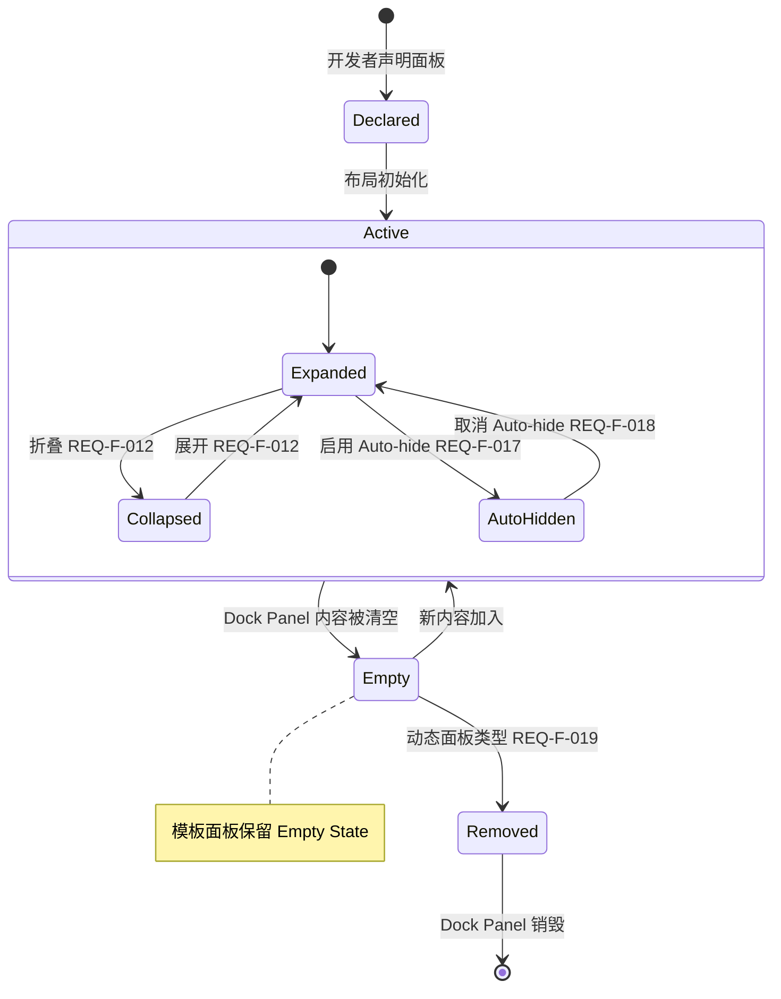
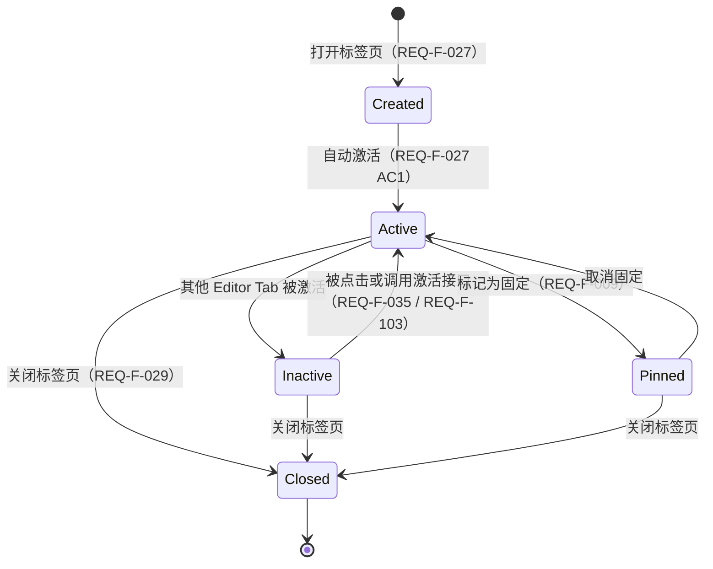
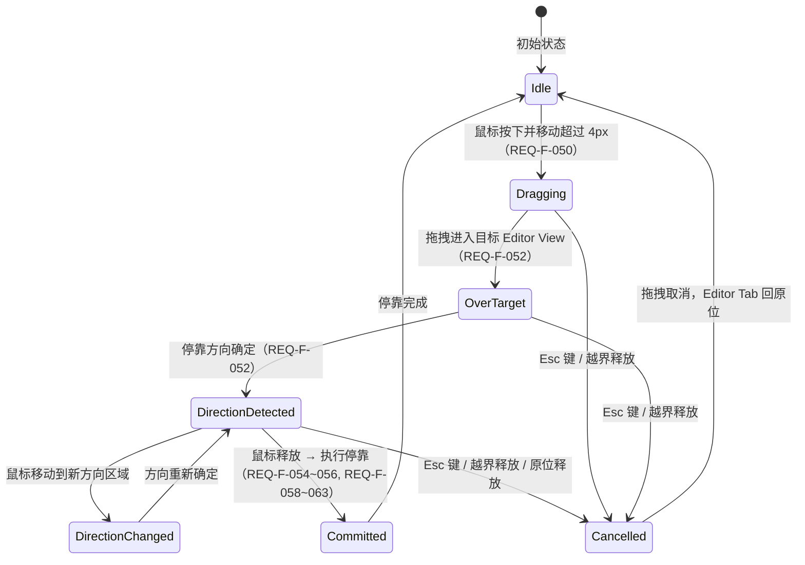
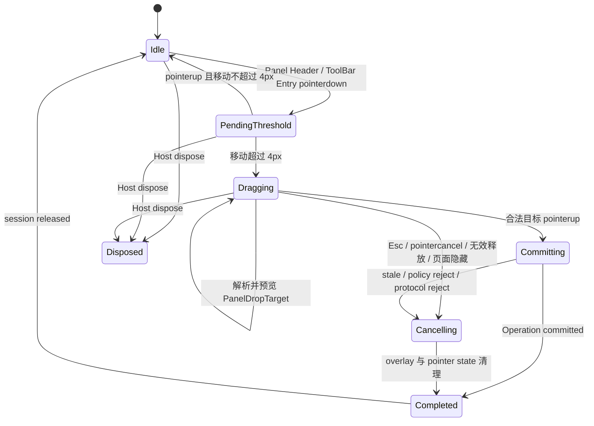

# 概要设计说明书（HLD）

> [English](../en/HLD.md) | 简体中文
>
> 状态：Chinese Synchronized。本文是英文主文档的翻译；如有冲突，以英文版本为准。

> **阅读指南**

- **本文档性质**：概要设计——描述 Atlas 内部架构，说明**如何实现** [SRS.md](./SRS.md) 中定义的产品行为。
- **前置文档**：[SRS.md](./SRS.md)（产品需求规范）。本文档使用与 SRS 完全相同的术语体系。
- **如果你是集成开发者**：只需读 SRS。本文档是框架内部的设计细节。
- **如果你是框架开发者**：本文档是第一入口——先理解架构骨架，再到 SRS 中确认要实现的用户行为细节。
- **如果你是开发 Agent**：除 SRS 与本文档主体外，必须执行 §10 的决策闸门、契约冻结和阶段验收；
  `Designed` 不等于允许绕过未关闭的 Open Issue。
- **设计条目**：本文档以编号设计条目（`DES-XXX-###`）组织，格式与 SRS 需求条目一致。每条设计决策均可追溯到 SRS 中的具体需求。

---

## 1 设计依据

以下设计目标直接派生自 SRS 的需求约束。

| 设计目标 | 来源（SRS） | 说明 |
|----------|------------|------|
| 空间结构可扩展 | F-001~004, F-049 | 当前 9 区域布局不应成为架构约束——支持未来任意嵌套分屏 |
| Dock Panel 与 Editor Tab 共享基础设施 | F-019, F-145, F-069, F-050~068 | 两者在打开/关闭/移动/去重/激活等行为上高度同构，不应维护两套代码路径 |
| 状态变更有据可查 | F-110~115, F-047 | 布局变更事件需携带完整上下文，且支持重置到初始状态 |
| 原子性保证 | F-133, F-014 | 快速连续操作需串行化；空间重分配涉及多个 Panel——中途失败不应产生不一致 |
| 持久化与运行时解耦 | F-085~088, F-091~098 | 导出/导入格式版本化，运行时模型变更不应破坏已有持久化数据 |
| 高性能拖拽 | NF-004, F-050~068, F-073~078 | 拖拽帧率 ≥30fps，JS 层高频预览不应回传 .NET |
| 多实例隔离 | F-109 | 同一页面多个 Layout Instance 互相不可见 |
| Dock 容器自适应折叠 | F-154 | 侧向/Bottom Dock 无可见 Panel 时自动折叠，释放空间给 Editor Area |
| 拖拽投放骨架 | F-155 | 隐藏 Dock Region 在拖拽期间临时渲染 Drop Scaffold 作为有效投放目标 |
| 移动操作撤销 | F-156 | Dock Panel 跨区域移动后支持撤销恢复 |

### 1.1 需求到设计的约束

SRS 是 Atlas 用户可感知行为的唯一规范来源，HLD 负责说明实现这些行为所采用的状态模型、模块接口、
交互协议、失败语义和验证方式。HLD 不复制 Acceptance Criteria，也不得以实现便利为理由降低需求。

每个设计条目遵循以下合同：

1. `来源` 列出该设计直接承担的 SRS 需求；范围引用必须能够展开为实际需求编号
2. committed state、derived projection 与 transient interaction state 必须明确区分
3. 所有 mutation 必须说明成功、失败、取消、NoChange 和并发冲突时的语义
4. 跨 Core / Blazor / TypeScript 的设计必须明确状态所有者与数据流方向
5. 设计无法同时满足冲突需求时，必须登记为 Open Issue，不得在实现中静默选择
6. 每个设计条目必须能够由 Core unit、Blazor component、Interop 或 E2E 中至少一层验证

需求追溯状态使用 `Designed`、`Partial`、`Deferred`、`Open` 四种值。`Open` 表示 SRS 存在歧义或
需要 ADR/Spike 才能确定实现合同，不代表可以跳过该需求。

### 1.2 已知待决问题

| 编号 | SRS 依据 | 问题 | HLD 处理 |
|------|----------|------|----------|
| OI-001 | F-069、F-140、F-150、F-155 | 可见 Dock Region、ToolBar 与 Drop Scaffold 对 Panel 的投放资格描述不一致 | **Closed**：ADR-0007 采用 ToolBar-first + hidden Scaffold；可见 RegionBody 默认拒绝 |
| OI-002 | F-070、DES-RND-005 | SRS 要求跨区域移动后组件内部状态保持，但 Blazor 跨父级重新挂载不能保证实例身份 | **Closed**：ADR-0012 将合同限定为内容身份与外置业务状态；跨 Group 允许 remount |
| OI-003 | SRS §5、附录 A | 正式需求块统计为 150，附录曾写为 152 | **Closed**：ADR-0014 固定 150 = F142 + NF8，附录已与正文同步 |
| OI-004 | AGENTS.md、DES-PRJ-001 | Target Framework、PackageId 与工程结构需要统一 | **Closed**：ADR-0001/0016/0017 采用 .NET 6.0、Atlas.Core/Atlas.Blazor 双包、独立 NuGet consumer sample、Node 24 LTS + npm；sample 不属于双包实现层且不加入主 solution |
| OI-005 | SRS 附录 A §3.10 | F-129、F-131 等边界场景曾出现在索引/引用中，但没有正式需求块和 AC | **Closed**：ADR-0014 将 9 个编号归类为非规范性设计/测试输入，不计入需求状态或覆盖率 |
| OI-006 | NF-006、DES-RND-001 | Blazor RenderFragment 在同一 DOM 内无法阻止内容访问其他 DOM；ErrorBoundary 也不是 security sandbox | **Closed**：ADR-0013 保持 TrustedComponent 默认路径并明确它不是安全沙箱；不可信内容使用 SandboxedFrame |
| OI-007 | F-006~008、F-122、DES-RND-001~003 | Host ContentTemplate 与 DI Registration 当前形成互斥渲染管线，无法表达一个确定性 Catalog 或强类型函数式绑定 | **Closed**：ADR-0018 采用一个 Effective Content Catalog，来源包括启动期 DI、Host-local Route 和 immutable Host-local Map；重复 startup DI 导致 Registry 构造失败，Host-local 冲突仅隔离受影响 Kind |

---

## 2 架构概览

```
DES-ARCH-001
分层架构
系统分为三层——UI 层（Blazor Components）、交互层（JS Interop）、核心层（Atlas.Core）。
每层有明确的职责边界和依赖方向。

┌──────────────────────────────────────────────────────────┐
│  Blazor UI 层（Components）                                │
│  AtlasWorkspaceHost / SplitNodeView / GroupNodeView / …   │
│  仅执行只读渲染 + 事件转发，不持有可变状态                    │
├──────────────────────────────────────────────────────────┤
│  JS 交互层（Interop）                                      │
│  拖拽预览、Splitter 实时调整、pointer 事件 → 结构化 intent   │
├──────────────────────────────────────────────────────────┤
│  Core 层（纯 C#，无 Blazor 依赖）                           │
│  ┌──────────┐ ┌──────────┐ ┌──────────┐ ┌──────────────┐ │
│  │ 布局状态  │ │ 操作引擎  │ │ 持久化   │ │ 内容身份      │ │
│  │(Snapshot) │ │(Operation)│ │(Serializer)│ │Kind/ResourceId│ │
│  └──────────┘ └──────────┘ └──────────┘ └──────────────┘ │
└──────────────────────────────────────────────────────────┘

Core 层不引用 Blazor、JSRuntime、DOM——所有布局逻辑可脱离浏览器环境进行单元测试。
JS 层只处理高频交互几何，不直接修改 committed state。Blazor 组件是状态的只读投影。

Core 项目引用限制为 BCL，不依赖任何 UI 框架；状态变更只通过 Core 层的 Operation pipeline；
Changed 事件触发一次重渲染 pass；组件用 projection dependency stamp（不可变 Snapshot 值的引用身份）门控实际重渲染，更新范围限定在受影响子树。

来源：F-001~004, NF-004, F-109
```

---

```
DES-ARCH-002
核心设计思想：不可变聚合根 + 原子操作 + 只读投影
所有布局状态收敛到一个不可变的聚合根（WorkspaceSnapshot），变更通过原子操作（Operation）提交，
UI 是该聚合根的只读投影。

"布局状态" = 当前所有 Region、Dock Panel、Editor View、Editor Tab、ToolBar Entry
的结构、位置、大小、激活关系和折叠/自动隐藏状态的完整快照。"原子操作" = 一次打开 Tab、
一次 Panel 移动、一次 Splitter 拖拽结束——操作要么完整生效，要么完全不生效。"只读投影" =
Blazor 组件不修改状态，只是把当前快照渲染成 DOM + 把用户交互转发给操作引擎。

此设计消除了"先改 A 再改 B"的中间状态窗口——任何失败不产生部分修改的残留状态。渲染组件保持为已提交
Snapshot 的只读投影；Changed 事件触发一次重渲染 pass，组级组件用 projection dependency stamp（不可变 Snapshot
值的引用身份）门控实际重渲染，避免全树无效重渲染。

Snapshot 对 consumer 只读，内部使用 immutable collection 或 copy-on-write。
不存在"直接修改 Model 属性"的 mutation 旁路。渲染组件基于明确 projection dependency stamp
实现 ShouldRender。

来源：F-133, F-047, F-110~115
```

---

```
DES-ARCH-003
边界规则
以下跨边界规则在所有设计中强制遵守：

1. Core 不引用 Blazor、RenderFragment、JSRuntime 或 DOM 类型——违反则 Core 无法独立测试
2. Blazor 依赖 Core，负责 RenderTree、component lifetime、CSS 和 JS interop——违反则依赖循环
3. TypeScript 只能提交结构化 user intent，不得直接修改 committed layout state——违反则状态多源
4. Application business state 不进入 Workspace serialization——违反则持久化泄漏运行时对象
5. Razor components 不直接修改 Snapshot 或内部 Model——违反则旁路 mutation 不可追溯
6. Workspace mutation 只能经过 IAtlasWorkspace.ExecuteAsync——违反则操作不可追溯
7. 一次成功 Operation 只发布一个 ChangeSet——违反则渲染不一致

每条规则对应一个已知的 V1 架构问题——多 mutation path、per-element JS registration、
runtime object persistence 等。V2 通过硬性边界规则消除这些问题的可能性。

规则 5 和 6 由 API design 强制保证：Snapshot 不暴露 mutable collection，Components 不持有
IAtlasWorkspace 引用以外任何可修改状态的句柄。规则 3 由 versioned interaction protocol 强制：
JS commit payload 是固定 schema 的 discriminated union。

来源：F-109, F-133, NF-006
```

---

```
DES-ARCH-004
状态所有权与单向数据流
Atlas 将状态划分为三类，禁止跨类别复制同一语义的可变状态：

  Committed Domain State（Core）
    WorkspaceSnapshot、Layout Tree、DockItem、Group selection、ToolBar visibility、
    Auto-hide placement、History 和 Revision。

  Derived Render Projection（Blazor）
    ToolBar Entry、可见 Panel、Tab header、CSS track、ARIA 属性和局部渲染 stamp。
    Projection 可缓存，但必须能仅由 Snapshot + render options 重建。

  Transient Interaction State（TypeScript / Host）
    pointer capture、drag session、geometry snapshot、hover/flyout timer、Drop Scaffold、
    preview、focus request 和 ResizeObserver invalidation。

数据流固定为：

  user input → TypeScript intent → IAtlasWorkspace.ExecuteAsync
    → WorkspaceSnapshot + LayoutChangeSet → Blazor projection → DOM

TypeScript 不持有 committed layout 副本；Blazor 不把 projection 回写为 domain state；Core 不读取
DOM 几何。交互提交携带 BaseRevision，Core 在 linearization point 前重新验证，避免拖拽期间其他
operation 导致旧几何覆盖新状态。

来源：F-100, F-109~115, F-133, NF-004~005
```

---

## 3 领域模型

```
DES-DOM-001
SRS 概念到内部模型映射
SRS 定义的产品概念在内部实现中按以下映射表达：

| SRS 概念         | 内部模型                                   | 说明                     |
|-----------------|------------------------------------------|-------------------------|
| Layout Instance | Workspace + WorkspaceSnapshot            | 布局实例的聚合根               |
| Region          | LayoutNode（SplitNode / GroupNode）        | 空间树节点，替代固定命名 Region    |
| Dock Panel      | DockItem（Kind = Tool）                    | Tool 类型的内容项             |
| Editor Tab      | DockItem（Kind = Document）                | Document 类型的内容项         |
| Editor View     | GroupNode（Kind = Document）               | Document 分组容器           |
| Content Identifier | ContentReference                       | 内容渲染器种类 + 业务资源身份       |
| ToolBar Entry   | ToolBarProjectionEntry                    | 不独立存储，从 Tool Item placement 推导 |
| LT / RT         | ToolBarState + ToolBarProjection          | 固定导航 Chrome；不是 Dock Region |
| Auto-hide State | AutoHideStripState                        | Tool Item 的一种 committed placement |
| Bottom Dock     | WorkArea 的子 SplitNode                     | 通过 Layout Tree 的子节点关系表达 |

Dock Panel 和 Editor Tab 共享 DockItem 作为统一内容项模型。两者的差异由 DockItemKind、
Capabilities 和 DockingPolicy 表达，不维护两套独立的 model hierarchy。ToolBar Entry 不独立
持久化——它从 DockItem 的归属关系实时推导，避免第二真相源。LT/RT 不是"面板容器"，是导航入口——
它们不参与 Panel 移动（F-020~024）。

ToolBar 为所有 Tool Item 提供统一入口，不等同于 AutoHideStrip。Expanded、Collapsed 与
AutoHidden Panel 均生成恰好一个 ToolBar Entry；AutoHideStrip 只保存 AutoHidden Item 的 placement
与 dock-back bookmark。ToolBar Entry 是渲染层派生数据——WorkspaceSnapshot 中不存储 ToolBar
条目表。派生投影（ToolBar Entry、Tab header 等渲染层数据）在每次渲染 pass 中由已提交的 Snapshot 重算；
Changed 事件触发该 pass，projection dependency stamp 限制实际重渲染。固定命名的 Region 不再
作为 domain type——IDE preset 通过 Layout Tree builder 生成对应 SplitNode/GroupNode 结构。

来源：§1.7 空间概念, §1.3 系统架构, F-020~024, F-149
```

---

```
DES-DOM-002
Workspace 聚合根
WorkspaceSnapshot 是 committed state 的唯一公开快照，对 consumer 只读：

  WorkspaceSnapshot = {
      Id,                   // 布局实例唯一标识
      Revision,             // 单调递增的并发版本号（每次成功操作 +1）
      RootNodeId,           // 空间树根节点（null = 空布局）
      Nodes,                // LayoutNode 字典（SplitNode / GroupNode）
      Items,                // DockItem 字典
      ToolBars,             // 按 LogicalSide 保存 ToolBar committed visibility
      ToolBarOrders,        // ToolBar-only 排序；不改变 Group 内 Panel 逻辑顺序
      AutoHideStrips,       // Auto-hide 停靠条状态（按 WorkspaceEdge）
  }

所有权规则：

1. RootNodeId + Nodes、Items、ToolBars、ToolBarOrders 和 AutoHideStrips 是 committed authoritative state（F-002）
2. ToolBar Entry 列表、Item 排序索引等是派生投影，不持久化、不是第二真相源（F-021）
3. RootNodeId = null 是唯一空布局表示，不增加 EmptyNode（F-003；历史边界场景 F-131）
4. 每个打开 Item 必须恰有一个 placement：Group 或 Auto-hide Strip（F-069, F-017）
5. 新建 Workspace 的初始 Revision 为 0；第一次成功 mutation 发布 Revision 1
6. Snapshot 对 consumer immutable；内部可使用 immutable collection 或 copy-on-write（F-133）

Snapshot 通过 IReadOnlyDictionary 和 IReadOnlyList 暴露，不暴露 mutable collection。
内部 Store 维护 Node/Item index 供 Renderer 快速查找，index 与 Snapshot 原子更新。
Revision 使用 checked increment，溢出时拒绝提交。

来源：F-001~004, F-109, F-047
```

---

```
DES-DOM-003
Layout Tree（空间树）
SRS §1.3 的固定 9 区域层级树在内部由 Layout Tree 表达，由两种 sealed node type 构成。

SplitNode — 描述两个子节点之间的空间划分：
  Axis: InlineChildren（水平排列）| BlockChildren（垂直排列）
  Anchor: FixedPixels 时约束 First 还是 Second child
  Basis: FixedPixels（像素值）| Proportional（比例）
  Constraints: min/max 尺寸约束
  FirstId, SecondId: 两个子节点 ID

GroupNode — 按顺序容纳一组 DockItem，拥有唯一 committed selection：
  Kind: Tool | Document
  RetentionPolicy: Persistent（模板）| Dynamic（动态）
  Visibility: Expanded | Collapsed
  ItemIds: 有序的 DockItem ID 列表
  SelectedItemId: 当前选中的 Item（null 表示空 Group）

Split sizing 规则：IDE preset 的 outer tool dock 使用 FixedPixels，editor-local split 默认
使用 Proportional（F-015~016, F-144）。Proportional 表示 First child 占可用空间比例。min/max
由 SplitConstraints value object 表达（F-015~016, F-078）。两个 child 最小尺寸总和超过容器时，
不修改 committed basis，由 Renderer 使用确定性 clamp policy（F-078）。resize drag 只在
pointerup 提交一个 history entry（F-074, NF-004）。

SRS 9 区域布局的空间树表达：

  Root (Split, BlockChildren)
  ├── TopToolbar Fixed Slot（不在树中）
  ├── WorkArea (Split, BlockChildren)
  │   ├── MainRow (Split, InlineChildren)
  │   │   ├── LeftDock (Split, BlockChildren)
  │   │   │   ├── GroupNode: Left Dock Upper (Tool, Persistent)
  │   │   │   └── GroupNode: Left Dock Lower (Tool, Persistent)
  │   │   ├── GroupNode: Editor Area (Document, Persistent)
  │   │   └── RightDock (Split, BlockChildren)
  │   │       ├── GroupNode: Right Dock Upper (Tool, Persistent)
  │   │       └── GroupNode: Right Dock Lower (Tool, Persistent)
  │   └── BottomDock (Split, InlineChildren)
  │       ├── GroupNode: Bottom Left Dock (Tool, Persistent)
  │       └── GroupNode: Bottom Right Dock (Tool, Persistent)
  └── StatusBar Fixed Slot（不在树中）

Top Toolbar 和 Status Bar 不在空间树中——它们是 Fixed Slot（固定装饰区域），不参与 Dock Panel
的承载和移动（F-002）。只有承载 Dock Panel 或 Editor View 的节点进入 Layout Tree。SplitAxis
描述 child 排列（Inline/Block），不描述 separator 朝向——ARIA separator orientation 由
renderer 反向派生。

Dock 容器自适应折叠（F-154）的渲染规则：侧向 Dock 的 Upper 和 Lower 子 Group 均无展开 Panel
时不渲染该侧 Dock 内容列及 Splitter，Editor Area 获得释放空间；Bottom Dock 的 Left 和 Right
子 Group 均无展开 Panel 时不渲染 Bottom Dock 行及 Splitter；仅一个子 Group 有展开 Panel
时隐藏其他空子 Group，可见子 Group 占满容器；以上所有情况下 ToolBar Entry 保留（F-021），
用于重新展开或 Auto-hide Flyout。

首版 closed hierarchy：只允许 SplitNode 和 GroupNode，不引入 LeafNode 或 EmptyNode。
SplitAxis.InlineChildren = children 沿 inline axis 排列，BlockChildren = 沿 block axis 排列。
Collapsed 首版只允许 Tool Group，Document Group 必须为 Expanded。Auto-hide 是 Item placement，
不与 Collapsed 共用状态。

来源：F-001~004, F-049, F-025~026, F-154
```

---

```
DES-DOM-004
Dock Item 统一模型
Dock Panel（Tool）和 Editor Tab（Document）统一为 DockItem：

  DockItem = {
      Id,                  // 在 Workspace 内唯一
      Kind,                // Tool | Document
      Title,               // 显示标题（F-143）
      Icon,                // 图标，可选（F-143）
      Content,             // ContentReference（F-006~008）
      Capabilities,        // 可关闭/可移动/可固定/可AutoHide/可分屏
      DocumentState,       // Document 专属状态（IsPinned, IsPreview），仅 Document 有效
  }

Tool 与 Document 共享：identity、title/icon、content identity、group ordering、selection、
move/reorder、close、rendering outlet。差异由 DockItemKind、kind-specific state、Capabilities
和 DockingPolicy 表达。

Capabilities 表达 Item 的稳定固有能力（F-036~037, F-009, F-017）：
  Tool:            CanClose, CanMove, CanAutoHide
  PermanentTool:   CanMove, CanAutoHide  (CanClose = false)
  Document:        CanClose, CanMove, CanSplit, CanPinDocument
  PreviewDocument: CanClose, CanMove     (CanPinDocument = false)

"当前能否移动到这个 target"由 Docking Policy 根据 Snapshot 和 target context 计算，不存储在
Capabilities 中。Capabilities 只表达 Item 自身的固有能力——避免了"为什么 Panel A 有时可移动
有时不可"的困惑。DocumentState 仅对 Kind = Document 有效，Tool 的 pin/unpin 语义由 Auto-hide
机制表达，不复用 Document pin——避免同一字段在不同 kind 下有不同语义。

Capabilities 由 runtime definition/provider 派生，不信任持久化输入。缺失 provider 的
placeholder 使用保守能力（全 false）。提供常用 preset 静态工厂方法，避免开发者逐项赋值。

来源：F-019, F-145, F-143, F-006~009, F-036~037
```

---

```
DES-DOM-005
Content Reference（内容引用）
ContentReference 由 Kind（渲染器种类）和 ResourceId（业务资源身份）组成：

  ContentReference = {
      Kind,        // 由哪个 renderer/provider 渲染（如 "explorer", "document-editor"）
      ResourceId,  // 当前业务资源身份（如 "main-solution", "42"）
  }

语义：Kind = 谁负责渲染，ResourceId = 渲染什么内容。ContentReference 不包含 title、event
callback、parameter dictionary、view model、service instance 或 UI occurrence identity。

多个 DockItemId 可以引用同一 ContentReference——业务共享状态按 ResourceId 管理，per-view
cursor/scroll 等状态按 DockItemId 管理。

去重（F-046）默认 identity 为 Kind + ResourceId，支持四种模式：ActivateExisting（激活已有
Item，不新建）、AllowMultiple（允许多个 DockItem 引用相同 ContentReference）、ReplaceExisting
（保留原 DockItemId 和 placement，替换 ContentReference）、RejectDuplicate（返回 typed error）。

将渲染器标识（Kind）与业务资源标识（ResourceId）分离，使应用层可以同一 renderer 渲染不同资源，
以及不同 renderer 渲染同一资源的不同视图，避免 V1 中 ContentKey 同时承担两种职责的模糊性。

ContentReference 是 immutable value object，构造时拒绝 null/empty。去重判定由
IContentIdentityPolicy 执行，默认使用 Kind + ResourceId。AllowMultiple 下多个 DockItemId
共享 ResourceId——应用层自行管理共享状态。

来源：F-006~007, F-046, F-095
```

---

```
DES-DOM-006
Auto-hide 与 Collapsed 分离
Auto-hide placement 是 committed state：

  AutoHideStripState = { Edge, Entries }
  其中 Edge 为 InlineStart（左）/ InlineEnd（右）/ BlockEnd（下）
  AutoHideEntry = { ItemId, DockBack }
  DockBack = { PreferredGroupId, PreferredIndex, FallbackEdge }

约束：Auto-hide 仅接受 CanAutoHide 且 Kind = Tool 的 Item。恢复时优先使用仍存在的
PreferredGroupId；目标已消失时由 Docking Policy 选择或创建合法 Tool Group。以下状态是
transient UI state，不持久化：hover item、flyout open/closed、300ms close timer、pointer
位置、drag preview。

Collapsed Tool Group 是 committed state：Collapsed Group 仍保留在 Layout Tree 中，但不占用
正常内容空间，也不获得 hover flyout。Collapsed Group 的 ancestor Split 保留原 committed basis
作为展开恢复值。Renderer 将 collapsed child 的 resolved content extent 视为 0、隐藏相邻 splitter。

Expanded ↔ Collapsed（F-012）与 Auto-hide placement（F-017）是两组独立状态。Collapsed 是
Group 的可见性状态——Group 仍在树中，只是不占空间；Auto-hide 是 Item 的 placement 状态——
Item 从 Group 中移出到停靠条。合并这两组状态会导致"折叠后是否应该出现 hover flyout"的语义冲突。

Auto-hide 恢复时，若 PreferredGroupId 已消失，Docking Policy 在 FallbackEdge 选择或创建 Tool
Group。拖动 auto-hidden Item、删除原 Group 和 restore/migration 必须显式更新 bookmark。
Collapsed 全部 Group 时显示 Workspace empty-content surface，同时继续渲染可恢复的 Toolbar entries。

来源：F-017~018, F-012, F-154
```

---

```
DES-DOM-007
强类型 ID
所有实体标识使用强类型 value type，不使用裸 string：

  WorkspaceId   — 布局实例唯一标识
  LayoutNodeId  — 空间树节点唯一标识
  DockItemId    — 内容项唯一标识

构造时拒绝 null、empty 和 whitespace；使用 ordinal equality；实现 IEquatable<T>、==、!=。
ToString() 仅用于诊断，不承担 serialization protocol。JSON/XML 映射由明确 converter/DTO 负责。

裸 string ID 导致无法在编译期区分"这是 Node ID 还是 Item ID"、无法保证 ID 格式合法性、
序列化协议与 domain identity 耦合。强类型 ID 在类型系统层面防止 ID 混淆。

使用 readonly struct 实现，保证零堆分配。内部存储使用 readonly string _value。DTO 层使用
string，与 domain 层之间通过显式转换映射。

来源：F-109, F-028, F-124
```

---

```
DES-DOM-008
不变量（Invariants）
每次 transaction 提交前必须验证以下不变量。任何失败回滚整个 transaction，不产生部分修改。

1. 每个 NodeId 唯一
2. 每个 DockItemId 唯一（F-124）
3. Layout Tree 无循环
4. 每个已打开 DockItem 必须且只能属于一个 Group 或一个 Auto-hide Strip（F-069, F-017）
5. 非空 Group 的 SelectedItemId 必须指向该 Group 中一个 Item；空 Group 的 SelectedItemId 必须为空（F-022）
6. Group 不含重复 ItemId
7. Group 中每个 Item 的 Kind 必须与 Group Kind 兼容，首版不允许 mixed Group（F-019, F-145）
8. Document Item 不进入 Auto-hide Strip；Collapsed 只允许 Tool Group（F-017~018）
9. Split child ID 必须解析且不同，Layout Tree 无共享 child
10. Persistent Group 可以为空；Dynamic Group 为空时自动删除（F-019, F-031, F-145）
11. 删除空 Dynamic Group 后必须递归提升单子 Split 的 sibling
12. 任何失败 operation 不改变 published Snapshot、Revision 或 History（F-133）
13. ContentReference kind/resourceId 非空；所有 Strong ID 不得为 default（F-006）
14. RootNodeId = null 是唯一空布局表示，不增加 EmptyNode（F-003；历史边界场景 F-131）
15. InlineStart / InlineEnd 各最多一个 ToolBarState；ToolBarState 不创建第三个物理侧
16. 每个 ToolBarOrderState 只引用同一 LogicalRegion 的 Tool Item，ItemId 唯一且与 placement
    集合构成完整排列；AutoHidden Item 的 LogicalRegion 由有效 DockBack 解析

不变量是防止状态腐败的最后防线。每条不变量对应一类已知的 V1 状态 bug——重复 selection、
孤立 Item、半应用变更等。Validator 在每次 transaction commit 前运行，与 Operation Planner
紧密耦合：Planner 产出 candidate，Validator 验证 candidate，两者共享同一 invariant rule engine。

Validator 是纯函数：输入 candidate Snapshot，输出 pass/fail + violation list。Topology
normalization 自叶到根执行。提升 sibling 时保留 sibling NodeId；被删除 Split/Group 的原 Node、
placement、basis、selection 和 visibility 必须进入 reverse patch。Core compatibility matrix
是封闭规则：首版 Docking Policy 只能收紧、不能放宽 Core invariant。

来源：F-133, F-019, F-031~032, F-069, F-017~018
```

---

```
DES-DOM-009
ToolBar 状态与派生投影
ToolBar 是 Work Area 两侧的固定导航 Chrome，不属于 Layout Tree，也不是 DockItem placement。
每个逻辑侧维护最小 committed state：

  ToolBarState = {
      Side,                 // InlineStart | InlineEnd；Renderer 映射为物理 Left / Right
      Visibility,           // Expanded | Collapsed
  }

ToolBar Entry 不作为实体持久化。Renderer 通过纯投影函数构建：

  BuildToolBarProjection(snapshot, side) -> ToolBarProjection

  ToolBarProjection = {
      Side,
      Visibility,
      UpperSection: {
          UpperDockEntries,
          LowerDockEntries,
      },
      BottomSection: {
          BottomDockEntries,
      },
  }

  ToolBarProjectionEntry = {
      ItemId,
      SourceGroupId,        // AutoHidden 时由 DockBack.PreferredGroupId 解析
      LogicalRegion,
      Order,
      Title,
      Icon,
      IsActive,
      DisplayState,         // Expanded | Collapsed | AutoHidden
  }

投影规则：

1. 每个 Tool Item 必须生成且只生成一个 Entry；Document Item 不生成 Entry
2. Group placement 与 AutoHide placement 互斥，合并投影时按 ItemId 去重并把重复视为 invariant failure
3. Upper / Lower / Bottom 分区由 IDE preset 的 Group semantic slot 决定，不由 DOM 位置反推
4. Group 内 ItemIds 表达 Panel 逻辑顺序；ToolBar-only presentation order 由独立
   `ToolBarOrderState` 保存，不修改 Group ItemIds（F-140 AC2 与 F-142）
5. 跨侧移动后 Side 与分区由目标 placement 重新推导；标题、图标和点击 identity 保持不变
6. 空逻辑分区在静止状态不生成虚拟 Entry；拖拽可达性由 transient PanelDropTarget 表达
7. RTL 只交换 LogicalSide 到物理边缘的映射，不修改 persisted Side 和 ordering
8. ToolBar 无任何 Entry 时不渲染；ToolBar Collapsed 时保留可恢复入口，不删除 Entry

ToolBarProjection 是 Core 中可纯函数测试的 read model；Atlas.Blazor 负责将其渲染为 button、
separator 和分区容器。投影不得保存 DOM 引用、focus、hover、Flyout open state 或 drag placeholder。

来源：F-020~024, F-140, F-149~153
```

---

```
DES-DOM-010
尺寸约束、折叠与空间重分配
Layout Tree 的空间尺寸只由 SplitNode 表达；DockItem 不直接保存当前像素尺寸。开发者声明的 Panel
初始比例和 min/max 转换为稳定的 sizing metadata：

  ToolSizingDefinition = {
      InitialRatio?,        // (0, 1]；初始化与 Reset 时使用
      MinExtent?,           // CSS px，有限且 >= 0
      MaxExtent?,           // CSS px，有限且 >= MinExtent
      CollapsedExtent,      // 主题/option 给出的折叠尺寸
  }

  ResolvedSplitLayout = {
      FirstExtent,
      SecondExtent,
      EffectiveConstraints,
      IsClamped,
  }

ToolSizingDefinition 属于声明/运行时定义，不从不可信持久化文档覆盖。当前尺寸仍保存为 SplitBasis；
ResetWorkspaceOperation 根据 initial definition 重建 basis。一个 Tool Group 有多个 Panel 时，当前
Active Item 的 sizing definition 决定 Group 的有效约束；未指定值回退到 Group/preset 默认值。

空间分配规则：

1. Expanded → Collapsed 不删除 Group，也不改写其恢复 basis；Renderer 将其 resolved content extent
   设为 CollapsedExtent，释放空间由 sibling 获得
2. Collapsed → Expanded 恢复原 committed basis；容器不足时按 min/max 确定性 clamp
3. Dynamic Group 删除后提升 sibling，sibling 占用原 Split 的全部可用空间；reverse patch 保存原树
4. 多个相邻可见 child 需要重分配时按原 resolved extent 比例分配，舍入余数确定性分配给最后一个
5. min 总和超过容器时不修改 committed basis；按最小可用 extent + overflow policy 渲染并记录 warning
6. max 产生剩余空间时优先分配给 Editor Area 或未达到 max 的 sibling，不生成负尺寸或 NaN
7. 所有 Tool Group 均折叠时允许 Editor Area 获得剩余空间；ToolBar Entry 继续可用
8. Splitter collapse button 与编程式 collapse 进入同一个 SetGroupVisibilityOperation

Container resize、Splitter preview 与最终 commit 均调用同一个纯 `ResolveSplitLayout` 算法，避免
CSS、TypeScript 和 Core 各自实现一套 clamp 规则。Preview 使用相同输入但不写 Snapshot。

来源：F-014~016, F-033, F-047, F-078, F-082, F-104, F-141, F-144, F-148
```

---

```
DES-DOM-011
Editor Tab 顺序、选择与最近访问状态
Document Group 在 GroupNode 基础上维护 Editor 行为配置：

  EditorGroupState = {
      OverflowMode,         // Scroll | Menu | Wrap
      ActivationPolicy,     // Adjacent | MostRecentlyVisited
      RecentlyVisitedIds,   // 最近在该 Group 被用户点击的 ItemId，最新在前
  }

Group.ItemIds 是唯一 Tab 逻辑顺序。DocumentState.IsPinned 形成稳定前缀：

  [Pinned Items...] [Unpinned Items...]

插入、拖拽和恢复必须保持此前缀不变量。新建非固定 Tab 插入 unpinned 分区；拖拽跨越 pin boundary
时将目标 index clamp 到所属分区，不以拖拽隐式改变 IsPinned。固定/取消固定是独立 operation，
提交后把 Item 移到对应分区的确定位置。

关闭 Active Tab 后的 selection planner：

1. ActivationPolicy = MostRecentlyVisited 时，选择 MRU 中仍存在且属于当前 Group 的第一项
2. 否则选择被关闭 index 右侧的新同 index Item
3. 右侧不存在时选择左侧最后一项
4. Group 为空时 SelectedItemId = null，再按 RetentionPolicy 保留或删除 Group

“访问”仅由终端用户点击 Tab 产生；编程式 activate、restore、open 自动激活和 close fallback
不写 RecentlyVisitedIds。关闭/移动 Item 时清理无效 MRU 引用；列表按 option 上限截断。

OverflowMode 与 logical ordering 是 committed/configured state；哪些 Tab 当前不可见、scrollLeft、
menu open 和行折叠测量是 transient render state。DockItem.Title 是标题唯一来源，自定义标题更新
通过 UpdateItemPresentationOperation 发布 Item change。

来源：F-034, F-038~040, F-042~045, F-048, F-138
```

---

## 4 操作引擎

```
DES-OP-001
Operation 模型
所有布局变更都封装为操作（Operation）——一个描述"从当前快照到目标快照需要做什么"的原子指令。
不存在"逐条修改属性"的旁路。

第一批 operation：

  OpenItemOperation              — F-027, F-101（打开 Tab/Panel）
  CloseItemOperation             — F-029, F-102（关闭 Tab/Panel）
  SelectItemOperation            — F-035, F-103（激活 Tab/Panel）
  MoveItemOperation              — F-069, F-140（跨区域移动 Panel）
  ReorderItemOperation           — F-142, F-151（区域内排序）
  SplitItemOperation             — F-049, F-055（分屏/方向停靠）
  ResizeSplitOperation           — F-073~078（Splitter 拖拽调整）
  SetGroupVisibilityOperation     — F-012, F-104（折叠/展开）
  SetAutoHideOperation           — F-017（启用 Auto-hide）
  RestoreAutoHiddenItemOperation — F-018（取消 Auto-hide）
  UpdateItemPresentationOperation — F-143（更新标题/图标）
  ReplaceContentReferenceOperation — F-006（替换内容引用）
  ResetWorkspaceOperation        — F-047（重置布局）
  RestoreWorkspaceOperation      — F-086, F-092, F-097（恢复/导入布局）

SRS 中用户操作的效果经常涉及多个实体。如关闭一个 Editor Tab（F-029）涉及移除 Tab + 按策略激活
另一个 Tab + 若为 Dynamic View 的最后一个 Tab 则移除 View + 若 View 移除则重分配空间。逐条
修改属性会因中间步骤失败产生不一致。Operation 模式保证"全部成功或全部回滚"。

便捷 API OpenToolAsync / OpenDocumentAsync 是 operation facade，不建立旁路。所有 operation
都是不可变 value object。新 operation 类型添加时不需修改已有 operation 逻辑——Planner 按
operation type 分发。

来源：F-027~029, F-069, F-049, F-073~078, F-012, F-017, F-047, F-086
```

---

```
DES-OP-002
Transaction Pipeline
操作执行流程：

  API 调用 → 基于当前 Snapshot 构造 Candidate Snapshot
    → 执行 Guard（如关闭前回调 F-041）── 拒绝 → 返回失败，当前状态不变
    → 执行 Validator（检查所有不变量、尺寸约束、去重冲突）
    → 原子替换：旧 Snapshot → 新 Snapshot（Revision + 1）
    → 发布 Changed 事件（F-110~115）

提交合同：

1. 从 current Snapshot 构建 candidate Snapshot、forward/reverse patch、candidate History
   和 ChangeSet
2. 在 candidate 上执行完整 invariant validation（F-133）
3. 原子替换 Snapshot + History 是唯一 linearization point（F-133）
4. Revision 在每次 Execute/Undo/Redo/Restore 成功提交时单调递增；Undo 不回退 Revision
5. failed/no-op/cancelled/stale operation 不交换 state、不递增 Revision、不发布事件（F-133）
6. Changed 事件在锁外发布；subscriber 异常逐个隔离并记录，不阻止后续 subscriber（F-110）
7. subscriber 中重入 ExecuteAsync 可以提交新 Revision，但新事件排在当前事件全部 subscriber 之后

关键设计：Guard（可能异步）在 transaction 外执行；Validator 和 state swap 在短 transaction
内完成。这避免了"持锁期间 await consumer callback"的死锁和 ABA 问题。Changed 在锁外发布，
防止 subscriber 中的重入操作与当前 transaction 互相阻塞。

内部提交使用 WorkspaceStoreState（Snapshot + History 作为一个原子引用替换）。Event dispatcher
不承诺 consumer SynchronizationContext；Blazor Host 通过 InvokeAsync marshal 到 renderer
context。ExecuteAsync 的成功只取决于 commit，不取决于 subscriber 是否成功。

来源：F-133, F-041, F-110~115
```

---

```
DES-OP-003
Async Guard（关闭前回调）
Close/save confirmation 可能异步（F-041）。首版采用严格 Workspace Revision 防止 ABA 问题：

  1. 在 transaction 外执行 async guard
  2. guard 前记录 BaseRevision
  3. guard 完成后进入短 transaction
  4. 若 current Revision ≠ BaseRevision，返回 StaleOperation，不自动重试 guard
  5. 构建并原子应用 patch
  6. publish one change set

禁止在 Workspace lock 内执行 guard、provider、migration hook 或任何 consumer callback。两个
并发 Close 不能静默触发两次保存/确认——第二个调用应共享已有 decision 或返回 typed conflict。
首版采用严格 Revision 而非实体级 version，优先保证简单和可验证。

Guard 接口：IDockItemCloseGuard.CanCloseAsync(DockItemCloseContext, CancellationToken)。
Domain 不持有 delegate，应用通过 DI/registration 将 guard 与 Content Kind 或 Item 关联。
按 operation/session 键控的 in-flight coordinator 保证一次 CloseItemOperation 最多执行一次
guard。Cancellation 只在 linearization point 前生效；state swap 后必须返回真实 committed result。

来源：F-041, F-029
```

---

```
DES-OP-004
Reversible Patch
每次成功 operation 同时生成 forward patch 和 reverse patch。History 不理解 Open、Move、Split
等业务语义，只理解 patch step：

  ForwardPatch  = 从当前 Snapshot 到目标 Snapshot 的变更步骤
  ReversePatch  = 从目标 Snapshot 回到当前 Snapshot 的变更步骤

首版 patch step 类型：
  ReplaceRoot(expectedBefore, after)
  ReplaceNode(nodeId, expectedBefore, after)
  ReplaceGroupItems(groupId, expectedBefore, after)
  ReplaceItem(itemId, expectedBefore, after)
  ReplaceAutoHideStrip(edge, expectedBefore, after)

每个 step 携带 expected-before，使用稳定 ID 寻址，不依赖会被前序 step 改变的裸 index。Reverse
从同一步的 before/after 自动推导。

Move 示例（对应 F-069）：
  Forward:
    1. 从 Group A 移除 item-x
    2. 恢复 Group A 的 selected item
    3. 将 item-x 插入 Group B
    4. Group B selected = item-x
    5. 清理空 Dynamic Group A（若适用）
  Reverse:
    1. 必要时重建 Group A 及其原 placement
    2. 从 Group B 移除 item-x
    3. 将 item-x 插回 Group A 原位
    4. 恢复 Group A / Group B 原 selected item
    5. 恢复被 cleanup 的 Split/Group topology

Patch step 携带 expected-before——如果当前 state 与 expected-before 不匹配，说明有并发修改或
bug，应拒绝应用（fail-fast）。这避免了 V1 中 undo 基于 stale snapshot 恢复导致的静默状态损坏。

所有 step 只应用到私有 candidate builder，中间状态不发布。patch 必须通过 round-trip invariant
test：apply forward 后 apply reverse，snapshot 与初始语义等价。Operation Planner 负责同时生成
Forward 与 Reverse——不手写两套独立逻辑。

来源：F-133, F-069, F-156
```

---

```
DES-OP-005
Undo / Redo
Undo/Redo 规则：

1. 只有成功 committed patch 进入 history
2. Undo = 执行 ReversePatch（产生新 Revision）；Redo = 执行 ForwardPatch（F-156）
3. failed/cancelled/no-op/stale operation 不进入 history
4. Undo 后执行新 operation 清空 redo branch
5. Restore/Reset 是明确 history barrier——默认以新的空 History 与 Snapshot 同时提交（F-047, F-086）
6. resize drag 只在 pointerup 提交一个 history entry（F-074）
7. 连续 keyboard resize 按 (SplitNodeId, input kind) 和配置时间窗口合并
8. History 有 entry 数量上限，超限时淘汰最旧记录
9. 单个 entry 超过 byte budget 时，operation 仍可提交但成为 history barrier

Undo/Redo 只保证 committed Workspace layout state，不撤销 consumer 保存、文件句柄、业务 store
或已执行 guard 的副作用。Close Undo 通过 ContentReference 重新解析内容并允许 remount——这比
试图恢复已 dispose 的组件实例更可靠。

History options：MaxEntries（默认 100）、ApproximateMaxBytes、ResizeCoalescingWindow（默认
500ms）。新 operation 先清空 redo branch，再从最旧的 undo entry 开始淘汰。单个 entry 超 byte
budget 时返回带 HistoryNotRecorded warning 的 success，不能让旧 entry 在新 state 上伪装成可撤销。

来源：F-156, F-047
```

---

```
DES-OP-006
IAtlasWorkspace 公共接口与 LayoutChangeSet
公共接口：

  public interface IAtlasWorkspace : IAsyncDisposable
  {
      WorkspaceId Id { get; }
      WorkspaceSnapshot Current { get; }
      bool CanUndo { get; }
      bool CanRedo { get; }
      event EventHandler<WorkspaceChangedEventArgs>? Changed;
      ValueTask<WorkspaceResult<LayoutChangeSet>> ExecuteAsync(
          LayoutOperation operation, CancellationToken cancellationToken = default);
      ValueTask<WorkspaceResult<LayoutChangeSet>> UndoAsync(
          CancellationToken cancellationToken = default);
      ValueTask<WorkspaceResult<LayoutChangeSet>> RedoAsync(
          CancellationToken cancellationToken = default);
  }

LayoutChangeSet 是通用 Changed 事件的 F-110 契约载荷，也是强类型领域事件（ItemOpened /
ItemClosed / ToolCreated / ToolRemoved / WorkspaceRestored）的派生来源。它包含 AddedNodes /
RemovedNodes / UpdatedNodes、AddedItems / RemovedItems / UpdatedItems、UpdatedToolBars /
UpdatedToolBarOrders / UpdatedAutoHideStrips、BeforeRevision / AfterRevision、ChangeKind。
集合只携带稳定 ID/side，不携带 RenderFragment 或 DOM reference。

实现备注：Blazor 投影层不直接消费 ChangeSet 的 ID 集合；定向更新通过不可变 Snapshot 参数传递加组级
projection dependency stamp（ShouldRender）实现，由框架的参数相等性 diff 将重渲染限定到受影响子树。

Typed result（WorkspaceResult<T>）：Succeeded 为 true 时 Value 必有，为 false 时 Error 必有。
合法但没有语义变化的 operation 返回 NoChange result（空 ChangeSet，不进入 History，不递增
Revision，不触发 Changed）。

Expected failures（item not found、target not found、target rejected by policy、duplicate
content identity、close cancelled、stale operation、invalid restore document）返回 typed
result。Programming error 和 unexpected failure 保留 exception 及完整日志上下文。

WorkspaceSnapshot 对 consumer immutable。内部实现可以使用 copy-on-write、structural sharing
和 lookup index，但不得把 mutable collection 暴露到 public API。Workspace 拥有 Core state、
history、in-flight guard coordinator、save queue cancellation 和自身事件；DOM listener、
JS controller、DotNetObjectReference 与 transient view state 由 AtlasWorkspaceHost 拥有。

DisposeAsync 必须拒绝新 operation、取消尚未进入 linearization point 的 guard/save wait、
等待当前 callback/notification drain，并保证返回后不再发布 Changed。Dispose 不隐式保存；
consumer 需要持久化时先显式 FlushAsync。WorkspaceError 提供稳定 Code、Operation kind 和可选
Node/Item ID；用户可展示消息与内部 exception/stack 分离。

来源：F-110~115, F-101~103
```

---

```
DES-OP-007
Tool Panel 移动、排序与 ToolBar 操作合同
Panel Header 与 ToolBar Entry 可以触发不同语义，不能仅凭最终索引使用同一个无类型 reorder：

  MoveToolOperation
    ItemId, TargetGroupId, TargetIndex?, BaseRevision
    — 跨 Group/Region 移动；目标 Panel 展开并成为 Active

  ReorderItemOperation
    ItemId, GroupId, TargetIndex, BaseRevision
    — Panel Header 同 Group 调序；调整 Group.ItemIds，并同步 ToolBar 分组内顺序

  ReorderToolBarEntryOperation
    ItemId, LogicalRegion, TargetIndex, BaseRevision
    — 只调整 ToolBarOrderState，不改变 Group.ItemIds 和 Panel placement

  SetToolBarVisibilityOperation
    LogicalSide, Visibility
    — 折叠/展开 LT 或 RT，不删除 Entry

MoveToolOperation 的 planning 顺序：

1. 验证 BaseRevision、Item 存在、Kind = Tool、CanMove 与目标 Tool Group
2. 捕获源 Group/Strip、源 index、DisplayState、Active state、DockBack 和源/目标 ToolBar order
3. 从源 placement 移除 Item；按 RetentionPolicy 处理空 Group 与 ancestor Split normalization
4. 插入目标 Group 的确定位置；未指定 index 时追加到目标逻辑顺序末尾
5. 把 Item 转换为 Expanded，并设置为目标 Group.SelectedItemId
6. 目标原 Active Item 转换为非 Active；其 committed DisplayState 按 SRS Panel 切换规则处理
7. 更新 ToolBarOrderState；跨侧移动时从源侧分区移除并插入目标侧分区
8. 生成 forward/reverse patch，在 candidate 上验证全部 invariant 后原子提交

原位置、相同 index 或 resolver 归一化后语义未变化时返回 NoChange。固定 Region、Document Group、
不存在目标、CanMove=false 与 policy 拒绝返回 typed failure；均不递增 Revision、不写 History、
不发布事件。一次成功移动只发布一个 ChangeSet，包含 Item placement、源/目标 Group selection、
ToolBar projection invalidation 和可能的 topology change。

Reverse patch 必须恢复源 placement/index、源 DisplayState/Active、目标原 Active/DisplayState、
ToolBarOrderState、DockBack、被移除的 Dynamic Group、被提升的 sibling 和相关 Split basis。
Undo 不重新运行 docking policy，也不从当前 UI 猜测源状态。

来源：F-022, F-069~071, F-140, F-142, F-151, F-156
```

---

```
DES-OP-008
声明式布局定义与原子 Reconciliation
Atlas.Blazor 的声明式 child components 只采集 immutable definition，不直接创建或修改 Workspace：

  AtlasWorkspaceDefinition = {
      WorkspaceId,
      FixedSlots,
      ToolDefinitions,
      DocumentGroupDefinitions,
      SplitDefinitions,
      Options,
  }

Host 在一个 render batch 的声明收集完成后生成 DefinitionRevision，并调用 Core
ReconcileDefinitionOperation。Core 在 candidate 中完成 ID/ContentReference 校验、IDE preset
Layout Tree 构建、初始 selection、initial sizing 和 ToolBar order；全部成功后一次提交。

首次定义为空时创建 RootNodeId = null 的空 Workspace，Blazor 渲染可接受 Drop 的 empty surface，
不报错。后续参数变化按稳定声明 identity 做 diff：新增/更新/移除必须形成一个 ChangeSet，不允许
Razor child 在 Dispose/OnParametersSet 中逐项 mutation 造成半更新。

声明定义与恢复数据冲突时使用显式 InitializationPolicy：

- DefinitionOnly：只使用声明
- RestoreIfAvailable：成功 restore 后以文档为 committed state；失败回退声明
- MergeDefinitions：仅允许 runtime definition 补充 presentation/capabilities，不修改 restored topology

InitialDefinition 被 Workspace 保存为 reset blueprint。ResetWorkspaceOperation 重新运行同一 builder，
恢复 F-144 InitialRatio、默认 selection 和 ToolBar order；不从当前 Snapshot 反推“初始状态”。
声明 identity 重复、非法尺寸和不兼容 Group kind 返回 typed failure，原 Workspace 不变。

来源：F-001~005, F-010, F-047, F-099~100, F-144
```

---

```
DES-OP-009
Command、Query 与领域事件接口
面向 Application Developer 的便捷 command 是 IAtlasWorkspace 的 facade，全部转换为 operation：

  OpenDocumentAsync / CloseItemAsync / ActivateItemAsync
  SetToolVisibilityAsync / SetToolBarVisibilityAsync
  SavePresetAsync / ApplyPresetAsync / DeletePresetAsync

Close/Activate 不存在 Item 返回 `ITEM_NOT_FOUND` typed result，不抛出异常。SetToolVisibility 将
visible 映射为 Expanded，将 hidden 映射为 Collapsed；它与 Panel Header、ToolBar Entry 和
Splitter collapse button 使用相同 operation。

Query 不进入 mutation pipeline：

  TryGetItem(DockItemId) -> DockItemSnapshot?
  EnumerateItems(ItemQuery) -> immutable result

自定义 predicate 作为 `WorkspaceSnapshot` extension 在锁外执行，Core 不在 lock 内调用 consumer
delegate。ActivateFirstAsync 先从一个 immutable Snapshot 解析 ItemId，再以该 Revision 执行
SelectItemOperation；并发变化返回 STALE_OPERATION，不静默激活另一个匹配项。

一次成功 operation 先发布通用 Changed，再由同一个 LayoutChangeSet 派生强类型领域事件：

  ItemOpened、ItemClosed、ItemActivated、ToolCreated、ToolRemoved、WorkspaceRestored

每个事件携带 WorkspaceId、ItemId、Before/AfterRevision、ChangeKind 和必要的 previous/current
placement；不携带 mutable model。一个 Item 在一个 ChangeSet 中最多触发每种事件一次。
subscriber 在 dispatcher queue 中按订阅顺序、锁外调用；异常隔离记录，不改变 command result。
NoChange、failed、cancelled operation 不发布领域事件。

来源：F-030, F-101~104, F-106~115, F-121, F-141, F-146
```

---

## 5 交互架构

```
DES-INT-001
JS / .NET 边界划分
交互处理流程：

  用户输入（pointer/keyboard）
    ↓
  JS 层（高频实时处理）
    - 拖拽预览渲染（F-051）
    - Splitter 实时拖拽（F-073, F-077）
    - 停靠指示区域高亮（F-063~064）
    - 方向/位置判定（F-052~053）
    - ToolBar 投放预览（F-150~151）
    ↓ 交互完成时，发送结构化 intent
  Core 层（.NET）
    - 合法性检查、Docking Policy
    - 构造 Operation → 提交（F-133）
    ↓
  Blazor 层（只读渲染）
    - 根据新 Snapshot 更新 DOM（Changed 事件携带 ChangeSet，触发重渲染 pass）

JS 负责：pointer capture、drag threshold、root-scoped source/target DOM lookup、geometry
snapshot、target intent resolution、preview/indicator/overlay、scroll/resize/visibility
cancellation、requestAnimationFrame 合并视觉写入、commit/cancel callback。

.NET 负责：ID 与 target validation、Tool/Document docking policy、topology mutation、
committed selection 与 Group visibility、auto-hide placement、history、persistence、
public events。

分工原则：JS 处理交互几何（高频、无状态），.NET 处理布局语义（低频、有状态）。pointermove
期间不回调 .NET——这直接决定了 NF-004（30fps）能否实现。

JS commit payload 是固定 schema 的 discriminated union：DockItemCommit / ResizeSplitCommit /
AutoHideCommit。交互被取消（Esc、窗口 resize、浏览器 Tab 切后台）时 JS 清理所有预览，不发送
commit。checked-in protocol schema/golden fixtures 同时被 C# 与 TypeScript 测试读取。

来源：NF-004, F-050~068, F-073~078
```

---

```
DES-INT-002
根级 Interaction Controller
每个 interactive Host 只注册一个根级 JS controller；首版一个 Workspace 最多绑定一个 interactive
Host。

DOM 通过 data-atlas-* metadata 描述：
  <button data-atlas-drag-kind="tool-panel" data-atlas-item-id="explorer">
  <section data-atlas-drop-target="group" data-atlas-group-id="left-tools">

TypeScript 通过 closest() 解析 source 和 target，不为每个 element 单独添加 listener。所有查询
限定在 controller root，验证 metadata 所属 hostId。

Controller session 状态机：
  Idle → PendingThreshold → Dragging → Committing/Cancelling → Completed
                                                      ↘ Disposed

每个 session 只能发生一次 terminal transition。必须处理 pointercancel、lostpointercapture、
Escape、page visibility/pagehide、source disconnect、第二 pointer、root disposal 和 rejected
.NET promise。

替代 V1 中 per-element drag handler 注册模式——V1 中 Tab、ToolBar Entry、Panel Header 和 Drop
Target 分别 attach/detach JS handler，导致生命周期分散、内存泄漏风险和重复的 drag session 逻辑。

attachWorkspaceAsync 按 WorkspaceId 与 HostId 原子登记；同一 Workspace 的第二个 interactive
attach 返回 typed failure。Controller dispose 完成后 registry 无 HostId、document/window
listener 与 observer 数量恢复、pointer session 全部 terminal、overlay 全部移除、后续 promise/
observer callback 不进入 .NET。多个 Workspace 的 interaction session 相互隔离，不使用全局单例。

来源：NF-004, F-109
```

---

```
DES-INT-003
拖拽投放模型
两种拖拽模型并行存在，行为不同。

Editor Tab 拖拽停靠（F-050~068）：
- 将目标 Editor View 区域划分为 5 个判定区：边缘 25% 为方向停靠区（上/下/左/右），中心 50%×50%
  为中心停靠区
- 中心停靠（F-058）：被拖拽 Tab 加入目标 Editor View 的 Tab 列表末尾
- 方向停靠（F-055）：在目标 Editor View 对应方向创建新的分屏 Editor View
- Dynamic View 被拖空后自动移除（F-061），Template View 保留为空（F-062）

Dock Panel 拖拽移动（F-069, F-150~153, F-155）：
- 不区分方向——目标只表达逻辑 Region 与 insertion index，不创建分屏
- ToolBar Entry、ToolBar 逻辑槽位、Drop Scaffold 和 Dock Region Body 使用统一目标描述
- 哪些目标表面默认启用由 PanelTargetPolicy 决定；固定区域始终无效
- ToolBar 内显示插入预览（高亮块挤开相邻条目），逻辑区域（Upper/Lower/Bottom）作为有效投放槽位
- Drop Scaffold（F-155）：隐藏 Dock Region 在拖拽期间临时渲染投放骨架，使空 Region 可接收拖入的 Panel
- 固定区域（Editor Area、Top ToolBar、Status Bar）不接受 Dock Panel 拖入（F-071）

Editor Tab 拖拽需要方向判定（分屏方向），Dock Panel 拖拽不需要（Tool 不参与分屏）。两种模型
不应混用——Dock Panel 拖到 Editor Area 内不应该弹出方向指示器，Editor Tab 拖到 ToolBar 也不
应该显示逻辑区域槽位。

JS 层通过 data-atlas-drag-kind 的 value（"tool-panel" vs "document-tab"）区分两种拖拽类型。
Document docking intent
使用 DockingZone 枚举（Center/Before/After/InlineStart/InlineEnd/BlockStart/BlockEnd），
不使用含糊的 Left/Right。Panel drop intent 使用 PanelDropTarget，不复用 DockingZone。

ADR-0007 已关闭 OI-001：Target Resolver 能识别 ToolBar、Scaffold 与 RegionBody，默认
PanelTargetPolicy 仅启用 PanelHeaderInsertion、ToolBarInsertion、ToolBarRegion 与隐藏 Region
Scaffold；可见 RegionBody 保持可识别但默认拒绝。命中优先级为 PanelHeaderInsertion >
ToolBarInsertion > ToolBarRegion > DropScaffold。固定区域和其他 Host 永远不产生有效目标。

来源：F-050~068, F-069, F-150~153, F-155, F-071
```

---

```
DES-INT-004
性能不变量
以下为不可退化的硬性性能约束：

1. pointermove 期间 0 次 JS → .NET 调用（browser devtools profiling）
2. drag start 最多 1 次通知；commit/cancel 最多 1 次通知（交互测试）
3. resize drag pointermove 只更新 preview，pointerup 才提交 Workspace operation（交互测试）
4. 相同 resolved intent 不重复修改 DOM（DOM mutation observer）
5. geometry 只在 drag start 或 invalidation 后重建（交互测试）
6. controller dispose 一次清理所有 listener、observer、overlay 和 DotNet reference（单元测试）
7. 多个 Workspace 的 interaction session 相互隔离（多实例测试）
8. disposed host 的 post-dispose callback 计数 = 0（单元测试）

这些不变量是 V2 交互架构的核心性能合同。违反任何一条意味着架构退化到 V1 模式——per-event .NET
callback、listener 泄漏等。每个不变量必须在 CI 中有对应的自动化断言。

不变量 1~3 由 JS controller 的 session 状态机强制保证。不变量 4~5 由 requestAnimationFrame
合并视觉写入保证。不变量 6~8 由 controller dispose + workspace isolation 单元测试覆盖。

来源：NF-004, NF-005
```

---

```
DES-INT-005
Panel Drag Session 与提交协议
Panel 拖拽由 root-scoped Interaction Controller 管理，一个 Workspace 同时最多有一个 active
pointer session：

  Idle → PendingThreshold → Dragging → Committing | Cancelling → Completed
                                                \→ Disposed

pointerdown 由已预加载的 native listener 处理，在原始事件调用栈中同步 setPointerCapture。
Primary pointer 移动超过 4px 后才进入 Dragging；阈值内 pointerup 仍按 click 处理。第二 pointer、
非主键和固定区域 source 不启动 session。

  PanelDragSession = {
      SessionId,
      WorkspaceId,
      HostId,
      PointerId,
      ItemId,
      SourceKind,           // PanelHeader | ToolBarEntry
      SourceGroupId,
      SourceIndex,
      BaseRevision,
      GeometrySnapshot,
      CurrentTarget,
  }

pointermove 只在 TypeScript 内执行 hit test，并通过 requestAnimationFrame 合并 preview 写入。
pointerup 命中合法目标时最多向 .NET 提交一次：

  PanelDropIntent = {
      ProtocolVersion,
      SessionId,
      WorkspaceId,
      HostId,
      ItemId,
      SourceKind,
      BaseRevision,
      TargetKind,
      TargetGroupId,
      LogicalRegion,
      InsertionIndex,
  }

Intent 不携带 DOM reference、坐标、Panel 对象、DisplayState 结果或"目标已合法"标记。Host 先验证
protocol/session/workspace，再转换为 DES-OP-007 的 operation；Core 必须重新验证 Revision、
identity、capability、target 与 policy。STALE_OPERATION 或 policy reject 视为 rejected commit：
清理 transient UI，以最新 Snapshot 重渲染，不自动重放或重定向到近似目标。

Escape、pointercancel、lostpointercapture、pagehide、visibility hidden、root/source disconnect、
resize invalidation 无法安全重建几何、Host dispose 或无效位置释放均取消。取消只清理 interaction
state，不调用 ExecuteAsync，不发布 layout event。每个 session 只有一个 terminal transition；
迟到 promise/callback 通过 SessionId + Host generation 丢弃。

来源：F-068~071, F-133, F-140, F-142, F-147, F-153, NF-004
```

---

```
DES-INT-006
Panel Target Resolver、投放骨架与预览
Target Resolver 是纯函数模块，输入 GeometrySnapshot + pointer position + current target，
输出稳定的 PanelDropTarget：

  PanelDropTarget = {
      Kind,                 // PanelHeaderInsertion | ToolBarInsertion | ToolBarRegion |
                            // DropScaffold | RegionBody
      LogicalSide,
      LogicalRegion,
      TargetGroupId,
      TargetItemId?,         // ToolBar Entry target identity
      InsertionIndex,
      Priority,
  }

命中优先级按 SourceKind 过滤后为 PanelHeaderInsertion > ToolBarInsertion > ToolBarRegion >
DropScaffold > RegionBody。Editor Area、Top Toolbar、Status Bar 与其他 Workspace 的 DOM 永不
产生 PanelDropTarget。相同语义 target 即使由重叠 DOM 命中也必须归一化为同一个 key，避免
preview 抖动和重复 DOM mutation。

Panel Header 同 Group 排序必须命中目标 ToolBar Entry 的 before/after 区域。resolver 在 intent 中同时
提供 ToolBar wire `InsertionIndex` 与 `TargetItemId`；Host 仅用 wire slot 判断相对目标 Entry 的
before/after，再按 `TargetItemId` 映射到 `Group.ItemIds` 的 logical index，提交
`ReorderItemOperation` 并同步 ToolBar 投影。禁止把 ToolBar wire index 直接当作 Group index。
原 Entry 位置解析为 NoChange；同 Group 的 ToolBar Region/DropScaffold 不承担 Panel logical reorder。
该交互与 `AtlasGroupView` 只投影一个 Active Panel Header 的模型兼容，不要求多 Header 同时可见。

ToolBar resolver 规则：

1. Entry 的 before/after 使用带迟滞的中线阈值；指针处于模糊中部时保持 CurrentTarget
2. 相邻 Entry 对共享边界必须解析为同一 insertion index
3. 最后 Entry 底部与虚拟尾槽解析为同一尾部 index
4. Divider 不进入 geometry target 集合
5. 空 Upper/Lower/Bottom 槽位仅在 Dragging 时提供至少一个 Entry 大小的 hit area
6. ToolBar-only reorder 与 Panel logical reorder 由 SourceKind + TargetKind 明确区分

Workspace Host 在首次渲染时提供一个专用 atlas interaction overlay root。TypeScript 只在该
容器内创建 preview、placeholder、indicator 与 Drop Scaffold，不修改 Blazor 管理的结构 DOM。
Scaffold 由预定义 Region anchor 的 geometry 产生，不展开真实 Group、不修改 Split basis。
drag terminal/dispose 必须一次清空 overlay root。

GeometrySnapshot 在 drag start 构建；scroll、ResizeObserver、device scale 或 DOM topology
变化将其标记 invalid。能在同一 animation frame 安全重建时重新 snapshot，否则取消 session。
target registry 使用不可变数组快照进行解析，禁止枚举期间注册/注销同一集合。

来源：F-069, F-071, F-148, F-150~155, NF-004~005
```

---

```
DES-INT-007
Splitter 高级交互与控制
每个 SplitNodeView 渲染一个 SplitterProjection：

  SplitterProjection = {
      SplitNodeId,
      Orientation,
      IsLocked,
      CanCollapseFirst,
      CanCollapseSecond,
      CssClass,
      ResolvedPosition,
  }

native pointerdown listener 先检查 IsLocked；锁定时不 setPointerCapture、不创建 resize session，
并渲染 locked visual/`aria-disabled=true`。未锁定时使用 ResizeSession 保存 pointerdown anchor、
容器 extent、start basis、constraints 与 BaseRevision。pointermove 调用与 DES-DOM-010 相同的
ResolveSplitLayout 生成 CSS preview，pointerup 只提交一个 ResizeSplitOperation。

双击使用 EqualizeSplitOperation；折叠按钮使用 SetGroupVisibilityOperation，不在 Razor 中直接
改 basis。折叠后 SplitNode 保留恢复 basis，按钮切换为展开语义。若对应 child 不可折叠或已被
topology normalization 移除，返回 NoChange/typed stale，不作用于新的 sibling。

Splitter 本体可获得键盘焦点并使用 `role="separator"`。Arrow key 按 orientation 以
SplitterOptions.KeyboardStepPixels 调整；Home/End 移到有效 min/max；连续 key repeat 在
ResizeCoalescingWindow 内合并为一个 History entry。每次键盘调整仍提交 ResizeSplitOperation，
并同步 `aria-valuenow/min/max`，不建立只改变 CSS 的旁路。

自定义样式只接受 developer-provided CSS class token 列表；拒绝空白分隔外的非法 token，不把任意
style 字符串写入 DOM。Atlas 保留 hit target、cursor、focus ring、locked 和 dragging 等结构 class，
自定义 class 只能叠加，不能删除可访问性状态。

容器 resize 时 active ResizeSession 按 DES-INT-005 取消；静止状态重新计算 resolved position，
不改 committed basis。IsLocked、collapse capability 和 custom class 来自 runtime definition，
持久化文档不能提升 capability。

来源：F-073~078, F-080~082, F-104, F-148, NF-003~004, NF-007
```

---

```
DES-INT-008
Keyboard Command、焦点导航与快捷键配置
AtlasWorkspaceHost 在 root 级处理 keyboard event，并通过 KeyboardCommandMap 映射为语义命令：

  NextDocumentTab       Ctrl+Tab
  PreviousDocumentTab   Ctrl+Shift+Tab
  CloseActiveDocument   Ctrl+W | Ctrl+F4
  FocusToolInlineStart  Alt+ArrowLeft（LTR）
  FocusToolInlineEnd    Alt+ArrowRight（LTR）
  FocusToolBlockStart   Alt+ArrowUp
  FocusToolBlockEnd     Alt+ArrowDown

快捷键使用 `KeyboardChord`（code + ctrl/alt/shift/meta）配置，不使用本地化 key 文本。RTL 下方向
先转换为 logical direction，再解析 ToolBar/Group。developer override 在 Host 初始化时验证：
同一 scope 冲突返回配置错误；未配置命令可禁用；Atlas 不覆盖浏览器/系统保留组合。

命令作用域：

1. Ctrl+Tab 只遍历当前 Active Document Group 的 ItemIds，并跳过不可用项
2. Close 使用 CloseItemOperation，完整执行 CanClose 与 async guard
3. Tool focus 按 Layout Tree 几何邻接和 logical direction 选择可见 Tool Group；若目标 collapsed，
   先激活其最近/selected Item，再在 ChangeSet 后请求内容 focus
4. 事件源为 input/textarea/select/contenteditable 且 chord 未显式声明为 global 时不拦截
5. 没有合法目标时不 preventDefault，返回 NoChange

Focus 不进入 WorkspaceSnapshot。Host 维护一次性 FocusRequest(ItemId, AfterRevision)，只在对应
revision 的 outlet 完成渲染后执行；新 operation、Item removal、Host dispose 会取消旧 request。
Tab/ToolBar/ContextMenu 还必须支持标准 Tab/Shift+Tab、Enter、Space、Escape 键盘语义，不能仅依赖
全局快捷键。

来源：F-035, F-041, F-116~118, NF-003, NF-007
```

---

## 6 内容渲染

```
DES-RND-001
统一 Effective Content Catalog
每个 AtlasWorkspaceHost 都通过一个 Effective Content Catalog 解析 TrustedComponent 内容。
Catalog 合并三种注册来源：

  启动期 DI Registration       services.AddAtlasContent<TComponent>(kind)
  Host-local 声明式 Route      <AtlasContentRoute Kind="...">...</AtlasContentRoute>
  Host-local 函数式 Map        AtlasContentMap.Create(...)

Host 将同一个 parameter/render cycle 的 `ContentRoutes` 和 `ContentMap` 暂存为一个候选 Host-local
Source generation。声明收集完成前继续使用上一份已提交 Route/Map generation；收集完成后以同一个
generation ID 原子提交两份候选 Source。收集不完整或抛错时，上一 generation 保持 active。因此
Catalog 不会把新 Map 与旧 Route 混用，Route→Map 或 Map→Route 切换也不会暴露瞬时 missing/conflict。

每个来源贡献一个包含 Kind 和唯一 Renderer 的 Descriptor。Catalog 只保存 Descriptor；不保存组件
实例或资源模型，也不把 Callback、Delegate、Fragment 或 per-view state 作为可独立查询的 Catalog
数据公开。Host-local Descriptor 可以在 Renderer closure 中捕获这些运行时值；该捕获是由 Host
拥有且不持久化的 Binding state，不是 Catalog 中的业务资源。ContentReference.Kind 选择
Descriptor，ContentReference.ResourceId 标识应用资源/会话，DockItemId 标识一个具体视图。
同一 Kind 和 ResourceId 可以对应多个视图。

解析顺序先执行 Trust Policy，再进入 Effective Catalog。SandboxedFrame 内容不进入
TrustedComponent Catalog 路径。对 trusted content，一次投影只解析 Kind 一次，并由渲染、
unavailable state 选择和诊断共享同一解析结果。未注册 Kind 保留 Item 和 ContentReference，
显示安全的 unavailable placeholder。`SandboxedFrameResolver` 每次投影最多求值一次；若其抛错，
该 Item 报告 `AtlasHostErrorCode.ContentRenderFailed`，Catalog 和 Binding Factory 不再求值，
其他 Item 继续正常工作。

一个 Effective Catalog 中一个 Kind 只能有一个 owner。启动期 DI 重复注册在 Host 或 per-Item
Outlet 尚不存在时，于 composition-root 构造阶段失败。涉及 Host-local Route 或 Map 的冲突只使
冲突 Kind 无效，并生成 `AtlasHostErrorCode.ContentRegistrationConflict`；无关 Kind 保持可用，
且不得依赖注册顺序隐式选择 winner。本决策不包含 runtime Register/Unregister/Replace 或
plugin unload。

来源：F-006~008, F-119~120, F-122, NF-006
```

---

```
DES-RND-002
强类型运行时绑定
Host-local 声明式内容使用普通 Razor component syntax：

  <ContentRoutes>
      <AtlasContentRoute Kind="orders.table" Context="content">
          <OrderTable Rows="@_state.Rows" OnSaved="@HandleSaved" />
      </AtlasContentRoute>
  </ContentRoutes>

Host-local 函数式配置通过 immutable AtlasContentMap 构建同一种 Renderer Descriptor：

  AtlasContentMap.Create(map =>
      map.MapComponent<OrderTable>("orders.table", component => component
          .Bind(x => x.Rows, _ => _state.Rows)
          .Bind(x => x.OnSaved, _ => _onSaved)));

AtlasContentRoute 由普通 Razor rendering 应用参数。AtlasContentMap 使用直接 parameter-member
expression 和 value factory；它验证所选 member 是可写 Blazor Parameter，并在投影时求值。
普通对象、EventCallback、EventCallback<T>、Action<T>、Func<T, Task>、RenderFragment 和
RenderFragment<T> 都保持强类型。内部 DynamicComponent 可以接收生成的 parameter map，但公共
API 不接受 Dictionary<string, object?>、字符串 parameter name 或裸组件实例。拥有组件的 Blazor
Renderer 负责实例化或复用组件，并通过 `SetParametersAsync` 应用生成的 `ParameterView`；Atlas 不得
直接赋值这些组件 Property，也不得调用所捕获组件的 `StateHasChanged`。

每个已提交 Renderer Descriptor 都具有 structural revision。其 structural signature 包含 Source owner、
Kind、Renderer category/component type 及有序 bound Parameter member set；当前 value 与 value-factory
result 不属于 structural。相同 signature 的 value-only update 保留 Outlet 组件 identity，并在每次渲染
提供完整 bound Parameter set。更改组件类型、增加/删除 Binding、替换 Route 声明或在 Route/Map 间
切换 owner 时，revision 递增并进入 Outlet key，使内容 remount。这避免 replacement descriptor 省略
Parameter 时，在 .NET 6 `SetParametersAsync` 下残留旧 Callback 或捕获值。

启动期 DI 内容保留窄协议：

  services.AddAtlasContent<ExplorerContent>("explorer");

组件遵循单参数协议：

  public abstract class AtlasContentComponent : ComponentBase
  {
      [Parameter, EditorRequired]
      public AtlasContentContext Content { get; set; } = null!;
  }

DI Registration 是 composition-root Descriptor，不是当前已挂载组件实例。Host-local Route/Map
可能捕获父组件、callback receiver、delegate、fragment 和局部状态，因此不得提升为 Singleton
service。替换 Host parameter 会为下一 atomic Host-local generation 暂存 replacement immutable Map。
retired generation 不再被 Outlet 引用后，Atlas 释放其持有的 Route/Map Descriptor 引用；实际回收还
要求应用/父组件释放其持有的旧 Map 或 Fragment 引用。这不是 runtime plugin registry。精确公共
Symbol、validation failure、默认值与替换规则由 10.2 节冻结。

来源：F-006~008, F-122, F-128
```

---

```
DES-RND-003
AtlasContentContext 与跨 Panel 协作
每个内容 outlet 接收稳定的 AtlasContentContext：

  AtlasContentContext = {
      WorkspaceId,  // Workspace/Host 状态分区键
      ItemId,       // 当前 DockItem 标识
      Reference,    // ContentReference（Kind + ResourceId）
      Item,         // 当前 Revision 的只读投影
      Commands,     // 当前 Item 合法的 bound operations（select/close/update title）
  }

边界：不暴露 mutable Workspace State；不暴露具体 consumer component type。Commands 只捕获
ItemId，执行时重新验证 current Revision/state，不依赖 stale snapshot object。业务服务继续使用
标准 DI。

Commands 不直接暴露 IAtlasWorkspace.ExecuteAsync——它只暴露当前 Item 合法的操作（若 Item 不可
关闭则不暴露 Close 命令）。这避免了内容组件误用 Workspace API（如关闭其他 Item、修改布局结构）。

Item 是 Reference 所属 Revision 的只读 projection。Commands 在每次调用时重新验证 current
Revision——若 Item 已被移除或状态变更，返回 typed failure。Context 对象由 Renderer 在渲染时
创建，不在组件间共享引用。WorkspaceId 允许应用 State/Coordinator 在一个 Blazor DI scope
包含多个 Atlas Host 时分区状态；ResourceId 分区业务资源/会话，DockItemId 分区 per-view state。

跨 Panel 协作按语义 ownership 选择机制，而不是查找组件实例：

1. 明确 parent/child 交互使用 Parameter 和 EventCallback<T>；
2. 业务数据变化使用按 WorkspaceId 和/或 ResourceId 分区的应用自有 State/Coordinator，使未挂载
   或被 LRU 淘汰的视图在以后挂载时读取最新状态；
3. mounted-only UI capability 将来可以使用按 DockItemId 寻址的受限强类型 command port，但 Atlas
   不公开 Get<TComponent>()、可变 Parameter property 或 StateHasChanged；
4. 应用确需多订阅者业务通知时保持 Host-local 和 typed；Atlas 不引入全局 string/object event bus。

来源：F-007~008, F-035, F-070, F-109
```

---

```
DES-RND-004
ErrorBoundary
每个 selected content outlet 都需要独立 ErrorBoundary：

  Group chrome 正常
  Content A 崩溃
  只替换 Content A 的 outlet
  Workspace 和其他 Group 继续工作

每个 outlet 使用 @key=(ItemId, ContentReference, ErrorGeneration) 作为 ErrorBoundary identity。
Kind 未注册（F-119）时显示安全 unavailable 提示而非崩溃。Host-local Route/Map 冲突
（F-122）只使该 Kind 无效；启动期 DI 重复注册则在 Host 创建前失败。Parameter factory 或
component rendering 异常（F-128）时显示 ErrorBoundary，不影响其他 Panel/Tab。Error UI 只显示
通用摘要和不透明 DiagnosticId。每次独立失败生成新值，对应 UI 与内部日志共享该值，后续 Retry
再次失败生成另一个值，且该值不编码 Workspace、Resource、Item、异常或其他敏感身份。Exception
message、stack trace 和类型名只进入日志。Retry 通过 bound command 递增 transient error
Generation，不复用 faulted boundary。切换 identity 时重建 boundary。

V1 中 content 异常可能导致整个 Layout 崩溃。V2 通过 per-outlet ErrorBoundary + @key 机制确保
错误隔离在一项内、Retry 重建组件实例而非复用崩溃状态、切换 Tab 时重建 boundary 避免跨内容状态
污染。

ErrorBoundary 是 Blazor 标准 ErrorBoundary 组件的包装。ErrorGeneration 是一个递增计数器，
由 bound command 在 Retry 时递增。日志记录包含 ItemId、ContentReference、Exception type 和
message。

来源：F-119~120, F-122, F-128
```

---

```
DES-RND-005
Content Lifetime
三层策略：

Default：inactive content unmount。业务状态由 application store 按 ResourceId 外置；per-view
state 按 DockItemId 外置。适用于大多数场景。

KeepAliveWithinGroup：同一 Group 内切换 tab 时可保留实例。inactive outlet 使用 hidden +
aria-hidden + inert，不得保留键盘焦点。跨 Group move/split 仍允许 remount。close 或 Group
删除必须 exactly-once dispose 缓存的组件实例。cache 数量受 WorkspaceContentLifetimeOptions
限制。适用于重度状态 Tab。

WorkspaceWideKeepAlive：首版不实现。需先通过 portal/centralized host spike 验证 RenderTree
ownership、focus、ARIA、DOM order 与 disposal。

明确不承诺"Item 在任意 Group 间拖动后组件实例绝不重建"——Blazor @key 在跨 parent reparent 时
不能保证实例保持。V2 通过外置状态（Default 策略）提供可靠的替代方案。

ADR-0012 已通过 Tool content move spike 关闭 OI-002：跨 Group move 会 remount/dispose component，
但 ResourceId/DockItemId 外置状态可恢复。F-070 的合同因此是用户可观察业务状态而非任意组件实例
identity；WorkspaceWideKeepAlive 不进入首版。

Catalog Descriptor 的生命周期长于单个 Outlet，但不超过其所属 Registration scope。启动期 DI
Descriptor 跟随 application service provider lifetime。active Host-local Route/Map Descriptor 跟随
AtlasWorkspaceHost。替换任一 Source 会淘汰上一 atomic generation；其不再被 Outlet 引用后，Atlas
释放所有由 Atlas 持有的 Descriptor 与捕获引用。Host dispose 时释放剩余的全部 Atlas-owned Host-local
引用。实际回收还要求应用/父组件释放其拥有的 Map、RenderFragment 或其他输入引用；Atlas 不承诺
caller-owned object 必然 GC。Outlet remount 会重建组件并重新应用当前 runtime binding；不复用已保存
的组件引用。Snapshot restore 只恢复 ItemId、布局和 ContentReference。

来源：F-008, F-027~029, F-031~032, F-069~070, F-147, NF-001
```

---

```
DES-RND-006
ToolBar 渲染与交互投影
AtlasWorkspaceHost 从 DES-DOM-009 的 ToolBarProjection 渲染 LT/RT。Razor component 不遍历
Layout Tree 自行推导第二套 Entry，也不在 component local state 保存 ordering。

静态结构：

  <nav data-atlas-toolbar-side="inline-start|inline-end">
    <section data-atlas-toolbar-region="upper">...</section>
    <separator />
    <section data-atlas-toolbar-region="lower">...</section>
    <section data-atlas-toolbar-region="bottom">...</section>
  </nav>

每个 Entry 使用稳定 @key=DockItemId 和 `<button role="tab">` 语义，呈现 title、icon、
active/expanded/auto-hidden 状态。Divider 只承担视觉/ARIA 分组语义，不携带 drag target metadata。
空分区在静止状态不渲染空 button；DES-INT-006 的 overlay 在拖拽命中时提供虚拟槽位。

Entry click 只发送 bound command：

- closed/collapsed → 展开并激活目标 Tool Item
- expanded + active → 折叠并按布局规则释放空间
- expanded + inactive → 激活并请求内容 focus

focus request 是 ChangeSet 消费后的 transient effect：Host 在目标内容 outlet 已渲染后聚焦，
失败不回滚已提交 operation。AutoHidden Entry hover 启动 Flyout；pointer 离开 Entry + Flyout
联合 hit region 后等待 300ms 收起。新的 hover、focus 进入 Flyout、drag start、Item move 和
Host dispose 必须取消 timer。

ToolBarProjection dependency stamp 至少包含相关 Group ItemIds/SelectedItemId、Tool Item
presentation、ToolBarOrderState、AutoHideStrip 与 ToolBarState。其他 Editor Group 变化不得使
两侧 ToolBar 无条件重渲染。

来源：F-020~024, F-022, F-140, F-149~153, NF-003, NF-007
```

---

```
DES-RND-007
Panel 移动时的内容身份与状态保持
移动 operation 只改变 DockItem placement、Group selection 与 presentation state，不替换
DockItemId 或 ContentReference。渲染层始终以 DockItemId 作为 UI occurrence identity，以
ContentReference.ResourceId 连接 application business state。

首版必须保证：

1. move/reorder 不调用 close guard，不触发 content removed/disposed 语义
2. ContentReference、DockItemId、title/icon/capability 在 move 前后保持
3. Default lifetime 允许组件 remount，但 provider 必须能从 ResourceId + DockItemId 恢复业务状态
4. KeepAliveWithinGroup 在同 Group reorder 时保持实例；跨 Group move 不作实例 identity 承诺
5. 若 WorkspaceWideKeepAlive spike 获得批准，Tool Item 可升级为跨 Group 保持实例的显式策略
6. move commit 前渲染异常不影响 Core 原子性；commit 后新 outlet 异常由 per-outlet ErrorBoundary 隔离

ADR-0012 已关闭 OI-002。测试必须分别验证 identity/business state 保持与 component instance 是否
remount，禁止用业务状态恢复冒充实例保持测试。

来源：F-069~070, F-120, F-128
```

---

```
DES-RND-008
Panel / Editor View Empty State
Empty State 是 Group 内容为空时的渲染投影，不创建伪 DockItem、默认 Tab 或 EmptyNode：

  EmptyStateContext = {
      WorkspaceId,
      GroupId,
      GroupKind,
      RetentionPolicy,
      CanAcceptDrop,
  }

AtlasWorkspaceHost 提供 ToolEmptyTemplate 与 DocumentEmptyTemplate；未提供时使用内置安全占位。
Template 只能接收只读 context 和显式 command callback，不能获得 mutable GroupNode。模板异常由
独立 ErrorBoundary 隔离，不把 Group 判定为非空。

Persistent/Template Group 为空时保留并显示 Empty State；Dynamic Group 通常在 transaction
normalization 中删除，因此不产生可见 Empty State。整个 Workspace RootNodeId=null 时显示
workspace-level empty surface。

空 Document Group 仍注册 DocumentDropTarget，接收 Center docking 后把拖入 Tab 插入 index 0、
设置 SelectedItemId 并移除 Empty State。空 Tool Region 正常状态是否可见由容器自适应规则决定，
拖拽期间通过 Drop Scaffold 提供目标，不靠创建假 Panel 保持可达。

来源：F-003, F-005, F-010~011, F-019, F-031~032, F-061~062, F-155
```

---

```
DES-RND-009
Editor Tab Strip、溢出与上下文菜单
Tab Strip 从 DES-DOM-011 的 ItemIds、Pinned state、selection 与 OverflowMode 渲染。每个 header
使用 @key=DockItemId、button/tab 语义、完整可访问名称和独立 close affordance；长标题使用 CSS
ellipsis，但 title/accessible name 保留完整文本。

Overflow 策略：

- Scroll（默认）：单行 no-wrap；wheel delta 转为水平 scroll；可选 scrollbar 只作为位置反馈
- Menu：单行；ResizeObserver 计算不能完整显示的 ItemId，菜单按钮列出所有或隐藏项并标记 active
- Wrap：允许多行，保持 logical order；容器高度变化进入 layout measurement，不修改 Snapshot

可见性、scroll offset、menu open 与 measured hidden IDs 是 transient view state。ResizeObserver
回调按 animation frame 合并，并以 ItemIds + container width generation 防止旧测量覆盖新 render。

同 Group Tab drag 解析 Before/After index，并由 ReorderItemOperation 提交；Pinned Item 只能在
pinned prefix 内移动，Unpinned Item 只能在其后移动。原位置释放为 NoChange。drag preview 不改变
真实 ItemIds，提交后以 Snapshot 重渲染。

右键菜单由 `TabCommandProvider` 根据 Item capability 构建 command descriptor，首版内置 Activate、
Close、CloseOthers、CloseToRight、Pin/Unpin；显示菜单不写 Workspace。执行菜单项进入对应
operation，Close 系列仍执行 guard。Escape、focusout、Item removal 和 Host dispose 关闭菜单。

来源：F-009, F-035, F-038~045, F-048, F-105, F-138, NF-003, NF-007
```

---

## 7 持久化

```
DES-PER-001
序列化范围
允许持久化：schema version、Workspace identity、Layout Tree topology（Node ID、Split
axis/anchor/basis/constraints、Group kind/retention/visibility/item ordering/selected item）、
ToolBar visibility 与 ToolBar-only ordering、Auto-hide edge/ordering 与 dock-back bookmark、
DockItem ID/kind/ContentReference 和 kind-specific committed state（如 DocumentState.IsPinned）。

禁止持久化：RenderFragment、EventCallback、Delegate、DI service、ViewModel、arbitrary object
parameter、component instance、open flyout/hover/drag/focus 等 transient state、Workspace
Revision/History/Patch/ChangeSet 和派生索引。

上述禁止项属于运行时对象或瞬态 UI 状态，无法可靠序列化，也不应在会话间恢复。V1 中
Dictionary<string, object?> Parameters 进入持久化的做法导致类型丢失、delegate 无法序列化、
反序列化后对象类型不匹配。V2 只保存拓扑和内容身份，运行时行为由 ContentReference 重新解析。

持久化 DTO 与 domain model 分离——domain model 变更不影响已有持久化数据。Restore 成功后使用
current Revision 的下一个值发布新 Snapshot。持久化文档不携带可伪造的 runtime concurrency Revision。

来源：F-085~088, F-091~092
```

---

```
DES-PER-002
XML Schema
V2 持久化格式为 XML。空 Workspace 使用空 <Layout />，不引入隐式默认 Group 或 EmptyNode。

  <AtlasWorkspace xmlns="urn:atlas:workspace:2"
                  schemaVersion="2.0" workspaceId="main">
    <Items>
      <Item id="explorer" kind="Tool" title="Explorer">
        <Content kind="explorer" resourceId="main-solution" />
      </Item>
      <Item id="document-42" kind="Document" title="Document 42">
        <Content kind="document-editor" resourceId="42" />
      </Item>
    </Items>
    <Layout>
      <Split id="root" axis="InlineChildren" anchor="First">
        <Basis kind="FixedPixels" value="280" />
        <First>
          <Group id="left-tools" kind="Tool" visibility="Expanded"
                 selectedItemId="explorer">
            <ItemRef id="explorer" />
          </Group>
        </First>
        <Second>
          <Group id="documents" kind="Document" visibility="Expanded"
                 selectedItemId="document-42">
            <ItemRef id="document-42" />
          </Group>
        </Second>
      </Split>
    </Layout>
    <ToolBars>
      <ToolBar side="InlineStart" visibility="Expanded">
        <RegionOrder region="InlineStartUpper">
          <ItemRef id="explorer" />
        </RegionOrder>
      </ToolBar>
      <ToolBar side="InlineEnd" visibility="Expanded" />
    </ToolBars>
    <AutoHide>
      <Strip edge="InlineStart">
        <Entry itemId="properties" preferredGroupId="left-tools"
               preferredIndex="1" fallbackEdge="InlineStart" />
      </Strip>
    </AutoHide>
  </AtlasWorkspace>

XML 支持 schema validation、版本化命名空间和人类可读的层级结构——适合布局拓扑这种天然嵌套的数据。
相比 JSON 的优势：schema 版本可以随根元素属性声明、元素顺序在语义上与 Item ordering 一致、
支持注释（便于手工调试和 golden file 审查）。

XML schema 已由 ADR-0010 与 golden file 批准。严格 XSD 不允许 unknown element/attribute，
canonical writer 使用固定 element order；reader 接受通过同一 XSD 的 2.x minor，拒绝其他 major。
SplitAxis 枚举值与 SRS、TypeScript wire value
使用相同定义。Items 独立于 Layout 列出，避免同一 Item 被多处引用时的重复定义。
ToolBars 只保存 committed visibility 与独立 presentation ordering；Entry 的 title、icon、active
和 DisplayState 仍从 Item/placement 派生，不在 XML 中复制。

来源：F-021, F-085~088, F-140, F-149
```

---

```
DES-PER-003
Restore Pipeline
流程：Parse DTO → Check Version → Run Schema Migration → Resolve Content Identity &
Capabilities → Validate Limits & Invariants → Apply Allowlisted Repair → Build Candidate
Store State → Atomic Publish & History Barrier → Return Restore Report。

关键约束：

1. Restore 必须在临时 document 上完成，不修改当前 Workspace（F-088, F-123）
2. 全部步骤成功后才构造新 Snapshot + 空 History，原子 swap 发布
3. 失败时 current Snapshot、Revision、History 和事件流全部不变（F-094, F-123）
4. Repair 默认 strict——仅允许无歧义的 selection fallback、已知旧 edge 名映射和 schema 缺省值
5. 重复 ID、cycle、多 parent、无法解析的 placement、非法数值和超限文档必须失败（F-123）

Missing Content Policy（F-095）：
  PreservePlaceholder（默认）：保留 Item 和 placement，渲染安全 placeholder，使用 conservative
    capabilities
  DropUnknownItems：静默移除未知 Item
  FailRestore：整体失败

Restore 的"临时 document + 原子 swap"模式与 Operation pipeline 一致——不在"半恢复"状态暴露给
consumer。Repair 默认 strict 避免了 V1 中"尽量恢复"导致的不可预测拓扑。

Persisted workspaceId 默认必须与 restore target WorkspaceId 相同。显式 Clone/Import 场景通过
独立 request 提供新的 WorkspaceId，并在 candidate 构建阶段确定性 remap。Restore 只发布一个
ChangeSet。

来源：F-086, F-088, F-094~095, F-123
```

---

```
DES-PER-004
V1 迁移
迁移映射：

  V1                       → V2
  Region + Panel list      → IDE preset 对应 Tool Group + Item ordering
  EditorViews flat list    → 一组 horizontal Document Group
  ContentKey               → ContentReference.Kind
  Panel/Tab ID             → DockItemId / ResourceId fallback
  Active flags             → Group.SelectedItemId（经确定性冲突 repair）
  Size ratios/pixels       → SplitBasis
  AutoHidden display state → AutoHideStrip placement
  Parameters               → 不做 generic migration，由 consumer 显式迁移 hook

Compatibility policy：Atlas 1.x 维持必要修复；Atlas 2.0 使用独立 schemaVersion 2.0；V2 支持
读取 ADR-0010 冻结的无 namespace `AtlasLayout` 1.0 窄兼容输入；因无真实 V1 artifact，不宣称
通用 V1 compatibility。V2 只写 V2；不支持 V1 读取 V2；migration failure 返回
structured report，原状态不变。

旧 Parameters 如果包含业务状态，框架无法猜测其类型和语义——只能由 consumer 通过显式 migration
hook 迁移。已确认的 V1 缺陷不得编码为 V2 compatibility contract；无法由 V1 数据可靠推导的二维
topology 不伪造语义，必须使用记录 warning 的确定性 fallback。

Legacy migration hook 必须运行在 Workspace lock 外，并输出纯 migration data。框架随后在
candidate 上重新执行 identity、capability 和 invariant validation。V1 importer 位于 Core
的明确 Compatibility.V1 边界，兼容窗口结束后可整体删除。

来源：F-085~088
```

---

```
DES-PER-005
资源限制与安全
持久化输入视为不可信。Parser 必须执行以下限制（在 allocation 前检查）：

  MaxDocumentBytes, MaxDepth, MaxNodeCount, MaxItemCount,
  MaxItemsPerGroup, MaxStringLength, MaxMigrationSteps

XML 必须禁用 DTD、外部实体和外部 resource resolution；拒绝 NaN/Infinity、负尺寸、整数溢出、
重复属性、future schema version 和超限 collection。

Save ordering：对同一 storage key 使用 single-writer queue 或 generation-based
latest-write-wins，禁止旧 Revision 的慢写覆盖新 Revision。页面卸载只能承诺 best-effort；
需要持久保证的 consumer 必须显式 await SaveAsync/FlushAsync。

V1 没有 parser 资源限制，恶意或损坏的布局数据可能导致 OOM 或无限递归。V2 在 allocation 前执行
限制检查，fuzz/adversarial tests 验证 parser 不产生无界递归或内存放大。

Serializer 失败、storage 写入失败与 Workspace mutation failure 使用不同 error code，不修改
current state。Save 在调用时原子捕获一个 immutable Snapshot 和 Revision，在 lock 外序列化。

来源：F-088, F-123
```

---

```
DES-PER-006
Layout Preset 生命周期
Preset 是命名的完整 persisted workspace document，不是对 current Snapshot 的可变引用：

  LayoutPresetDescriptor = {
      Name,
      SchemaVersion,
      SavedRevision,
      SavedAt?,
  }

  ILayoutPresetStore
    SaveAsync(name, document)
    TryLoadAsync(name)
    DeleteAsync(name)
    ListAsync()

名称经过长度、空白和 storage-key 编码验证；比较规则由 store 明确，默认 ordinal。SavePreset 在调用
时原子捕获 Snapshot + runtime definitions 所允许的 committed state，在 Workspace lock 外序列化，
然后进入 per-key single-writer queue。相同 name 后写覆盖前写，较旧 Revision 的慢写不得覆盖较新值。

ApplyPreset 使用 DES-PER-003 Restore Pipeline；全部成功后以一个 RestoreWorkspaceOperation 原子发布，
清空 Undo/Redo 形成 History Barrier，并发布 WorkspaceRestored。读取失败、文档非法或内容解析失败
不改变 current Snapshot。Preset 的 workspaceId 默认必须匹配；显式 ClonePreset request 才允许
确定性 remap 到新 WorkspaceId。

DeletePreset 只删除持久化对象，不修改当前 Workspace；不存在 name 返回 NoChange/NotFound typed
result，由 public interface 明确。自动保存使用独立保留 key，不冒充命名 Preset，也不出现在用户
Preset 列表。

来源：F-096~098
```

---

```
DES-PER-007
Restore Identity Remap 与报告
Restore 在临时 DTO 图上建立所有 identity index 后再处理冲突。若 persisted Document Item ID 与
target Workspace 中必须保留的 runtime identity 冲突，IdentityAllocator 生成新的 DockItemId，
并在 candidate 构建前一次性重写所有引用：

  IdentityRemap = {
      OldItemId,
      NewItemId,
      Reason,               // Conflict | CloneImport | LegacyMigration
  }

  RestoreReport = {
      IdentityRemaps,
      Warnings,
      DroppedItems,
      PlaceholderItems,
      AppliedRepairs,
      SourceSchemaVersion,
      TargetRevision,
  }

分配器使用 target Workspace scope 内的确定性 suffix/counter，生成结果必须再次通过强类型 ID、
长度和唯一性验证。Group.ItemIds、SelectedItemId、ToolBarOrderState、AutoHideEntry、DockBack、
history-independent references 和 provider occurrence state key 必须使用同一 remap table 更新。
不得只改 Item dictionary key 留下悬挂引用。

同一个旧 ID 在一次 restore 中只能映射到一个新 ID；persisted document 自身的重复 ID 属于
INVALID_LAYOUT_DATA，不通过 remap 掩盖。Restore 成功时 report 与 ChangeSet 一起返回；失败时
可返回 diagnostic report，但 TargetRevision 为空且 current state 不变。

来源：F-086, F-089~090, F-123~124
```

---

```
DES-PER-008
存储降级、Allowlisted Repair 与严重错误回退
持久化 adapter 的 unavailable、quota、permission、serialization 与 write failure 使用独立 error
code，并与 Workspace mutation failure 分离。初始化时 storage 不可用：

1. 记录结构化 warning（WorkspaceId、adapter kind、error category，不含布局内容）
2. 使用声明 InitialDefinition 正常创建 Workspace
3. 标记 persistence health = Degraded，暂停自动保存并使用有界重试/backoff
4. 所有 layout command 继续可用；显式 Save/Flush 返回 typed failure

Restore repair 只处理无歧义情况：缺省可推导字段、selection 指向已存在 sibling 的 fallback、
已知旧枚举映射。重复 ID、cycle、多 parent、非法 placement 和数值超限始终失败。

运行时 committed state corruption 使用更窄的 `WorkspaceConsistencyRecovery`：

- Group 引用不存在 Item：删除无效引用并重选合法 Item
- Item 不存在任何 placement：移除孤立 Item，释放其 runtime definition/cache
- 派生 index 不一致：从 immutable Snapshot 重建 index

Repair 在 current state 的隔离 candidate 上执行并重新验证全部 invariant；成功只发布一个
Recovery ChangeSet，并清空可能引用旧拓扑的 History。任何存在多种解释的 repair 均禁止。

无法修复的 tree corruption 触发 ResetToInitialDefinition：先验证 initial candidate，再原子替换；
reset 失败则 Workspace 进入 Faulted read-only 状态，保留安全错误 UI，不循环重试。日志保留内部
violation，用户错误 UI 不显示 exception/stack。降级、repair 和 reset 均不得在失败路径暴露半状态。

来源：F-093~095, F-123, F-125~127
```

---

## 8 错误处理与质量属性

```
DES-ERR-001
Typed Failure、Content Catalog 与诊断边界
Expected failure 不使用 exception 控制流程。`WorkspaceError` 至少包含稳定 Code、OperationKind、
可选 ItemId/NodeId、可本地化 MessageKey 和可安全向用户展示以支持关联的不透明 DiagnosticId。
`AtlasHostError` 单独携带 Host error Code、DiagnosticId、MessageKey，以及可选 WorkspaceId、ItemId
和 NodeId：

  ITEM_NOT_FOUND
  CONTENT_ALREADY_REGISTERED
  CONTENT_NOT_REGISTERED
  CAPABILITY_REJECTED
  TARGET_REJECTED_BY_POLICY
  STALE_OPERATION
  INVALID_LAYOUT_DATA
  PERSISTENCE_UNAVAILABLE
  WORKSPACE_FAULTED

Close/Activate/Get 不存在 Item 分别返回 typed failure 或 null（按 public interface 合同），不抛出。
启动期 DI Descriptor 使用 ordinal Kind identity，重复注册在 composition-root 构造时确定性失败。
Host-local Route/Map 冲突生成安全的 per-Kind 诊断，不覆盖任一 Descriptor；无关 Kind 保持可用。
首版不公开 runtime Register、Unregister 或 ReplaceProvider API。

内容解析使用明确的 Host error code：无效声明式 Route 报告 `DefinitionInvalid`，未注册 Kind
报告 `ContentNotRegistered`，Host-local ownership 冲突报告 `ContentRegistrationConflict`。
Trust/Sandbox Resolver、Renderer、Callback 或 Parameter Factory 执行失败报告 `ContentRenderFailed`。`AtlasHostErrorCode` 追加
`ContentRegistrationConflict = 7`；现有数值 1~6 保持不变。

Programming error（null internal dependency、impossible enum、disposed object misuse）和 unexpected
failure 可以抛出并记录，但 Atlas Host 的 user-triggered command adapter 必须转换为安全 UI state，
不得向 DOM 输出 exception message、type 或 stack。`WorkspaceError.DiagnosticId` 与
`AtlasHostError.DiagnosticId` 是公共、非敏感的诊断值，不得编码 WorkspaceId、ResourceId、DockItemId、
异常类型或其他敏感数据。现有 Core operation diagnostic 可以继续使用稳定的非本地化标识。仅针对
content projection、Callback 或 Parameter Factory failure，Host 必须为每次 failure occurrence 创建新的
opaque `AtlasHostError.DiagnosticId`；安全 UI 与对应内部日志记录使用同一个 ID，Retry 后再次失败则获得
新 ID。消费者必须把所有 DiagnosticId 当作 opaque diagnostic/correlation value，不得解析或用于控制流程。
日志按 policy 对敏感 ContentReference.ResourceId 脱敏。

来源：F-030, F-119~124, F-128
```

---

```
DES-NFR-001
所有权、释放与内存上限
运行时资源采用单一所有者树：

  AtlasWorkspaceHost
    ├── IAtlasWorkspace
    ├── JS module/controller + DotNetObjectReference
    ├── Resize/Mutation/MediaQuery observer
    ├── transient overlay、timer、focus request
    └── content lifetime cache / ErrorBoundary generation

Item close/remove 先原子提交 domain state，再由 ChangeSet 驱动 render outlet/cache 释放；同一 Item
即使同时出现在 RemovedItems、Group removal 和 Host dispose 路径也只能 exactly-once dispose。
KeepAlive cache 使用 DockItemId key、entry/byte 上限和 LRU eviction；已关闭 Item 不得继续占用 cache。

Host DisposeAsync 的顺序：

1. 标记 generation disposed，拒绝新 interaction callback
2. 取消 pointer session、timer、focus、save wait 和 observer callback
3. dispose JS controller/module reference 与 DotNetObjectReference
4. dispose content cache/outlet，再 dispose Workspace
5. 清空事件订阅和 root-scoped registry

禁止 static DOM registry、static Workspace instance 和无法按 Host 释放的 document listener。多实例
测试要求销毁一个 Host 不影响其他 Host。内存验证使用重复 open/close/move 场景、listener/observer
计数、post-dispose callback 计数和浏览器 heap trend；GC 时点不作为 exactly-once 的唯一断言。

来源：F-029, F-114, F-147, NF-001
```

---

```
DES-NFR-002
Reduced Motion
AtlasWorkspaceHost 监听 `matchMedia("(prefers-reduced-motion: reduce)")`，把结果投影为 root
`data-atlas-reduced-motion` 状态。MediaQuery listener 归 Host 所有并在 Dispose 时移除。

Reduced Motion 启用时：

- collapse/expand、Flyout、Tab/Panel preview 和 size change 的 transition/animation duration 设为 0
- 不使用平滑滚动；Tab scroll 使用即时定位
- 拖拽高亮、focus ring、active state 和 Drop Scaffold 仍即时显示，不能因禁用动画丢失反馈
- operation timing、Auto-hide 300ms 交互延迟和 async guard 语义不改变

运行期间系统偏好变化立即更新 render projection，不写 WorkspaceSnapshot、不进入 History/持久化。
CSS 以 media query 为无脚本默认，Host state 用于需要 JavaScript 分支的 preview renderer。

来源：NF-008
```

---

```
DES-NFR-003
WAI-ARIA 语义与焦点合同
关键交互元素使用稳定的原生/ARIA 语义：

| 元素 | 语义 | 关键属性 |
|------|------|----------|
| LT/RT Entry 集合 | `tablist` | `aria-orientation="vertical"`、可访问名称 |
| ToolBar Entry | `button role="tab"` | `aria-label`、`aria-selected`、`aria-controls` |
| Editor Tab Strip | `tablist` | `aria-orientation`、当前 Group label |
| Editor Tab | `button role="tab"` | `aria-selected`、`aria-controls`、roving tabindex |
| Panel Header | heading + controls | 标题关联、关闭/折叠按钮 label |
| Splitter | `separator` | `aria-orientation`、`aria-valuemin/max/now`、`aria-disabled` |
| Context/Overflow Menu | `menu/menuitem` | expanded、controls、active descendant |

DOM 顺序必须与视觉 logical order 一致；禁止仅用 CSS `order` 把焦点顺序与视觉顺序分离。Tab 键按
DOM 顺序进入各交互区域，区域内部使用 roving tabindex 减少重复停靠点。所有可聚焦元素使用
`:focus-visible` 提供不低于主题对比要求的可见指示器，自定义样式不得移除而不提供替代。

Snapshot commit 后的 focus restoration 遵循：

1. 激活 Item → 对应 tab/entry 保持 selected，内容在显式命令要求时获得 focus
2. 关闭 focused Item → 按 selection planner 聚焦新 active header；Group 删除则聚焦最近 ancestor
3. 折叠 Panel → 焦点回对应 ToolBar Entry
4. 打开菜单/Flyout → focus 进入其首个有效项；Escape 回 source
5. move/reorder → 使用 DockItemId 在新 projection 中恢复，不保存 ElementReference

键盘-only E2E 覆盖 Tab/Shift+Tab、Ctrl+Tab、Ctrl+W、Alt+Arrow、Splitter Arrow/Home/End 和
Escape；accessibility tree 断言覆盖 role、name、state 与 controls 关联。

来源：F-022, F-035, F-116~118, NF-003, NF-007
```

---

```
DES-NFR-004
内容信任模式与安全隔离
Atlas 区分两种不能混淆的内容承载合同：

  TrustedComponent
    Application 提供 RenderFragment/DynamicComponent，与 Atlas 共享 document、DI scope 和进程。
    Atlas 提供 ErrorBoundary、只读 AtlasContentContext 与状态接口隔离，但不能阻止组件主动查询
    document 或访问应用共享单例，因此不构成 NF-006 所述安全沙箱。

  SandboxedFrame
    内容在独立 iframe 中运行，使用 sandbox attribute、独立 origin/CSP 和 versioned postMessage
    protocol。默认不授予 allow-same-origin、top-navigation、popups 或任意 parent DOM 能力；
    只通过 allowlisted message command 获取内容 identity、focus 和 resize 协作。

只有 SandboxedFrame 能作为跨面板脚本访问的安全 seam。Frame message 必须验证 origin（适用时）、
Workspace/Item identity、ProtocolVersion、payload size 和 command allowlist；未知消息忽略并记录。
一个 frame 崩溃或拒绝响应只替换对应 outlet，不影响 Workspace。

ADR-0013 已关闭 OI-006：Atlas 不得在文档或 public interface 中声称 TrustedComponent 已“沙箱化”；
NF-006 的恶意脚本隔离仅适用于 SandboxedFrame。Frame 使用固定 deny-by-default sandbox，协议接收方
验证 source、opaque origin、identity、version、size 与 allowlist；独立 origin/CSP 由 consumer 负责。

来源：F-120, F-128, NF-006
```

---

## 9 项目结构

```
DES-PRJ-001
模块划分与依赖方向
项目结构：

  src/
    Atlas.Core/              ← 纯 C#，NuGet 包 Atlas.Core（net6.0）
      Model/                   Nodes/ SplitNode, GroupNode
      │                        Items/ DockItem, ContentReference
      │                        Content/
      Operations/              OpenItem / CloseItem / SelectItem / MoveItem / ...
      Policies/                DockingPolicy, ContentIdentityPolicy
      History/                 LayoutPatch, PatchPlan, History
      Persistence/             Serializer, RestorePipeline, Migration
      Results/                 WorkspaceResult<T>, WorkspaceError

    Atlas.Blazor/            ← NuGet 包 Atlas.Blazor（net6.0），依赖 Atlas.Core
      Components/              Workspace/ AtlasWorkspaceHost
      │                        Nodes/ SplitNodeView, GroupNodeView
      │                        Groups/ GroupHeaderView, DockContentOutlet
      │                        Content/
      │                        Chrome/
      Interop/                 RootInteractionController, IJSAtlasInterop
      ClientScripts/           interaction-controller.ts, drag-session.ts, ...
      wwwroot/

  tests/
    Atlas.Core.Tests/        ← 纯逻辑测试（无 Blazor 依赖）
    Atlas.Blazor.Tests/      ← bUnit 组件测试
    browser/                 ← 静态真实浏览器验证 fixtures

  samples/
    Atlas.Demo/              ← 独立 Blazor WASM NuGet consumer（单独 solution）

依赖方向：Atlas.Core ← Atlas.Blazor ← Atlas.Demo；测试项目只依赖被测产物。禁止反向依赖。
`Atlas.Demo` 不加入 `Atlas.sln`，不属于 Atlas 双包实现层，不引用源码项目；它只从 Release pack feed
消费 `Atlas.Core` / `Atlas.Blazor`，因此主 solution 的干净恢复不依赖本地预生成包。详见 ADR-0017。

V1/V2 共存规则：

| 层               | Atlas 1.x               | Atlas 2.0                              |
|-----------------|-------------------------|----------------------------------------|
| NuGet PackageId | Atlas                   | Atlas.Core、Atlas.Blazor                |
| Namespace root  | 现有 Atlas.*             | Atlas.Core.*、Atlas.Blazor.*            |
| DI extension    | 现有 AddAtlas            | AddAtlasWorkspace                      |
| Static assets   | _content/Atlas/...      | _content/Atlas.Blazor/...              |

V2 JS/CSS 文件名、module export 和 CSS root class 使用 atlas-v2 前缀或 PackageId 路径，
不覆盖 V1 asset。同一解决方案可以同时引用 V1/V2 以运行迁移工具，但同一 DOM subtree 同时挂载
两个版本不作为支持场景。

Target framework：net6.0。该版本由维护者基于兼容性约束明确指定；其官方支持已结束的风险记录在
ADR-0001，依赖更新和安全验证不得因此降级。工程使用 Node 24 LTS + npm 构建 TypeScript。
Atlas 1.x maintenance branch 独立维护。

两个项目而非更细粒度拆分：Core/Blazor 边界是最重要的架构边界（可测试性、依赖方向），进一步拆分
Model/Operations/Services 项目在没有独立发布需求时只会增加 solution 维护负担和 package
reference 复杂度。Core 不引用 Blazor、ASP.NET DI、Demo。

来源：F-109, NF-002
```

---

```
DES-PRJ-002
TypeScript 模块划分
按职责拆分 TypeScript 模块：

  ClientScripts/
    public-api.ts
    interaction-controller.ts
    drag-session.ts
    geometry-snapshot.ts
    target-resolver.ts
    panel-target-resolver.ts
    split-target-resolver.ts
    toolbar-target-resolver.ts
    preview-renderer.ts
    drag-overlay.ts
    keyboard-controller.ts
    reduced-motion.ts
    frame-bridge.ts
    protocol.ts

CI 要求：TypeScript CI 必须分别执行 tsc --noEmit、纯函数/controller 测试和 bundle。esbuild
成功不能替代 typecheck。

V1 的 index.ts 混合了 drag session、geometry、toolbar resolver、preview、overlay、observer、
DOM mutation 和 .NET callback 等职责。按职责拆分后每个模块可独立测试，controller 只编排
session 生命周期。

protocol.ts 定义 versioned wire protocol types——C# 与 TypeScript 共享 golden fixtures。
纯函数模块（geometry-snapshot、target-resolver、preview-renderer）不依赖 DOM，可在 Node.js
环境测试。Controller 和 session 模块需要 jsdom 或 browser 环境测试。

来源：NF-003~004, NF-006, NF-008
```

---

```
DES-PRJ-003
ToolBar 与 Panel 拖拽验证矩阵
相关设计必须按状态语义分层验证，E2E 不替代纯函数和 Core transaction 测试：

| 验证层 | 主要对象 | 必须覆盖 |
|-------|---------|---------|
| Atlas.Core.Tests | ToolBarProjection | Entry 1:1、分区、RTL logical side、Group/Strip 去重、独立 ordering |
| Atlas.Core.Tests | Move/Reorder operations | 空/非空目标、Active 切换、Dynamic Group、NoChange、stale、policy reject、Undo |
| Atlas.Interop.Tests | panel-target-resolver | before/after 阈值、共享边界、空槽、Divider 排除、目标优先级、跨实例隔离 |
| Atlas.Interop.Tests | drag-session/controller | 4px 阈值、pointer capture、所有 cancel 路径、单 terminal、迟到 callback、dispose |
| Atlas.Blazor.Tests | ToolBar rendering | 分区/Divider、button/ARIA、projection stamp、Flyout timer、focus effect |
| Atlas.E2E.Tests | user journey | Header/Entry 拖拽、跨侧移动、Scaffold、Esc、固定区域拒绝、Undo、内容状态 |
| Performance profile | drag hot path | pointermove 0 interop、≥30fps、相同 target 0 重复 DOM mutation |

Golden fixtures 同时验证 TypeScript `PanelDropIntent` 与 C# DTO 的 ProtocolVersion、枚举 wire value、
required/optional field 和 unknown-version rejection。测试不得依赖私有 collection 类型；Core
行为通过 IAtlasWorkspace 接口与公开 Snapshot/ChangeSet 观察，resolver 通过纯输入输出验证。

OI-001 的 policy 组合继续分别参数化测试。依据 ADR-0012，内容测试分别报告 business state
preservation 与 component instance preservation，不能合并为一个模糊的"内容保持"断言。

来源：F-020~024, F-069~071, F-140, F-142, F-147, F-150~156, NF-004~005, NF-007
```

---

## 10 开发执行合同（Agent Implementation Contract）

本节不是新的产品需求，也不改变 SRS Acceptance Criteria；它把前述设计转换为后续开发 Agent
可执行、可阻断和可验收的工程合同。`DEV-*` 编号不进入 SRS—DES 覆盖率，但对实现工作具有规范性：

- `MUST`：违反即不符合本 HLD，不得合并
- `SHOULD`：原则上执行；偏离时必须记录理由和验证证据
- `MAY`：在不改变公共合同和用户可感知行为时可自行选择

`Designed` 只表示需求已有设计责任，并不自动表示所有前置决策已经关闭。Agent 不得把 Open Issue
的某个分支实现成事实标准，也不得通过默认值、测试跳过或文档措辞替用户完成产品决策。

### 10.1 决策与实施闸门

| 闸门 | 必须关闭的事项 | 阻断范围 | 关闭证据 | 关闭前允许的工作 |
|------|---------------|----------|----------|------------------|
| DEV-GATE-001 Repository Baseline | OI-004 | solution、TargetFramework、PackageId、namespace、CI、NuGet 依赖 | 仓库基线 ADR + 可运行的 SDK/CI 配置 | 纯文档、与 TFM 无关的模型 Spike |
| DEV-GATE-002 Panel Drop Policy | OI-001 | Panel target resolver 默认策略、Panel drag E2E、用户文档 | **Closed**：ADR-0007 Accepted；SRS 已统一 enabled set、优先级、失败语义与默认策略 | 参数化 resolver、全部候选策略的纯函数测试 |
| DEV-GATE-003 Content Lifetime | **Closed**：ADR-0012；跨 Group remount/dispose + 外置业务状态恢复 Spike | 跨 Group 的 instance-preservation 声明和 Workspace-wide keep-alive | Blazor Spike + Accepted ADR，明确业务状态合同 | Default、KeepAliveWithinGroup、外置状态恢复 |
| DEV-GATE-004 Content Trust | **Closed**：ADR-0013；[threat model](./security/content-threat-model.md) | 对外安全承诺、SandboxedFrame public API、威胁模型 E2E | 产品决策 + threat model + Accepted ADR；browser E2E 仍是 P7 Exit 条件 | TrustedComponent + ErrorBoundary，但不得声称安全沙箱 |
| DEV-GATE-005 Persistence Schema | **Closed**：ADR-0010 Accepted；namespace/version/order/default/limits/unknown policy 与 V1 窄兼容已冻结 | V2 Serializer、V1 importer、Preset 兼容性 | schema ADR、XSD、V1/V2 golden files、schema validation tests | DTO/validator 接口与 adversarial parser tests |
| DEV-GATE-006 Traceability Baseline | **Closed**：ADR-0014；150 = F142 + NF8 | 自动化覆盖率统计和“全部需求完成”声明 | SRS/附录集合一致性测试；历史删除与非规范编号已有明确 disposition | 以 150 个正式需求块维护矩阵 |
| DEV-GATE-007 Unified Content Catalog | **Closed**：ADR-0018；启动期 DI、Host-local Route 与 immutable Host-local Map 进入一个 strict Catalog | 删除旧的 Host-wide Template API、公开 Route/Map API 与跨 Panel 协作示例 | SRS F-006~008/119/120/122/128 + DES-RND-001~005 + Accepted ADR-0018 | 在冻结合同下执行 TDD 实施和 package/browser 验证 |

闸门只阻断表中范围，不阻断无依赖模块。例如 DEV-GATE-002 未关闭时可以完成 Core transaction、
geometry snapshot 和参数化 target resolver，但不得选择默认 Panel drop policy，也不得把相关 E2E
标记为最终通过。DEV-GATE-001 关闭前不得创建与未经批准的 framework 或 package topology 绑定的
全量项目骨架。

每个闸门的状态仅允许 `Open`、`Evidence Ready`、`Closed`。Agent 可以生成 Spike 和决策材料，
不能自行把状态改为 `Closed`；关闭需要维护者批准并在 HLD 的 OI 表、相关 ADR 和追溯矩阵中同步。

### 10.2 规范性公共 API Surface Manifest

公共 API 必须从一份受版本控制的 manifest 生成或校验；HLD 中的示例不是允许任意改名的伪代码。
DEV-GATE-001 关闭后，首个项目脚手架提交必须同时建立 API compatibility baseline
（例如 `PublicAPI.Shipped.txt` / `PublicAPI.Unshipped.txt` 或等价机制）。

以下 symbol family 是 V2 基线；允许调整 namespace 以匹配最终 PackageId，但职责、输入输出语义与
public/internal 边界不得改变：

| Owner | Public symbol family | 必须提供的合同 | 禁止事项 |
|-------|----------------------|----------------|----------|
| Core | `IAtlasWorkspace` | `Id`、immutable `Current`、Undo/Redo、`ExecuteAsync`、`Changed`、`DisposeAsync` | 暴露 mutable collection 或 DOM/Blazor 类型 |
| Core | `IAtlasWorkspaceFactory` | 从 validated `AtlasWorkspaceDefinition` 创建实例；失败返回 typed result | 创建半初始化 Workspace 或注册 global mutable state |
| Core | `AtlasWorkspaceCommands` | Open/Close/Activate、Panel visibility、Reset、Preset facade；全部转成 Operation | command 直接修改 Snapshot |
| Core | `AtlasWorkspaceQueries` | `TryGetItem`、immutable enumerate/filter、按 ID 查询 placement | 在 Workspace lock 内执行 consumer predicate |
| Core | `WorkspaceResult<T>` / `WorkspaceError` | Success、NoChange、Expected Failure、stable ErrorCode、DiagnosticId | expected failure 使用异常控制流 |
| Core | `WorkspaceSnapshot` / `LayoutChangeSet` | immutable read model、Revision、稳定 ID 集合 | 暴露内部 builder、patch 或可修改索引 |
| Core | `IAtlasLayoutSerializer` | Export、Restore request/report、schema version、resource limits | 序列化 RenderFragment、delegate、service 或业务对象 |
| Core | `ILayoutPresetStore` | Save/TryLoad/Delete/List、per-key write ordering、cancellation | 隐式静态 store 或 last-completing-write-wins |
| Blazor | `AtlasWorkspaceHost` | Workspace/definition 初始化模式、templates、options、safe error callback | 同时启用两个 authoritative 初始化源 |
| Blazor | definition components | Workspace、Split、Tool Group、Document Group、Tool Item、Document Item 的 immutable definition | 在生命周期回调中逐项 mutation Workspace |
| Blazor | content contracts | `AtlasContentContext`、`AtlasContentComponent`、content/empty/header templates | 任意字符串 parameter dictionary |
| Blazor | `AddAtlasWorkspace` | 注册 stateless factory、registry、options、serializer adapter；说明 service lifetime | 把 Workspace 或 JS controller 注册为 Singleton |
| Interop | C# facade | root controller initialize/update/dispose、单次 semantic commit callback | public 暴露 `IJSObjectReference`、DOM handle 或坐标 DTO |

统一内容托管 API 的 namespace 和形状冻结如下。这些是在实现阶段加入 API compatibility baseline 的
公共合同，不是示意性名称：

| Owner | 精确公共 Symbol | 参数类别/默认值 | Validation 与运行时合同 |
|-------|----------------|--------------|----------------------|
| `Atlas.Blazor.Components` | `AtlasWorkspaceHost.ContentRoutes : RenderFragment?` | Template/Callback；默认 `null`；运行时可替换 | 只在内部 Route Collector 下渲染；暂存 Route Source 在声明收集完成后与暂存 Map 原子提交；收集不完整/抛错时保留上一 generation；Outlet 释放 retired generation 后 Atlas 释放其引用 |
| `Atlas.Blazor.Components` | `AtlasWorkspaceHost.ContentMap : AtlasContentMap?` | Immutable configuration object；默认 `null`；运行时可替换 | 新 Map 或 `null` 与 ContentRoutes 一同暂存，在 generation commit 时原子替换/删除旧 Map Source；不可观察到 new-Map/old-Route 混用；Outlet 释放后 Atlas 释放 retired 引用，但 caller-owned Map 引用可延长 capture lifetime |
| `Atlas.Blazor.Components` | `AtlasContentRoute` | Renderless 声明组件 | 具有 `[Parameter, EditorRequired] string Kind` 和 `[Parameter, EditorRequired] RenderFragment<AtlasContentContext>? ChildContent`；空白 Kind 或 null ChildContent 报告 `AtlasHostErrorCode.DefinitionInvalid`，且不贡献 Renderer |
| `Atlas.Blazor.Content` | `AtlasContentMap` | Immutable Host-local 配置 | public sealed type，无 public constructor；`static AtlasContentMap Create(Action<AtlasContentMapBuilder> configure)` 是唯一创建入口，同步执行一次非 null configure Delegate 并返回 immutable copy；null 抛出 `ArgumentNullException`；configure exception 向外传播且不返回 partial Map |
| `Atlas.Blazor.Content` | `AtlasContentMapBuilder` | 仅用于 Create 阶段的 Builder | public sealed type，无 public constructor；实例只由 `AtlasContentMap.Create` 提供；`MapComponent<TComponent>(string kind, Action<AtlasComponentBinding<TComponent>> configure)` 返回同一 Builder，并要求 `where TComponent : IComponent`；空白 Kind 或 null configure 抛出 `ArgumentException`/`ArgumentNullException`；重复 Kind Contribution 保留给 Catalog 做确定性冲突检测，不覆盖；`Create` 的 configure Delegate 返回后，捕获的 Builder/Binding 再调用会抛出 `InvalidOperationException`，且不能修改已返回 Map |
| `Atlas.Blazor.Content` | `AtlasComponentBinding<TComponent>` | Create 阶段的强类型 Binding Builder | public sealed type，无 public constructor；实例只由 `MapComponent` 提供；要求 `where TComponent : IComponent`；`Bind<TValue>(Expression<Func<TComponent, TValue>> parameter, Func<AtlasContentContext, TValue> valueFactory)` 返回同一 Binding Builder |
| `Atlas.Blazor.Content` | `AtlasComponentBinding<TComponent>.Bind<TValue>` | Runtime Binding；不持久化 | Selector 必须是类型与 `TValue` 精确一致的直接 public writable `[Parameter]` Property；Field、Method、nested member、Indexer、`[CascadingParameter]`、非 Parameter、保留的 `AtlasContentComponent.Content`、重复 Property、null Selector 或 null Factory 在 `Create` 期间以 `ArgumentException`/`ArgumentNullException` 失败；value-factory exception 属于 per-outlet F-128 failure |
| `Atlas.Blazor.Content` | `AtlasContentComponent.Content : AtlasContentContext` | Renderer 提供的 required Parameter | 当 `TComponent : AtlasContentComponent` 时，Atlas 自动把当前 Context 放入每次完整生成的 Parameter set；consumer 不得覆盖或绑定该保留 member |
| `Atlas.Blazor.Content` | `AtlasContentContext.WorkspaceId : WorkspaceId` | Immutable runtime identity | 创建 Context 时与 ItemId/Reference/Item/Commands 一同设置；它不是组件 Parameter，也不进入持久化 |
| `Atlas.Blazor.DependencyInjection` | `AddAtlasContent<TComponent>(this IServiceCollection services, string kind)` | 启动期 DI Source；无运行时替换 | 要求 `where TComponent : AtlasContentComponent`；null services 或 Kind 抛出 `ArgumentNullException`，空白 Kind 抛出 `ArgumentException`，重复 ordinal Kind ownership 在构造 scoped Content Registry 时失败 |
| `Atlas.Blazor.Components` | `AtlasHostErrorCode.ContentRegistrationConflict = 7` | Additive Host error code | 报告 Host-local Route/Map ownership 冲突；现有数值 1~6 保持不变 |

`AtlasContentRoute` 的 Razor `Context="..."` syntax 用于命名
`RenderFragment<AtlasContentContext>` receiver，不是独立组件 Parameter。Route/Map 迁移后从
`AtlasWorkspaceHost` 和 unshipped API baseline 删除 `ContentTemplate`；不提供 fallback 或兼容替换
语义。Host-local Route/Map 冲突遵循 DES-RND-001，与上述 composition-fatal duplicate-DI 规则不同。

API freeze 必须回答并通过编译时 contract test 固定：

1. symbol 的 namespace、generic arity、nullability、默认值和 cancellation 行为
2. result 的 Success / NoChange / Failure 区分，以及 failure code
3. event 的顺序、线程上下文、不重入保证和 subscriber exception 隔离
4. `DisposeAsync`、`FlushAsync` 和 in-flight callback 的先后关系
5. options 是 create-time immutable、runtime replaceable，还是仅对下一次 operation 生效
6. public enum 的数值与 wire name；未知值是拒绝、忽略还是 fallback

`FlushAsync` 已在 DES-OP-006 的生命周期合同中出现，因此 API freeze 时 MUST 将其放入明确 owner
（Workspace persistence facade 或独立 coordinator），不能只在 prose 中存在。DES-OP-009 的便捷
command 也必须以 extension/facade 的确定 public symbol 出现，不能只实现低层 `ExecuteAsync` 后
宣称 F-101~108 已完成。

### 10.3 Blazor 初始化与组件参数合同

`AtlasWorkspaceHost` 只支持以下两种初始化模式，并在第一次有效 render 前验证互斥性：

| 模式 | Authoritative input | Workspace owner | 参数变化 |
|------|---------------------|-----------------|----------|
| Declarative | child definition components 生成的 `AtlasWorkspaceDefinition` | Host 通过 factory 创建并释放 | 按 DES-OP-008 生成一个 `ReconcileDefinitionOperation` |
| Programmatic | Application 提供的 `IAtlasWorkspace` | Application；Host 默认不释放，除非显式设置 ownership | Host 只订阅/渲染，不把 child definition 回写 |

同时提供 Programmatic Workspace 与 declarative layout children 属于 composition error；Host 显示安全
错误边界并记录 typed diagnostic，不采用“后声明覆盖前声明”。声明组件只参与 definition collection，
自身不渲染结构 DOM。稳定 declaration key 缺失、重复或在一次 render 中变化时，reconciliation
整体失败并保留上一 Revision。

所有 public component parameter 必须归入以下类别之一：

- **Identity**：首次 materialize 后不可静默改变；改变等价于 remove + add
- **Definition**：进入下一次原子 reconciliation
- **Presentation**：只改变 derived projection，不进入 History
- **Template/Callback**：不进入 Snapshot；在 Workspace lock 外调用
- **Transient interaction option**：只影响 Host/JS controller，不持久化

组件 API 文档与 contract tests 必须为每个参数标明类别、默认值、是否 `EditorRequired`、是否允许
运行时变化。Agent 不得根据实现便利把 presentation 参数持久化，也不得把 identity 参数当普通
`OnParametersSet` 更新。

### 10.4 跨边界契约产物

跨 C#、TypeScript、XML 和 CSS 的合同不能只依靠两份实现“保持一致”。对应实现开始前，以下产物
必须 checked-in，并由测试同时消费：

| Contract | Canonical artifact | Mirrors / Consumers | 必须验证 |
|----------|--------------------|---------------------|----------|
| Interaction protocol | `ClientScripts/protocol.ts` | C# interop DTO、golden JSON fixtures | ProtocolVersion、discriminator、required/optional field、enum wire name、unknown version |
| Persistence V2 | `Persistence/Schema/atlas-workspace-v2.xsd` | Serializer DTO、V2 golden XML | namespace、element order、defaults、limits、unknown element/attribute |
| V1 migration | V1 input fixtures + expected V2/report | importer、migration tests | deterministic ID remap、warning、unsupported parameter、failure atomicity |
| Public .NET API | API compatibility baseline | Core/Blazor assemblies、API diff CI | symbol、visibility、nullability、default value、obsolete policy |
| Error catalog | `WorkspaceErrorCode` enum + appendix B | command facade、interop mapping、docs | stable code、operation applicability、safe MessageKey |
| DOM metadata | selector manifest used by controller tests | Razor markup、TypeScript resolver | host scoping、required attributes、no cross-instance match |

变更规则：

1. canonical artifact 与所有 mirror 必须在同一提交更新；禁止“先改 TypeScript，后续再修 C#”
2. protocol 和 persistence 只允许 additive backward-compatible change，或提升 major schema/version
3. unknown field 可忽略仅在 schema 明确允许时；unknown discriminator/version 必须拒绝
4. golden fixture 是兼容性合同，不得为迁就新实现直接覆盖；行为改变需要 ADR 或 SRS 依据
5. build 生成物不得成为唯一 source of truth；代码审查必须能看到 canonical diff

DEV-GATE-005 关闭前可以实现 parser 限制和 DTO validation，但不得把 DES-PER-002 的示例 XML
当成最终 schema。Interaction protocol 的第一版必须覆盖 drag、split resize、focus request 和
controller lifecycle，而不是只覆盖 happy-path Panel drop。

### 10.5 关键生命周期时序

以下时序是模块边界与回调顺序的规范性摘要；细节仍以对应 DES 条目为准。

#### 10.5.1 Declarative Host 初始化

```mermaid
sequenceDiagram
    participant App as "Application"
    participant Host as "AtlasWorkspaceHost"
    participant Def as "Definition Collector"
    participant Core as "Workspace Factory / Core"
    participant UI as "Render Projection"
    participant JS as "Root JS Controller"

    App->>Host: "Render parameters + declaration children"
    Host->>Def: "Begin DefinitionRevision"
    Def-->>Host: "Immutable AtlasWorkspaceDefinition"
    Host->>Host: "Validate initialization mode"
    Host->>Core: "Create / Reconcile candidate"
    Core->>Core: "Validate identity, topology, sizing, invariants"
    alt "Candidate valid"
        Core-->>Host: "Snapshot + one ChangeSet"
        Host->>UI: "Render immutable projection"
        UI-->>Host: "Root DOM ready"
        Host->>JS: "Initialize once with HostId + ProtocolVersion"
    else "Candidate invalid"
        Core-->>Host: "Typed failure; committed state unchanged"
        Host->>UI: "Keep previous projection or safe initialization error"
    end
```

JS controller 初始化只能发生在 root DOM 可用之后；重复 render 调用 `update`，不能重复注册 document
listener。Host 初始化失败时不得留下部分 Workspace、DotNetObjectReference 或 observer。

#### 10.5.2 Operation 提交与事件发布

```mermaid
sequenceDiagram
    participant Caller as "UI / Application / Interop Adapter"
    participant WS as "IAtlasWorkspace"
    participant Guard as "Consumer Guard / Provider"
    participant Store as "Committed Snapshot"
    participant Host as "Blazor Host"
    participant Events as "Event Dispatcher"

    Caller->>WS: "ExecuteAsync(Operation, CancellationToken)"
    WS->>WS: "Capture BaseRevision and plan"
    opt "External decision required"
        WS->>Guard: "Invoke outside Workspace lock"
        Guard-->>WS: "Decision"
    end
    WS->>WS: "Re-enter linearization point; revalidate Revision"
    alt "Valid and changed"
        WS->>Store: "Atomic snapshot swap + History entry"
        WS-->>Caller: "Success(ChangeSet)"
        WS->>Host: "Changed(ChangeSet)"
        Host->>Host: "Render affected projections"
        WS->>Events: "Queue typed events after Changed"
    else "No semantic change"
        WS-->>Caller: "NoChange(empty ChangeSet)"
    else "Cancelled / stale / expected failure"
        WS-->>Caller: "Typed failure; no state/event/history change"
    end
```

任何 consumer callback 都不得在 Workspace lock 内运行。Caller 收到 Success 时 committed Snapshot
已经可读；UI render 与 consumer event handler 可以稍后完成，不能回滚已经成功的 operation。

#### 10.5.3 Pointer Drag Session

```mermaid
sequenceDiagram
    participant Pointer as "Browser Pointer Events"
    participant JS as "Root Interaction Controller"
    participant Resolver as "Geometry / Target Resolver"
    participant Host as "Blazor Commit Adapter"
    participant Core as "Operation Pipeline"

    Pointer->>JS: "pointerdown"
    JS->>JS: "Native setPointerCapture + create session"
    JS->>Resolver: "Build GeometrySnapshot once"
    loop "pointermove before terminal"
        Pointer->>JS: "coordinates"
        JS->>Resolver: "Resolve semantic target"
        Resolver-->>JS: "Normalized intent key"
        JS->>JS: "Update preview only when key changes"
    end
    alt "pointerup on valid target"
        JS->>Host: "One versioned commit intent"
        Host->>Core: "Execute operation with BaseRevision"
        Core-->>Host: "Success / NoChange / typed failure"
        Host-->>JS: "Terminal acknowledgement"
    else "Escape / pointercancel / lost capture / dispose"
        JS->>JS: "Cancel locally; no Core mutation"
    end
    JS->>JS: "Clear preview, overlay, capture and session exactly once"
```

`pointermove` hot path不得调用 .NET。所有 terminal path 共享一个幂等 cleanup；迟到的 callback 通过
Host generation/session ID 拒绝，不能复活已结束 session。

#### 10.5.4 Restore 与 Host Dispose

Restore 顺序固定为：读取不可变 document → schema/version 检查 → migration/remap → limits/invariant
验证 → allowlisted repair → candidate 构建 → 一次 atomic swap → History Barrier → ChangeSet /
RestoreReport。任何前置步骤失败均不得触碰 current Snapshot。

Host Dispose 顺序固定为：标记 disposed generation → 拒绝/取消新 interaction → 停止 observer、
timer 与 focus effect → dispose JS controller/module/DotNetObjectReference → drain render/event
callback → 按 ownership 释放 content cache 和 Workspace。Dispose 完成后 callback/event 数量必须为 0。

### 10.6 稳定 DOM、CSS 与 Overlay 合同

Razor markup 是 Blazor 与 TypeScript 的内部协议。JS 只能依赖下表列出的稳定 metadata，不能依赖
组件生成的任意层级、文本内容、CSS module hash 或 consumer 自定义 class：

| Element | Required stable metadata | Owner / Purpose |
|---------|--------------------------|-----------------|
| Workspace root | `data-atlas-host-id`、`data-atlas-protocol-version`、direction、reduced-motion state | root-scoped lookup 与实例隔离 |
| Layout node | `data-atlas-node-id`、node kind | geometry snapshot；不作为 public API |
| Group | `data-atlas-group-id`、group kind、logical slot | group target 与 focus restoration |
| Dock item occurrence | `data-atlas-item-id`、item kind | source identity；同一 Host 内唯一可见 occurrence |
| ToolBar | `data-atlas-toolbar-side`、region container metadata | Entry projection 与 Panel target resolver |
| Tab strip / entry | group/item ID、command capability | reorder、overflow、roving tabindex |
| Splitter | `data-atlas-split-id`、axis、locked state | resize session 与 keyboard contract |
| Overlay root | session ID、host ID | preview、indicator、scaffold；Host 内唯一 |

DOM metadata 只携带 opaque stable ID、enum wire name 和 capability bit，不携带序列化 model、title、
ContentReference.ResourceId 或 consumer data。所有 query 从 Workspace root 开始；禁止
`document.querySelector` 查找未限定 HostId 的 Atlas element。

结构 class 使用 `atlas-v2-*` 前缀，分为：

- **layout class**：root、split、group、content outlet、toolbar、tab strip
- **interaction class**：drag-source、drop-target、preview、splitter-hover/dragging/locked
- **state class/data state**：active、selected、collapsed、auto-hidden、faulted、reduced-motion
- **consumer class**：仅追加到允许的 element，不能替换结构/ARIA class

布局必须使用 CSS logical properties（inline/block）表达方向，DOM logical order 与焦点顺序一致。
Snapshot 中的 basis/constraints 通过受控 CSS custom property 或 grid/flex track 投影；CSS 不重新
实现 Core sizing policy。overflow、min-content 和 scrollbar 只能影响呈现，不得反推 committed size。

层级关系使用一组 root-scoped token，不允许组件各自硬编码互相竞争的 z-index：

| Layer | Default order | 内容 |
|-------|---------------|------|
| content | 0 | Group content、Empty State |
| chrome | 10 | Header、Tab Strip、ToolBar、Splitter |
| flyout | 20 | Auto-hide Flyout、context/overflow menu |
| drag | 30 | Drag preview、indicator、Drop Scaffold |
| fatal overlay | 40 | Workspace-level fault UI；不得覆盖应用级 modal |

Overlay root 必须位于 Workspace root 的受控 stacking context 内，不默认 portal 到 `document.body`。
若未来为 overflow clipping 引入 portal，必须携带 HostId、focus return target 和 dispose ownership，
并通过 ADR 修改本合同。Reduced Motion 只改变动画，不改变 layer、hit target 或可见反馈。

DOM contract tests 至少验证：

1. 多 Host 相同 ItemId 不发生跨实例命中
2. consumer class/内容文本改变不影响 resolver
3. rerender 后旧 Element/geometry 不被使用
4. overlay、Flyout、menu 和 observer 在 Dispose 后全部移除
5. DOM order、ARIA controls 和 visible logical order 一致

### 10.7 分阶段实施与验收门禁

全量开发必须按可运行的 tracer bullet 推进。允许在同一阶段并行开发不共享文件的模块，但不得越过
入口闸门，也不得在下游先复制一份临时模型/协议后等待上游“以后统一”。

| Phase | 范围 | Entry gate | Exit gate（必须全部满足） |
|-------|------|------------|---------------------------|
| P0 Baseline | 决策材料、solution、项目、CI、format、API baseline | DEV-GATE-001 Closed | restore/build/test/format 可在干净环境运行；无产品功能 |
| P1 Core Model | 强类型 ID、Snapshot、Layout Tree、Item、invariants、sizing pure functions | P0 | Core 无 Blazor 引用；invariant/property tests 覆盖空树、cycle、multi-parent、selection、constraints |
| P2 Operation Engine | planner/validator、transaction、ChangeSet、events、history、command/query facade | P1 + API surface frozen | success/no-change/failure/stale/cancel/undo 行为测试；callback 均在 lock 外 |
| P3 Blazor Projection | Host、definition reconciliation、Group/Tab/ToolBar/Empty/Error rendering、content registry | P2 | bUnit 覆盖声明更新、局部 render、content resolution、focus request、multi-instance |
| P4 Splitter & Keyboard | JS root controller 基础、resize、keyboard command、ARIA | P3 + interaction protocol frozen | Node/controller/component/E2E 分层通过；pointermove 0 interop |
| P5 Drag & Dock | Tab drag、Panel drag、target resolver、preview、cancel、undo | P4 + DEV-GATE-002 Closed | resolver matrix、全部 terminal path、跨实例、stale、30fps profile 通过 |
| P6 Persistence | V2 XML、restore、Preset、V1 migration、repair/degradation | P2 + DEV-GATE-005 Closed | XSD/golden/fuzz/atomicity/single-writer tests 通过 |
| P7 Content Lifetime & Security | keep-alive policy、SandboxedFrame、threat model | P3 + DEV-GATE-003/004 Closed | lifecycle/heap/browser/security E2E 通过；public claim 与实际边界一致 |
| P8 System Hardening | 全量追溯、a11y、RTL deferred guard、performance、packaging、demo | P3~P7 | 150 正式需求逐条有实现状态与测试证据；Open/Deferred 未伪装完成 |
| Consumer Demo | 可迁移的 SRS §3.1 IDE 工作区、consumer boundary 与真实浏览器复验 | P8 + ADR-0017 Accepted | 双包 Release pack；独立 solution restore/build/test/format；仓库外 restore/build/test/run；当前浏览器证据单独记录且不替代 P7/P8 历史证据 |

P5 与 P6 可以在 P2/P4 稳定后并行，但共享的 ID、Result、Revision、protocol enum 和 public API
必须先冻结。ADR-0013 已关闭 DEV-GATE-004；SandboxedFrame 的协议、public API 和安全声明必须严格
遵守该 ADR 与 threat model。

任何 Phase 的 Exit gate 还必须满足：

- `dotnet build`、`dotnet test`、format check 和相关 TypeScript typecheck/test/bundle 全部通过
- 没有为通过测试而削弱 assertion、跳过 CI 或扩大 public API
- 新增行为有 SRS Requirement ID、DES ID、owner module 和测试证据
- public API、protocol、schema 或架构边界变化已更新 contract artifact；必要时有 ADR
- interaction hot path 变化提供 performance evidence；资源 ownership 变化提供 dispose/leak evidence

### 10.8 Agent Work Package 合同

每个开发任务必须是可独立验收的 work package，描述：

| 字段 | 要求 |
|------|------|
| Scope | 明确包含和不包含的行为；不得使用“完成布局系统”一类无边界表述 |
| Trace | 至少一个 `REQ-F-*` / `REQ-NF-*` 和承担设计的 `DES-*` |
| Owner | 唯一主要项目/目录；跨 Core/Blazor/Interop 时列出边界 DTO |
| Preconditions | 所需 DEV-GATE、上游 public/protocol/schema version |
| Public impact | 新增/修改/无；存在影响时附 API diff |
| Failure semantics | Success、NoChange、cancel、stale、expected failure、unexpected exception |
| Tests | 测试层、可观察行为、fixture；不能只写“添加单元测试” |
| Verification | build/test/typecheck/E2E/performance 中实际需要的命令 |
| Traceability update | 实现完成后写入 requirement → code → test 状态 |

Agent 遇到以下情况必须停止扩展实现范围并报告，而不是猜测：

1. SRS 与 HLD 用户可感知语义冲突，且没有已关闭 ADR
2. 需要修改已冻结 public API、wire protocol、persistence schema 或错误码
3. 需要引入新的 global state、跨 Host registry、大型第三方依赖或新的安全能力
4. 测试只能通过放宽 AC、跳过失败场景或依赖非确定 timing
5. 当前 Phase 的上游模型尚未合并，导致必须复制临时 DTO/enum/invariant

实现状态使用 `Not Started`、`In Progress`、`Implemented`、`Verified`、`Blocked`。只有代码已合并且
对应自动化测试通过才可标为 `Verified`；HLD 中的 `Designed` 不能直接转换为 `Implemented`。

---

## 附录 A：生命周期状态图

### A.1 面板生命周期



### A.2 Editor Tab 生命周期



### A.3 Editor Tab 拖拽状态机



### A.4 Dock Panel 拖拽状态机



Panel Drag Session 只管理 transient interaction state；只有 `Committing → Completed` 的成功路径
允许产生 Workspace Revision、History 和 ChangeSet。

---

## 附录 B：错误码定义

| 错误码 | 触发条件 | 依据 |
|--------|---------|:--:|
| `LAYOUT_VERSION_INCOMPATIBLE` | 导入的布局数据主版本号与当前系统不兼容 | F-088 |
| `CONTENT_ALREADY_REGISTERED` | 保留的旧 `WorkspaceErrorCode`；Phase 1 Catalog 无运行路径。启动期 DI 重复使 Registry 构造失败；Host-local ownership 冲突使用 `AtlasHostErrorCode.ContentRegistrationConflict` | F-122 |
| `INVALID_LAYOUT_DATA` | 导入的布局数据结构不符合要求 | F-123 |
| `DUPLICATE_TAB_ID` | 打开 Editor Tab 时指定的标识已存在 | F-124 |
| `ITEM_NOT_FOUND` | Close/Activate command 指定的 Item 不存在 | F-030, F-121 |
| `STALE_OPERATION` | 操作持有的 BaseRevision 与 current Revision 不一致 | DES-OP-003 |
| `CONTENT_NOT_REGISTERED` | ContentReference.Kind 在 Effective Content Catalog 中未找到 | F-119 |
| `TARGET_REJECTED_BY_POLICY` | Docking Policy 拒绝目标 placement | F-069 |
| `CAPABILITY_REJECTED` | Item capability 禁止 close/move/pin/auto-hide 等操作 | F-036~037 |
| `CLOSE_CANCELLED_BY_GUARD` | 关闭前回调返回拒绝 | F-041 |
| `PERSISTENCE_UNAVAILABLE` | 存储 adapter 不可用、拒绝访问或写入失败 | F-093 |
| `WORKSPACE_FAULTED` | 状态不可修复且 InitialDefinition reset 失败 | F-127 |
| `INTERACTION_PROTOCOL_INVALID` | JS commit payload 版本、字段或 Host/Workspace identity 非法 | DES-INT-005 |
| `DRAG_SESSION_EXPIRED` | SessionId 已结束、Host generation 已变化或 callback 到达 disposed Host | DES-INT-005 |
| `TARGET_NOT_FOUND` | Operation 指定的目标 Group、View 或 Layout Node 不存在 | F-101, DES-OP-006 |
| `DUPLICATE_CONTENT_IDENTITY` | RejectDuplicate 去重模式检测到相同 ContentReference identity | F-046, DES-DOM-005 |

> F-030 与 F-121 统一返回 `ITEM_NOT_FOUND`；F-037 的不可关闭能力由 operation capability validation
> 返回 `CAPABILITY_REJECTED`，不抛出异常。`TARGET_NOT_FOUND` 不用于缺失的 Dock Item。

---

## 附录 C：设计条目索引

| 编号 | 标题 | 来源 |
|------|------|------|
| DES-ARCH-001 | 分层架构 | F-001~004, NF-004, F-109 |
| DES-ARCH-002 | 核心设计思想 | F-133, F-047, F-110~115 |
| DES-ARCH-003 | 边界规则 | F-109, F-133, NF-006 |
| DES-ARCH-004 | 状态所有权与单向数据流 | F-100, F-109~115, F-133, NF-004~005 |
| DES-DOM-001 | SRS 概念到内部模型映射 | §1.7, §1.3 |
| DES-DOM-002 | Workspace 聚合根 | F-001~004, F-109, F-047 |
| DES-DOM-003 | Layout Tree（空间树） | F-001~004, F-049, F-025~026, F-154 |
| DES-DOM-004 | Dock Item 统一模型 | F-019, F-145, F-143, F-006~009, F-036~037 |
| DES-DOM-005 | Content Reference | F-006~007, F-046, F-095 |
| DES-DOM-006 | Auto-hide 与 Collapsed | F-017~018, F-012, F-154 |
| DES-DOM-007 | 强类型 ID | F-109, F-028, F-124 |
| DES-DOM-008 | 不变量 | F-133 等 |
| DES-DOM-009 | ToolBar 状态与派生投影 | F-020~024, F-140, F-149~153 |
| DES-DOM-010 | 尺寸约束、折叠与空间重分配 | F-014~016, F-033, F-047, F-078, F-082, F-104, F-141, F-144, F-148 |
| DES-DOM-011 | Editor Tab 顺序、选择与最近访问状态 | F-034, F-038~040, F-042~045, F-048, F-138 |
| DES-OP-001 | Operation 模型 | F-027~029, F-069, F-049 等 |
| DES-OP-002 | Transaction Pipeline | F-133, F-041, F-110~115 |
| DES-OP-003 | Async Guard | F-041, F-029 |
| DES-OP-004 | Reversible Patch | F-133, F-069, F-156 |
| DES-OP-005 | Undo / Redo | F-156, F-047 |
| DES-OP-006 | IAtlasWorkspace 公共接口 | F-110~115, F-101~103 |
| DES-OP-007 | Tool Panel 移动、排序与 ToolBar 操作合同 | F-022, F-069~071, F-140, F-142, F-151, F-156 |
| DES-OP-008 | 声明式布局定义与原子 Reconciliation | F-001~005, F-010, F-047, F-099~100, F-144 |
| DES-OP-009 | Command、Query 与领域事件接口 | F-030, F-101~104, F-106~115, F-121, F-141, F-146 |
| DES-INT-001 | JS / .NET 边界划分 | NF-004, F-050~068, F-073~078 |
| DES-INT-002 | 根级 Interaction Controller | NF-004, F-109 |
| DES-INT-003 | 拖拽投放模型 | F-050~068, F-069, F-150~153, F-155, F-071 |
| DES-INT-004 | 性能不变量 | NF-004, NF-005 |
| DES-INT-005 | Panel Drag Session 与提交协议 | F-068~071, F-133, F-140, F-142, F-147, F-153, NF-004 |
| DES-INT-006 | Panel Target Resolver、投放骨架与预览 | F-069, F-071, F-148, F-150~155, NF-004~005 |
| DES-INT-007 | Splitter 高级交互与控制 | F-073~078, F-080~082, F-104, F-148, NF-003~004, NF-007 |
| DES-INT-008 | Keyboard Command、焦点导航与快捷键配置 | F-035, F-041, F-116~118, NF-003, NF-007 |
| DES-RND-001 | 统一 Effective Content Catalog | F-006~008, F-119~120, F-122, NF-006 |
| DES-RND-002 | 强类型运行时绑定 | F-006~008, F-122, F-128 |
| DES-RND-003 | AtlasContentContext 与跨 Panel 协作 | F-007~008, F-035, F-070, F-109 |
| DES-RND-004 | ErrorBoundary | F-119~120, F-122, F-128 |
| DES-RND-005 | Content Lifetime | F-008, F-027~029, F-031~032, F-069~070, F-147, NF-001 |
| DES-RND-006 | ToolBar 渲染与交互投影 | F-020~024, F-022, F-140, F-149~153, NF-003, NF-007 |
| DES-RND-007 | Panel 移动时的内容身份与状态保持 | F-069~070, F-120, F-128 |
| DES-RND-008 | Panel / Editor View Empty State | F-003, F-005, F-010~011, F-019, F-031~032, F-061~062, F-155 |
| DES-RND-009 | Editor Tab Strip、溢出与上下文菜单 | F-009, F-035, F-038~045, F-048, F-105, F-138, NF-003, NF-007 |
| DES-PER-001 | 序列化范围 | F-085~088, F-091~092 |
| DES-PER-002 | XML Schema | F-021, F-085~088, F-140, F-149 |
| DES-PER-003 | Restore Pipeline | F-086, F-088, F-094~095, F-123 |
| DES-PER-004 | V1 迁移 | F-085~088 |
| DES-PER-005 | 资源限制与安全 | F-088, F-123 |
| DES-PER-006 | Layout Preset 生命周期 | F-096~098 |
| DES-PER-007 | Restore Identity Remap 与报告 | F-086, F-089~090, F-123~124 |
| DES-PER-008 | 存储降级、Allowlisted Repair 与严重错误回退 | F-093~095, F-123, F-125~127 |
| DES-ERR-001 | Typed Failure、Content Catalog 与诊断边界 | F-030, F-119~124, F-128 |
| DES-NFR-001 | 所有权、释放与内存上限 | F-029, F-114, F-147, NF-001 |
| DES-NFR-002 | Reduced Motion | NF-008 |
| DES-NFR-003 | WAI-ARIA 语义与焦点合同 | F-022, F-035, F-116~118, NF-003, NF-007 |
| DES-NFR-004 | 内容信任模式与安全隔离 | F-120, F-128, NF-006 |
| DES-PRJ-001 | 模块划分与依赖方向 | F-109, NF-002 |
| DES-PRJ-002 | TypeScript 模块划分 | NF-003~004, NF-006, NF-008 |
| DES-PRJ-003 | ToolBar 与 Panel 拖拽验证矩阵 | F-020~024, F-069~071, F-140, F-142, F-147, F-150~156, NF-004~005, NF-007 |

---

## 附录 D：SRS—HLD 完整设计追溯矩阵

本矩阵覆盖 SRS 正文中的 150 个正式需求块。连续且具有相同设计责任和状态的需求合并为一行；
`来源` 字段与本矩阵由同一编号展开规则校验。仅出现在 SRS 索引/变更记录、没有正式需求块和 AC 的
编号不计入覆盖率。

状态含义：

- `Designed`：已有明确状态、接口、失败语义和验证责任
- `Partial`：主体设计存在，但仍有用户可感知合同待确认
- `Open`：SRS 冲突尚未裁决，相关实现不得擅自选择
- `Deferred`：SRS 明确不在当前 Phase

追溯状态描述“需求是否已有设计责任”，不描述代码实施状态。后续 Agent 必须同时满足 §10 的
DEV-GATE 和 Phase Exit gate；不得把本表中的 `Designed` 直接解释为 `Implemented` 或 `Verified`。

### D.1 状态例外与重点验证

| SRS 需求 | 主要设计条目 | 验证层 | 状态/说明 |
|----------|-------------|-------|----------|
| REQ-F-020 | DES-DOM-009、DES-RND-006 | Core/Blazor/E2E | Designed |
| REQ-F-021 | DES-DOM-009、DES-RND-006、DES-PER-001~002 | Core/Blazor/Persistence | Designed |
| REQ-F-022 | DES-NFR-003、DES-OP-007、DES-RND-006 | Core/Blazor/E2E | Designed |
| REQ-F-023 | DES-DOM-006、DES-DOM-009、DES-RND-006 | Core/Blazor/E2E | Designed |
| REQ-F-024 | DES-DOM-009、DES-RND-006 | Core/Blazor/E2E | Deferred，与 RTL 总体需求一致 |
| REQ-F-069 | DES-OP-007、DES-INT-003、DES-INT-005~006 | Core/Interop/E2E | Designed，OI-001 已由 ADR-0007 关闭 |
| REQ-F-070 | DES-RND-005、DES-RND-007 | Blazor/E2E | Designed，OI-002 已由 ADR-0012 关闭 |
| REQ-F-071 | DES-INT-003、DES-INT-006 | Interop/E2E | Designed |
| REQ-F-140 | DES-DOM-009、DES-OP-007、DES-INT-005 | Core/Interop/E2E | Designed，OI-001 已由 ADR-0007 关闭 |
| REQ-F-142 | DES-DOM-009、DES-OP-007、DES-INT-005 | Core/Interop/E2E | Designed |
| REQ-F-147 | DES-INT-002、DES-INT-005、DES-PRJ-003 | Interop/Blazor | Designed |
| REQ-F-148 | DES-INT-006、DES-DOM-003 | Interop/E2E | Designed |
| REQ-F-149 | DES-DOM-009、DES-RND-006 | Core/Blazor | Designed |
| REQ-F-150 | DES-INT-003、DES-INT-006 | Interop/E2E | Designed，OI-001 已由 ADR-0007 关闭 |
| REQ-F-151 | DES-OP-007、DES-INT-006 | Core/Interop/E2E | Designed |
| REQ-F-152 | — | — | Deferred，Floating Window 不在当前 Phase |
| REQ-F-153 | DES-INT-005~006、DES-PRJ-003 | Interop/E2E | Designed |
| REQ-F-154 | DES-DOM-003、DES-DOM-006、DES-INT-006 | Core/Interop/E2E | Designed |
| REQ-F-155 | DES-INT-003、DES-INT-006 | Interop/E2E | Designed，OI-001 已由 ADR-0007 关闭 |
| REQ-F-156 | DES-OP-004~005、DES-OP-007 | Core/E2E | Designed |
| REQ-NF-003 | DES-INT-007~008、DES-NFR-003 | Blazor/E2E | Designed |
| REQ-NF-004 | DES-INT-001~006、DES-PRJ-003 | Interop/Performance | Designed |
| REQ-NF-005 | DES-INT-004、DES-INT-006、DES-PRJ-003 | Interop/Performance | Designed |
| REQ-NF-006 | DES-ARCH-003、DES-NFR-004、DES-PRJ-002 | Security/E2E | Designed，OI-006 已由 ADR-0013 关闭 |
| REQ-NF-007 | DES-NFR-003、DES-RND-006、DES-RND-009 | Blazor/E2E | Designed |

### D.2 完整需求映射

| SRS 需求 | 设计条目 | 状态 |
|----------|----------|------|
| REQ-F-001~002、REQ-F-004 | DES-ARCH-001、DES-DOM-002、DES-DOM-003、DES-OP-008 | Designed |
| REQ-F-003 | DES-ARCH-001、DES-DOM-002、DES-DOM-003、DES-OP-008、DES-RND-008 | Designed |
| REQ-F-005、REQ-F-010 | DES-OP-008、DES-RND-008 | Designed |
| REQ-F-006 | DES-DOM-004、DES-DOM-005、DES-RND-001、DES-RND-002 | Designed |
| REQ-F-007 | DES-DOM-004、DES-DOM-005、DES-RND-001、DES-RND-002、DES-RND-003 | Designed |
| REQ-F-008 | DES-DOM-004、DES-RND-001、DES-RND-002、DES-RND-003、DES-RND-005 | Designed |
| REQ-F-009 | DES-DOM-004、DES-RND-009 | Designed |
| REQ-F-011 | DES-RND-008 | Designed |
| REQ-F-012 | DES-DOM-006、DES-OP-001 | Designed |
| REQ-F-014~016、REQ-F-033 | DES-DOM-010 | Designed |
| REQ-F-017 | DES-DOM-006、DES-DOM-008、DES-OP-001 | Designed |
| REQ-F-018 | DES-DOM-006、DES-DOM-008 | Designed |
| REQ-F-019 | DES-DOM-004、DES-DOM-008、DES-RND-008 | Designed |
| REQ-F-020、REQ-F-023 | DES-DOM-001、DES-DOM-009、DES-PRJ-003、DES-RND-006 | Designed |
| REQ-F-021 | DES-DOM-001、DES-DOM-009、DES-PER-002、DES-PRJ-003、DES-RND-006 | Designed |
| REQ-F-022 | DES-DOM-001、DES-DOM-009、DES-NFR-003、DES-OP-007、DES-PRJ-003、DES-RND-006 | Designed |
| REQ-F-024 | DES-DOM-001、DES-DOM-009、DES-PRJ-003、DES-RND-006 | Deferred |
| REQ-F-025~026 | DES-DOM-003 | Designed |
| REQ-F-027 | DES-OP-001、DES-RND-005 | Designed |
| REQ-F-028 | DES-DOM-007、DES-OP-001、DES-RND-005 | Designed |
| REQ-F-029 | DES-NFR-001、DES-OP-001、DES-OP-003、DES-RND-005 | Designed |
| REQ-F-030、REQ-F-121 | DES-ERR-001、DES-OP-009 | Designed |
| REQ-F-031~032 | DES-DOM-008、DES-RND-005、DES-RND-008 | Designed |
| REQ-F-034 | DES-DOM-011 | Designed |
| REQ-F-035 | DES-INT-008、DES-NFR-003、DES-RND-003、DES-RND-009 | Designed |
| REQ-F-036~037、REQ-F-143、REQ-F-145 | DES-DOM-004 | Designed |
| REQ-F-038~040、REQ-F-042~045、REQ-F-048、REQ-F-138 | DES-DOM-011、DES-RND-009 | Designed |
| REQ-F-041 | DES-INT-008、DES-OP-002、DES-OP-003、DES-RND-009 | Designed |
| REQ-F-046 | DES-DOM-005 | Designed |
| REQ-F-047 | DES-ARCH-002、DES-DOM-002、DES-DOM-010、DES-OP-001、DES-OP-005、DES-OP-008 | Designed |
| REQ-F-049 | DES-DOM-003、DES-OP-001 | Designed |
| REQ-F-050~060、REQ-F-063~067 | DES-INT-001、DES-INT-003 | Designed |
| REQ-F-061~062 | DES-INT-001、DES-INT-003、DES-RND-008 | Designed |
| REQ-F-068 | DES-INT-001、DES-INT-003、DES-INT-005 | Designed |
| REQ-F-069 | DES-DOM-008、DES-INT-003、DES-INT-005、DES-INT-006、DES-OP-001、DES-OP-004、DES-OP-007、DES-PRJ-003、DES-RND-005、DES-RND-007 | Designed |
| REQ-F-070 | DES-INT-005、DES-OP-007、DES-PRJ-003、DES-RND-003、DES-RND-005、DES-RND-007 | Designed |
| REQ-F-071 | DES-INT-003、DES-INT-005、DES-INT-006、DES-OP-007、DES-PRJ-003 | Designed |
| REQ-F-073~077 | DES-INT-001、DES-INT-007、DES-OP-001 | Designed |
| REQ-F-078 | DES-DOM-010、DES-INT-001、DES-INT-007、DES-OP-001 | Designed |
| REQ-F-080~081 | DES-INT-007 | Designed |
| REQ-F-082 | DES-DOM-010、DES-INT-007 | Designed |
| REQ-F-085、REQ-F-087 | DES-PER-001、DES-PER-002、DES-PER-004 | Designed |
| REQ-F-086 | DES-OP-001、DES-PER-001、DES-PER-002、DES-PER-003、DES-PER-004、DES-PER-007 | Designed |
| REQ-F-088 | DES-PER-001、DES-PER-002、DES-PER-003、DES-PER-004、DES-PER-005 | Designed |
| REQ-F-089~090 | DES-PER-007 | Designed |
| REQ-F-091~092 | DES-PER-001 | Designed |
| REQ-F-093、REQ-F-125~127 | DES-PER-008 | Designed |
| REQ-F-094 | DES-PER-003、DES-PER-008 | Designed |
| REQ-F-095 | DES-DOM-005、DES-PER-003、DES-PER-008 | Designed |
| REQ-F-096~098 | DES-PER-006 | Designed |
| REQ-F-099 | DES-OP-008 | Designed |
| REQ-F-100 | DES-ARCH-004、DES-OP-008 | Designed |
| REQ-F-101~103 | DES-OP-006、DES-OP-009 | Designed |
| REQ-F-104 | DES-DOM-010、DES-INT-007、DES-OP-009 | Designed |
| REQ-F-105 | DES-RND-009 | Designed |
| REQ-F-106~108、REQ-F-146 | DES-OP-009 | Designed |
| REQ-F-109 | DES-ARCH-001、DES-ARCH-003、DES-ARCH-004、DES-DOM-002、DES-DOM-007、DES-INT-002、DES-OP-009、DES-PRJ-001、DES-RND-003 | Designed |
| REQ-F-110~113、REQ-F-115 | DES-ARCH-002、DES-ARCH-004、DES-OP-002、DES-OP-006、DES-OP-009 | Designed |
| REQ-F-114 | DES-ARCH-002、DES-ARCH-004、DES-NFR-001、DES-OP-002、DES-OP-006、DES-OP-009 | Designed |
| REQ-F-116~118 | DES-INT-008、DES-NFR-003 | Designed |
| REQ-F-119 | DES-ERR-001、DES-RND-001、DES-RND-004 | Designed |
| REQ-F-120 | DES-ERR-001、DES-NFR-004、DES-RND-001、DES-RND-004、DES-RND-007 | Designed |
| REQ-F-122 | DES-ERR-001、DES-RND-001、DES-RND-002、DES-RND-004 | Designed |
| REQ-F-123 | DES-ERR-001、DES-PER-003、DES-PER-005、DES-PER-007、DES-PER-008 | Designed |
| REQ-F-124 | DES-DOM-007、DES-ERR-001、DES-PER-007 | Designed |
| REQ-F-128 | DES-ERR-001、DES-NFR-004、DES-RND-002、DES-RND-004、DES-RND-007 | Designed |
| REQ-F-133 | DES-ARCH-002、DES-ARCH-003、DES-ARCH-004、DES-DOM-008、DES-INT-005、DES-OP-002、DES-OP-004 | Designed |
| REQ-F-140 | DES-DOM-009、DES-INT-005、DES-OP-007、DES-PER-002、DES-PRJ-003、DES-RND-006 | Designed |
| REQ-F-141 | DES-DOM-010、DES-OP-009 | Designed |
| REQ-F-142 | DES-INT-005、DES-OP-007、DES-PRJ-003 | Designed |
| REQ-F-144 | DES-DOM-010、DES-OP-008 | Designed |
| REQ-F-147 | DES-INT-005、DES-NFR-001、DES-PRJ-003、DES-RND-005 | Designed |
| REQ-F-148 | DES-DOM-010、DES-INT-006、DES-INT-007 | Designed |
| REQ-F-149 | DES-DOM-001、DES-DOM-009、DES-PER-002、DES-RND-006 | Designed |
| REQ-F-150 | DES-DOM-009、DES-INT-003、DES-INT-006、DES-PRJ-003、DES-RND-006 | Designed |
| REQ-F-151 | DES-DOM-009、DES-INT-003、DES-INT-006、DES-OP-007、DES-PRJ-003、DES-RND-006 | Designed |
| REQ-F-152 | DES-DOM-009、DES-INT-003、DES-INT-006、DES-PRJ-003、DES-RND-006 | Deferred |
| REQ-F-153 | DES-DOM-009、DES-INT-003、DES-INT-005、DES-INT-006、DES-PRJ-003、DES-RND-006 | Designed |
| REQ-F-154 | DES-DOM-003、DES-DOM-006、DES-INT-006、DES-PRJ-003 | Designed |
| REQ-F-155 | DES-INT-003、DES-INT-006、DES-PRJ-003、DES-RND-008 | Designed |
| REQ-F-156 | DES-OP-004、DES-OP-005、DES-OP-007、DES-PRJ-003 | Designed |
| REQ-NF-001 | DES-NFR-001、DES-RND-005 | Designed |
| REQ-NF-002 | DES-PRJ-001 | Designed |
| REQ-NF-003 | DES-INT-007、DES-INT-008、DES-NFR-003、DES-PRJ-002、DES-RND-006、DES-RND-009 | Designed |
| REQ-NF-004 | DES-ARCH-001、DES-ARCH-004、DES-INT-001、DES-INT-002、DES-INT-004、DES-INT-005、DES-INT-006、DES-INT-007、DES-PRJ-002、DES-PRJ-003 | Designed |
| REQ-NF-005 | DES-ARCH-004、DES-INT-004、DES-INT-006、DES-PRJ-003 | Designed |
| REQ-NF-006 | DES-ARCH-003、DES-NFR-004、DES-PRJ-002、DES-RND-001 | Designed |
| REQ-NF-007 | DES-INT-007、DES-INT-008、DES-NFR-003、DES-PRJ-003、DES-RND-006、DES-RND-009 | Designed |
| REQ-NF-008 | DES-NFR-002、DES-PRJ-002 | Designed |
